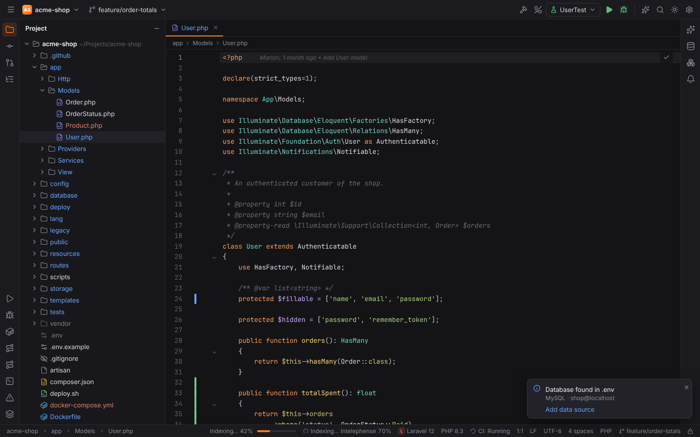

# Forge

A fast, memory-safe IDE in the spirit of PHPStorm — built with **Rust + Tauri 2** and a
**SolidJS** UI. Runs on Windows, Linux and macOS.

Forge is the core. Languages and big feature sets ship as **packs** of plugins:

| Pack | Focus |
| --- | --- |
| **PHPForge** | PHP, Laravel, Symfony, Doctrine (DQL), WordPress, Drupal / Joomla / Shopware basics, Composer, PHPUnit, Xdebug |
| **WebForge** | HTML, CSS, JavaScript/TypeScript, npm/pnpm/yarn/bun scripts, React, Vue, Angular |
| **LuaForge** | Lua 5.1–5.4, LuaJIT, LÖVE, Neovim: EmmyLua/LuaLS annotations, lua-language-server, StyLua |
| **PyForge** | Python: interpreters (venv, uv, Poetry, conda, Pipenv, Hatch, Docker, SSH, WSL), Python Packages, requirements inspections, basedpyright / ty / ruff, Black |
| **GoForge** | Go: SDK / GOPATH with SDK downloads, go.mod / go.work, gofmt / goimports, go vet, golangci-lint, go generate, Go Build / Go Test (benchmarks, fuzzing, coverage), Delve (attach, remote), pprof Profiler |
| **RustForge** | Rust: rustup toolchains and rust-toolchain.toml, the Cargo tool window (targets, features, dependencies), Cargo / Cargo Test configurations (libtest, nextest, doctests, coverage with cargo-llvm-cov), Clippy quick fixes, rustfmt, rust-analyzer, LLDB / GDB with Rust type renderers |
| **JavaForge** | Java with Maven and Gradle: Eclipse JDT LS (installed on request), JDK detection and Temurin downloads, Application runs, JUnit 5/4 and TestNG with JaCoCo coverage, the Java debugger (java-debug) |

AI is built into the core: chat with Claude Code or Gemini CLI rendered natively (no terminal),
AI commit messages, and any provider: Anthropic, OpenAI, OpenRouter, Ollama, LM Studio, llama.cpp
or another OpenAI-compatible API.

Language servers for JavaScript/TypeScript, Vue, Python, Go, Rust, C/C++, YAML, Docker and ~25 more
languages are detected and started per project, and can be installed from
Settings | Languages & Frameworks | Language Servers.
Code review is built in as well: pull and merge requests with inline threads, issues and CI
pipelines for GitLab (also self-managed), Forgejo/Gitea and GitHub.

Deployment works like PHPStorm's Tools | Deployment: SFTP, FTP/FTPS and local-folder servers with
path mappings, upload on save, Sync with Deployed and the File Transfer tool window.

The layout and keymap follow PHPStorm 1:1 so you feel at home immediately; the look is Forge's own.
Vim users get IdeaVim-style emulation (Tools | Vim) that reads `~/.ideavimrc`.

**Browser Companion**: click a React, Vue, Angular or Svelte component in your running app and
its source opens in Forge ([browser-extension/](browser-extension/README.md)). Error pages
(Ignition, Symfony, Whoops, Xdebug) and dev overlays open files through `forge://open` links and
the `forge path/to/file:12` launcher.



## Development

Requirements: Rust (stable), Node 22 + pnpm, and on Linux the
[Tauri system dependencies](https://tauri.app/start/prerequisites/).

```sh
cd app/ui && pnpm install
pnpm tauri dev            # desktop app
pnpm dev                  # UI only in the browser, backed by a mocked demo project
                          # (Laravel; open /?project=symfony for the Symfony + Doctrine demo)
pnpm screenshots          # capture docs/screenshots (needs `pnpm dev` running)
cargo test --workspace && cargo clippy --workspace --all-targets -- -D warnings
```

See [CONTRIBUTING.md](CONTRIBUTING.md) for step-by-step guides (also usable as coding-agent
skills in `.claude/skills/`), [docs/ARCHITECTURE.md](docs/ARCHITECTURE.md) and
[docs/ROADMAP.md](docs/ROADMAP.md).

## License

MIT. Third-party language servers (e.g. Intelephense premium) and AI providers require
your own license or API key.
