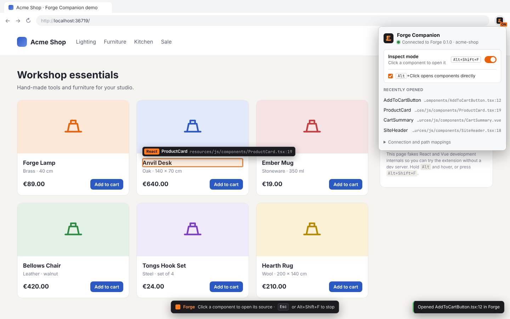

# Forge Companion (browser extension)

Click a component in your running web app and its source opens in [Forge](../README.md), at
the line where it was written. Works with React, Vue 3, Vue 2, Angular and Svelte in
development mode, plus any build that adds source attributes to the DOM.



- **Inspect mode**: press <kbd>Alt+Shift+F</kbd> (or use the toolbar popup), hover to see the
  component and its file, click to open it. <kbd>Esc</kbd> stops.
- **Alt+Click** opens the component under the cursor directly; holding <kbd>Alt</kbd> shows the
  highlight first.
- **Context menu**: "Open Component in Forge" on any element, and "Open “…” in Forge" on
  selected text that contains a `file:line` reference (stack traces, PHP errors, compiler output).
  Links to `file:line` open their target.
- **Popup**: connection status, pairing, inspect toggle, recently opened files, the Forge port
  and path mappings (for apps running in Docker or on a remote machine).

Chrome/Chromium/Edge 111+ and Firefox 128+ (Manifest V3).

## Install (load unpacked)

```sh
cd browser-extension
pnpm install
pnpm build            # dist/chrome and dist/firefox
```

- **Chrome, Edge, Brave**: open `chrome://extensions`, turn on **Developer mode**, click
  **Load unpacked** and pick `browser-extension/dist/chrome`.
- **Firefox**: open `about:debugging#/runtime/this-firefox`, click **Load Temporary Add-on…** and
  pick `browser-extension/dist/firefox/manifest.json`. Then allow the extension to access
  `127.0.0.1` (Extensions → Forge Companion → Permissions), which Firefox asks for separately.

`pnpm watch` rebuilds on changes; reload the extension afterwards.

## Pair with Forge

1. In Forge open **Settings | Tools | Browser Companion** and click **Pair New Browser…**.
2. Click the Forge icon in the browser toolbar and type the 6-digit code.

The code works once and expires after five minutes. The extension then keeps a random token;
Forge stores only its hash and lists the browser under **Paired Browsers**, where it can be
unpaired at any time.

## How it works

```
page world (page.js)          content script (content.js)        background (background.js)        Forge
React fibers, Vue instances,  overlay, inspect mode, Alt+Click,  holds the token, maps paths,       127.0.0.1:63342
window.ng, __svelte_meta  ⇄   context menu target           →   POST /api/forge/open          →   opens the file
```

- The page script only answers "what is this element?" through DOM attributes; it never sees
  the token or talks to Forge.
- The background worker finds Forge on `127.0.0.1:63342` (or the next nine ports, if PhpStorm
  already uses 63342), maps the source path to a local file and sends it with the token.
- Nothing leaves your machine: the only host the extension contacts is `127.0.0.1`.

### Where the source location comes from

| Framework | Source | Precision |
| --- | --- | --- |
| React ≤ 18 (dev) | fiber `_debugSource` / `__source`, filled by the development JSX transform | element, line and column |
| React 19 (dev) | component name (+ file from `_debugStack`); Forge finds the declaration | component declaration |
| Vue 3 (dev) | `__vueParentComponent.type.__file` | component file |
| Vue 2 (dev) | `__vue__.$options.__file` | component file |
| Angular (`ng serve`) | `ng.getComponent` / `ng.getOwningComponent` → class name; Forge finds the class | component class |
| Svelte 4/5 (dev) | `__svelte_meta.loc` | element, line and column |
| Any | `data-source-file` + `data-source-line` (+ `-column`), `data-inspector-relative-path` (react-dev-inspector), `data-v-inspector` (vite-plugin-vue-inspector), `data-insp-path` (code-inspector-plugin) | element |

Source paths are mapped to files in the project Forge has open: absolute paths stay as they
are, `webpack:///./src/…`, `/@fs/…`, dev-server URLs (`http://localhost:5173/src/App.tsx?t=…`)
and relative paths are joined to the project root. Add **path mappings** in the popup when the
app runs elsewhere (`/var/www/html => /home/me/shop`).

### Exact element locations for React 19, Preact and Solid

React 19 no longer exposes where an element was written. This dev-only Babel plugin adds the
attributes the extension reads (also shown in Forge under Settings | Tools | Browser Companion):

```js
// forge-jsx-source.js
export default function forgeJsxSource({ types: t }) {
  return {
    visitor: {
      JSXOpeningElement(path, state) {
        const { name, loc } = path.node;
        if (!loc || name.type !== "JSXIdentifier" || !/^[a-z]/.test(name.name)) return;
        path.node.attributes.push(
          t.jsxAttribute(t.jsxIdentifier("data-source-file"), t.stringLiteral(state.filename)),
          t.jsxAttribute(t.jsxIdentifier("data-source-line"), t.stringLiteral(String(loc.start.line))),
        );
      },
    },
  };
}
```

```ts
// vite.config.ts
react({ babel: { plugins: process.env.NODE_ENV === "production" ? [] : ["./forge-jsx-source.js"] } })
```

## Try it without a project

`pnpm demo` serves a small shop at http://localhost:5179 whose DOM carries the same development
internals React 18 and Vue 3 add, with paths in `/home/me/Projects/acme-shop`.

## Development

```sh
pnpm typecheck
pnpm test        # vitest: path mapping, link parsing, framework resolvers, API client
pnpm build
```

`docs/screenshots/browser-companion-extension.png` is produced by the `browser-companion-extension`
scenario in `app/ui/scripts/scenarios/browser-companion.mjs`, which loads `dist/chrome` into
Chromium and drives the demo against a stand-in for Forge's API.
