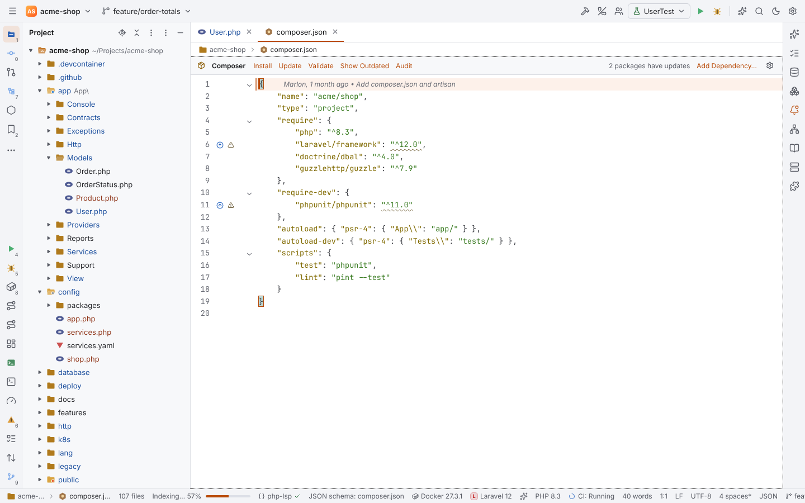
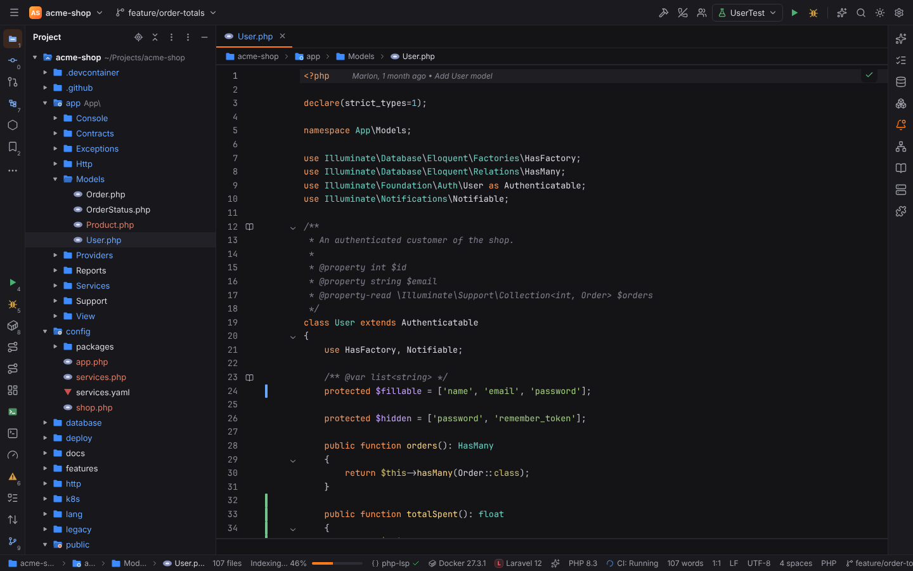
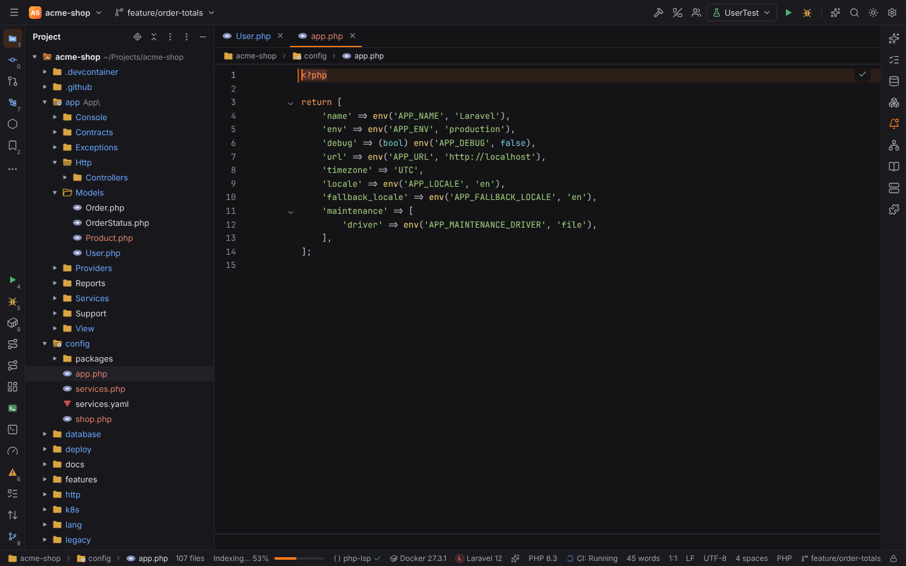
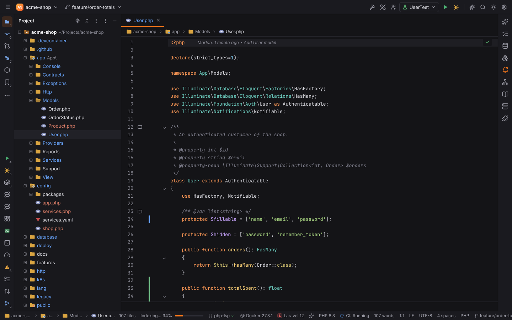

# Icon themes

An icon theme replaces the file and folder icons in every place that shows them: the Project
view, editor tabs, Recent Files, Search Everywhere, Find in Files, the Structure tool window,
code completion and the navigation bar. Since format 2 it can also replace the **symbol
icons** (Structure, completion, Go to Class / Symbol, Search Everywhere, breadcrumbs, the
navigation bar, File Structure, Hierarchy) and **UI icons** (tool window stripe buttons,
main toolbar actions, run configuration types, VCS file status), ship **light variants**,
mark a **tint layer** and give the **project root** and **hollow folders** icons of their own.
The user picks the active theme in Settings | Appearance & Behavior | File Icons
(`fileIcons.theme`). With no theme, or for anything the theme has no icon for, Forge shows its
own icons (`app/ui/src/shell/FileIcon.tsx`, `features/php/SymbolIcon.tsx`, lucide).

A theme is **data only**: a JSON file that maps names to icon ids and an SVG per icon. It runs
no code and needs no permission.

## Where the parts live

| Part | Where |
| --- | --- |
| Theme format, validation, SVG checks, resolver with a per-path cache, stable ids, tinting, folder colors | `crates/forge-icons` ([crate page](crates/forge-icons.md)) |
| Resolver in the UI (synchronous, desktop and browser) | `crates/forge-wasm/src/icons.rs` (`icons_set_theme`, `icons_set_options`, `icons_resolve`, `icons_symbol`, `icons_ui`, `icons_tint`, `icons_folder_color`, `icons_open_folders`) |
| Plugin contribution, loading a theme from a package | `crates/forge-plugins` (`contributes.iconThemes`, `icon_themes::load`) |
| IPC | `icon_theme_load({ id }) -> LoadedIconTheme` (`commands/third_party.rs`), browser mock in `mock/pluginsMock.ts` |
| Contribution point, active theme, look hooks | `app/ui/src/features/iconThemes/state.ts` (`registerIconTheme`, `themedIcon`, `themedSymbol`, `themedUiIcon`, `iconLook`, `iconStyle`) |
| `<UiIcon>`, `<ThemedSymbolIcon>` | `app/ui/src/features/iconThemes/UiIcon.tsx` |
| Settings page, folder colors and associations editors | `app/ui/src/features/iconThemes/index.tsx` |
| Tree arrows | `app/ui/src/shell/TreeArrow.tsx` |
| Example | `sdk/examples/shapes-icons` |

## `icon-theme.json`

```json
{
  "version": 2,
  "icons": { "file": "icons/file.svg", "php": "icons/php.svg", "folder": "icons/folder.svg", "folder-open": "icons/folder-open.svg" },
  "iconsLight": { "php": "icons/light/php.svg", "folder": "icons/light/folder.svg" },
  "file": "file",
  "folder": "folder",
  "folderExpanded": "folder-open",
  "rootFolder": "folder-root",
  "rootFolderExpanded": "folder-root-open",
  "folderHollow": "folder-hollow",
  "folderHollowExpanded": "folder-hollow-open",
  "fileNames": { "composer.json": "composer" },
  "fileExtensions": { "php": "php", "blade.php": "blade" },
  "fileTypes": { "shell": "shell", "python": "python" },
  "pathRules": [{ "pattern": "Controllers/*.php", "icon": "controller" }, { "pattern": "/bin/*", "icon": "shell" }],
  "filePatterns": [{ "pattern": "*Test.php", "icon": "test" }, { "pattern": "**/tests/*.php", "icon": "test" }],
  "fileRegex": [{ "pattern": "^\\.env(\\..+)?$", "icon": "env" }],
  "folderNames": { "src": "folder-src" },
  "folderNamesExpanded": { "src": "folder-src-open" },
  "symbols": { "class": "sym-class", "abstractClass": "sym-abstract-class", "method": "sym-method", "marker.static": "marker-static" },
  "ui": { "toolwindow.project": "ui-project", "action.run": "ui-run", "runconfig.php": "ui-php", "vcs.modified": "ui-modified" },
  "options": { "treeArrows": "plusMinus", "accentColor": "#e0a040", "monochrome": false, "iconSize": 16, "hollowFolders": true }
}
```

| Key | Format | Meaning |
| --- | --- | --- |
| `version` | 2 | the format version; absent means 1. A newer version than Forge reads is refused |
| `icons` | 1 | icon id → SVG file, relative to the theme file (inside the package, `.svg`) |
| `iconsLight` | 2 | icon id → SVG of its light variant; an icon named `<id>_light` in `icons` does the same |
| `file`, `folder`, `folderExpanded` | 1 | default icons; without `file` unmatched files keep Forge's icon |
| `rootFolder`, `rootFolderExpanded` | 2 | the project root in the Project view (else the folder rules) |
| `folderHollow`, `folderHollowExpanded` | 2 | hollow default folders (see [Hollow folders](#hollow-folders)) |
| `fileNames` | 1 | exact file names (then ignoring case) |
| `fileExtensions` | 1 | extensions without the dot; the longest compound one wins (`blade.php` before `php`) |
| `fileTypes` | 2 | file type ids of `forge-filetypes` (`php`, `shell`, `python`, …) for files no rule above matched: extensionless scripts detected by their `#!` line or modeline |
| `pathRules` | 2 | path globs relative to the project root, in order; a leading `/` anchors a rule at the root, otherwise it matches at any folder depth (`Controllers/*.php` matches `app/Http/Controllers/UserController.php`) |
| `filePatterns` | 1 | globs, in order: `*`, `**`, `?`, `[a-z]`, `[!x]`; a pattern with `/` matches the whole path |
| `fileRegex` | 1 | regular expressions on the file name, in order |
| `folderNames`, `folderNamesExpanded` | 1 | folders by name; an expanded folder falls back to its closed icon |
| `symbols` | 2 | [stable symbol kinds](#symbol-kinds) → icon id |
| `ui` | 2 | [stable UI icon ids](#ui-icon-ids) → icon id |
| `options` | 1, 2 | the theme's look: `treeArrows` (`chevron`, `triangle`, `plusMinus`, `arrow`, `none`), `accentColor` (`#rgb` / `#rrggbb`, folders), `monochrome`, `iconSize` (8–32 px), `hollowFolders` (format 2) |

**Backward compatibility.** Format 1 files (no `version`) load unchanged: every format 2 key
is optional, and an icon without a tint layer is recolored as a whole, as before. Forge
`FORMAT_VERSION` is 2 (`forge_icons::FORMAT_VERSION`).

### Precedence

For a **file** (the first that matches wins):

1. the user's associations (`fileIcons.associations`, in table order)
2. `pathRules` (relative to the project root, in order)
3. `fileNames` (exact, then ignoring case)
4. `filePatterns` (in order)
5. `fileRegex` (in order)
6. `fileExtensions` (the longest compound extension first)
7. `fileTypes` (the detected file type: only asked for when nothing above matched)
8. `file`

For a **folder**: the user's folder associations, `rootFolderExpanded` / `rootFolder` (the
project root only), `folderNamesExpanded` (expanded folders), `folderNames`,
`folderExpanded` / `folder`. Then, for a [hollow folder](#hollow-folders), its hollow variant;
then, with a light UI theme, the light variant.

Rules that name an icon the theme does not declare are reported by validation, and the
resolver never answers with such an id. Unknown `symbols` kinds and `ui` ids without a known
prefix are allowed (newer Forge versions may ask for them) and shown as warnings on the
settings page.

### Symbol kinds

The `symbols` section maps these stable kinds (`forge_icons::ids::SYMBOL_KINDS`) to icon ids.
A missing kind falls back as shown; without any icon Forge draws its own letter badge.

| Kind | Falls back to | Kind | Falls back to |
| --- | --- | --- | --- |
| `namespace` | – | `method` | – |
| `module` | `namespace` | `abstractMethod` | `method` + `marker.abstract` |
| `class` | – | `finalMethod` | `method` + `marker.final` |
| `abstractClass` | `class` + `marker.abstract` | `staticMethod` | `method` + `marker.static` |
| `finalClass` | `class` + `marker.final` | `constructor` | `method` |
| `interface` | – | `function` | – |
| `trait` | – | `property` | – |
| `enum` | – | `staticProperty` | `property` + `marker.static` |
| `enumCase` | `constant` | `field` | `property` |
| `alias` | `class` | `constant` | – |
| `tag`, `rule`, `region` | – | `variable`, `parameter` (→ `variable`) | – |

`marker.abstract`, `marker.final` and `marker.static` are overlays drawn on top of the symbol
icon (full size; draw them in a corner of the 16×16 box). A combined kind (`abstractClass`)
replaces its marker. Forge's visibility overlays (public, protected, private) stay and are
drawn next to the icon. Language server completion kinds map as `enumMember` → `enumCase`,
`struct` → `class`, `typeParameter` → `parameter`.

### UI icon ids

The `ui` section maps stable ids (`forge_icons::ids::UI_ICONS`) to icon ids. Ids start with
`toolwindow.`, `action.`, `runconfig.` or `vcs.`. A missing id falls back to shorter ids with
its last `-part` removed, within its prefix: `runconfig.php-builtin-server` →
`runconfig.php-builtin` → `runconfig.php`.

| Id | Wired in |
| --- | --- |
| `toolwindow.<id>` (`project`, `structure`, `commit`, `git`, `terminal`, `run`, `debug`, `problems`, `services`, `database`, `todo`, `find`, `bookmarks`, `notifications`, `ai-chat`, … any registered tool window id) | stripe buttons (`shell/ToolStripe.tsx`) |
| `action.run`, `action.rerun`, `action.debug`, `action.stop` | Run widget of the main toolbar (`features/run/RunWidget.tsx`) |
| `action.build`, `action.search`, `action.settings`, `action.aiChat` | main toolbar (`shell/MainToolbar.tsx`) |
| `runconfig.<type>` (`php-script`, `php-builtin-server`, `phpunit`, `artisan`, `composer`, `shell`, `npm`, … any run configuration type id) | run configuration icons (`ConfigIcon`: Run widget, its dropdown, Run/Debug Configurations) |
| `vcs.modified`, `vcs.added`, `vcs.deleted`, `vcs.untracked`, `vcs.conflict` | a status icon after the file name in the Commit tool window (the status color stays) |

Not wired yet: tool window title bars and their toolbars, editor gutter icons, the Git log,
notifications. `<UiIcon id size>{lucide fallback}</UiIcon>` themes another place.

### Light and dark variants

A theme ships light variants with `iconsLight` (`"php": "icons/light/php.svg"`) or with
icons named `<id>_light` in `icons`; not both for one id. Forge draws them while a light UI
theme is active: Light, Solarized Light and High Contrast Light (every theme id that is
`light` or ends in `-light`, `forge_icons::uses_light_variant`). The dark themes, High
Contrast included, use the normal icons, so a theme's normal icons should be drawn for dark
backgrounds. Users can force one variant with `fileIcons.variant`. The switch is live: the UI
theme is handed to Rust (`icons_set_options`), which clears its cache, and every icon
re-renders. Symbol, UI, root and hollow icons have light variants the same way.



### Tint layers

The accent color (`options.accentColor`, `fileIcons.accentColor`), the user's folder colors
and monochrome recolor an icon's **tint layer** when the SVG marks one, and leave the other
parts (a badge on a folder) in their colors:

| Marker | Recolors |
| --- | --- |
| `data-forge-tint="fill"` (any value but `stroke` and `both`), `class="forge-tint"` | fill |
| `data-forge-tint="stroke"`, `class="forge-tint-stroke"` | stroke |
| `data-forge-tint="both"` | fill and stroke |

```xml
<svg xmlns="http://www.w3.org/2000/svg" viewBox="0 0 16 16">
  <path d="M1.5 3.5A1 1 0 0 1 2.5 2.5h3.6l1.4 1.5h6a1 1 0 0 1 1 1v7.5a1 1 0 0 1-1 1h-11a1 1 0 0 1-1-1z" fill="#d9a441" data-forge-tint="fill"/>
  <circle cx="11.5" cy="10.5" r="2.5" fill="#4a90d9"/>
</svg>
```

SVGs are XML, so the attribute needs a value: a bare `data-forge-tint` makes the image
invalid, and `check_svg` refuses it. A marked group (`<g data-forge-tint="fill">`) recolors
everything in it. Rust (`forge_icons::tint_svg`)
adds a `<style>` with the color right after the `<svg>` start tag; the markers and the result
pass `check_svg`. Accent colors apply to folders; monochrome recolors files in the muted text
color and grays the rest of the icon. Icons without a marker, and every icon with
`fileIcons.tintMode = "mask"`, are drawn as a one-color mask, as in format 1.



### Hollow folders

With `options.hollowFolders` or `fileIcons.hollowFolders` on, folders that hold a file open in
the editor (at any depth, `forge_icons::folders_with_open_files`) are drawn hollow: the
folder's icon `<id>_hollow` if the theme declares one (`folder-src_hollow`), else
`folderHollow` / `folderHollowExpanded` for default folders, else the normal icon. Forge's own
icons use lucide's folder with a dot.




Limits and checks (`forge_icons::check_svg`): at most 5,000 icons (light variants included),
128 KiB per SVG, an `<svg>` root, no scripts, event handler attributes, `foreignObject`,
`iframe`, `javascript:` URLs or external references. Forge draws theme icons as CSS images (or
masks), which cannot run scripts; the checks keep packages honest anyway.

## Contributing a theme from a plugin

In `forge-plugin.json`:

```json
"contributes": {
  "iconThemes": [
    { "id": "acme.material-icons.dark", "label": "Material (dark)", "path": "theme/icon-theme.json" }
  ]
}
```

- `id` starts with the plugin id (like every contribution) and is the value of
  `fileIcons.theme`.
- `path` is a `.json` file inside the package. Put it in a folder of its own next to its SVGs:
  `pnpm plugin pack` packs that whole folder. A plugin without `main` (no code) is fine.
- The theme and every SVG it names are loaded and checked when the package is installed, so a
  broken theme is refused with the field that is wrong.
- No permission is needed and the theme loads in Safe Mode: Forge reads only the theme file
  and `.svg` files of the plugin's own package (`icon_themes::theme_file_allowed`).

When the plugin is enabled, the plugin host registers its themes with `registerIconTheme`;
disabling or uninstalling it removes them, and the icons fall back to Forge's.

## `registerIconTheme` (built-in features)

```ts
import { registerIconTheme } from "@/features/iconThemes/state";

const remove = registerIconTheme({
  id: "forge.example.theme",
  label: "Example",
  source: "Example plugin",           // shown next to the label in the picker
  load: async () => ({ definition, svgs }), // IconThemeDef + icon id → SVG text
});
```

`svgs` holds the SVG text per key: the icon ids, and `<id>_light` for each `iconsLight`
entry (`IconThemeDef::svg_files`). The active theme is loaded when it is selected, validated
and handed to the Rust resolver together with the user's associations
(`fileIcons.associations`, kinds `fileName`, `extension`, `pattern`, `regex`, `folderName`).
Problems (an association naming a missing icon, a regex that does not compile, a folder color
that is not a color) and warnings are shown on the settings page; the offending rules are
skipped.

## Showing icons

`<FileIcon name path? dir? open? root? hollow? size? dimmed? />` asks the active theme first.
Pass `path` when it is known so path patterns and `pathRules` apply; `root` marks the project
root and `hollow` a folder with open files (`isHollowFolder(path)`). For files whose icon could
depend on the detected file type (`icons_needs_file_type`), `FileIcon` asks
`fileTypeOf(path)` (`editor/fileTypes.ts`), which knows the `#!` line of open files.

`<SymbolIcon kind visibility? modifiers? />` (`features/php/SymbolIcon.tsx`) asks
`themedSymbol(kind, modifiers)`; `<ThemedSymbolIcon kind fallback />` does the same for other
badges (Search Everywhere). `<UiIcon id size>{fallback}</UiIcon>` shows a UI icon. Outside
Solid (CodeMirror completion), use `themedIconElement(path, kind, size)` and
`themedSymbolElement(kind, size)`; they return `null` when the theme has no icon. All of them
use `iconStyle(key, kind, size, color?)`, which applies the look hooks.

Caches: Rust caches file and folder answers per path (and kind, root, hollow, file type);
`icons_set_theme` and `icons_set_options` (UI theme, `fileIcons.variant`, project root,
folder colors) replace or clear them. Tinted SVGs are cached per icon and color in the UI and
cleared on the same changes.

## Look hooks

`iconLook()` combines the theme's `options` with the user's settings, which win:

| Hook | Setting | Effect |
| --- | --- | --- |
| Tree arrows | `fileIcons.treeArrows` (`theme`, `chevron`, `triangle`, `plusMinus`, `arrow`, `none`) | `<TreeArrow open />` in the Project view and Structure |
| Monochrome | `fileIcons.monochrome` (`theme`, `on`, `off`) | icons in `--fg-muted` (folders in the accent color): the tint layer, or a mask |
| Accent color | `fileIcons.accentColor` | folder icons in that color: the tint layer, or a mask |
| Tint mode | `fileIcons.tintMode` (`layer`, `mask`) | recolor only the tint layer, or always the whole icon |
| Icon size | `fileIcons.size` (0 = theme / view default) | width and height of themed icons |
| Variant | `fileIcons.variant` (`auto`, `dark`, `light`) | light variants with light UI themes, or always one of them |
| Saturation, opacity | `fileIcons.saturation`, `fileIcons.opacity` (percent) | CSS `saturate()` and `opacity` of themed icons |
| Hollow folders | `fileIcons.hollowFolders` (`theme`, `on`, `off`) | folders with open files drawn hollow |
| Folder colors | `fileIcons.folderColors` (`pattern`, `color`) | a color per folder name, glob or path glob (relative to the project root), before the accent color; also for Forge's own folder icons |



## The Shapes Icons example

`sdk/examples/shapes-icons` is a complete format 2 icon theme plugin with simple shapes (MIT,
drawn for Forge): PHP, Blade, JS/TS, JSON, Markdown, CSS, HTML, YAML, shell scripts (also by
file type), `.env`, Git files, lock files, `composer.json`, tests, controllers (a path rule),
`src`, `app`, `tests`, `config` and `public` folders with a tint layer, a root folder, hollow
folders, symbol icons with a static marker, UI icons for the main tool windows, the Run and
Debug buttons, PHP run configurations and VCS states, and light variants (`icons/light`).

```sh
cd sdk/examples/shapes-icons && node ../../scripts/forge-plugin.mjs pack .
```

Install the `.forgeplugin` with Settings | Plugins | Install Plugin from Disk, then choose
"Shapes (Shapes Icons)" in Settings | Appearance & Behavior | File Icons. Browser mode has it
installed already. `cargo test -p forge-plugins` loads the example from disk and checks a few
resolutions, including the format 2 sections.
