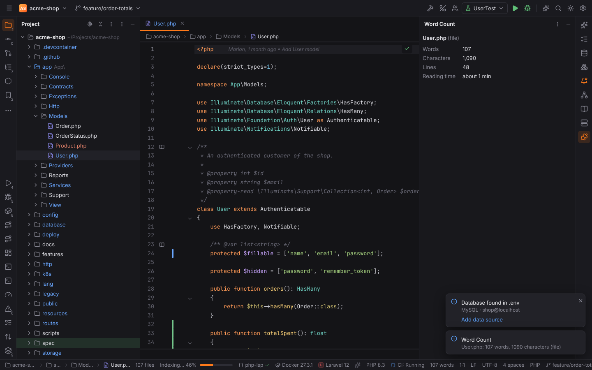

# Getting started with plugins

## Scaffold a plugin

From `app/ui` in the Forge repository:

```sh
pnpm plugin new ~/src/hello-forge --name "Hello Forge" --publisher Acme
```

This copies `sdk/templates/basic` into the folder and fills in the id (`acme.hello-forge`;
pass `--id` to choose another), name, publisher and the current Forge version:

```text
hello-forge/
  forge-plugin.json     the manifest
  src/index.ts          activate(context)
  package.json          build, typecheck and pack scripts (esbuild, TypeScript, @forge/plugin-api)
  tsconfig.json
  scripts/pack.mjs      writes the .forgeplugin file
  README.md
```

`@forge/plugin-api` (`sdk/plugin-api`) holds the types of the `forge` global; the template
links it with a `file:` dependency.

## Build and pack

```sh
cd ~/src/hello-forge
npm install
npm run build     # src/index.ts → dist/plugin.js (esbuild, format iife, global name __forgePlugin)
npm run pack      # → acme.hello-forge-0.1.0.forgeplugin and its SHA-256
```

Inside the Forge repository the same works without `npm install`:
`pnpm plugin build <folder>` and `pnpm plugin pack <folder>` use the esbuild that comes with
Vite.

## Install it

Settings | Plugins | ⚙ | **Install Plugin from Disk…**, pick the `.forgeplugin` file and accept
its permissions. The plugin appears under **Downloaded** and starts at once; its commands are in
Find Action (`Ctrl+Shift+A`) and the Keymap settings. Reinstalling a newer version updates it.

In browser mode (`pnpm dev`) the Word Count example is installed already, and Install Plugin
from Disk offers its version 1.1.0.

## The Word Count example

`sdk/examples/word-count` is a complete plugin, committed built (`dist/plugin.js`) so browser
mode and the tests load it. After changing it, run `pnpm plugin build ../../sdk/examples/word-count`.



It contributes:

- a status item with the number of words of the active editor (or the selection), and a
  tooltip with characters and lines;
- the command **Show Word Count** (`Ctrl+Alt+Shift+W`), which shows a balloon;
- the tool window **Word Count** with a table (words, characters, lines, reading time);
- the settings page Tools | **Word Count** with two settings.

```ts
import type { PluginContext } from "@forge/plugin-api";

export function activate(context: PluginContext): void {
  context.subscriptions.push(
    forge.commands.register("example.word-count.show", async () => {
      const editor = await forge.editor.getActive();
      await forge.window.showMessage(`${editor?.text.split(/\s+/).length ?? 0} words`);
    }),
    forge.editor.onDidChange((editor) => void render(editor)),
  );
}
```

It needs one permission, `"editor": ["read"]`.

## Debugging

Each plugin runs in an iframe with `data-forge-plugin="<id>"`. In the webview's developer tools
pick that frame as the console context to see the plugin's logs and errors. An error thrown
by `activate` shows a balloon "<name> failed to start".
