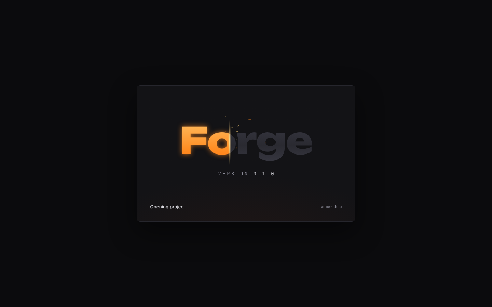
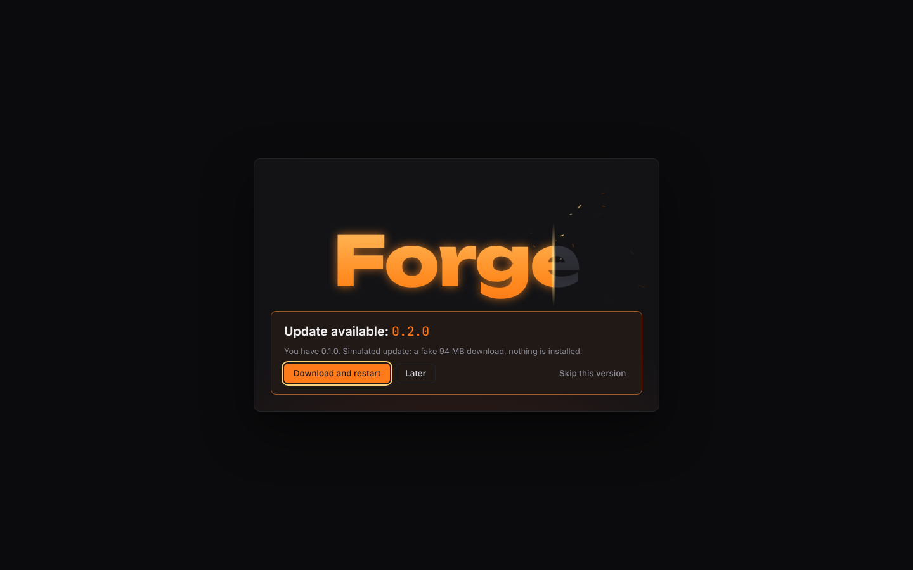
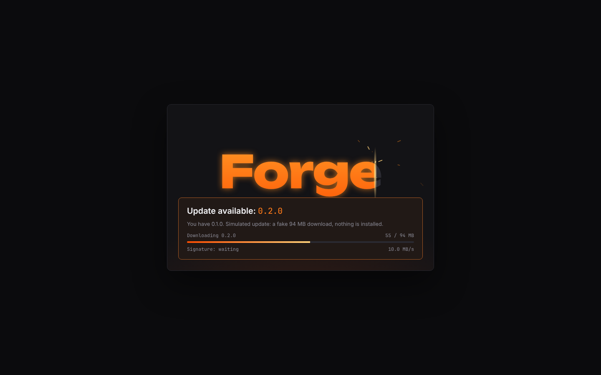
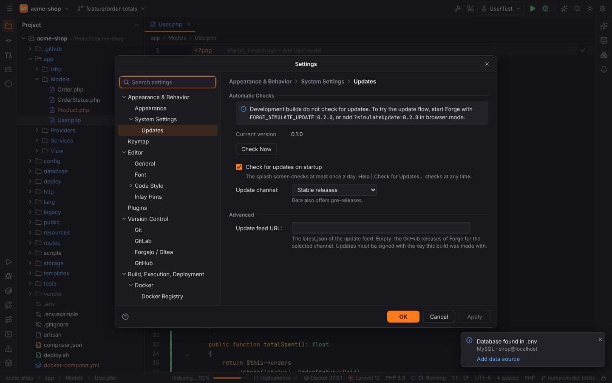
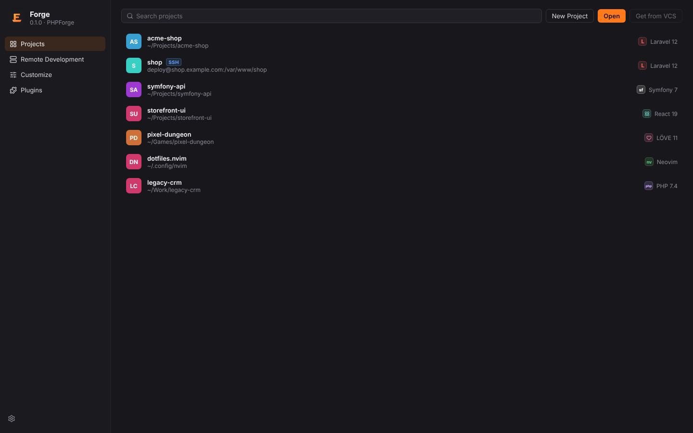
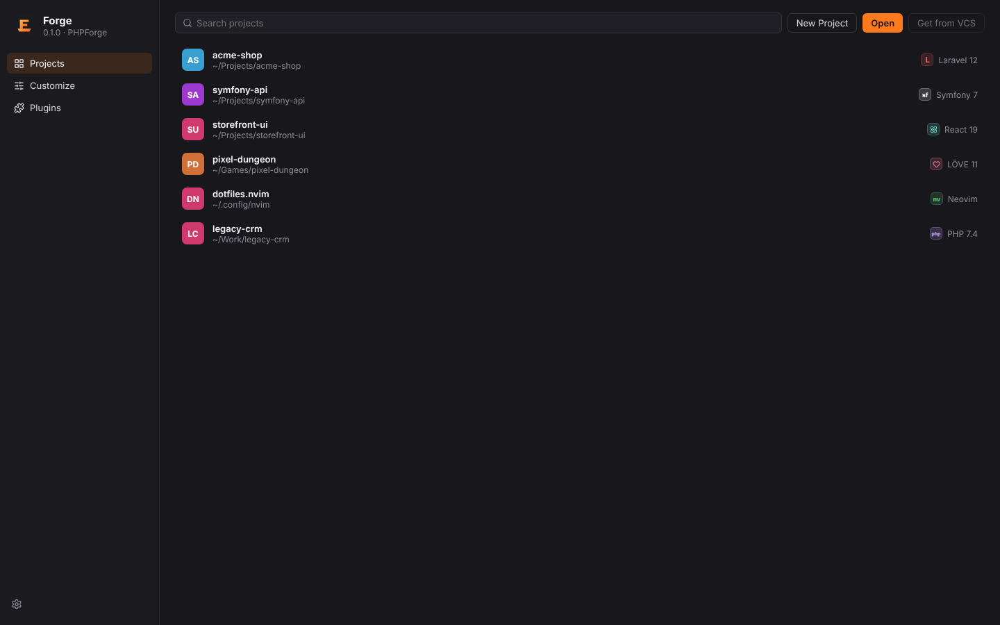

# First start and the Welcome screen

## Starting Forge

Start Forge from your application menu, or from a terminal:

```sh
forge                       # Welcome screen
forge ~/Projects/shop       # open a folder as the project
forge src/App.tsx:12        # open a file at line 12 (in the project it belongs to)
```

All launcher forms are listed in [CLI arguments and forge:// links](../reference/cli-and-links.md).
If Forge is already running, a second `forge …` call is handed to the running window instead
of starting another instance.

Without a project argument Forge reopens the last local project you worked on, if it still
exists ("Reopen projects on startup", `system.reopenLastProject` under Settings | Appearance &
Behavior | System Settings). With that setting off, or when there is no recent project, it shows
the **Welcome screen**. Remote projects are not reopened automatically.

## The splash screen



While Forge starts, a small window shows the Forge wordmark. Its letters fill with molten
metal as the loading steps finish, so the fill is the real progress. The line at the bottom
names the current step:

| Step | What happens |
| --- | --- |
| Loading the core | settings and the keymap |
| Loading plugins | the built-in plugins' settings and servers (Browser Companion) |
| Opening project | the project from the command line, a `forge://` link or the last session, and its framework detection |
| Starting background services | language server registration, file watcher, data sources, Docker / Kubernetes |
| Checking for updates | at most once a day, see [Updates](#updates) |
| Opening workbench | the main window loads; the splash closes when it is shown |

Turn the splash off with "Show splash screen on startup" (`appearance.showSplash`) under
Settings | Appearance & Behavior | Appearance. Forge then starts without it and shows the
main window when loading is done.

## Updates



Release builds check for a new version on the last splash step, at most once a day. When one
exists, the splash shows **Update available** with the download size and three buttons:

| Button | Effect |
| --- | --- |
| **Download and restart** | downloads the update, checks its signature against Forge's signing key, installs it and restarts Forge |
| **Later** | opens the workbench; Forge asks again the next day |
| **Skip this version** | this version is never offered automatically again |



While downloading, the panel shows the megabytes, the speed and "Signature: verifying… →
valid". An update whose signature does not match is not installed. When the download fails
(offline, bad signature) the splash says so and opens the workbench after a moment.

**Help | Check for Updates…** checks at any time, also for skipped versions. The settings are
under Settings | Appearance & Behavior | System Settings | Updates:



- "Check for updates on startup" (`updates.checkOnStartup`)
- "Update channel" (`updates.channel`): **Stable releases** (the default) or **Beta releases**.
  Beta also offers pre-releases such as `0.3.0-beta.1`; when a stable release is newer than the
  last pre-release, beta installations get that one. Going back to Stable does not downgrade:
  Forge waits until a stable release is newer than the installed pre-release.
- "Update feed URL" (`updates.endpoint`): another `latest.json`, e.g. a company mirror
- a skipped version can be offered again with **Offer Again**

> **Note:** builds made without the updater key (for example your own builds) never check for
> updates; the settings page says "Updates are not configured in this build". Development
> builds never check either.

## The Welcome screen



The left side has four entries, as in PHPStorm:

| Entry | What it does |
| --- | --- |
| **Projects** | Recent projects, with a search field and the buttons **New Project**, **Open** and **Get from VCS** |
| **Remote Development** | SSH connections and remote projects, see [Remote development](../user/remote-development.md) |
| **Customize** | opens the Settings dialog |
| **Plugins** | opens the Settings dialog (Settings | Plugins) |

The gear icon at the bottom opens Settings as well.

### Recent projects

Every project you open is added to the list. Each row shows a colored badge with the project's
initials, the name, the path and, on the right, the detected project type ("Laravel 12",
"Symfony 7", "React 19", "LÖVE 11", "PHP 8.3", …). Remote projects carry an **SSH** badge and
reconnect when you click them.



Type in **Search projects** to filter by name or path. Click a row to open the project.

The list is stored in `recent-projects.json` in Forge's config folder (see
[File locations](../reference/file-locations.md)).

### Empty state

On the very first start there are no recent projects, and the screen shows three large
buttons instead: **New Project**, **Open** and **Get from VCS**.

> **Note:** **Get from VCS** (cloning a repository) is not available yet; the button is
> disabled.

## Window title bar

Forge draws its own title bar. Its buttons look like your desktop's by default (Windows,
macOS traffic lights, GNOME or KDE Plasma). You can change the style, or switch back to the
operating system's own title bar, with Settings | Appearance & Behavior | Appearance |
**Window controls**. See [Settings and themes](../user/settings-and-themes.md#window-controls).

## What next

- [Open or create a project](projects.md)
- [Learn the workbench](../user/workbench.md)
