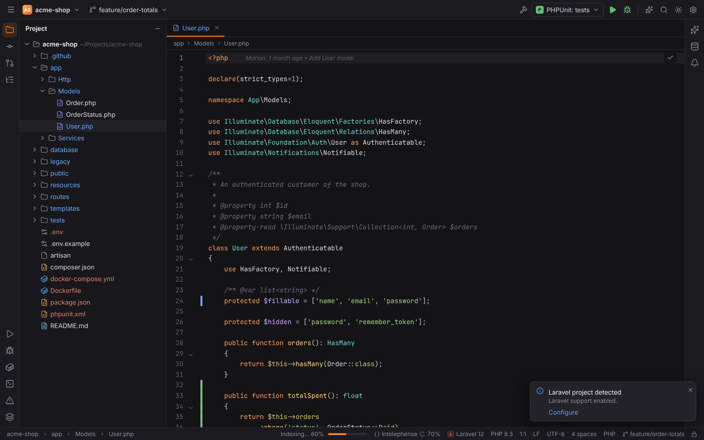

# Project type detection

When a project opens, Forge reads marker files in the project root **and one folder level
below it** (so a monorepo with `backend/` and `frontend/` is understood) and decides which
languages, frameworks and tools the project uses. Plugins that belong to a framework only
activate when that framework is found, so a Laravel project does not show Symfony tool windows
and a plain Lua project does not start PHP language servers.

## What is detected

### Languages

| Language | Detected from |
| --- | --- |
| PHP | `composer.json`, or any `.php` file |
| TypeScript | `tsconfig.json`, `.ts` or `.tsx` files |
| JavaScript | `.js`, `.mjs` or `.jsx` files |
| HTML | `.html` or `.htm` files |
| CSS | `.css` or `.scss` files |
| Lua | a `.lua` file in the root, two or more `.lua` files in a folder, `.luarc.json`, `.luarc.jsonc`, `.luacheckrc`, `stylua.toml`, `.stylua.toml`, `selene.toml` or a `*.rockspec` |
| Rust | `Cargo.toml` (also the tool `cargo`), a `.rs` file in the root, or two or more `.rs` files in a folder |
| Go | a `.go` file in the root, two or more `.go` files in a folder, `go.mod` or `go.work` (also the tool `go-workspace`) |
| Python | a `.py` file in the root, two or more `.py` files in a folder, `pyproject.toml`, `setup.py`, `setup.cfg`, `requirements*.txt` / `constraints*.txt`, `Pipfile` or `environment.yml` |

### Frameworks

| Framework | Detected from |
| --- | --- |
| Laravel | `laravel/framework` in `composer.json`, or an `artisan` file |
| Symfony | `symfony/framework-bundle`, or `bin/console` together with `config/bundles.php` |
| Doctrine | `doctrine/orm` |
| Drupal | `drupal/core` or `drupal/core-recommended`, `core/lib/Drupal.php`, or a module / theme `<name>.info.yml` with `core_version_requirement` |
| Joomla | `administrator/manifests/files/joomla.xml`, or an extension manifest (`<extension type="component">` and the like) in the root |
| Shopware | `shopware/core`, `shopware/platform` or `shopware/storefront`, a `shopware-platform-plugin` composer.json, or `engine/Shopware/Kernel.php` (Shopware 5) |
| Magento | `magento/framework`, `magento/product-community-edition`, or `app/etc/env.php` with `bin/magento` |
| WordPress | `johnpbloch/wordpress`, `roots/*` packages, `wp-config.php`, `wp-config-sample.php`, `wp-includes/`, `wp-content/`, a plugin header (`Plugin Name:` in a root PHP file) or a theme header (`Theme Name:` in `style.css`) |
| Livewire | `livewire/livewire` |
| PHPUnit, Pest | `phpunit/phpunit`, `pestphp/pest` |
| Next.js, Nuxt, React, Vue.js, Svelte, Solid, Vite | `next`, `nuxt`, `react`, `vue`, `svelte`, `solid-js`, `vite` in `package.json`; Vite also from a `vite.config.*` file |
| Angular | `@angular/core` in `package.json`, or `angular.json` |
| LÖVE | `conf.lua`, or a `main.lua` that uses `love.` |
| Neovim | `init.lua` next to a `lua/` folder (or one that uses `vim.`), or `lua/` together with `plugin/` |
| Django | `django` in `requirements*.txt` (also `requirements/*.txt`), `pyproject.toml` or `Pipfile`, together with a `manage.py` |
| Flask, FastAPI, Celery | `flask`, `fastapi`, `celery` in `requirements*.txt`, `pyproject.toml` or `Pipfile` |

Versions come from `composer.lock` / the npm lock files when present, otherwise from the
version constraints in the manifests (Python frameworks: `uv.lock` / `poetry.lock`). The PHP
version comes from `require.php`.

### Tools

`composer`, `npm`, `pnpm`, `yarn`, `bun` (from lock files and `package.json`), `go-workspace` (`go.work`), `cargo` (`Cargo.toml`), `luarocks`
(`*.rockspec`), `uv` (`uv.lock`), `poetry` (`poetry.lock`), `pipenv` (`Pipfile`), `conda`
(`environment.yml`), `docker` (`Dockerfile`, `compose.yaml`/`compose.yml`,
`docker-compose.yml`/`.yaml`) and `git` (a `.git` folder).

Folders that are never scanned as sub-projects: `vendor`, `node_modules`, `target`, `dist`,
`build`, `storage`, `var`, `public` and hidden folders. At most 64 sub-folders are checked.

## Primary type

The most specific framework becomes the project's **primary** type, in this order: Laravel,
Symfony, Drupal, WordPress, Shopware, Magento, Joomla, Next.js, Nuxt, Angular, Svelte, Vue.js, React, Solid, LÖVE,
Neovim, Vite. Without a framework the primary language is used (PHP, TypeScript, JavaScript,
Lua, Rust, Go, Python, HTML, CSS).

The primary type appears

- as the badge next to the project on the Welcome screen,
- in the status bar (for example "Laravel 12"); click it to open Settings | Plugins. Laravel
  and Symfony replace this widget with their own (see [Laravel](../user/laravel.md) and
  [Symfony](../user/symfony.md)),
- in a one-time balloon "Laravel project detected — Laravel support enabled" with a
  **Configure** link to the framework's settings page.

## Packs and plugins that activate

| Pack | Activates for |
| --- | --- |
| PHPForge | PHP projects; Laravel, Symfony, Doctrine, Composer, PHPUnit/Pest and Xdebug plugins for their framework or tool |
| WebForge | JavaScript, TypeScript, HTML or CSS; React for `react`/`next`, Vue.js for `vue`/`nuxt`, Angular for `angular` |
| LuaForge | Lua projects |
| PyForge | Python projects (Python Interpreters and Packages); the Python editing plugin is always active |
| GoForge | Go projects |
| RustForge | Rust projects |
| KotlinForge | Kotlin projects: `*.kt` files, Kotlin scripts (not `*.gradle.kts`), a `src/main/kotlin` / `src/test/kotlin` tree or a build applying the Kotlin plugin; `io.kotest` in the build reports Kotest |
| JavaForge | Java projects: a `pom.xml`, a Gradle build (`build.gradle(.kts)`, `settings.gradle(.kts)`), `*.java` files or a `src/main/java` / `src/test/java` tree; Maven and Gradle are reported as tools |
| JavaForge: Groovy | Groovy sources (`*.groovy`, `*.gvy`, `*.gy`, `src/main/groovy`, `src/test/groovy`) or a build applying the `groovy` plugin (not Gradle build scripts); `org.spockframework` reports Spock |
| JavaForge: Scala | an sbt build (`build.sbt`, `project/build.properties`; tool `sbt`), Scala sources (`*.scala`, `src/main/scala`) or Gradle's `scala` plugin; ScalaTest and MUnit in `build.sbt` |
| JavaForge: Android | a Gradle module applying `com.android.application` / `com.android.library` (also catalog aliases) or a `src/main/AndroidManifest.xml`; the framework `android` with the AGP version, tool `android` |

Core plugins (Git, Terminal, Run/Debug, Database, Services, AI, language servers, …) are
always active. Each plugin can still be switched off in Settings | Plugins, see
[Plugins and packs](../user/plugins-and-packs.md). The exact rules are the `projectTypes`
of each plugin, listed in [Reference: plugins](../reference/plugins.md).

## Re-detect

Detection runs when the project opens. If you add a framework later (for example
`composer require symfony/framework-bundle`), run **Detect Project Type** with Find Action
(`Ctrl+Shift+A`), or reopen the project, so the new plugins activate.
