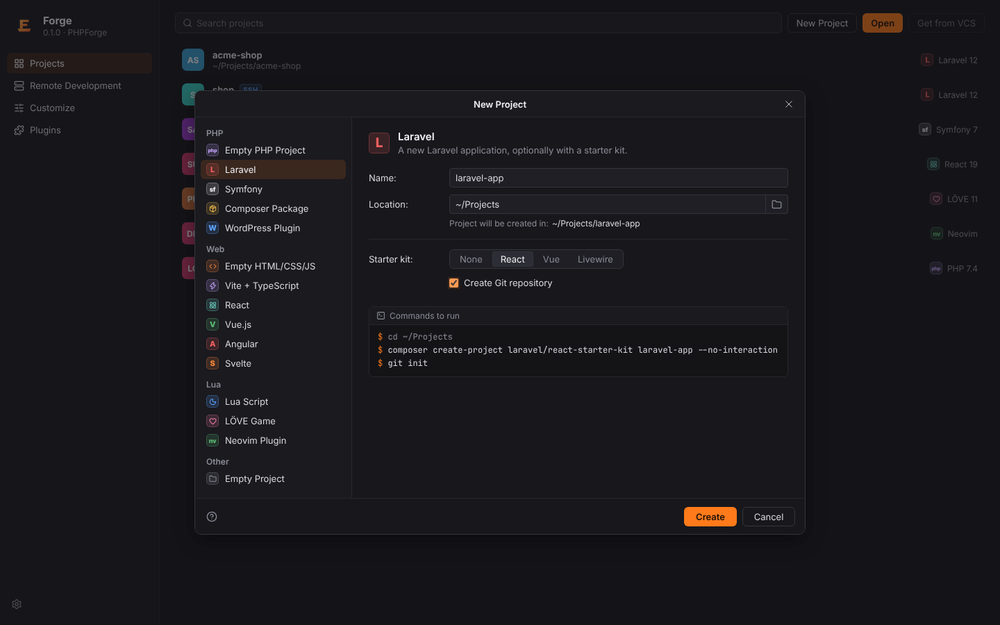
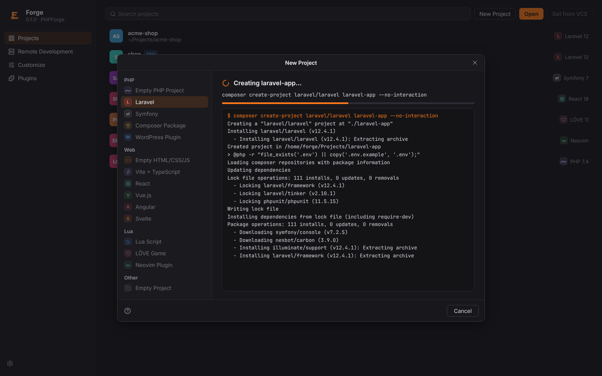
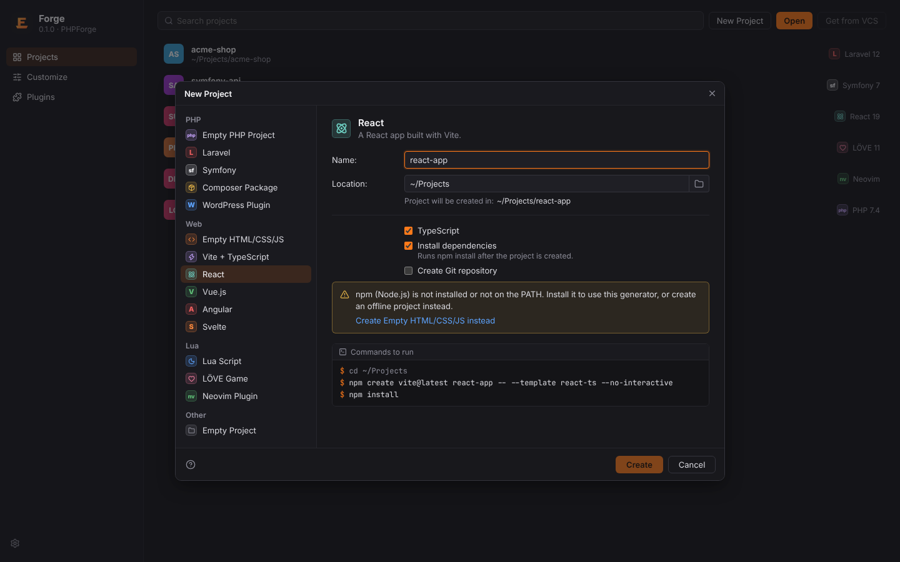
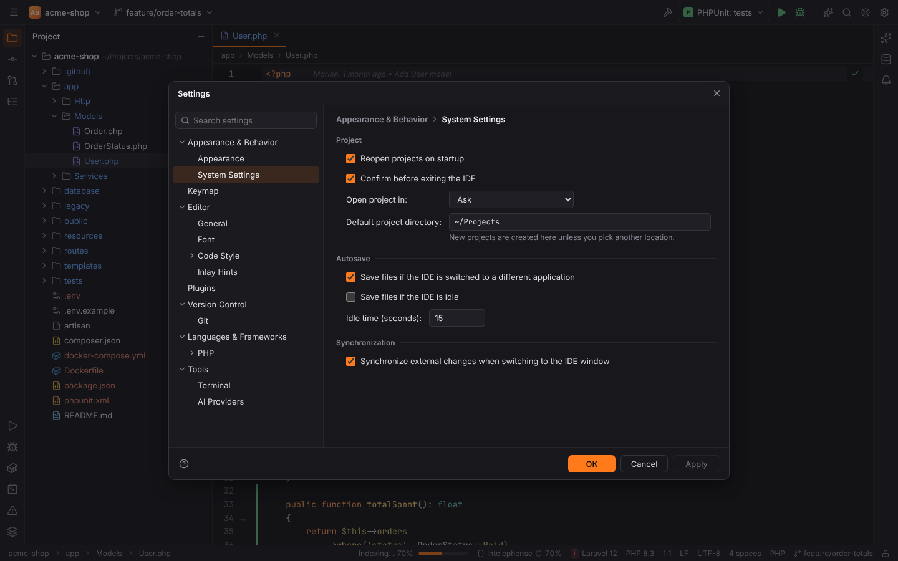

# Opening and creating projects

A Forge project is a folder. There is no project file to import: open the folder, and Forge
[detects what it contains](project-detection.md) and turns on the matching plugins.
Project-specific data lives in a `.forge/` folder inside the project (settings, run
configurations, breakpoints, data sources); see [File locations](../reference/file-locations.md).

## Open an existing project

- On the Welcome screen click **Open** and choose the folder.
- From a terminal: `forge path/to/project`.
- In the workbench, the project widget at the left of the main toolbar (the badge with the
  project name) runs **Open…** as well.

Opening a project replaces the current one in the same window and closes its editor tabs.
Each project's tool window layout and editor tabs come back when you open it again, see
[Layout per project](../user/workbench.md#layout-per-project).

Remote projects (folders on a Linux server reached over SSH) open from Welcome |
**Remote Development**, see [Remote development](../user/remote-development.md).

To close the project and return to the Welcome screen, run **Close Project** through
[Find Action](../user/search-everywhere.md#find-action) (`Ctrl+Shift+A`).

## Create a new project

Click **New Project** on the Welcome screen, or run the **New Project…** action
(`NewProject`) with Find Action.

1. Pick a generator on the left.
2. Enter the **Name** and the **Location**. "Project will be created in:" shows the final
   folder. The location defaults to the **Default project directory**.
3. Set the generator's options.
4. Check the **Commands to run** box: it shows exactly which commands Forge runs, or which
   files it writes for offline templates.
5. Click **Create**. The dialog shows the steps and their output, then opens the new project.

### Generators

| Group | Generator | What it does | Needs | Options |
| --- | --- | --- | --- | --- |
| PHP | Empty PHP Project | Composer project with PSR-4 autoloading, `src/`, `tests/` and PHPUnit | — (offline template) | PHP version, sample code, Git repository |
| PHP | Laravel | `composer create-project laravel/laravel` or a starter kit (`laravel/react-starter-kit`, `laravel/vue-starter-kit`, `laravel/livewire-starter-kit`) | `composer` | Starter kit (None, React, Vue, Livewire), Git repository |
| PHP | Symfony | `symfony new` when the Symfony CLI is installed, else `composer create-project symfony/skeleton` | `composer` | Project type (Web application, Skeleton), Git repository |
| PHP | Composer Package | reusable library with PHPUnit, README and MIT licence | — (offline template) | Vendor, PHP version, sample code, Git repository |
| PHP | WordPress Plugin | plugin header, main class, shortcode, `readme.txt`, uninstall hook | — (offline template) | PHP version, Git repository |
| Web | Empty HTML/CSS/JS | `index.html`, a stylesheet and a script | — (offline template) | sample code, Git repository |
| Web | Vite + TypeScript | `npm create vite@latest` (vanilla TypeScript) | `npm` | install dependencies, Git repository |
| Web | React | Vite React template | `npm` | TypeScript, install dependencies, Git repository |
| Web | Vue.js | Vite Vue 3 template | `npm` | TypeScript, install dependencies, Git repository |
| Web | Angular | `npx @angular/cli@latest new` | `npx` | install dependencies, Git repository |
| Web | Svelte | `npx sv create` (SvelteKit, minimal template) | `npx` | TypeScript, install dependencies, Git repository |
| Lua | Lua Script | a script, a module and a LuaLS configuration | — (offline template) | Lua version, sample code, Git repository |
| Lua | LÖVE Game | LÖVE 11 game with `main.lua`, `conf.lua` and API completion | — (offline template) | sample code, Git repository |
| Lua | Neovim Plugin | plugin with `setup()`, a user command and a help file | — (offline template) | GitHub user, Git repository |
| Other | Empty Project | an empty folder | — | Git repository |

Generators that call an official CLI (composer, symfony, npm, npx) check that the tool is on
your `PATH` first. If it is missing, the dialog says so and offers an offline alternative, for
example "Create Empty HTML/CSS/JS instead":

**Create Git repository** runs `git init` in the new folder.

## Default project directory

New projects go to `~/Projects` unless you pick another location. Change it in
Settings | Appearance & Behavior | System Settings | **Default project directory**
(`system.defaultProjectDirectory`).

## Demo projects (browser mode)

When Forge runs in a plain browser for development (`pnpm dev`, see
[Development setup](../developer/dev-setup.md)), it opens built-in demo projects instead of
folders on disk: a Laravel shop by default, and Symfony, React, Vue, Angular, Lua (LÖVE) and
remote demos with `?project=symfony|react|vue|angular|lua|remote`. They exist for screenshots
and development and are not part of the desktop app.
