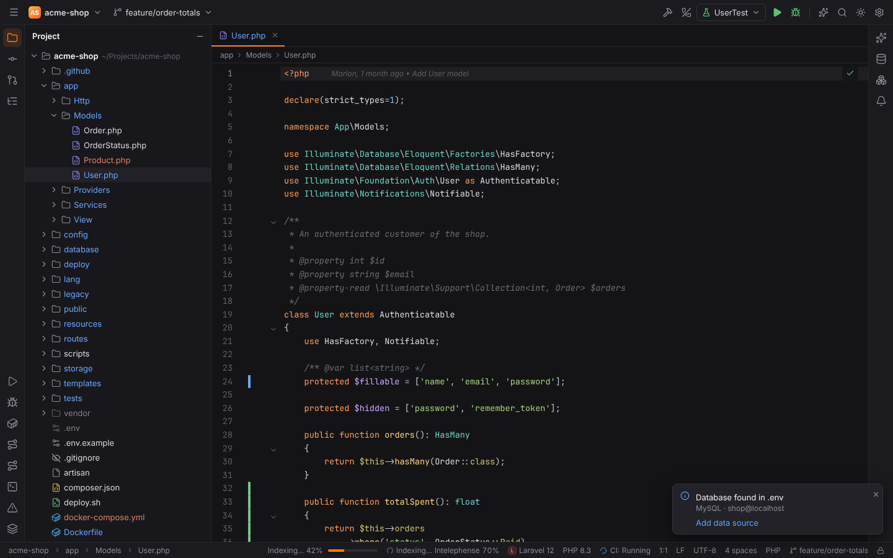

# Forge documentation

Forge is a fast, memory-safe IDE in the spirit of PHPStorm for Windows, Linux and macOS, built
with Rust + Tauri 2 and a SolidJS UI. Layout, wording and the default keymap follow PHPStorm 1:1;
the look is Forge's own ("Ember" dark, "Anvil" light).

Languages and large feature sets ship as **packs**:

| Pack | Focus |
| --- | --- |
| **PHPForge** | PHP, Composer, PHPUnit, Xdebug, Laravel, Symfony, Doctrine (DQL) |
| **WebForge** | HTML, CSS, JavaScript/TypeScript, npm/pnpm/yarn/bun, React, Vue, Angular |
| **LuaForge** | Lua 5.1–5.4, LuaJIT, LÖVE, Neovim |

The core adds Git and code review (GitHub, GitLab, Forgejo/Gitea), Run/Debug configurations, a
terminal, database tools, Scratches with an HTTP client, Docker/Compose/Kubernetes, remote
development over SSH, language servers for about 30 more languages, AI (your own providers,
Claude Code and Gemini CLI as a native chat) and a browser companion.

## Where to start

| Section | For |
| --- | --- |
| [Getting started](getting-started/index.md) | installing Forge, the first start, opening and creating projects, switching from PHPStorm |
| [User guide](user/index.md) | one page per feature |
| [Reference](reference/index.md) | keymap, settings, file types, language servers, CLI, file locations, environment variables, plugins |
| [Developer guide](developer/index.md) | architecture, extending Forge, quality gates, releases, one page per crate |
| [FAQ](faq.md) | short answers |
| [Troubleshooting](troubleshooting.md) | AppImage/FUSE, WebKitGTK, language servers, remote agent, keychain, Wayland |

## Popular pages

- [Keymap reference](reference/keymap.md) — every shortcut on Windows/Linux and macOS
- [Language servers](user/language-servers.md) — install Intelephense and friends, licence keys
- [Laravel](user/laravel.md) and [Symfony](user/symfony.md)
- [Xdebug debugging](user/debugging.md)
- [Remote development](user/remote-development.md)
- [AI](user/ai.md)

## Coming soon

These features are being built on other branches and are **not** part of this version; the
pages describe the current state and mark the gaps with notes.

- **Main menu**: the ☰ button in the toolbar (today: Find Action, `Ctrl+Shift+A`).
- **Intelephense one-click install** from the PHP settings.
- **Remote parity**: framework analysis, WebForge, catalog language servers, database tools,
  Xdebug, AI chat, code hosts and the Browser Companion in remote projects.
- **Services port forwarding** for containers and Kubernetes pods.
- **Dialog windows with OS-styled controls** everywhere (polish of the dialog window frames).
- **Editor polish and Find in Files** (`Ctrl+Shift+F`, Replace in Files, the Find tool window).

Also not available yet, without a date: refactorings (Rename, Extract, Move), Find Usages,
quick-fixes (`Alt+Enter`), bookmarks, TODO, Local History, split editors, Get from VCS, stash,
multiple project windows, a plugin Marketplace and automatic updates.

## About this guide

The guide is plain Markdown with a small frontmatter contract so any documentation generator can
render it; see [About this guide](README.md). Every user-visible change to Forge updates the
matching page.
