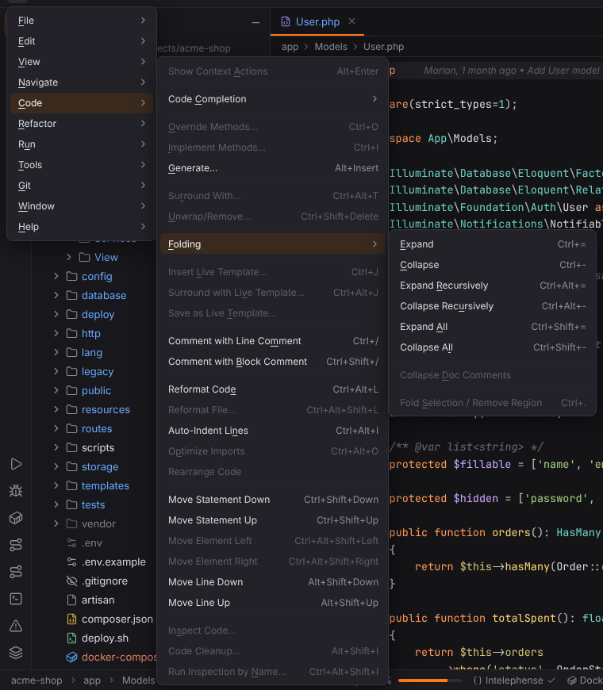

# Code menu

Completion, Generate, folding, comments, formatting and moving lines. Open it with ☰ (`Alt+\`) or from the menu bar, see [Main menu](../../user/workbench.md#main-menu).

**Available**: *yes* — implemented; *not yet* — shown disabled until Forge implements it; *dynamic* — filled at runtime. Shortcuts are the Windows/Linux and macOS defaults.

| Entry | Windows / Linux | macOS | Available | What it does |
| --- | --- | --- | --- | --- |
| Show Context Actions | `Alt+Enter` | `Alt+Enter` | not yet | Not available yet; the entry is disabled. |
| **Code Completion** | | | | submenu |
| Code Completion › Basic Completion | `Ctrl+Space`, `Shift+Space` | `Ctrl+Space`, `Shift+Space` | yes | Opens code completion at the caret; also offers words from the document. [More](../../user/editor.md#code-completion) |
| Code Completion › Type-Matching Completion | `Ctrl+Shift+Space` | `Ctrl+Shift+Space` | not yet | Not available yet; the entry is disabled. |
| Code Completion › Cyclic Expand Word | `Alt+/` | `Alt+/` | not yet | Not available yet; the entry is disabled. |
| Code Completion › Cyclic Expand Word (Backward) | `Alt+Shift+/` | `Alt+Shift+/` | not yet | Not available yet; the entry is disabled. |
| Override Methods… | `Ctrl+O` | `Ctrl+O` | not yet | Not available yet; the entry is disabled. |
| Implement Methods… | `Ctrl+I` | `Ctrl+I` | not yet | Not available yet; the entry is disabled. |
| Generate… | `Alt+Insert` | `Cmd+N` | yes | In PHP files: generates a constructor, getters, setters, overrides, `__toString()` or a PHPDoc block. [More](../../user/php.md#generate) ([screenshot](../../../screenshots/docs-generate.png)) |
| Surround With… | `Ctrl+Alt+T` | `Cmd+Alt+T` | not yet | Not available yet; the entry is disabled. |
| Unwrap/Remove… | `Ctrl+Shift+Delete` | `Cmd+Shift+Delete` | not yet | Not available yet; the entry is disabled. |
| **Folding** | | | | submenu |
| Folding › Expand | `Ctrl+=`, `Ctrl+NumPad+` | `Cmd+=`, `Cmd+NumPad+` | yes | Unfolds the folded region at the caret. [More](../../user/editor.md#folding) |
| Folding › Collapse | `Ctrl+-`, `Ctrl+NumPad-` | `Cmd+-`, `Cmd+NumPad-` | yes | Folds the region at the caret. [More](../../user/editor.md#folding) |
| Folding › Expand Recursively | `Ctrl+Alt+=`, `Ctrl+Alt+NumPad+` | `Cmd+Alt+=`, `Cmd+Alt+NumPad+` | yes | Unfolds the region at the caret. [More](../../user/editor.md#folding) |
| Folding › Collapse Recursively | `Ctrl+Alt+-`, `Ctrl+Alt+NumPad-` | `Cmd+Alt+-`, `Cmd+Alt+NumPad-` | yes | Folds the region at the caret. [More](../../user/editor.md#folding) |
| Folding › Expand All | `Ctrl+Shift+=`, `Ctrl+Shift+NumPad+` | `Cmd+Shift+=`, `Cmd+Shift+NumPad+` | yes | Unfolds every region of the file. [More](../../user/editor.md#folding) |
| Folding › Collapse All | `Ctrl+Shift+-`, `Ctrl+Shift+NumPad-` | `Cmd+Shift+-`, `Cmd+Shift+NumPad-` | yes | Folds every region of the file. [More](../../user/editor.md#folding) ([screenshot](../../../screenshots/docs-folding.png)) |
| Folding › Collapse Doc Comments | — | — | not yet | Not available yet; the entry is disabled. |
| Folding › Fold Selection / Remove Region | `Ctrl+.` | `Cmd+.` | not yet | Not available yet; the entry is disabled. |
| Insert Live Template… | `Ctrl+J` | `Cmd+J` | not yet | Not available yet; the entry is disabled. |
| Surround with Live Template… | `Ctrl+Alt+J` | `Cmd+Alt+J` | not yet | Not available yet; the entry is disabled. |
| Save as Live Template… | — | — | not yet | Not available yet; the entry is disabled. |
| Comment with Line Comment | `Ctrl+/`, `Ctrl+NumPad/` | `Cmd+/`, `Cmd+NumPad/` | yes | Comments or uncomments the current line or the selected lines. [More](../../user/editor.md#editing-actions) |
| Comment with Block Comment | `Ctrl+Shift+/`, `Ctrl+Shift+NumPad/` | `Cmd+Alt+/`, `Cmd+Alt+NumPad/` | yes | Wraps the selection in a block comment, or removes it. [More](../../user/editor.md#editing-actions) |
| Reformat Code | `Ctrl+Alt+L` | `Cmd+Alt+L` | yes | Formats the file with the language server's formatter (StyLua for Lua). [More](../../user/editor.md#reformat-code) |
| Reformat File… | `Ctrl+Alt+Shift+L` | `Cmd+Alt+Shift+L` | not yet | Not available yet; the entry is disabled. |
| Auto-Indent Lines | `Ctrl+Alt+I` | `Ctrl+Alt+I` | yes | Re-indents the current line or the selection. [More](../../user/editor.md#editing-actions) |
| Optimize Imports | `Ctrl+Alt+O` | `Ctrl+Alt+O` | not yet | Not available yet; the entry is disabled. |
| Rearrange Code | — | — | not yet | Not available yet; the entry is disabled. |
| Move Statement Down | `Ctrl+Shift+Down` | `Cmd+Shift+Down` | yes | Moves the current line or selection down. [More](../../user/editor.md#editing-actions) |
| Move Statement Up | `Ctrl+Shift+Up` | `Cmd+Shift+Up` | yes | Moves the current line or selection up. [More](../../user/editor.md#editing-actions) |
| Move Element Left | `Ctrl+Alt+Shift+Left` | `Cmd+Alt+Shift+Left` | not yet | Not available yet; the entry is disabled. |
| Move Element Right | `Ctrl+Alt+Shift+Right` | `Cmd+Alt+Shift+Right` | not yet | Not available yet; the entry is disabled. |
| Move Line Down | `Alt+Shift+Down` | `Alt+Shift+Down` | yes | Moves the current line or selection down. [More](../../user/editor.md#editing-actions) |
| Move Line Up | `Alt+Shift+Up` | `Alt+Shift+Up` | yes | Moves the current line or selection up. [More](../../user/editor.md#editing-actions) |
| Inspect Code… | — | — | not yet | Not available yet; the entry is disabled. |
| Code Cleanup… | `Alt+Shift+I` | `Ctrl+Alt+Shift+I` | not yet | Not available yet; the entry is disabled. |
| Run Inspection by Name… | `Ctrl+Alt+Shift+I` | `Cmd+Alt+Shift+I` | not yet | Not available yet; the entry is disabled. |
