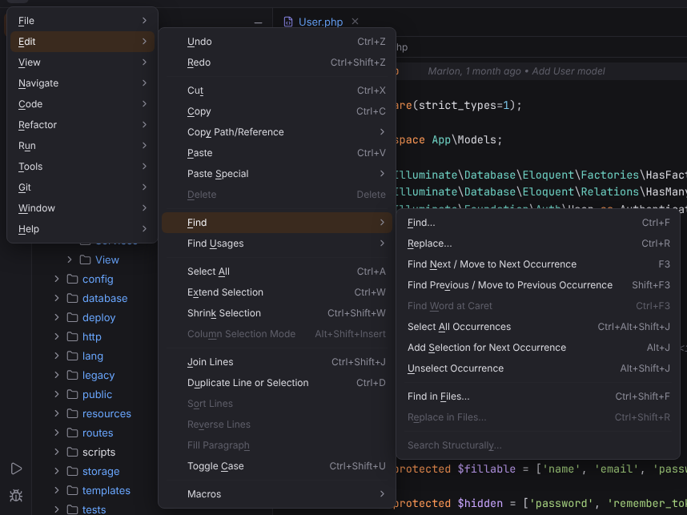

# Edit menu

Undo, clipboard, find and replace, selection and line editing. Open it with ☰ (`Alt+\`) or from the menu bar, see [Main menu](../../user/workbench.md#main-menu).

**Available**: *yes* — implemented; *not yet* — shown disabled until Forge implements it; *dynamic* — filled at runtime. Shortcuts are the Windows/Linux and macOS defaults.

| Entry | Windows / Linux | macOS | Available | What it does |
| --- | --- | --- | --- | --- |
| Undo | `Ctrl+Z`, `Alt+Backspace` | `Cmd+Z` | yes | Undoes the last edit in the editor. [More](../../user/editor.md#editing-actions) |
| Redo | `Ctrl+Shift+Z`, `Alt+Shift+Backspace` | `Cmd+Shift+Z` | yes | Redoes the last undone edit. [More](../../user/editor.md#editing-actions) |
| Cut | `Ctrl+X`, `Shift+Delete` | `Cmd+X` | yes | Cuts the selection, or the whole line when nothing is selected. [More](../../user/editor.md#editing-actions) |
| Copy | `Ctrl+C`, `Ctrl+Insert` | `Cmd+C` | yes | Copies the selection, or the whole line when nothing is selected. [More](../../user/editor.md#editing-actions) |
| **Copy Path/Reference** | | | | submenu |
| Copy Path/Reference › Absolute Path | `Ctrl+Shift+C` | `Cmd+Shift+C` | yes | Copies the absolute path of the current file. [More](../../user/editor.md#editing-actions) |
| Copy Path/Reference › File Name | — | — | not yet | Not available yet; the entry is disabled. |
| Copy Path/Reference › Path From Content Root | — | — | not yet | Not available yet; the entry is disabled. |
| Copy Path/Reference › Reference | `Ctrl+Alt+Shift+C` | `Cmd+Alt+Shift+C` | yes | Copies a reference to the caret position (`path:line`). [More](../../user/editor.md#editing-actions) |
| Paste | `Ctrl+V`, `Shift+Insert` | `Cmd+V` | yes | Pastes from the clipboard. [More](../../user/editor.md#editing-actions) |
| **Paste Special** | | | | submenu |
| Paste Special › Paste from History… | `Ctrl+Shift+V` | `Cmd+Shift+V` | yes | Pastes one of the texts copied or cut in this session. [More](../../user/editor.md#paste-from-history) |
| Paste Special › Paste as Plain Text | `Ctrl+Alt+Shift+V` | `Cmd+Alt+Shift+V` | yes | Pastes the clipboard as plain text. [More](../../user/editor.md#editing-actions) |
| Delete | `Delete` | `Delete`, `Backspace` | yes | Delete |
| **Find** | | | | submenu |
| Find › Find… | `Ctrl+F` | `Cmd+F` | yes | Opens the find panel of the editor for the current file. [More](../../user/editor.md#find-and-replace-in-a-file) ([screenshot](../../../screenshots/docs-find-in-file.png)) |
| Find › Replace… | `Ctrl+R` | `Cmd+R` | yes | Opens the find panel with the replace field. [More](../../user/editor.md#find-and-replace-in-a-file) |
| Find › Find Next / Move to Next Occurrence | `F3` | `Cmd+G` | yes | Moves to the next match of the current search. [More](../../user/editor.md#find-and-replace-in-a-file) |
| Find › Find Previous / Move to Previous Occurrence | `Shift+F3` | `Cmd+Shift+G` | yes | Moves to the previous match. [More](../../user/editor.md#find-and-replace-in-a-file) |
| Find › Find Word at Caret | `Ctrl+F3` | `Alt+Cmd+F3` | not yet | Not available yet; the entry is disabled. |
| Find › Select All Occurrences | `Ctrl+Alt+Shift+J` | `Ctrl+Cmd+G` | yes | Selects every occurrence of the selected text. [More](../../user/editor.md#multiple-carets-and-column-selection) |
| Find › Add Selection for Next Occurrence | `Alt+J` | `Ctrl+G` | yes | Adds the next occurrence of the selected text as another selection (multiple carets). [More](../../user/editor.md#multiple-carets-and-column-selection) |
| Find › Unselect Occurrence | `Alt+Shift+J` | `Ctrl+Shift+G` | yes | Removes the occurrence added last. [More](../../user/editor.md#multiple-carets-and-column-selection) |
| Find › Find in Files… | `Ctrl+Shift+F` | `Cmd+Shift+F` | yes | Searches the text of all project files, with match case, whole words, regular expressions, file masks and a folder scope. [More](../../user/search-everywhere.md#find-in-files) ([screenshot](../../../screenshots/docs-find-in-files.png)) |
| Find › Replace in Files… | `Ctrl+Shift+R` | `Cmd+Shift+R` | yes | Opens the Find tool window's Find in Files tab with a **Replace with** field, a preview of every changed line and undo. [More](../../user/search-everywhere.md#find-in-files) |
| Find › Search Structurally… | — | — | not yet | Not available yet; the entry is disabled. |
| **Find Usages** | | | | submenu |
| Find Usages › Find Usages | `Alt+F7` | `Alt+F7` | yes | Shows the usages of the symbol at the caret in the Find tool window. [More](../../user/editor.md#find-usages-and-show-usages) ([screenshot](../../../screenshots/php-nav-find-window.png)) |
| Find Usages › Find Usages Settings… | `Ctrl+Alt+Shift+F7` | `Cmd+Alt+Shift+F7` | yes | Opens the Find Usages dialog (options per element, scope, Open in new tab), then finds the usages. [More](../../user/editor.md#find-usages-settings) ([screenshot](../../../screenshots/find-usages-dialog.png)) |
| Find Usages › Show Usages | `Ctrl+Alt+F7` | `Cmd+Alt+F7` | yes | Shows the usages of the symbol at the caret in a popup. [More](../../user/editor.md#find-usages-and-show-usages) ([screenshot](../../../screenshots/php-nav-show-usages.png)) |
| Find Usages › Find Usages in File | `Ctrl+F7` | `Cmd+F7` | yes | Shows the usages of the symbol at the caret in the current file in the Find tool window. [More](../../user/editor.md#find-usages-in-file) ([screenshot](../../../screenshots/find-usages-in-file.png)) |
| Find Usages › Highlight Usages in File | `Ctrl+Shift+F7` | `Cmd+Shift+F7` | yes | Highlights the usages (or exit points, implementing methods) in the file until Escape; F3 / Shift+F3 jump between them. [More](../../user/editor.md#highlight-usages) ([screenshot](../../../screenshots/highlight-usages-in-file.png)) |
| Select All | `Ctrl+A` | `Cmd+A` | yes | Selects the whole document. [More](../../user/editor.md#editing-actions) |
| Extend Selection | `Ctrl+W` | `Alt+Up` | yes | Extends the selection to the next larger syntactic unit (word, expression, statement, block). [More](../../user/editor.md#editing-actions) |
| Shrink Selection | `Ctrl+Shift+W` | `Alt+Down` | yes | Shrinks the selection back. [More](../../user/editor.md#editing-actions) |
| Column Selection Mode | `Alt+Shift+Insert` | `Cmd+Shift+8` | yes | Shift+arrow keys and mouse drags select rectangles; checked while on. [More](../../user/editor.md#multiple-carets-and-column-selection) |
| Join Lines | `Ctrl+Shift+J` | `Ctrl+Shift+J` | yes | Joins the selected lines (or the next line) into one. [More](../../user/editor.md#editing-actions) |
| Duplicate Line or Selection | `Ctrl+D` | `Cmd+D` | yes | Duplicates the current line or the selection. [More](../../user/editor.md#editing-actions) |
| Sort Lines | — | — | not yet | Not available yet; the entry is disabled. |
| Reverse Lines | — | — | not yet | Not available yet; the entry is disabled. |
| Fill Paragraph | — | — | not yet | Not available yet; the entry is disabled. |
| Toggle Case | `Ctrl+Shift+U` | `Cmd+Shift+U` | yes | Switches the selection between upper and lower case. [More](../../user/editor.md#editing-actions) |
| **Macros** | | | | submenu |
| Macros › Start Macro Recording | — | — | not yet | Not available yet; the entry is disabled. |
| Macros › Play Back Last Macro | — | — | not yet | Not available yet; the entry is disabled. |
| Macros › Play Saved Macros… | — | — | not yet | Not available yet; the entry is disabled. |
| Macros › Edit Macros | — | — | not yet | Not available yet; the entry is disabled. |
