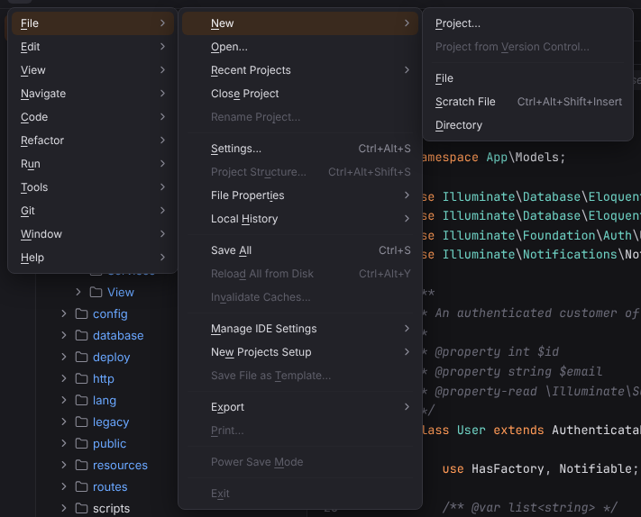

# File menu

Projects, new files and scratches, settings and saving. Open it with ☰ (`Alt+\`) or from the menu bar, see [Main menu](../../user/workbench.md#main-menu).

**Available**: *yes* — implemented; *not yet* — shown disabled until Forge implements it; *dynamic* — filled at runtime. Shortcuts are the Windows/Linux and macOS defaults.

| Entry | Windows / Linux | macOS | Available | What it does |
| --- | --- | --- | --- | --- |
| **New** | | | | submenu |
| New › Project… | — | — | yes | Opens the New Project wizard with generators for PHP, Laravel, Symfony, web frameworks and Lua. [More](../../getting-started/projects.md#create-a-new-project) ([screenshot](../../../screenshots/docs-new-project.png)) |
| New › Project from Version Control… | — | — | not yet | Not available yet; the entry is disabled. |
| New › File | — | — | yes | Creates a file in the folder selected in the Project view (or the project root) and opens it. [More](../../user/workbench.md#context-menu) |
| New › Scratch File | `Ctrl+Alt+Shift+Insert` | `Cmd+Shift+N` | yes | Asks for a language and creates a new scratch file in Forge's global scratch folder. [More](../../user/scratches-and-http.md#creating-scratches) ([screenshot](../../../screenshots/docs-new-scratch.png)) |
| New › Directory | — | — | yes | Creates a folder in the folder selected in the Project view (or the project root). [More](../../user/workbench.md#context-menu) |
| New › PHP File, PHP Class, PHPUnit Test, … | — | — | yes | The file templates the project uses (PHP, Laravel, Symfony, web, Vue, React, Lua and your own); PHP Class opens the New PHP Class dialog with the PSR-4 namespace. [More](../../user/file-templates.md) ([screenshot](../../../screenshots/file-templates-main-menu.png)) |
| New › Edit File Templates… | — | — | yes | Opens Settings \| Editor \| File and Code Templates. [More](../../user/file-templates.md#editing-templates) |
| Open… | — | — | yes | Opens a folder as the project (native folder picker in the desktop app). [More](../../getting-started/projects.md#open-an-existing-project) |
| **Recent Projects** | — | — | dynamic | Lists your recent projects (except the open one); click one to open it. |
| Close Project | — | — | yes | Closes the project and returns to the Welcome screen. [More](../../getting-started/projects.md#open-an-existing-project) |
| Rename Project… | — | — | not yet | Not available yet; the entry is disabled. |
| Settings… | `Ctrl+Alt+S` | `Cmd+,` | yes | Opens the Settings dialog. [More](../../user/settings-and-themes.md#the-settings-dialog) ([screenshot](../../../screenshots/docs-settings.png)) |
| Project Structure… | `Ctrl+Alt+Shift+S` | `Cmd+;` | not yet | Not available yet; the entry is disabled. |
| **File Properties** | | | | submenu |
| File Properties › File Encoding | — | — | not yet | Not available yet; the entry is disabled. |
| File Properties › Remove BOM | — | — | not yet | Not available yet; the entry is disabled. |
| File Properties › Associate with File Type… | — | — | not yet | Not available yet; the entry is disabled. |
| File Properties › **Line Separators** | | | | submenu |
| File Properties › Line Separators › CRLF - Windows (`\r\n`) | — | — | not yet | Not available yet; the entry is disabled. |
| File Properties › Line Separators › LF - Unix and macOS (`\n`) | — | — | not yet | Not available yet; the entry is disabled. |
| File Properties › Line Separators › CR - Classic Mac OS (`\r`) | — | — | not yet | Not available yet; the entry is disabled. |
| File Properties › Make File Read-Only | — | — | not yet | Not available yet; the entry is disabled. |
| File Properties › File Path | `Ctrl+Alt+F12` | `Cmd+Alt+F12` | not yet | Not available yet; the entry is disabled. |
| **Local History** | | | | submenu |
| Local History › Show History | — | — | yes | Revisions of the selected file or folder (or the editor's file) recorded on save, refactorings, VCS operations and external changes, with diff, Revert and Create Patch. [More](../../user/local-history.md#show-history) ([screenshot](../../../screenshots/local-history-file.png)) |
| Local History › Put Label… | — | — | yes | Names the current moment for the whole project; revert files, folders or the project to it. [More](../../user/local-history.md#labels) ([screenshot](../../../screenshots/local-history-put-label.png)) |
| Save All | `Ctrl+S` | `Cmd+S` | yes | Saves all modified files. [More](../../user/workbench.md#editor-tabs) |
| Reload All from Disk | `Ctrl+Alt+Y` | `Cmd+Alt+Y` | not yet | Not available yet; the entry is disabled. |
| Invalidate Caches… | — | — | not yet | Not available yet; the entry is disabled. |
| **Manage IDE Settings** | | | | submenu |
| Manage IDE Settings › Import Settings… | — | — | not yet | Not available yet; the entry is disabled. |
| Manage IDE Settings › Export Settings… | — | — | not yet | Not available yet; the entry is disabled. |
| Manage IDE Settings › Restore Default Settings… | — | — | not yet | Not available yet; the entry is disabled. |
| **New Projects Setup** | | | | submenu |
| New Projects Setup › Settings for New Projects… | — | — | not yet | Not available yet; the entry is disabled. |
| Save File as Template… | — | — | not yet | Not available yet; the entry is disabled. |
| **Export** | | | | submenu |
| Export › Export to HTML… | — | — | not yet | Not available yet; the entry is disabled. |
| Print… | — | — | not yet | Not available yet; the entry is disabled. |
| Power Save Mode | — | — | not yet | Not available yet; the entry is disabled. |
| Exit | — | `Cmd+Q` | desktop app | Closes the Forge window (desktop app only). |
