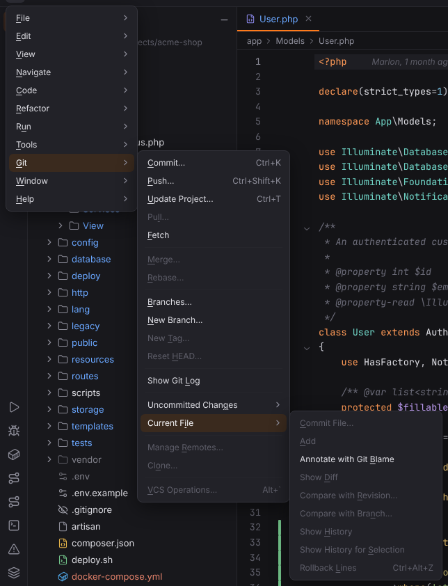

# Git menu

Commit, push, update, branches, the log and file actions. In projects without Git the menu is called VCS. Open it with ☰ (`Alt+\`) or from the menu bar, see [Main menu](../../user/workbench.md#main-menu).

**Available**: *yes* — implemented; *not yet* — shown disabled until Forge implements it; *dynamic* — filled at runtime. Shortcuts are the Windows/Linux and macOS defaults.

| Entry | Windows / Linux | macOS | Available | What it does |
| --- | --- | --- | --- | --- |
| Commit… | `Ctrl+K` | `Cmd+K` | yes | Opens the Commit tool window to commit the selected changes. [More](../../user/git.md#commit-tool-window) ([screenshot](../../../screenshots/docs-commit.png)) |
| Push… | `Ctrl+Shift+K` | `Cmd+Shift+K` | yes | Pushes the current branch. [More](../../user/git.md#push-update-and-fetch) |
| Update Project… | `Ctrl+T` | `Cmd+T` | yes | Pulls the current branch. [More](../../user/git.md#push-update-and-fetch) |
| Pull… | — | — | not yet | Not available yet; the entry is disabled. |
| Fetch | — | — | yes | Fetches all remotes. [More](../../user/git.md#push-update-and-fetch) |
| Merge… | — | — | not yet | Not available yet; the entry is disabled. |
| Rebase… | — | — | not yet | Not available yet; the entry is disabled. |
| Branches… | — | — | yes | Opens the Git Branches popup: checkout, new branch, merge, rebase, push, delete. [More](../../user/git.md#branches) ([screenshot](../../../screenshots/docs-branches.png)) |
| New Branch… | — | — | yes | Creates a branch from the current one and optionally checks it out. [More](../../user/git.md#branches) |
| New Tag… | — | — | not yet | Not available yet; the entry is disabled. |
| Reset HEAD… | — | — | not yet | Not available yet; the entry is disabled. |
| Show Git Log | — | — | yes | Opens the Log tab of the Git tool window. [More](../../user/git.md#log) ([screenshot](../../../screenshots/docs-git-log.png)) |
| **Uncommitted Changes** | | | | submenu |
| Uncommitted Changes › Shelve Changes… | — | — | not yet | Not available yet; the entry is disabled. |
| Uncommitted Changes › Show Shelf | — | — | not yet | Not available yet; the entry is disabled. |
| Uncommitted Changes › Stash Changes… | — | — | not yet | Not available yet; the entry is disabled. |
| Uncommitted Changes › Unstash Changes… | — | — | not yet | Not available yet; the entry is disabled. |
| Uncommitted Changes › Rollback… | `Ctrl+Alt+Z` | `Cmd+Alt+Z` | not yet | Not available yet; the entry is disabled. |
| Uncommitted Changes › Show Local Changes | — | — | not yet | Not available yet; the entry is disabled. |
| **Current File** | | | | submenu |
| Current File › Commit File… | — | — | not yet | Not available yet; the entry is disabled. |
| Current File › Add | — | — | not yet | Not available yet; the entry is disabled. |
| Current File › Annotate with Git Blame | — | — | yes | Shows Git blame (author and date per line) in the editor gutter. [More](../../user/git.md#blame) ([screenshot](../../../screenshots/vcs-blame.png)) |
| Current File › Show Diff | — | — | not yet | Not available yet; the entry is disabled. |
| Current File › Compare with Revision… | — | — | not yet | Not available yet; the entry is disabled. |
| Current File › Compare with Branch… | — | — | not yet | Not available yet; the entry is disabled. |
| Current File › Show History | — | — | not yet | Not available yet; the entry is disabled. |
| Current File › Show History for Selection | — | — | not yet | Not available yet; the entry is disabled. |
| Current File › Rollback Lines | `Ctrl+Alt+Z` | `Cmd+Alt+Z` | not yet | Not available yet; the entry is disabled. |
| Manage Remotes… | — | — | not yet | Not available yet; the entry is disabled. |
| Clone… | — | — | not yet | Not available yet; the entry is disabled. |
| VCS Operations… | `` Alt+` `` | `Ctrl+V` | not yet | Not available yet; the entry is disabled. |

In a project without a Git repository the menu is called **VCS** and offers the version control entries that do not need a repository.
