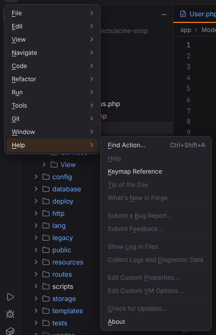

# Help menu

Find Action, the keymap reference and About. Open it with ☰ (`Alt+\`) or from the menu bar, see [Main menu](../../user/workbench.md#main-menu).

**Available**: *yes* — implemented; *not yet* — shown disabled until Forge implements it; *dynamic* — filled at runtime. Shortcuts are the Windows/Linux and macOS defaults.

| Entry | Windows / Linux | macOS | Available | What it does |
| --- | --- | --- | --- | --- |
| Find Action… | `Ctrl+Shift+A` | `Cmd+Shift+A` | yes | Finds any action by name and runs it (Find Action). [More](../../user/search-everywhere.md#find-action) ([screenshot](../../../screenshots/docs-find-action.png)) |
| Help | — | — | not yet | Not available yet; the entry is disabled. |
| Keymap Reference | — | — | yes | Opens Settings | Keymap. [More](../../user/keymap.md) |
| Tip of the Day | — | — | not yet | Not available yet; the entry is disabled. |
| What's New in Forge | — | — | not yet | Not available yet; the entry is disabled. |
| Submit a Bug Report… | — | — | not yet | Not available yet; the entry is disabled. |
| Submit Feedback… | — | — | not yet | Not available yet; the entry is disabled. |
| Show Log in Files | — | — | not yet | Not available yet; the entry is disabled. |
| Collect Logs and Diagnostic Data | — | — | not yet | Not available yet; the entry is disabled. |
| Edit Custom Properties… | — | — | not yet | Not available yet; the entry is disabled. |
| Edit Custom VM Options… | — | — | not yet | Not available yet; the entry is disabled. |
| Check for Updates… | — | — | not yet | Not available yet; the entry is disabled. |
| About | — | — | yes | Shows the version, platform and build information. ([screenshot](../../../screenshots/docs-about.png)) |
