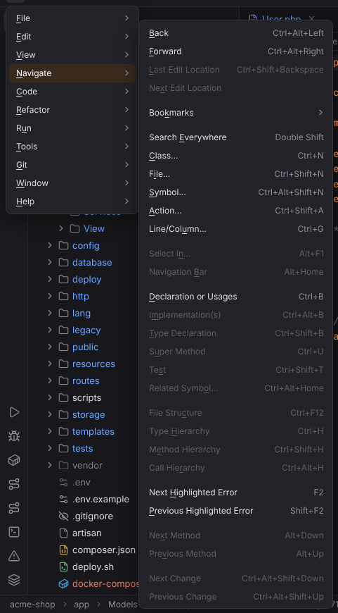

# Navigate menu

Back and forward, Search Everywhere, Go to Class/File/Symbol/Line, declarations and problems. Open it with ☰ (`Alt+\`) or from the menu bar, see [Main menu](../../user/workbench.md#main-menu).

**Available**: *yes* — implemented; *not yet* — shown disabled until Forge implements it; *dynamic* — filled at runtime. Shortcuts are the Windows/Linux and macOS defaults.

| Entry | Windows / Linux | macOS | Available | What it does |
| --- | --- | --- | --- | --- |
| Back | `Ctrl+Alt+Left` | `Cmd+[`, `Cmd+Alt+Left` | yes | Goes back to the previous caret location in your navigation history. [More](../../user/editor.md#go-to-declaration) |
| Forward | `Ctrl+Alt+Right` | `Cmd+]`, `Cmd+Alt+Right` | yes | Goes forward in the navigation history. [More](../../user/editor.md#go-to-declaration) |
| Last Edit Location | `Ctrl+Shift+Backspace` | `Cmd+Shift+Backspace` | yes | Goes back to the previous place where you changed text, across files. [More](../../user/shortcuts/navigation.md#last-edit-location) |
| Next Edit Location | — | — | yes | Goes forward again through the places where you changed text. [More](../../user/shortcuts/navigation.md#next-edit-location) |
| **Bookmarks** | | | | submenu |
| Bookmarks › Toggle Bookmark | `F11` | `F3` | yes | Adds or removes a bookmark on the caret line. [More](../../user/workbench.md#bookmarks) |
| Bookmarks › Toggle Bookmark with Mnemonic | `Ctrl+F11` | `Alt+F3` | yes | Adds a bookmark with a digit or letter you pick in a popup, or changes or removes it. [More](../../user/workbench.md#bookmarks) ([screenshot](../../../screenshots/bookmark-mnemonic.png)) |
| Bookmarks › Show All Bookmarks | `Shift+F11` | `Cmd+F3` | yes | Opens the Bookmarks tool window. [More](../../user/workbench.md#bookmarks) ([screenshot](../../../screenshots/bookmarks.png)) |
| Bookmarks › Edit Bookmark Description… | — | — | yes | Edits the description of the bookmark on the caret line. [More](../../user/workbench.md#bookmarks) |
| Bookmarks › Next Bookmark | — | — | yes | Moves the caret to the next bookmark of the file. [More](../../user/workbench.md#bookmarks) |
| Bookmarks › Previous Bookmark | — | — | yes | Moves the caret to the previous bookmark of the file. [More](../../user/workbench.md#bookmarks) |
| Search Everywhere | `Double Shift` | `Double Shift` | yes | Searches classes, files, symbols, actions and text in one popup. [More](../../user/search-everywhere.md) ([screenshot](../../../screenshots/docs-search-everywhere.png)) |
| Class… | `Ctrl+N` | `Cmd+O` | yes | Finds a class, interface, trait or enum by name (camel humps work). [More](../../user/search-everywhere.md) ([screenshot](../../../screenshots/docs-goto-class.png)) |
| File… | `Ctrl+Shift+N` | `Cmd+Shift+O` | yes | Finds a project file by name or path. [More](../../user/search-everywhere.md) ([screenshot](../../../screenshots/docs-goto-file.png)) |
| Symbol… | `Ctrl+Alt+Shift+N` | `Cmd+Alt+O` | yes | Finds a function, method, property or constant by name. [More](../../user/search-everywhere.md) ([screenshot](../../../screenshots/docs-goto-symbol.png)) |
| Action… | `Ctrl+Shift+A` | `Cmd+Shift+A` | yes | Finds any action by name and runs it (Find Action). [More](../../user/search-everywhere.md#find-action) ([screenshot](../../../screenshots/docs-find-action.png)) |
| Line/Column… | `Ctrl+G` | `Cmd+L` | yes | Moves the caret to a line (and column) of the current file. [More](../../user/editor.md#editing-actions) ([screenshot](../../../screenshots/docs-goto-line.png)) |
| Select In… | `Alt+F1` | `Alt+F1` | yes | Shows the current file in the Project view, Commit, Structure, File Structure, Navigation Bar, Git Log, the system file manager or a terminal. [More](../../user/shortcuts/navigation.md#select-in) ([screenshot](../../../screenshots/select-in.png)) |
| Navigation Bar | `Alt+Home` | `Cmd+Up` | yes | Focuses the navigation bar with the file's folder open (shows the bar as a popup when it is hidden). [More](../../user/navigation-bar-and-file-structure.md#navigation-bar) ([screenshot](../../../screenshots/navigation-bar-alt-home.png)) |
| Declaration or Usages | `Ctrl+B` | `Cmd+B` | yes | Jumps to the declaration of the symbol at the caret; on a declaration it shows the usages; several targets open the Choose Declaration popup. [More](../../user/editor.md#go-to-declaration) ([screenshot](../../../screenshots/php-nav-stub.png)) |
| Implementation(s) | `Ctrl+Alt+B` | `Cmd+Alt+B` | yes | Lists the implementations of the class, interface or method at the caret. [More](../../user/editor.md#implementation-type-declaration-super-method) ([screenshot](../../../screenshots/php-nav-gutter.png)) |
| Type Declaration | `Ctrl+Shift+B` | `Cmd+Shift+B` | yes | Jumps to the class of the variable, property or method return type at the caret. [More](../../user/editor.md#implementation-type-declaration-super-method) |
| Super Method | `Ctrl+U` | `Cmd+U` | yes | Jumps to the method the current method overrides or implements. [More](../../user/editor.md#implementation-type-declaration-super-method) |
| Test | `Ctrl+Shift+T` | `Cmd+Shift+T` | yes | Jumps between a class, component or module and its tests; Create New Test... opens the Create New PHP Test / Create New Test dialog. [More](../../user/go-to-test.md) ([screenshot](../../../screenshots/go-to-test-chooser.png)) |
| Related Symbol… | `Ctrl+Alt+Home` | `Ctrl+Cmd+Up` | yes | Jumps to related files: tests, views, templates, routes, migrations, stories and styles. [More](../../user/navigation-bar-and-file-structure.md#related-symbol) ([screenshot](../../../screenshots/related-symbol.png)) |
| File Structure | `Ctrl+F12` | `Cmd+F12` | yes | Shows the file's structure in a popup with speed search; press again for inherited members. [More](../../user/navigation-bar-and-file-structure.md#file-structure-popup) ([screenshot](../../../screenshots/file-structure-popup.png)) |
| Type Hierarchy | `Ctrl+H` | `Ctrl+H` | yes | Shows the class, supertypes or subtypes hierarchy of the type at the caret in the Hierarchy tool window. [More](../../user/hierarchies.md#type-hierarchy) ([screenshot](../../../screenshots/hierarchy-type.png)) |
| Method Hierarchy | `Ctrl+Shift+H` | `Cmd+Shift+H` | yes | Shows the classes that define, inherit or should define the method at the caret. [More](../../user/hierarchies.md#method-hierarchy) ([screenshot](../../../screenshots/hierarchy-method.png)) |
| Call Hierarchy | `Ctrl+Alt+H` | `Ctrl+Alt+H` | yes | Shows the callers or callees of the method or function at the caret, level by level, with the call sites. [More](../../user/hierarchies.md#call-hierarchy) ([screenshot](../../../screenshots/hierarchy-call.png)) |
| Next Highlighted Error | `F2` | `F2` | yes | Moves the caret to the next problem in the file. [More](../../user/editor.md#problems) |
| Previous Highlighted Error | `Shift+F2` | `Shift+F2` | yes | Moves the caret to the previous problem in the file. [More](../../user/editor.md#problems) |
| Next Occurrence | `Ctrl+Alt+Down` | `Cmd+Alt+Down` | yes | Opens the next result of the Find tool window's active tab. [More](../../user/workbench.md#find-tool-window) |
| Previous Occurrence | `Ctrl+Alt+Up` | `Cmd+Alt+Up` | yes | Opens the previous result of the Find tool window's active tab. [More](../../user/workbench.md#find-tool-window) |
| Next Method | `Alt+Down` | `Ctrl+Down` | yes | Moves the caret to the next class, function, method or CSS rule. [More](../../user/shortcuts/navigation.md#next-method) |
| Previous Method | `Alt+Up` | `Ctrl+Up` | yes | Moves the caret to the previous class, function, method or CSS rule. [More](../../user/shortcuts/navigation.md#previous-method) |
| Next Change | `Ctrl+Alt+Shift+Down` | `Ctrl+Alt+Shift+Down` | yes | Moves to the next changed block (Git gutter marker) and shows its popup with Rollback and Show Diff. [More](../../user/shortcuts/navigation.md#next-change) ([screenshot](../../../screenshots/next-change.png)) |
| Previous Change | `Ctrl+Alt+Shift+Up` | `Ctrl+Alt+Shift+Up` | yes | Moves to the previous changed block and shows its popup. [More](../../user/shortcuts/navigation.md#previous-change) |
