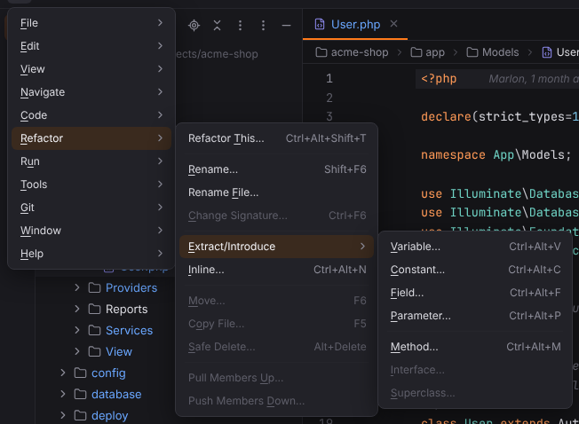

# Refactor menu

Refactorings. Every entry works: Refactor This, Rename, Rename File, Change Signature, Extract/Introduce Variable, Constant, Field, Parameter, Method, Interface and Superclass, Inline, Move, Copy, Safe Delete, Pull Members Up, Push Members Down and Make Static. Open it with ☰ (`Alt+\`) or from the menu bar, see [Main menu](../../user/workbench.md#main-menu).

**Available**: *yes* — implemented; *not yet* — shown disabled until Forge implements it; *dynamic* — filled at runtime. Shortcuts are the Windows/Linux and macOS defaults.

| Entry | Windows / Linux | macOS | Available | What it does |
| --- | --- | --- | --- | --- |
| Refactor This… | `Ctrl+Alt+Shift+T` | `Ctrl+T` | yes | A popup with the refactorings that apply at the caret, numbered and filtered by typing. [More](../../user/shortcuts/refactoring.md#refactor-this) ([screenshot](../../../screenshots/refactor-this-class.png)) |
| Rename… | `Shift+F6` | `Shift+F6` | yes | Renames the symbol at the caret in place across the project (the file or folder in the Project view). [More](../../user/editor.md#rename) ([screenshot](../../../screenshots/rename-in-place.png)) |
| Rename File… | — | — | yes | Renames the file of the current editor. [More](../../user/editor.md#rename) |
| Change Signature… | `Ctrl+F6` | `Cmd+F6` | yes | Changes the name, visibility, return type and parameters of a method or function and updates every call. [More](../../user/php.md#move-copy-safe-delete-change-signature-and-make-static) ([screenshot](../../../screenshots/change-signature-dialog.png)) |
| **Extract/Introduce** | | | | submenu |
| Extract/Introduce › Variable… | `Ctrl+Alt+V` | `Cmd+Alt+V` | yes | Puts the expression into a new local variable, named in place. [More](../../user/php.md#extract-introduce-and-inline) ([screenshot](../../../screenshots/introduce-variable-in-place.png)) |
| Extract/Introduce › Constant… | `Ctrl+Alt+C` | `Cmd+Alt+C` | yes | Turns a constant expression into a class constant or a global `const`. [More](../../user/php.md#extract-introduce-and-inline) ([screenshot](../../../screenshots/introduce-constant-dialog.png)) |
| Extract/Introduce › Field… | `Ctrl+Alt+F` | `Cmd+Alt+F` | yes | Moves the expression into a new property. [More](../../user/php.md#extract-introduce-and-inline) |
| Extract/Introduce › Parameter… | `Ctrl+Alt+P` | `Cmd+Alt+P` | yes | Adds a parameter for the expression and passes it at every call. [More](../../user/php.md#extract-introduce-and-inline) |
| Extract/Introduce › Method… | `Ctrl+Alt+M` | `Cmd+Alt+M` | yes | Moves the selected code into a new method or function. [More](../../user/php.md#extract-introduce-and-inline) ([screenshot](../../../screenshots/extract-method-dialog.png)) |
| Extract/Introduce › Interface… | — | — | yes | Extracts an interface with the chosen public methods and constants; the class implements it. [More](../../user/php.md#extract-interface-and-superclass-pull-members-up-and-push-members-down) ([screenshot](../../../screenshots/extract-interface-dialog.png)) |
| Extract/Introduce › Superclass… | — | — | yes | Moves the chosen members into a new parent class (abstract declarations on request). [More](../../user/php.md#extract-interface-and-superclass-pull-members-up-and-push-members-down) ([screenshot](../../../screenshots/extract-superclass-dialog.png)) |
| Inline… | `Ctrl+Alt+N` | `Cmd+Alt+N` | yes | Inlines a variable, method, function or constant. [More](../../user/php.md#extract-introduce-and-inline) ([screenshot](../../../screenshots/inline-method-dialog.png)) |
| Move… | `F6` | `F6` | yes | Moves a class to another namespace, static members to another class, a function to another file, or files and folders in the Project view. [More](../../user/php.md#move-copy-safe-delete-change-signature-and-make-static) ([screenshot](../../../screenshots/move-class-dialog.png)) |
| Copy File… | `F5` | `F5` | yes | Copies a class under a new name, or files and folders in the Project view. [More](../../user/php.md#move-copy-safe-delete-change-signature-and-make-static) |
| Safe Delete… | `Alt+Delete` | `Cmd+Delete` | yes | Deletes the element (or files) after checking for usages. [More](../../user/php.md#move-copy-safe-delete-change-signature-and-make-static) ([screenshot](../../../screenshots/safe-delete-usages-detected.png)) |
| Pull Members Up… | — | — | yes | Moves members into a superclass or interface of the class. [More](../../user/php.md#extract-interface-and-superclass-pull-members-up-and-push-members-down) ([screenshot](../../../screenshots/pull-members-up-dialog.png)) |
| Push Members Down… | — | — | yes | Moves members into every direct subclass. [More](../../user/php.md#extract-interface-and-superclass-pull-members-up-and-push-members-down) |
| Make Static… | — | — | yes | Makes an instance method static and updates its calls. [More](../../user/php.md#move-copy-safe-delete-change-signature-and-make-static) ([screenshot](../../../screenshots/make-static-dialog.png)) |
