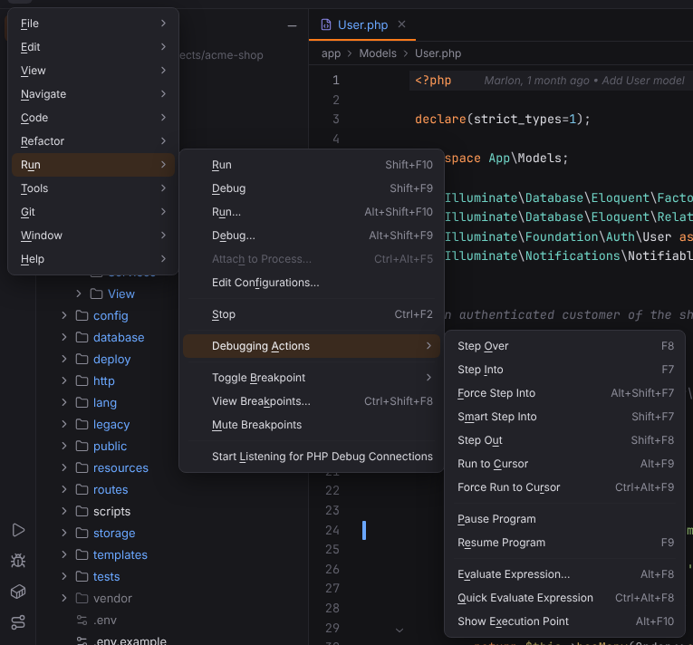

# Run menu

Run/Debug configurations, debugging actions and breakpoints. Open it with ☰ (`Alt+\`) or from the menu bar, see [Main menu](../../user/workbench.md#main-menu).

**Available**: *yes* — implemented; *not yet* — shown disabled until Forge implements it; *dynamic* — filled at runtime. Shortcuts are the Windows/Linux and macOS defaults.

| Entry | Windows / Linux | macOS | Available | What it does |
| --- | --- | --- | --- | --- |
| Run | `Shift+F10` | `Ctrl+R` | yes | Runs the configuration selected in the run widget. [More](../../user/run-debug.md) |
| Debug | `Shift+F9` | `Ctrl+D` | yes | Debugs the selected configuration (Xdebug for PHP, `--inspect` for npm). [More](../../user/run-debug.md#debugging) |
| Run… | `Alt+Shift+F10` | `Ctrl+Alt+R` | yes | Lists the run configurations to run one; hold `Shift` to debug instead. [More](../../user/run-debug.md#run-widget) ([screenshot](../../../screenshots/docs-run-chooser.png)) |
| Debug… | `Alt+Shift+F9` | `Ctrl+Alt+D` | yes | Lists the run configurations to debug one. [More](../../user/run-debug.md#run-widget) |
| Attach to Process… | `Ctrl+Alt+F5` | `Cmd+Alt+F5` | not yet | Not available yet; the entry is disabled. |
| Edit Configurations… | — | — | yes | Opens the Run/Debug Configurations dialog. [More](../../user/run-debug.md#rundebug-configurations-dialog) ([screenshot](../../../screenshots/docs-run-configurations.png)) |
| Stop | `Ctrl+F2` | `Cmd+F2` | yes | Stops the running process or debug session. [More](../../user/run-debug.md#run-tool-window) |
| **Debugging Actions** | | | | submenu |
| Debugging Actions › Step Over | `F8` | `F8` | yes | Executes the current line and stops at the next one. [More](../../user/debugging.md#the-debug-tool-window) |
| Debugging Actions › Step Into | `F7` | `F7` | yes | Steps into the function called on the current line. [More](../../user/debugging.md#the-debug-tool-window) |
| Debugging Actions › Force Step Into | `Alt+Shift+F7` | `Alt+Shift+F7` | yes | Steps into the call even in code that is normally skipped. [More](../../user/debugging.md#the-debug-tool-window) |
| Debugging Actions › Smart Step Into | `Shift+F7` | `Shift+F7` | yes | Steps into the call on the current line (currently like Step Into). [More](../../user/debugging.md#the-debug-tool-window) |
| Debugging Actions › Step Out | `Shift+F8` | `Shift+F8` | yes | Runs to the end of the current function and stops in the caller. [More](../../user/debugging.md#the-debug-tool-window) |
| Debugging Actions › Run to Cursor | `Alt+F9` | `Alt+F9` | yes | Continues until the line with the caret. [More](../../user/debugging.md#the-debug-tool-window) |
| Debugging Actions › Force Run to Cursor | `Ctrl+Alt+F9` | `Cmd+Alt+F9` | yes | Continues until the caret line, ignoring breakpoints on the way. [More](../../user/debugging.md#the-debug-tool-window) |
| Debugging Actions › Pause Program | — | — | yes | Asks the debugger to pause the script (if the engine supports it). [More](../../user/debugging.md#the-debug-tool-window) |
| Debugging Actions › Resume Program | `F9` | `Cmd+Alt+R` | yes | Continues until the next breakpoint. [More](../../user/debugging.md#the-debug-tool-window) |
| Debugging Actions › Evaluate Expression… | `Alt+F8` | `Alt+F8` | yes | Evaluates a PHP expression in the current frame. [More](../../user/debugging.md#the-debug-tool-window) |
| Debugging Actions › Quick Evaluate Expression | `Ctrl+Alt+F8` | `Cmd+Alt+F8` | yes | Evaluates the selection or the expression at the caret. [More](../../user/debugging.md#the-debug-tool-window) |
| Debugging Actions › Show Execution Point | `Alt+F10` | `Alt+F10` | yes | Shows the line where the debugger is paused. [More](../../user/debugging.md#the-debug-tool-window) |
| **Toggle Breakpoint** | | | | submenu |
| Toggle Breakpoint › Line Breakpoint | `Ctrl+F8` | `Cmd+F8` | yes | Adds or removes a line breakpoint at the caret. [More](../../user/debugging.md#breakpoints) |
| Toggle Breakpoint › Temporary Line Breakpoint | `Ctrl+Alt+Shift+F8` | `Cmd+Alt+Shift+F8` | yes | Adds a breakpoint that is removed once it is hit. [More](../../user/debugging.md#breakpoint-properties-logpoints-and-temporary-breakpoints) |
| View Breakpoints… | `Ctrl+Shift+F8` | `Cmd+Shift+F8` | yes | Lists all breakpoints, with conditions and exception breakpoints. [More](../../user/debugging.md#breakpoints) ([screenshot](../../../screenshots/docs-view-breakpoints.png)) |
| Mute Breakpoints | — | — | yes | Turns all breakpoints off temporarily, or on again. [More](../../user/debugging.md#breakpoints) |
| Start Listening for PHP Debug Connections | — | — | yes | Starts or stops listening for incoming Xdebug connections on port 9003. [More](../../user/debugging.md#listening-for-connections) |
| Web Server Debug Validation… | — | — | yes | Checks the Xdebug configuration of a web server or CLI interpreter. [More](../../user/debugging.md#web-server-debug-validation) |

**Start Listening for PHP Debug Connections** and **Web Server Debug Validation…** are added by the Xdebug plugin (`forge.xdebug`) in PHP projects; Start Listening is a toggle with a check mark while Forge listens.
