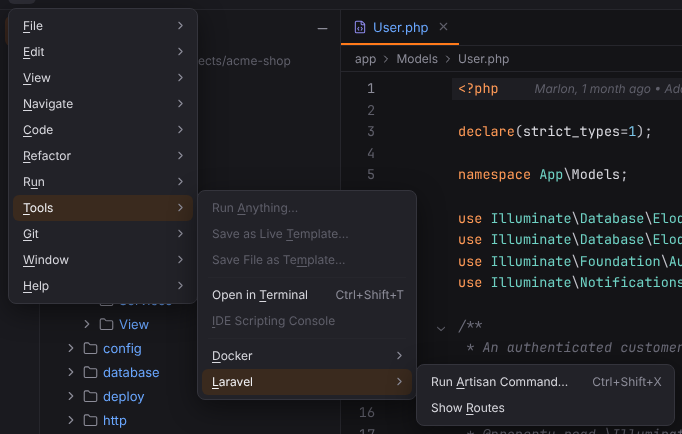

# Tools menu

Terminal, Vim emulation, Run Command… and the tools of plugins (Composer, Deployment, Docker, Laravel, Symfony). Open it with ☰ (`Alt+\`) or from the menu bar, see [Main menu](../../user/workbench.md#main-menu).

**Available**: *yes* — implemented; *not yet* — shown disabled until Forge implements it; *dynamic* — filled at runtime. Shortcuts are the Windows/Linux and macOS defaults.

| Entry | Windows / Linux | macOS | Available | What it does |
| --- | --- | --- | --- | --- |
| Run Anything… | `Double Ctrl` | `Double Ctrl` | yes | Runs or debugs configurations, scripts, PHP files and commands from one popup. [More](../../user/run-debug.md#run-anything) ([screenshot](../../../screenshots/run-anything.png)) |
| Run Command… | `Ctrl+Shift+X` | `Cmd+Shift+X` | yes | Opens the Command Line Tools Console popup: run Composer, Artisan, Symfony Console, WP-CLI, Drush and custom tools with completion (plugin `forge.command-line-tools`, PHP projects). [More](../../user/command-line-tools.md#run-command) ([screenshot](../../../screenshots/docs-run-command.png)) |
| WP-CLI… | — | — | yes | Opens the Command Line Tools Console with `wp ` typed in (plugin `forge.wordpress`, WordPress projects). [More](../../user/wordpress.md#wp-cli) |
| Drush…, Shopware Console… | — | — | yes | Open the Command Line Tools Console with `drush ` or the Shopware `bin/console` alias typed in (plugin `forge.cms`). [More](../../user/cms.md#drush-and-the-shopware-console) |
| WordPress › Run WP-CLI Command…, Show Hooks, Install WordPress Stubs…, Refresh Hook Index | — | — | yes | The WordPress submenu (plugin `forge.wordpress`). [More](../../user/wordpress.md) |
| Save as Live Template… | — | — | yes | Opens Settings \| Editor \| Live Templates with a new template made from the selection. [More](../../user/live-templates.md#save-as-live-template) ([screenshot](../../../screenshots/save-as-live-template.png)) |
| Save File as Template… | — | — | not yet | Not available yet; the entry is disabled. |
| Open in Terminal | `Ctrl+Shift+T` | `Cmd+T` | yes | Opens a new terminal tab (Tools | Open in Terminal). [More](../../user/terminal.md#tabs) ([screenshot](../../../screenshots/docs-terminal.png)) |
| Start SSH Session… | — | — | yes | Chooses an SSH configuration or an SFTP deployment server and opens a Terminal tab connected over SSH. [More](../../user/remote-host-and-ssh.md#ssh-sessions) ([screenshot](../../../screenshots/ssh-session-chooser.png)) |
| IDE Scripting Console | — | — | not yet | Not available yet; the entry is disabled. |
| **External Tools** | | | dynamic | submenu: the enabled [External Tools](../../user/run-debug.md#external-tools) (Settings \| Tools \| External Tools) ([screenshot](../../../screenshots/external-tools-menu.png)) |
| Vim | `Ctrl+Alt+V` | `Cmd+Alt+V` | yes | Turns Vim emulation on or off (check mark; plugin `forge.vim`). [More](../../user/vim-emulation.md) ([screenshot](../../../screenshots/vim-emulation.png)) |
| Render All Doc Comments | — | — | yes | Shows every documentation comment of the file as formatted text, or the text again. [More](../../user/code-structure.md#rendered-documentation-comments) ([screenshot](../../../screenshots/rendered-doc-comments.png)) |
| **Composer** | | | | submenu |
| Composer › Add Dependency… | — | — | yes | Opens Manage Composer Dependencies: search Packagist, choose a version, install, update or remove packages. [More](../../user/composer.md#manage-composer-dependencies) ([screenshot](../../../screenshots/composer-dependencies.png)) |
| Composer › Install | — | — | yes | Runs `composer install` in the Run tool window. [More](../../user/composer.md#the-composerjson-toolbar) |
| Composer › Update | — | — | yes | Runs `composer update`. [More](../../user/composer.md#the-composerjson-toolbar) |
| Composer › Validate | — | — | yes | Runs `composer validate`. [More](../../user/composer.md#the-composerjson-toolbar) |
| Composer › Show Outdated | — | — | yes | Runs `composer outdated --direct`. [More](../../user/composer.md#outdated-packages) |
| Composer › Audit | — | — | yes | Runs `composer audit` and shows the advisories in the Problems tool window. [More](../../user/composer.md#composer-audit) ([screenshot](../../../screenshots/composer-audit.png)) |
| **Deployment** | | | | submenu |
| Deployment › Upload to Default Server | — | — | yes | Uploads the selected files or the open file to the default server. [More](../../user/deployment.md#uploading-and-downloading) ([screenshot](../../../screenshots/deployment-file-transfer.png)) |
| Deployment › Upload to… | `Ctrl+Alt+Shift+X` | `Cmd+Alt+Shift+X` | yes | Asks for the server, then uploads. [More](../../user/deployment.md#uploading-and-downloading) ([screenshot](../../../screenshots/deployment-choose-server.png)) |
| Deployment › Download from Default Server / Download from… | — | — | yes | Copies the deployed files into the project. [More](../../user/deployment.md#uploading-and-downloading) |
| Deployment › Compare with Deployed Version / … on… | — | — | yes | Diff of the deployed file and the project file. [More](../../user/deployment.md#uploading-and-downloading) ([screenshot](../../../screenshots/deployment-compare.png)) |
| Deployment › Sync with Deployed to Default Server / … to… | — | — | yes | Folder diff of a project folder and its deployed copy with Upload / Download per row. [More](../../user/deployment.md#sync-with-deployed) ([screenshot](../../../screenshots/deployment-sync.png)) |
| Deployment › Delete on Default Server | — | — | yes | Deletes the deployed files after a confirmation. [More](../../user/deployment.md#uploading-and-downloading) |
| Deployment › Configuration… | — | — | yes | Opens Settings \| Build, Execution, Deployment \| Deployment. [More](../../user/deployment.md#servers) ([screenshot](../../../screenshots/deployment-settings.png)) |
| Deployment › Options… | — | — | yes | Opens Deployment \| Options. [More](../../user/deployment.md#options) ([screenshot](../../../screenshots/deployment-options.png)) |
| Deployment › Automatic Upload (Always) | — | — | yes | Switches automatic upload on save between Always and Never (check mark). [More](../../user/deployment.md#options) |
| Deployment › Browse Remote Host | — | — | yes | Opens the Remote Host tool window on the default server. [More](../../user/remote-host-and-ssh.md#remote-host-tool-window) ([screenshot](../../../screenshots/remote-host-tree.png)) |
| **Docker** | | | | submenu |
| Docker › Pull Image… | — | — | yes | Pulls a Docker image. [More](../../user/services.md#pulling-images-and-registries) |
| Docker › Refresh Services | — | — | yes | Refreshes the Services tree. [More](../../user/services.md) |
| **Laravel** | | | | submenu |
| Laravel › Run Artisan Command… | — | — | yes | Opens Run Command with the Artisan alias typed in. [More](../../user/laravel.md#run-artisan-command) |
| Laravel › Show Routes | — | — | yes | Shows the Laravel Routes tool window. [More](../../user/laravel.md#routes-tool-window) |

## Entries of plugins

Tools collects the actions of active plugins; the screenshot shows a Laravel project.

| Submenu | Entries | Appears in |
| --- | --- | --- |
| — | Vim (check mark) | always (plugin `forge.vim`) |
| Composer | Add Dependency…, Install, Update, Validate, Show Outdated, Audit | Composer projects (`forge.composer`) |
| Deployment | Upload, Download, Compare, Sync, Delete, Configuration…, Options…, Automatic Upload, Browse Remote Host | always (plugin `forge.deployment`) |
| Docker | Pull Image…, Refresh Services | always (plugin `forge.services`) |
| Laravel | Run Artisan Command…, Show Routes | Laravel projects (`forge.laravel`) |
| Symfony | Run Console Command…, Show Routes, Refresh Symfony Index | Symfony projects (`forge.symfony`) |
