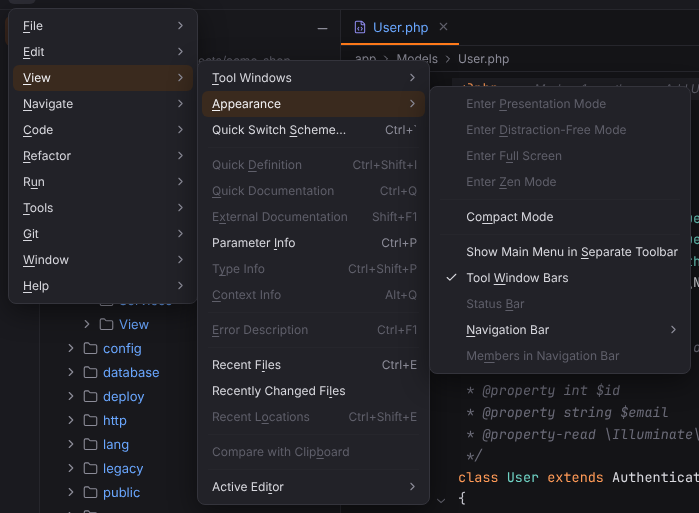

# View menu

Tool windows, appearance toggles, documentation popups and recent files. Open it with ☰ (`Alt+\`) or from the menu bar, see [Main menu](../../user/workbench.md#main-menu).

**Available**: *yes* — implemented; *not yet* — shown disabled until Forge implements it; *dynamic* — filled at runtime. Shortcuts are the Windows/Linux and macOS defaults.

| Entry | Windows / Linux | macOS | Available | What it does |
| --- | --- | --- | --- | --- |
| **Tool Windows** | — | — | dynamic | Lists every tool window of the project alphabetically; click one to show or hide it. |
| **Appearance** | | | | submenu |
| Appearance › Enter Presentation Mode | — | — | not yet | Not available yet; the entry is disabled. |
| Appearance › Enter Distraction-Free Mode | — | — | not yet | Not available yet; the entry is disabled. |
| Appearance › Enter Full Screen | — | `Ctrl+Cmd+F` | not yet | Not available yet; the entry is disabled. |
| Appearance › Enter Zen Mode | — | — | not yet | Not available yet; the entry is disabled. |
| Appearance › Compact Mode | — | — | yes | Turns compact mode (smaller toolbars and tool window headers) on or off. [More](../../user/settings-and-themes.md#appearance-options) |
| Appearance › Show Main Menu in Separate Toolbar | — | — | yes | Shows the main menu as a menu bar above the main toolbar, or back behind ☰. [More](../../user/workbench.md#main-menu) |
| Appearance › Tool Window Bars | — | — | yes | Shows or hides the tool window stripes along the window edges. [More](../../user/workbench.md#managing-tool-windows) |
| Appearance › Status Bar | — | — | not yet | Not available yet; the entry is disabled. |
| Appearance › **Navigation Bar** | | | | submenu |
| Appearance › Navigation Bar › Top | — | — | yes | Shows the navigation bar above the editor (the default). [More](../../user/navigation-bar-and-file-structure.md#navigation-bar) ([screenshot](../../../screenshots/navigation-bar.png)) |
| Appearance › Navigation Bar › In Status Bar | — | — | yes | Shows the navigation bar only in the status bar. [More](../../user/navigation-bar-and-file-structure.md#navigation-bar) ([screenshot](../../../screenshots/navigation-bar-status-bar.png)) |
| Appearance › Navigation Bar › Don't Show | — | — | yes | Hides the navigation bar; `Alt+Home` shows it as a popup. [More](../../user/navigation-bar-and-file-structure.md#navigation-bar) ([screenshot](../../../screenshots/navigation-bar-floating.png)) |
| Appearance › Members in Navigation Bar | — | — | yes | Adds the class and method at the caret to the navigation bar. [More](../../user/navigation-bar-and-file-structure.md#navigation-bar) ([screenshot](../../../screenshots/navigation-bar-members.png)) |
| Quick Switch Scheme… | `` Ctrl+` `` | `` Ctrl+` `` | yes | Switches between the dark and the light theme. [More](../../user/settings-and-themes.md#themes) |
| Quick Definition | `Ctrl+Shift+I` | `Alt+Space`, `Cmd+Y` | yes | Shows the source of the declaration at the caret in a popup. [More](../../user/editor.md#quick-definition) ([screenshot](../../../screenshots/quick-definition.png)) |
| Quick Documentation | `Ctrl+Q` | `F1`, `Ctrl+J` | yes | Shows the documentation of the symbol at the caret; press again to move it to the Documentation tool window. [More](../../user/editor.md#quick-documentation) ([screenshot](../../../screenshots/quick-documentation.png)) |
| External Documentation | `Shift+F1` | `Shift+F1` | yes | Opens the symbol's page on php.net, the Laravel API, MDN, the Vue or React reference or the Lua manual. [More](../../user/editor.md#external-documentation) |
| Parameter Info | `Ctrl+P` | `Cmd+P` | yes | Shows the parameters of the call at the caret, the current one in bold. [More](../../user/editor.md#parameter-info) |
| Type Info | `Ctrl+Shift+P` | `Ctrl+Shift+P` | yes | Shows the type of the expression at the caret. [More](../../user/editor.md#type-info-context-info-and-error-description) ([screenshot](../../../screenshots/type-info.png)) |
| Context Info | `Alt+Q` | `Ctrl+Shift+Q` | yes | Shows the headers of the class and method around the caret. [More](../../user/editor.md#type-info-context-info-and-error-description) ([screenshot](../../../screenshots/context-info.png)) |
| Error Description | `Ctrl+F1` | `Cmd+F1` | yes | Shows the full description of the problems at the caret. [More](../../user/editor.md#type-info-context-info-and-error-description) ([screenshot](../../../screenshots/error-description.png)) |
| Recent Files | `Ctrl+E` | `Cmd+E` | yes | Lists recently opened files and the tool windows; press again for recently edited files only. [More](../../user/workbench.md#recent-files-and-switcher) ([screenshot](../../../screenshots/docs-recent-files.png)) |
| Recently Changed Files | — | — | yes | Lists recently edited files. [More](../../user/workbench.md#recent-files-and-switcher) |
| Recent Locations | `Ctrl+Shift+E` | `Cmd+Shift+E` | yes | Lists recently visited and edited places with a code snippet each; press again for changed places only. [More](../../user/workbench.md#recent-locations) ([screenshot](../../../screenshots/recent-locations.png)) |
| Compare With… | `Ctrl+D` | `Cmd+D` | yes | Compares the two files or folders selected in the Project view, or asks for the second one. [More](../../user/git.md#compare-files-and-folders) ([screenshot](../../../screenshots/compare-directories.png)) |
| Compare with Clipboard | — | — | yes | Compares the clipboard with the selection or the whole file. [More](../../user/git.md#compare-with-clipboard) ([screenshot](../../../screenshots/compare-with-clipboard.png)) |
| **Active Editor** | | | | submenu |
| Active Editor › Soft-Wrap | — | — | not yet | Not available yet; the entry is disabled. |
| Active Editor › Show Whitespaces | — | — | not yet | Not available yet; the entry is disabled. |
| Active Editor › Show Line Numbers | — | — | not yet | Not available yet; the entry is disabled. |
| Active Editor › Show Indent Guides | — | — | not yet | Not available yet; the entry is disabled. |
| Active Editor › Show Breadcrumbs | — | — | yes | Shows or hides the structure breadcrumbs for the file's language. [More](../../user/code-structure.md#breadcrumbs) ([screenshot](../../../screenshots/breadcrumbs-siblings.png)) |
| Active Editor › Show Sticky Lines | — | — | yes | Shows or hides the sticky lines for the file's language. [More](../../user/code-structure.md#sticky-lines) ([screenshot](../../../screenshots/sticky-lines.png)) |
| Active Editor › Reader Mode | — | — | yes | Switches Reader mode in the editor. [More](../../user/code-structure.md#reader-mode) ([screenshot](../../../screenshots/reader-mode.png)) |

The toggles under **Appearance** (Compact Mode, Show Main Menu in Separate Toolbar, Tool Window Bars, the Navigation Bar placement and Members in Navigation Bar) show a check mark when on.
