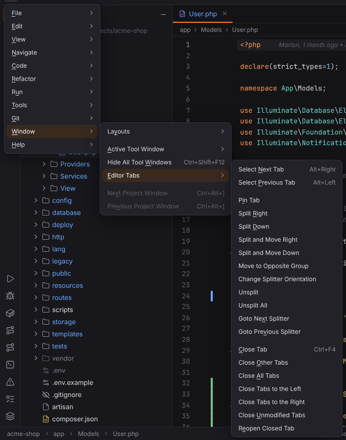

# Window menu

Layouts, the active tool window, editor tabs and project windows. Open it with ☰ (`Alt+\`) or from the menu bar, see [Main menu](../../user/workbench.md#main-menu).

**Available**: *yes* — implemented; *not yet* — shown disabled until Forge implements it; *dynamic* — filled at runtime. Shortcuts are the Windows/Linux and macOS defaults.

| Entry | Windows / Linux | macOS | Available | What it does |
| --- | --- | --- | --- | --- |
| **Layouts** | | | | submenu |
| Layouts › Store Current Layout as Default | — | — | yes | Stores where the tool windows sit, which are open and their sizes as the default for all projects. [More](../../user/workbench.md#moving-and-hiding-tool-windows) |
| Layouts › Restore Default Layout | `Shift+F12` | `Shift+F12` | yes | Goes back to the stored default layout, or Forge's own. [More](../../user/workbench.md#moving-and-hiding-tool-windows) |
| **Active Tool Window** | | | | submenu |
| Active Tool Window › Hide Active Tool Window | `Shift+Escape` | `Shift+Escape` | yes | Hides the tool window that has the focus and returns to the editor. [More](../../user/workbench.md#managing-tool-windows) |
| Active Tool Window › Hide Side Tool Windows | — | — | yes | Hides the left and right tool windows. [More](../../user/workbench.md#managing-tool-windows) |
| Active Tool Window › Jump to Last Tool Window | `F12` | `F12` | yes | Shows and focuses the tool window used last. [More](../../user/workbench.md#managing-tool-windows) |
| Active Tool Window › Maximize Tool Window | `Ctrl+Shift+'` | `Cmd+Shift+'` | not yet | Not available yet; the entry is disabled. |
| Active Tool Window › Stretch to Left | `Ctrl+Shift+Left` | `Ctrl+Alt+Shift+Left` | yes | Makes the focused tool window wider or narrower towards the left. [More](../../user/workbench.md#managing-tool-windows) |
| Active Tool Window › Stretch to Right | `Ctrl+Shift+Right` | `Ctrl+Alt+Shift+Right` | yes | Makes the focused tool window wider or narrower towards the right. [More](../../user/workbench.md#managing-tool-windows) |
| Active Tool Window › Stretch to Top | `Ctrl+Shift+Up` | `Ctrl+Alt+Shift+Up` | yes | Makes the focused bottom tool window taller. [More](../../user/workbench.md#managing-tool-windows) |
| Active Tool Window › Stretch to Bottom | `Ctrl+Shift+Down` | `Ctrl+Alt+Shift+Down` | yes | Makes the focused bottom tool window lower. [More](../../user/workbench.md#managing-tool-windows) |
| Active Tool Window › Close Active Tab | `Ctrl+Shift+F4` | `Cmd+Shift+F4` | yes | Closes the active tab of the focused tool window (Run, Terminal). [More](../../user/workbench.md#managing-tool-windows) |
| Hide All Tool Windows | `Ctrl+Shift+F12` | `Cmd+Shift+F12` | yes | Hides all tool windows; press again to bring them back. [More](../../user/workbench.md#managing-tool-windows) |
| **Editor Tabs** | | | | submenu |
| Editor Tabs › Select Next Tab | `Alt+Right` | `Ctrl+Right`, `Cmd+Shift+]` | yes | Selects the next editor tab. [More](../../user/workbench.md#editor-tabs) |
| Editor Tabs › Select Previous Tab | `Alt+Left` | `Ctrl+Left`, `Cmd+Shift+[` | yes | Selects the previous editor tab. [More](../../user/workbench.md#editor-tabs) |
| Editor Tabs › Pin Tab | — | — | yes | Pins or unpins the current tab; pinned tabs stay on Close Other Tabs and Close All Tabs. [More](../../user/workbench.md#pinned-tabs) ([screenshot](../../../screenshots/pinned-tabs.png)) |
| Editor Tabs › Split Right | — | — | yes | Opens the current file in a new editor group on the right. [More](../../user/workbench.md#split-editors) ([screenshot](../../../screenshots/split-editors.png)) |
| Editor Tabs › Split Down | — | — | yes | Opens the current file in a new editor group below. [More](../../user/workbench.md#split-editors) |
| Editor Tabs › Split and Move Right | — | — | yes | Moves the current tab into a new editor group on the right. [More](../../user/workbench.md#split-editors) |
| Editor Tabs › Split and Move Down | — | — | yes | Moves the current tab into a new editor group below. [More](../../user/workbench.md#split-editors) |
| Editor Tabs › Move to Opposite Group | — | — | yes | Moves the current tab to the neighbouring editor group. [More](../../user/workbench.md#split-editors) |
| Editor Tabs › Change Splitter Orientation | — | — | yes | Switches split editors between side by side and stacked. [More](../../user/workbench.md#split-editors) |
| Editor Tabs › Unsplit | — | — | yes | Merges the current editor group into its neighbour. [More](../../user/workbench.md#split-editors) |
| Editor Tabs › Unsplit All | — | — | yes | Merges all editor groups into one. [More](../../user/workbench.md#split-editors) |
| Editor Tabs › Goto Next Splitter | — | `Alt+Tab` | yes | Moves the focus to the next editor group. [More](../../user/workbench.md#split-editors) |
| Editor Tabs › Goto Previous Splitter | — | `Alt+Shift+Tab` | yes | Moves the focus to the previous editor group. [More](../../user/workbench.md#split-editors) |
| Editor Tabs › Close Tab | `Ctrl+F4` | `Cmd+W` | yes | Closes the current editor tab. [More](../../user/workbench.md#editor-tabs) |
| Editor Tabs › Close Other Tabs | — | `Cmd+Alt+W` | yes | Closes all editor tabs of the group except the current one and pinned ones. [More](../../user/workbench.md#tab-context-menu) |
| Editor Tabs › Close All Tabs | — | — | yes | Closes all editor tabs of the group except pinned ones. [More](../../user/workbench.md#tab-context-menu) |
| Editor Tabs › Close Tabs to the Left | — | — | yes | Closes the unpinned tabs left of the current one. [More](../../user/workbench.md#tab-context-menu) |
| Editor Tabs › Close Tabs to the Right | — | — | yes | Closes the unpinned tabs right of the current one. [More](../../user/workbench.md#tab-context-menu) |
| Editor Tabs › Close Unmodified Tabs | — | — | yes | Closes the editor tabs without unsaved changes. [More](../../user/workbench.md#editor-tabs) |
| Editor Tabs › Reopen Closed Tab | — | — | yes | Reopens the editor tab closed last. [More](../../user/workbench.md#editor-tabs) |
| Next Project Window | `Ctrl+Alt+]` | `` Cmd+` `` | not yet | Not available yet; the entry is disabled. |
| Previous Project Window | `Ctrl+Alt+[` | `` Cmd+Shift+` `` | not yet | Not available yet; the entry is disabled. |
