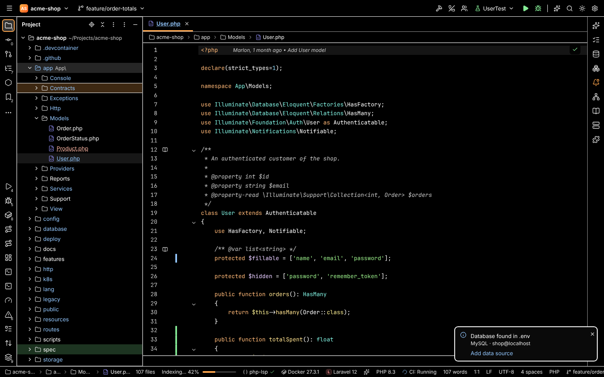
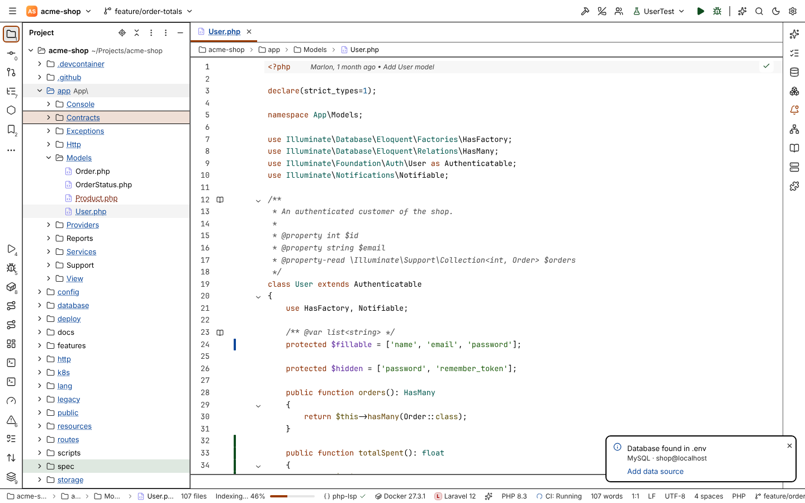
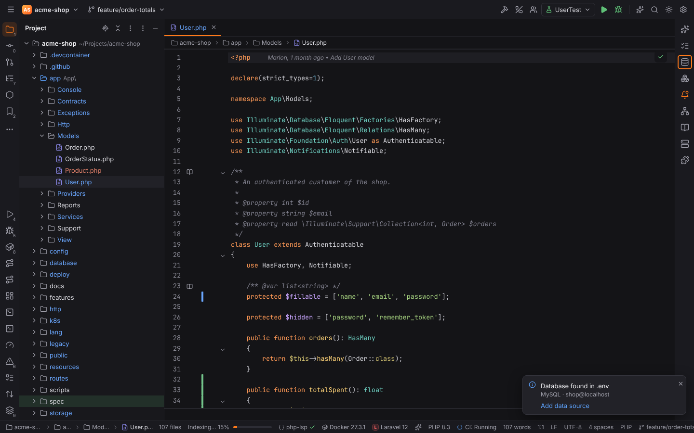
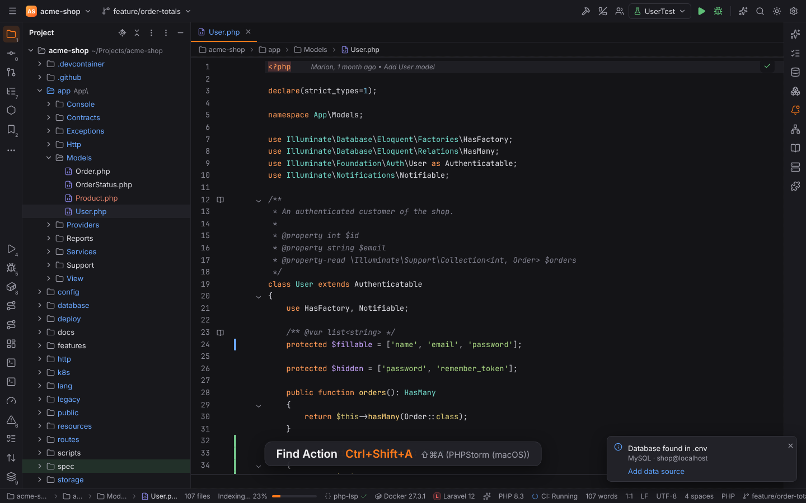

# Accessibility

Forge follows PHPStorm: every part of the window works with the keyboard alone, the workbench
carries the names and states screen readers need, two High Contrast themes meet WCAG AAA, and
the Presentation Assistant shows which action you just invoked. The options are in
Settings | Appearance & Behavior | Appearance, sections **Accessibility** and
**Presentation Assistant**.

## Screen readers

Forge's window is a web view, so it works with the screen reader of your system: NVDA or JAWS
on Windows, VoiceOver on macOS and Orca on Linux.

What a screen reader finds without any setting:

| Part | Role and what is read |
| --- | --- |
| Main toolbar, tool window bars, editor, status bar | landmarks with names ("Left tool window bar", "Status bar") |
| Tool window buttons | name, shortcut (`Alt+1`) and whether the window is shown (pressed) |
| Tool windows | regions named after the window ("Project", "Commit") |
| Project, Structure, Commit and Settings trees | trees with level, expanded and selected state; file names include their Git status ("User.php, modified") |
| Editor tabs | tab list; the active tab is selected, a changed file says "modified" |
| Editor | a text box named "Editor for *file*"; CodeMirror reads the line at the caret |
| Search Everywhere, Find Action, Go to File, Switcher, Choose Declaration | a search field with a list of results; the selected result is read as you move |
| Main menu and context menus | menus with items, submenus (expanded or not), check marks and disabled items |
| Dialogs | dialogs named after their title; focus stays inside until they close and then returns where it was |
| Settings | every field has its label and its description |
| Balloons and notifications | read as they appear; errors interrupt |

**Support screen readers** (`appearance.screenReader`) turns on extra announcements:

- the name of the active file when you switch tabs;
- the problems on a line when the caret moves onto it.

**Announce Caret Position** (`Alt+Shift+L`, View menu and Find Action) reads the line and
column of the caret and the problems there ("Line 12, column 5. Error: Undefined variable
$user."), with or without the setting.

## High Contrast themes

Settings | Appearance & Behavior | Appearance | **Theme**: **High Contrast** (`high-contrast`,
white on black) and **High Contrast Light** (`high-contrast-light`, black on white).

- All text reaches at least 7:1 contrast (WCAG AAA), secondary text and hints included.
- Panels, popups, dialogs, inputs and buttons have visible borders; the focus ring is 3 pixels
  wide.
- States do not rely on color alone: selected rows are outlined, the active tab is underlined
  and bold, pressed tool window buttons are framed, modified / added / unversioned files are
  underlined dotted / solid / dashed, error and warning balloons have a colored edge and an icon.
- The editor follows with the **High Contrast** and **High Contrast Light** color schemes
  (keywords bold); see [Color schemes](color-schemes.md).

The sun/moon button switches between the two High Contrast themes.

| | |
| --- | --- |
|  |  |

**Use contrast scrollbars** (`appearance.contrastScrollbars`) draws wider scrollbars in a strong
color, in every theme.

The Forge Ember, Anvil and Solarized themes meet WCAG AA (4.5:1) for text; Solarized keeps its
fixed palette for syntax colors.

## Keyboard-only use

Everything can be reached without a mouse. The keys are PHPStorm's and can be changed in
Settings | Keymap.

| Key | Action |
| --- | --- |
| `Alt+1` … `Alt+9` (macOS `Cmd+1` …) | show a tool window and move focus into it (its tree or list); again hides it |
| `Escape` (in a tool window) | **Focus Editor**: back to the editor, the window stays open |
| `Shift+Escape` | **Hide Active Tool Window** |
| `F12` | **Jump to Last Tool Window** |
| `Ctrl+Tab` | **Switcher**: tool windows and recent files; keep `Ctrl` down, press `Tab` to move, release to open |
| `Ctrl+Shift+F6` / `Ctrl+Alt+Shift+F6` | **Focus Next Area** / **Focus Previous Area**: main toolbar, navigation bar, tool window bars, tool windows, editor, status bar; each area remembers where focus was |
| `Alt+Home` (macOS `Cmd+Up`) | **Jump to Navigation Bar** |
| `Alt+\` | main menu |
| `ContextMenu` (the menu key) | context menu of the focused item |
| `Tab` / `Shift+Tab` | next / previous control; in a dialog, focus wraps around inside it |

In trees (Project, Structure, Commit, Settings) the arrow keys move and expand, `Home` / `End`
jump, `Enter` (or `F4`) opens; in the Commit tree `Space` includes or excludes a file. In the
editor tab bar the left and right arrows switch tabs and `Enter` returns to the editor; tabs
close with `Ctrl+F4`.

Keyboard focus is always visible: a ring in the accent color around the focused control, or
around the selected row of a focused tree or list. Clicking with the mouse does not show it.

## Presentation Assistant

The Presentation Assistant shows the name and shortcut of every action you invoke (from the
keyboard, a menu, Find Action or a toolbar button), for demos, screencasts and pair
programming. Turn it on in Settings | Appearance & Behavior | Appearance | Presentation
Assistant, or with View | Appearance | **Presentation Assistant**.

| Setting | Key | Default |
| --- | --- | --- |
| Show Presentation Assistant | `appearance.presentationAssistant.enabled` | off |
| Popup size: Small, Medium, Large | `appearance.presentationAssistant.size` | Medium |
| Position: top or bottom; left, center or right | `appearance.presentationAssistant.position` | bottom center |
| Duration (ms) | `appearance.presentationAssistant.duration` | 4000 |
| Show alternate keymap | `appearance.presentationAssistant.alternateKeymap` | on |

With **Show alternate keymap**, the popup also shows the shortcut of the other PHPStorm keymap:
the macOS shortcut while you use the Windows/Linux keymap, and the other way round.

## Related

- [Keymap](keymap.md): change any of the shortcuts above.
- [Settings and themes](settings-and-themes.md): all themes and appearance options.
- For contributors: [Writing accessible UI](../developer/accessibility.md).
