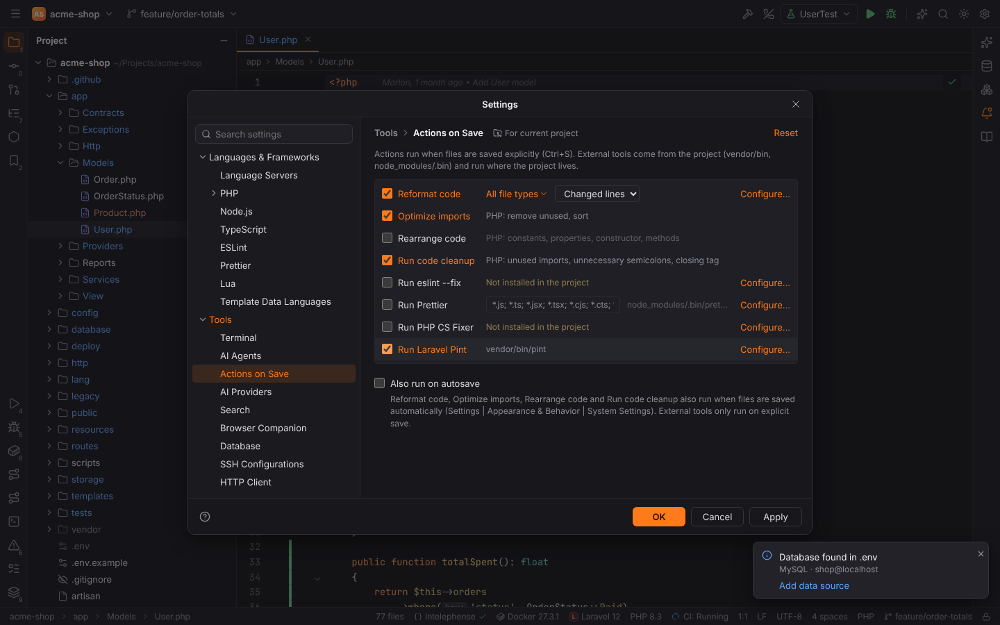
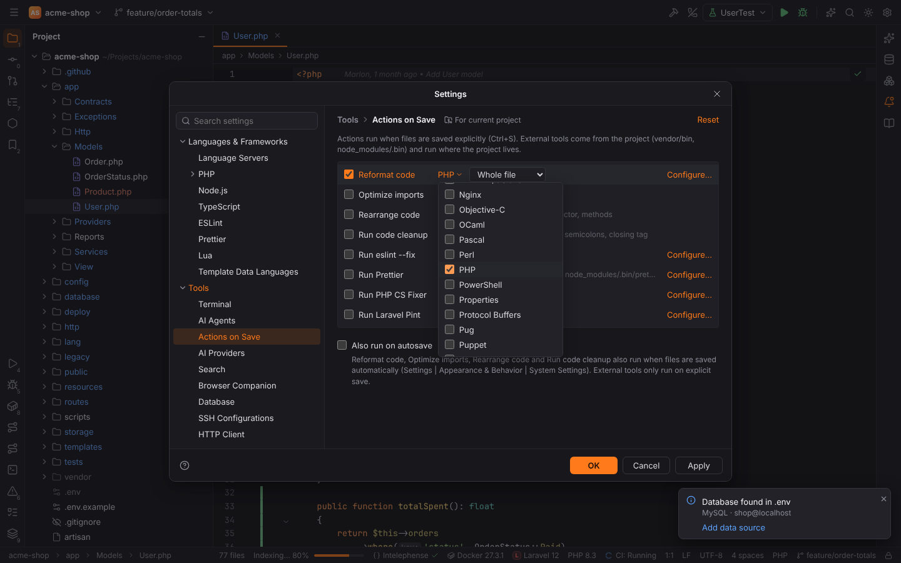
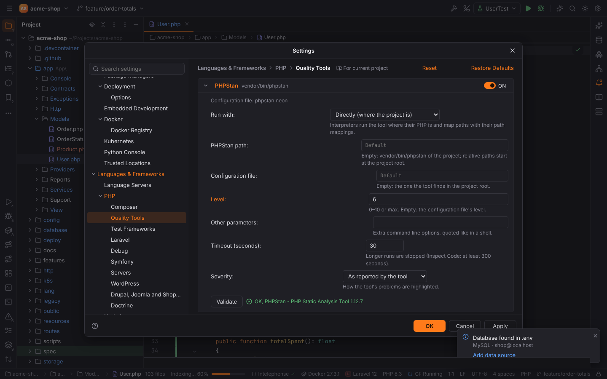
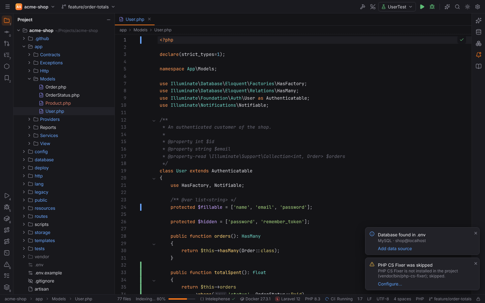

# Actions on Save

Settings | Tools | Actions on Save (`Ctrl+Alt+S`, then Tools) chooses what happens to a file
when you save it, like PHPStorm. Every action is off by default. The settings are stored per
project ("For current project"), so a team can share them in `.forge/settings.toml`.

## Actions

| Action | Files | What it does | Configure… |
| --- | --- | --- | --- |
| **Reformat code** | the chosen file types (default: all) | Reformat Code (`Ctrl+Alt+L`): the language server's formatter, StyLua for Lua, plus the options of the [code style](editor.md#code-style) the formatter does not know. **Whole file** or **Changed lines** (only lines changed since the last commit; files that are not committed yet are reformatted completely). | Editor \| Code Style |
| **Optimize imports** | PHP | Removes unused `use` imports and arranges the rest as Settings \| Editor \| Code Style \| PHP \| Imports says (by default classes, then functions, then constants, each alphabetically), see [Optimize Imports](imports.md). Group uses (`use A\{B, C};`) are split into single imports. | |
| **Rearrange code** | PHP | Orders the members of classes, interfaces, traits and enums: trait `use`, enum cases, constants, properties, the constructor, the other methods. Members keep their order inside a group; docblocks, attributes and comments move with their member and blank lines stay where they were. | |
| **Run code cleanup** | PHP | Applies the safe quick fixes: removes unused imports, unnecessary semicolons (`;;`, `};`) and the redundant closing tag `?>` at the end of a pure PHP file. | |
| **Run eslint --fix** | `.js`, `.jsx`, `.ts`, `.tsx`, `.mjs`, `.cjs`, `.mts`, `.cts`, `.vue`, `.html`, `.svelte`, `.astro` | `eslint --fix <file>` with the project's ESLint configuration. | Languages & Frameworks \| ESLint |
| **Run Prettier** | files matching **Run for files** (default `*.js; *.ts; *.jsx; *.tsx; *.cjs; *.cts; *.mjs; *.mts; *.vue; *.astro`) | `prettier --write <file>` with the project's Prettier configuration. | Languages & Frameworks \| Prettier |
| **Run Rector** | PHP | `rector process <file>` with the project's `rector.php`. | Languages & Frameworks \| PHP \| Quality Tools |
| **Run PHP CS Fixer** | PHP | `php-cs-fixer fix <file>` with the project's `.php-cs-fixer.dist.php`. | Languages & Frameworks \| PHP \| Quality Tools |
| **Run phpcbf** | PHP | PHP_CodeSniffer's fixer `phpcbf <file>` with the project's `phpcs.xml`. | Languages & Frameworks \| PHP \| Quality Tools |
| **Run Laravel Pint** | PHP | `pint <file>` with the project's `pint.json`. | Languages & Frameworks \| PHP \| Quality Tools |

The PHP actions are skipped for Blade templates and files with syntax errors; an import is
only removed when nothing in the file refers to it, including docblocks (`@var User`) and
annotations (`@ORM\Column`). The rows of a pack are shown only while its plugin is enabled.
"Update copyright notice" and "Upload to default server" are not offered because Forge has no
copyright profiles or deployment servers yet.

The "Reformat code" file types are picked from the **All file types** drop-down:

## External tools

ESLint, Prettier and the PHP tools are the project's own installations:
`node_modules/.bin/eslint`, `node_modules/.bin/prettier`, `vendor/bin/rector`,
`vendor/bin/php-cs-fixer`, `vendor/bin/phpcbf` and `vendor/bin/pint` (`.cmd` / `.bat` on
Windows). The page shows where each one was found, or "Not installed in the project". A
different executable can be set on the tool's settings page (`web.eslint.path`,
`web.prettier.path`, `php.tools.rector.path`, `php.tools.phpCsFixer.path`,
`php.tools.phpcs.phpcbfPath`, `php.tools.pint.path`); a relative path starts at the project
root. The PHP tools also take their configuration file, ruleset, other parameters and PHP
interpreter (Docker, Docker Compose, SSH, WSL) from
[PHP Quality Tools](php-quality-tools.md).

The tools run on the saved file where the project lives, so they work in
[remote projects](remote-development.md) too. A missing tool is skipped with a balloon (once
per session); a failing tool shows its error in a balloon with a **Configure…** link, and the
file gets back the text it had before that tool ran. Balloons belong to the "Actions on Save"
notification group.

## When the actions run

- On **explicit save**: `Ctrl+S` (Save All, macOS `Cmd+S`).
- On **autosave** (when Forge loses the focus or after the idle time, see
  [Saving](editor.md#saving)) only with **Also run on autosave**
  (`actionsOnSave.runOnAutosave`), and then only Reformat code, Optimize imports, Rearrange
  code and Run code cleanup. External tools only run on explicit save.
- Saves that are part of another action (renaming, changing the encoding or line separator,
  Git operations) never run them.

The actions run in this order: Reformat code, Run code cleanup, Optimize imports, Rearrange
code, then the On Save cleanup of Settings | Editor | General (trailing spaces, final line
break), then the file is written and the external tools run on it (ESLint, Prettier,
Rector, PHP CS Fixer, phpcbf, Pint).

Everything the actions changed reaches the editor as **one edit**: a single `Ctrl+Z` undoes
all of it. If you keep typing while the actions run, your text wins: the actions' result is
dropped and what you typed is saved as it is.

## Settings

| Key | Default | Meaning |
| --- | --- | --- |
| `actionsOnSave.reformat.enabled` | `false` | Reformat code |
| `actionsOnSave.reformat.scope` | `whole` | `whole` (Whole file) or `changed` (Changed lines) |
| `actionsOnSave.reformat.fileTypes` | `[]` | file type ids (`php`, `javascript`, …); empty: all file types |
| `actionsOnSave.optimizeImports` | `false` | Optimize imports |
| `actionsOnSave.rearrange` | `false` | Rearrange code |
| `actionsOnSave.codeCleanup` | `false` | Run code cleanup |
| `actionsOnSave.eslint` | `false` | Run eslint --fix |
| `actionsOnSave.prettier.enabled` | `false` | Run Prettier |
| `actionsOnSave.prettier.files` | `*.js; *.ts; …` | Prettier's "Run for files" patterns |
| `actionsOnSave.phpCsFixer` | `false` | Run PHP CS Fixer |
| `actionsOnSave.rector` | `false` | Run Rector |
| `actionsOnSave.phpcbf` | `false` | Run phpcbf |
| `actionsOnSave.pint` | `false` | Run Laravel Pint |
| `actionsOnSave.runOnAutosave` | `false` | Also run on autosave |

See the [settings reference](../reference/settings.md#tools--actions-on-save) for all keys.
