# AI

AI is part of Forge's core and works with **your own** providers and tools; Forge ships no
credentials and no subscription. There are three parts:

- **AI providers**: language model APIs Forge calls itself, used for AI in the editor, AI
  commit messages and available to plugins.
- **AI in the editor**: inline code completion, "Explain with AI" and "Fix with AI" in
  `Alt+Enter`, and AI-generated documentation and tests, all with a diff preview.
- **AI Chat**: Claude Code or Gemini CLI, installed on your machine with your own login, run
  headless and rendered as a native chat.

## Providers

Settings | Tools | **AI Providers**:

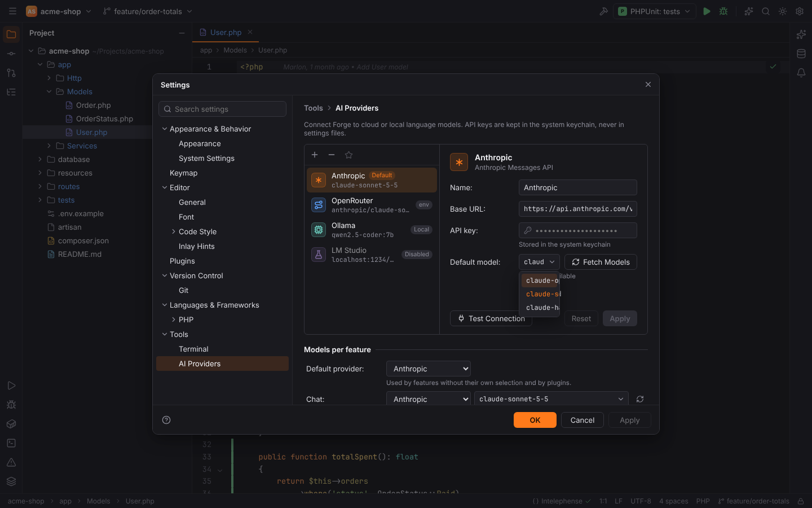

**Add Provider** offers presets:

| Kind | Default base URL | API key | Default model |
| --- | --- | --- | --- |
| Anthropic (Claude, Messages API) | `https://api.anthropic.com/v1` | required (`ANTHROPIC_API_KEY` as fallback) | Forge's current Claude default |
| OpenAI | `https://api.openai.com/v1` | required (`OPENAI_API_KEY`) | `gpt-4.1` |
| OpenRouter | `https://openrouter.ai/api/v1` | required (`OPENROUTER_API_KEY`) | `anthropic/claude-sonnet-5.5` |
| Ollama | `http://localhost:11434/v1` | not required | pick one |
| LM Studio | `http://localhost:1234/v1` | not required | pick one |
| llama.cpp (`llama-server`) | `http://localhost:8080/v1` | not required | pick one |
| OpenAI-compatible (custom) | `http://localhost:8000/v1` | optional | pick one |

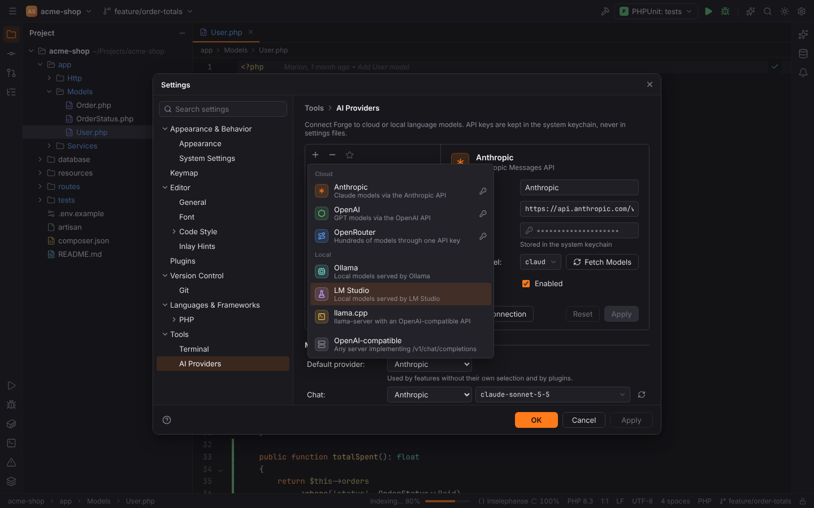

For each provider set **Name**, **Base URL**, **API key** and **Default model**. **Fetch
Models** lists the models the server offers (for local servers: "Fetch models from the running
server"). **Test Connection** reports latency and the number of models, or a hint such as "is
Ollama running? Start it with `ollama serve`".

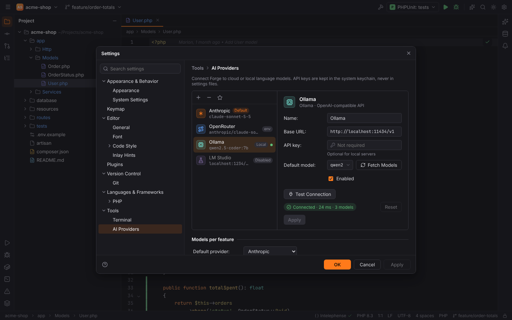

- API keys are stored in the OS keychain (service `forge-ai`), never in files ("Will be stored
  in the system keychain on Apply"). Without a stored key, the environment variables above are
  used.
- The provider list lives in `ai.toml` in Forge's config folder.
- **Set as Default Provider** chooses the provider used by features without their own choice.
- **Models per feature**: pick the provider/model for **Chat**, **Code completion** ("prefer a
  fast local model") and **Commit messages** separately.

> **Note:** the **Chat** model is used by the editor actions (Explain, Fix, Generate) and the
> **Code completion** model by inline completion; the AI Chat tool window itself uses the
> agent CLIs below. The "Google Gemini" provider kind declared in the AI plugin manifest has
> no implementation yet; use Gemini through Gemini CLI or an OpenAI-compatible endpoint.

A provider can be switched off with its **Enabled** checkbox; Forge then sends nothing to it,
also not through a feature that selected it.

## AI in the editor

Settings | Tools | **AI Assistant** (`ai.assistantSettings`) turns the editor features on and
picks their models. Nothing is sent before you add a provider; inline completion is off until
you enable it.

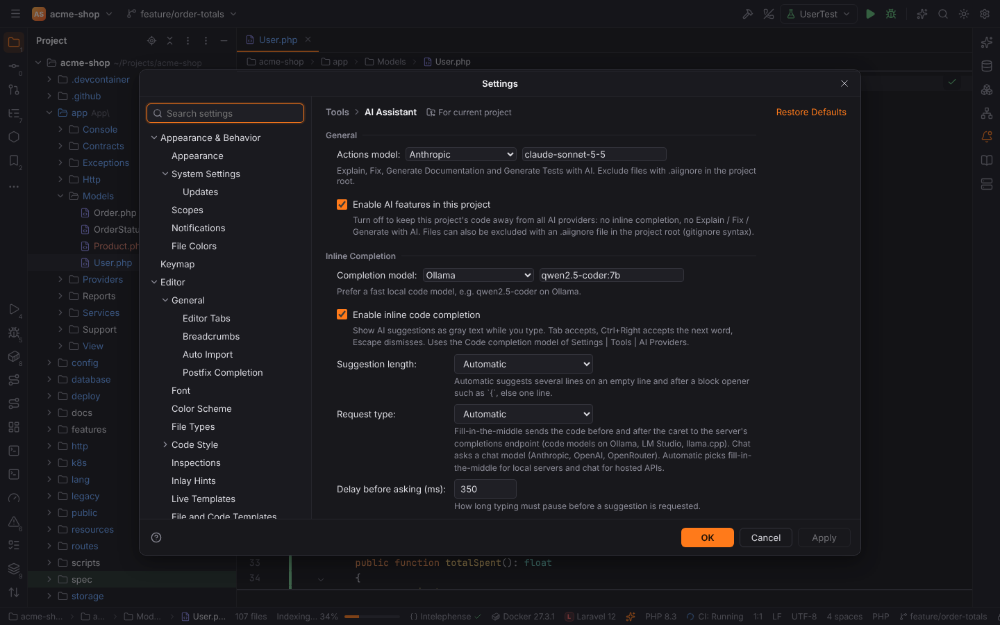

| Setting | Meaning |
| --- | --- |
| Actions model | Provider and model of Explain, Fix and Generate with AI (the **Chat** model of Settings \| Tools \| AI Providers). |
| Enable AI features in this project (`ai.enabled`) | A **project** setting: off keeps all of the project's code away from AI. |
| Completion model | Provider and model of inline completion (the **Code completion** model). A fast local code model such as `qwen2.5-coder` on Ollama works best. |
| Enable inline code completion (`ai.completion.enabled`) | Gray suggestions while you type. Also in the status bar widget and as Enable/Disable AI Inline Completion (`ai.toggleInlineCompletion`). |
| Suggestion length (`ai.completion.multiline`) | **Automatic**: several lines on an empty line and after a block opener such as `{`, else one line; or always **Single line** / **Multi-line**. |
| Request type (`ai.completion.mode`) | **Fill-in-the-middle** sends the code before and after the caret to the server's `/completions` endpoint (code models on Ollama, LM Studio, llama.cpp, other OpenAI-compatible servers); **Chat** asks a chat model with a `<CURSOR>` marker (Anthropic, OpenAI, OpenRouter). **Automatic** picks fill-in-the-middle for local servers and chat for hosted APIs. |
| Delay before asking (`ai.completion.debounceMs`) | How long typing must pause before a suggestion is requested (350 ms). |
| Disable for languages (`ai.completion.disabledLanguages`) | Language ids without inline completion, e.g. `markdown`, `json`. |

### Excluding files: .aiignore

An `.aiignore` file in the project root (gitignore syntax; `.aiexclude` is read too) keeps
files away from every AI feature: inline completion is not asked there and the actions report
"… is excluded from AI by .aiignore".

```text
# secrets and generated code never go to a model
.env
*.pem
config/secrets/
src/**/generated/*.ts
!docs/examples/*.pem
```

A pattern without `/` matches the name anywhere; with a `/` it is relative to the project root;
a trailing `/` matches folders and everything in them; `!` includes a file again (not inside an
excluded folder).

### Inline completion

While you type, Forge asks the completion model after a short pause and shows the answer as
gray text at the caret, like PHPStorm's AI Assistant. Typing on cancels the request; typing
the characters the suggestion starts with keeps the rest.

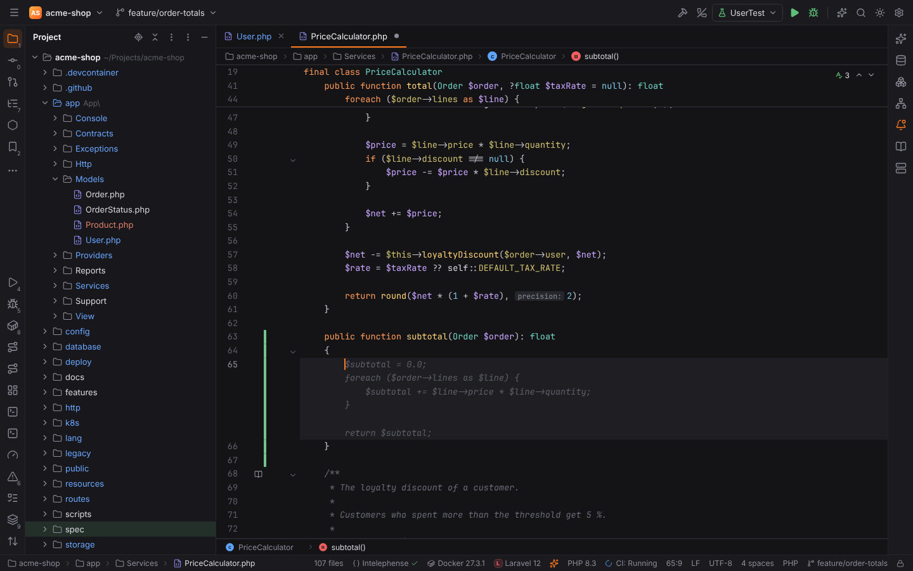

| Key | Action |
| --- | --- |
| `Tab` | Insert Inline Proposal (`InsertInlineCompletionAction`) |
| `Ctrl+Right` (macOS `Alt+Right`) | Insert Inline Proposal Word (`InsertInlineCompletionWordAction`) |
| no default | Insert Inline Proposal Line (`InsertInlineCompletionLineAction`) |
| `Alt+]` / `Alt+[` | Show Next / Previous Inline Proposal: asks the model for alternatives and cycles through them |
| `Alt+Shift+\` | Call Inline Completion (`CallInlineCompletionAction`): ask now |
| `Escape` | Dismiss the suggestion |

The keys are keymap actions (rebind them in Settings | Keymap, group Editor Actions | Inline
Completion). They act only while a suggestion is shown, so `Tab` still indents and
`Ctrl+Right` still moves by word otherwise; while the code completion popup is open, `Tab`
chooses its item.

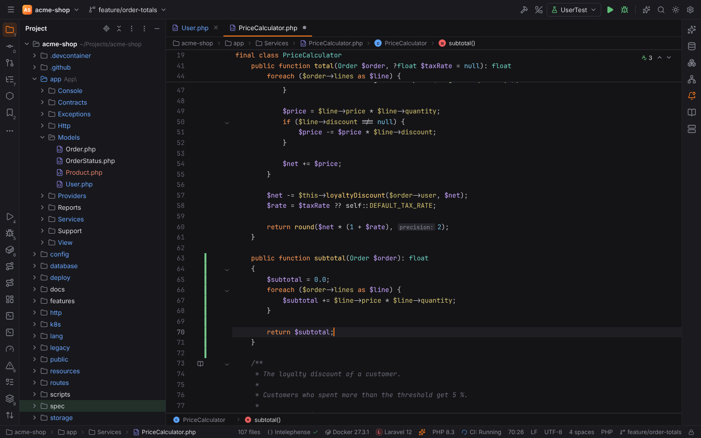

What the model gets: the code before and after the caret (about 8 KB / 2.5 KB), the file's
imports when they are outside that window, the path, and the beginning of up to three other
open files (same language first). Answers are cleaned before they are shown: Markdown fences,
end tokens and code the model repeated from before the caret are removed, the text that is
already after the caret (`)`, `;`, a closing `}` line) is not suggested twice, single-line mode
keeps one line, and multi-line suggestions end with the block they are in.

The **status bar widget** (✨) shows whether inline completion is on for the current file, a
spinner while a suggestion is asked and red after an error. Click it to enable or disable
inline completion, turn it off for the file's language, or open the settings.

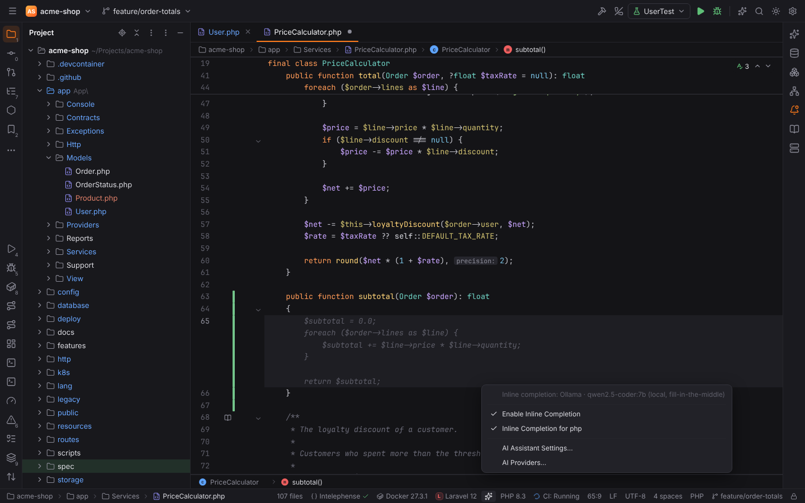

### Explain with AI and Fix with AI

`Alt+Enter` offers **Explain with AI** everywhere and **Fix with AI** on a line with a problem
(errors and warnings of the language servers and inspections). They are also in the editor's
context menu under **AI Actions** and in Find Action.

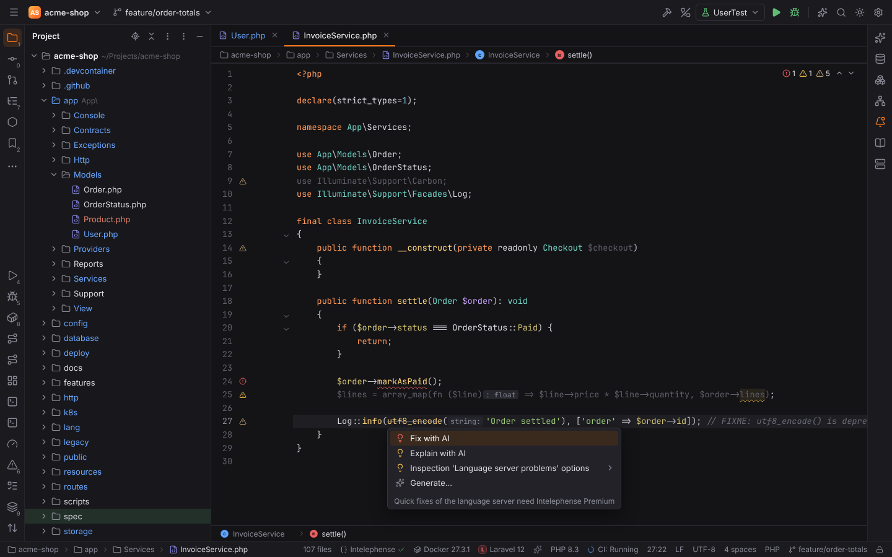

- **Explain with AI** explains the selection, or the function or class around the caret. The
  explanation streams into the **AI Chat** tool window as a new turn; its footer names the
  provider and model.

  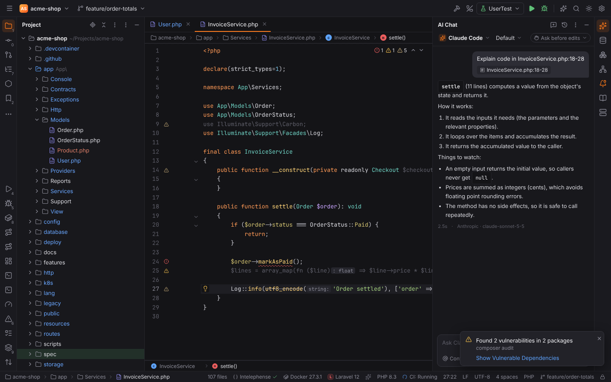

- **Fix with AI** sends the problems at the caret with the code around them and shows the
  proposed change as a diff. **Apply** (`Ctrl+Enter`) changes the editor in one undoable step;
  **Discard** (`Escape`) changes nothing. If the file changed while the AI was answering, Forge
  asks you to run the action again.

  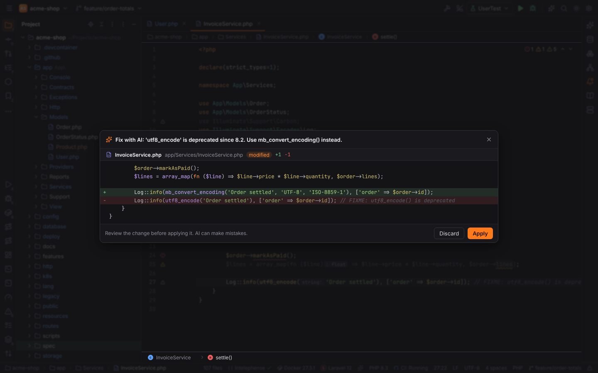

### Generate documentation and tests

**Generate** (`Alt+Insert`) lists **Documentation with AI…** and **Tests with AI…** below the
language's own entries (in files without a Generate menu only these two); they are also under
**AI Actions** in the editor's context menu.

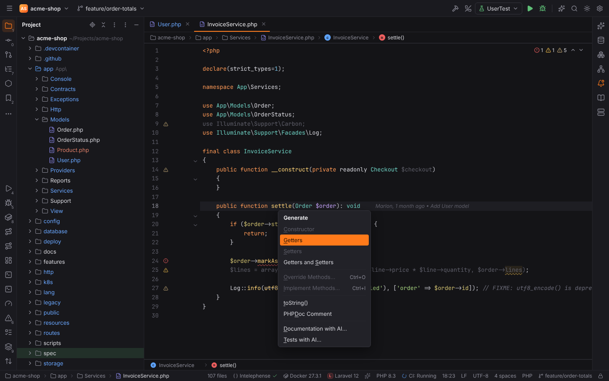

- **Generate Documentation with AI** (`ai.generateDocs`) writes the documentation comment of
  the function or class at the caret in the language's format: PHPDoc, JSDoc, Javadoc, KDoc,
  Doxygen, rustdoc `///`, LuaDoc `---`, Go `//` comments or a Python docstring. It goes above
  attributes and annotations and replaces an existing doc comment.

  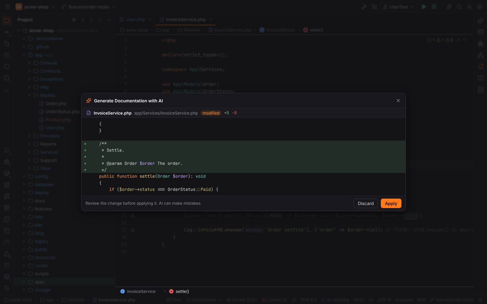

- **Generate Tests with AI** (`ai.generateTests`) writes tests for the selection or the
  declaration at the caret with the language's usual framework (PHPUnit, Vitest, pytest,
  busted, Go `testing`, JUnit, …) into the conventional test file: `tests/Unit/…Test.php`,
  `name.test.ts`, `tests/test_name.py`, `name_test.go`, `src/test/java/…Test.java`,
  `spec/name_spec.lua`; Rust tests are appended to the file as `#[cfg(test)] mod tests`. An
  existing test file is sent along and extended. **Create File** / **Apply** writes the file
  and opens it.

  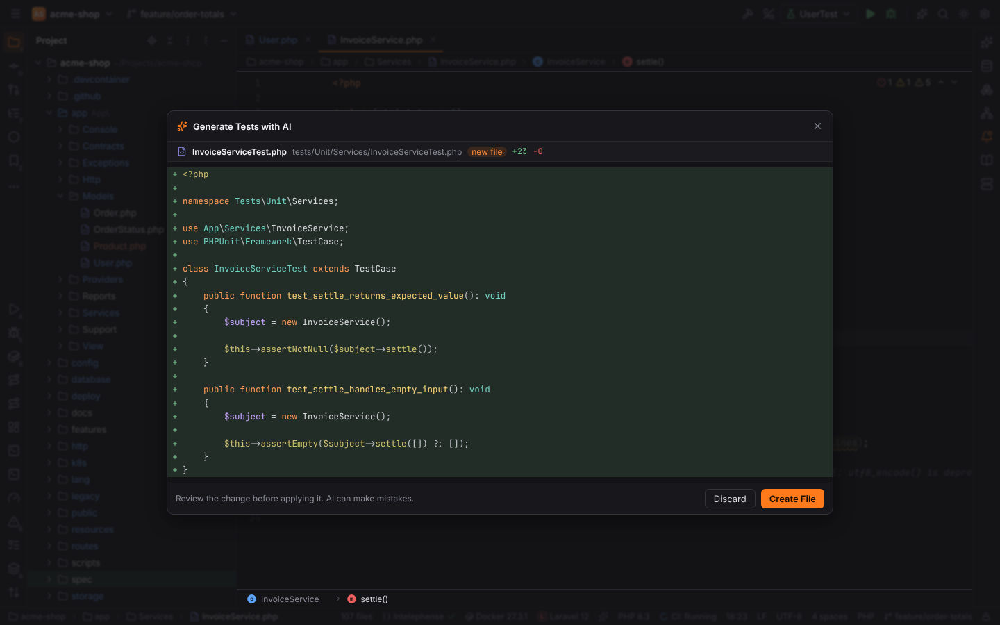

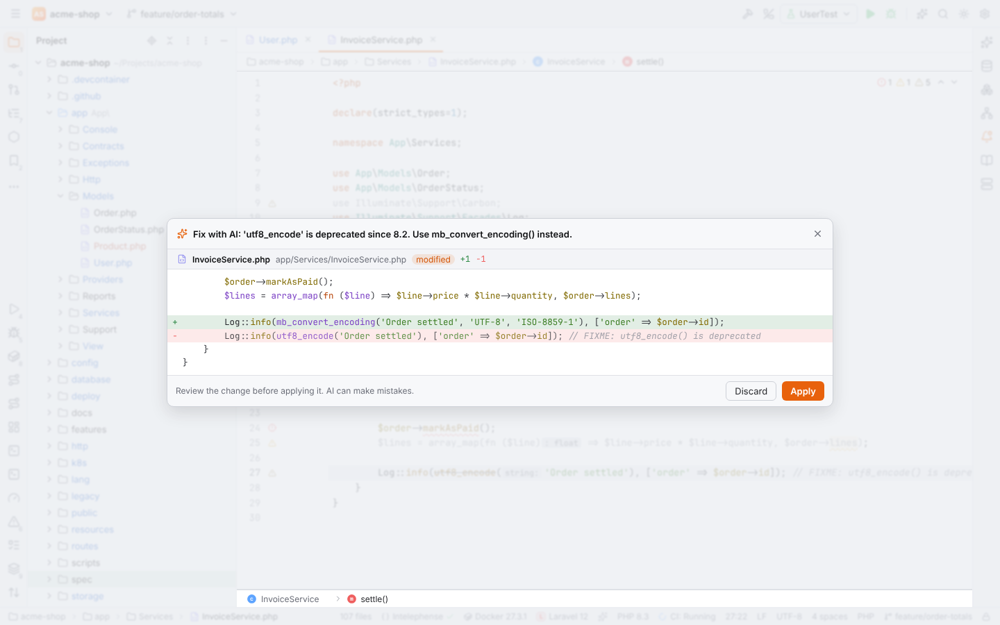

## AI commit messages

In the Commit tool window, **Generate Commit Message with AI** writes a message for the ticked
changes. See [Git](git.md#ai-commit-messages).

## AI Chat

The **AI Chat** tool window (right stripe, or the ✨ button in the main toolbar) runs an
agentic coding CLI in your project and renders its output as a chat: text, thinking, tool calls
as cards, file edits as diffs, permission questions as buttons. No terminal is involved.

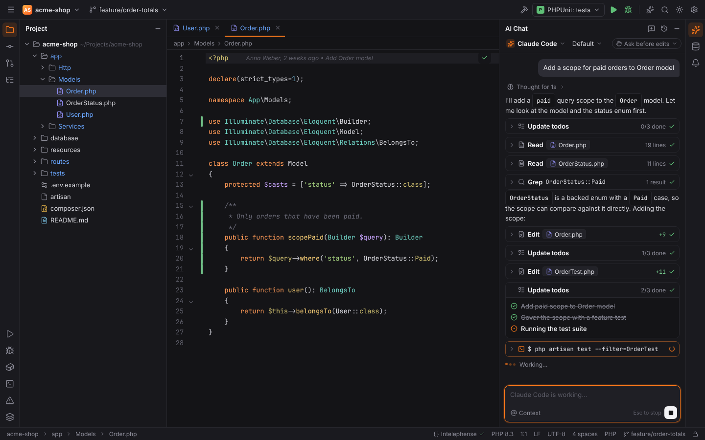

### Agents

| Agent | Needs | Install |
| --- | --- | --- |
| **Claude Code** | the `claude` CLI, logged in (subscription or API key) | `npm install -g @anthropic-ai/claude-code` |
| **Gemini CLI** | the `gemini` CLI, logged in | `npm install -g @google/gemini-cli` |

Pick the agent in the chat header. If the CLI is not found, the chat says "Not installed" with
the install command; set its path in Settings | Tools | **AI Agents** (`agents.<id>.path`;
empty = find it on `PATH`).

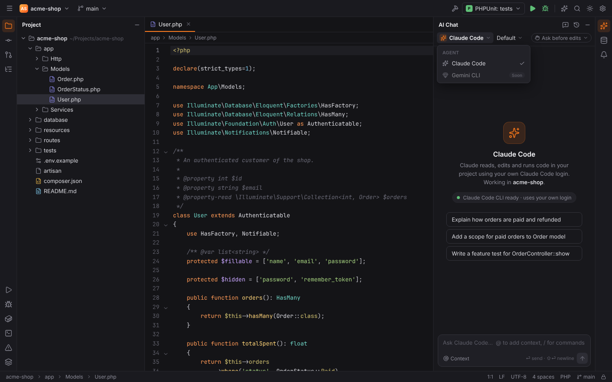

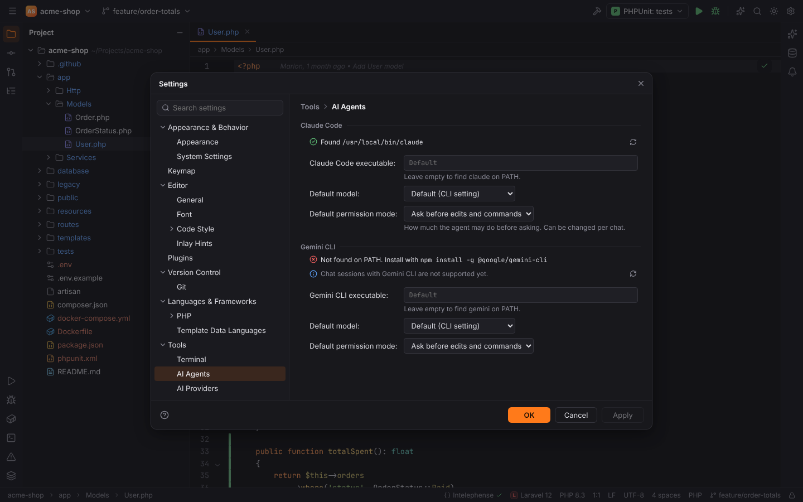

### Writing messages

- `Enter` sends, `Shift+Enter` inserts a line break, `Esc` stops the running turn.
- **Attach context** (`@`) attaches the current file, the current selection
  (`file:12-20`), or another open file.
- Slash commands: `/clear` starts a new chat; for Claude Code also `/compact`, `/review`,
  `/init` and `/cost`. `Tab` completes them.
- Suggested prompts appear in an empty chat.

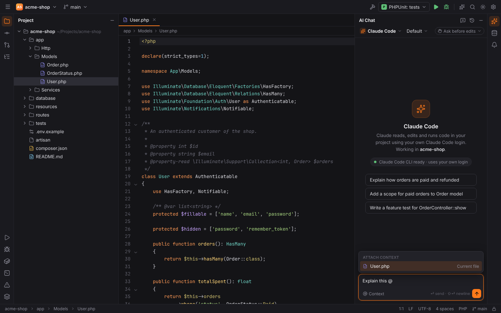

### Models and modes

The header has a **Model** and a **Permission mode** selector; defaults come from Settings |
Tools | AI Agents (`agents.<id>.model`, `agents.<id>.permissionMode`).

| Claude Code mode | Behaviour |
| --- | --- |
| Ask before edits (default) | confirm every edit and command |
| Auto-accept edits | apply file edits without asking; commands still ask |
| Plan mode | explore and plan, no changes |
| Bypass permissions | never ask — trusted projects only |

Gemini CLI cannot ask inside the IDE, so its mode decides which tools it gets:

| Gemini CLI mode | Behaviour |
| --- | --- |
| Read-only (default) | read and search, no edits or commands |
| Auto-accept edits | edit files without asking, no commands |
| YOLO | edits and commands, never asks |

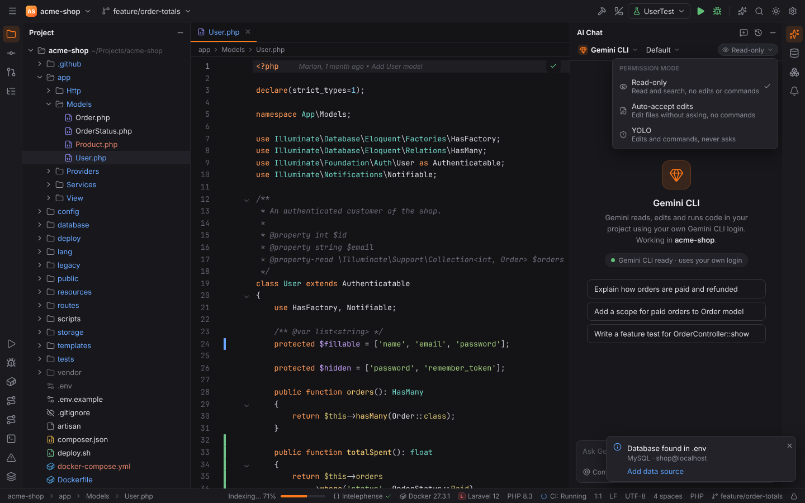

### Permission requests

With Claude Code in "Ask before edits", each edit or command shows a card: **Allow once**,
**Allow for this session** ("Don't ask again for this exact command until the chat ends") or
**Deny**. Edit cards show the diff; **Open diff** opens it in a dialog.

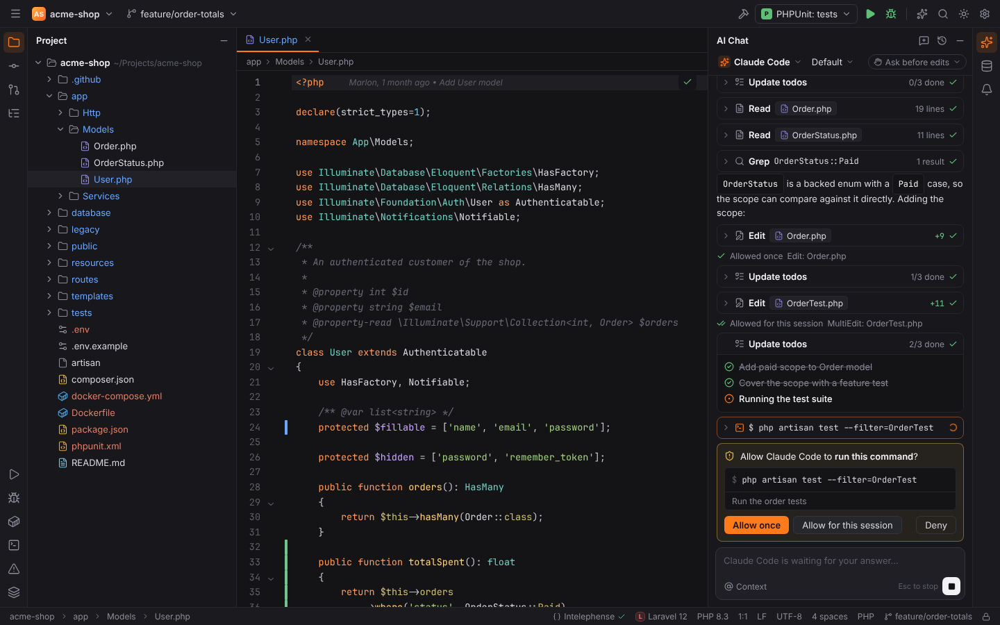

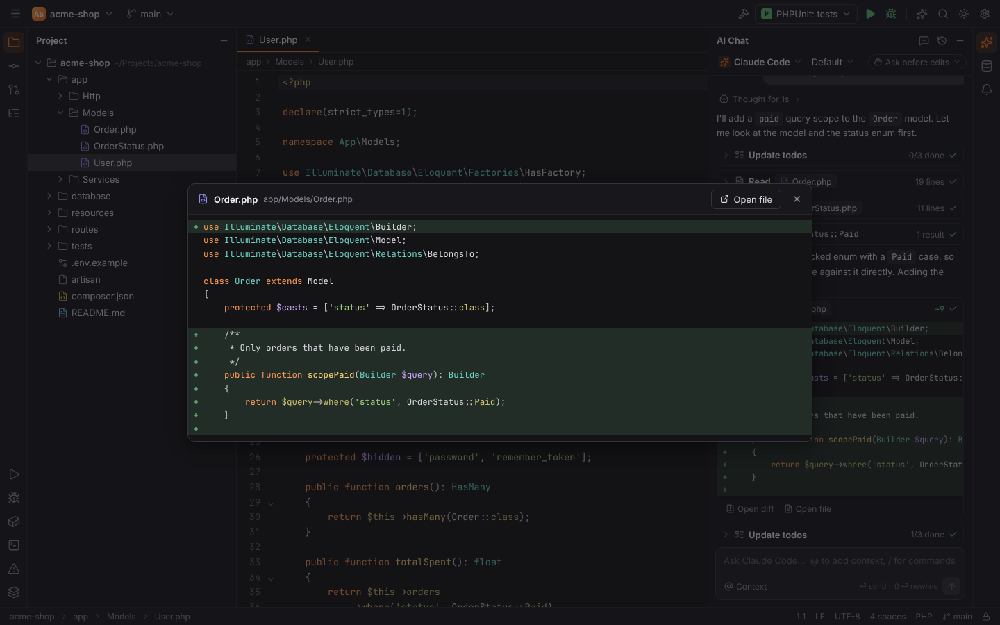

Files changed by the agent are reloaded in open editor tabs automatically.

### History

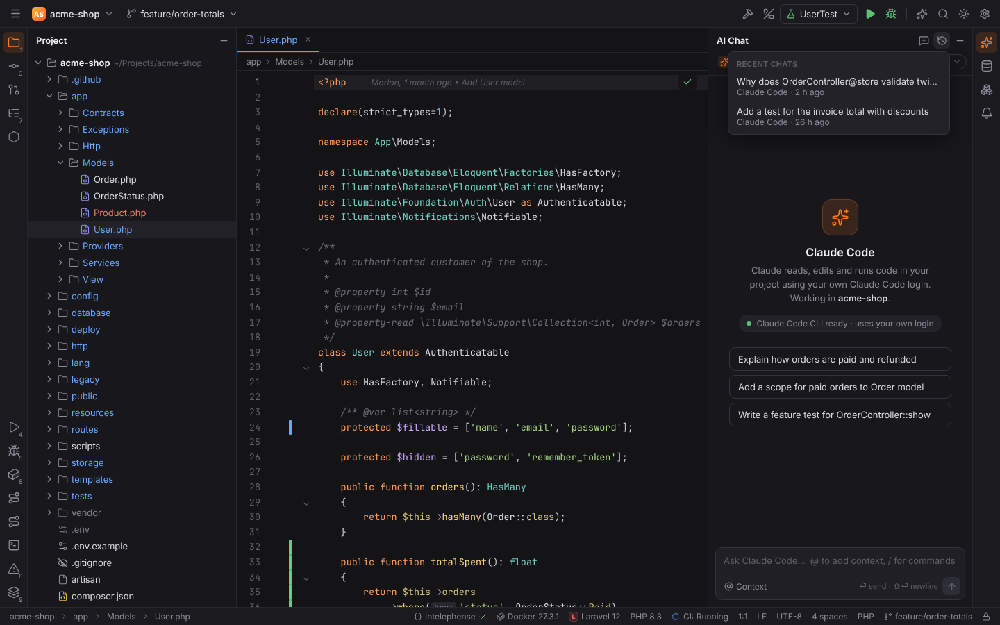

**Chat history** lists the chats of the open project, newest first; selecting one shows it
again and resumes the CLI's conversation with the next message. **New chat** starts over.
Chats are saved after every turn in Forge's data directory (`<data dir>/forge/chat-history`,
the newest 100 per project), never in the project. The end of a turn shows duration, tokens and cost when
the CLI reports them.

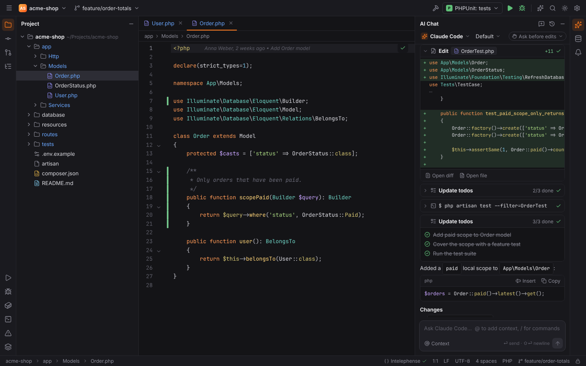

In [remote projects](remote-development.md) the agent CLI runs **on the host**: install and log
in to `claude` or `gemini` there. Forge finds the executable on the host and the agent works
next to the files.

## Privacy

Forge sends data only to the providers you configure and the CLIs you run: commit diffs to the
commit message provider, code around the caret to the completion provider (only with inline
completion enabled), the code an editor action is about to the actions provider, and your chat
messages and attached context to the agent CLI (which talks to its own service). Nothing is
sent anywhere by default. Disabled providers, projects with AI turned off and files in
`.aiignore` are never sent. A local provider (Ollama, LM Studio, llama.cpp) keeps everything
on your machine. None of the AI features runs project code, so they work the same in
[Safe Mode](project-trust.md).
