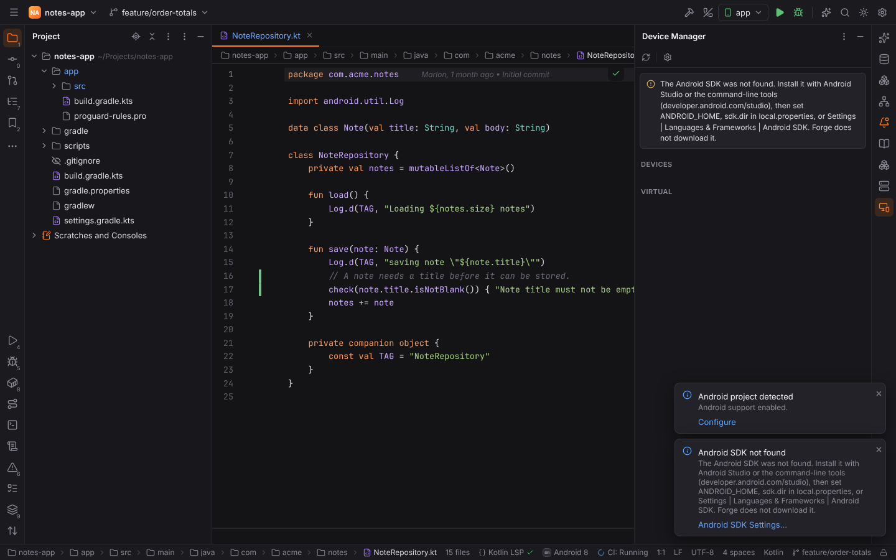
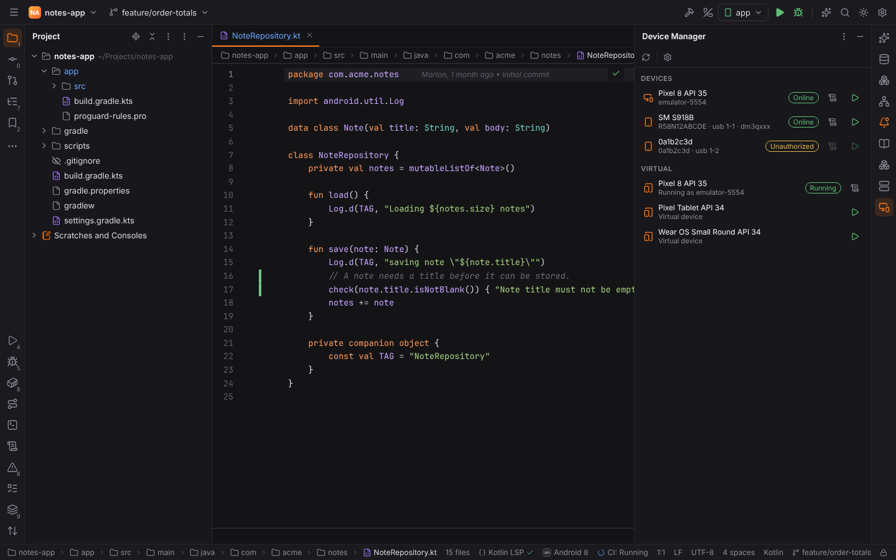
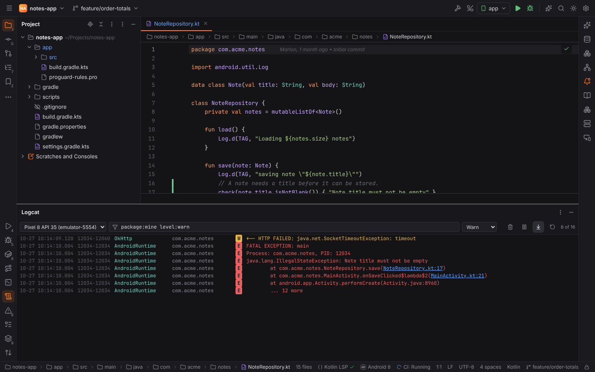

# Android

Android support is one of JavaForge's JVM extras, in the style of Android Studio. It is the
**Android** plugin (`forge.android`, JavaForge pack) and builds on [JavaForge](java.md)
(Gradle, JDKs) and [KotlinForge](kotlin.md) for Kotlin sources.

## Android projects

A project is an Android project when one of its Gradle modules applies the Android Gradle
Plugin (`com.android.application` or `com.android.library`, also as version catalog aliases
such as `alias(libs.plugins.android.application)` and as `apply plugin:`), or has a
`src/main/AndroidManifest.xml` (see [project detection](../getting-started/project-detection.md)).
The status bar shows **Android** with the AGP version of `gradle/libs.versions.toml`
(`agp = "8.7.3"`). Gradle itself (the Gradle tool window, tasks, sync) is JavaForge's.

Forge reads each module's `namespace`, `applicationId`, `minSdk`, `targetSdk` and
`compileSdk` from its build file (Kotlin or Groovy DSL); Settings | Languages & Frameworks |
**Android SDK** lists them.

## The Android SDK

Forge uses your own Android SDK and **never downloads it**. It looks in this order:

1. **Android SDK location** in Settings | Languages & Frameworks | Android SDK;
2. `ANDROID_HOME`, then `ANDROID_SDK_ROOT`;
3. `sdk.dir` of the project's `local.properties` (Android Studio writes it);
4. the default folder: `~/Android/Sdk` (Linux), `~/Library/Android/sdk` (macOS),
   `%LOCALAPPDATA%\Android\Sdk` (Windows).

adb is the SDK's `platform-tools/adb` (else `adb` on the `PATH`), the emulator its
`emulator/emulator`. Without an SDK a balloon and the Device Manager show where to get one:
install Android Studio or the command-line tools from developer.android.com/studio, then point
Forge at it.

## Device Manager

The **Device Manager** tool window (right stripe) lists the devices adb sees
(`adb devices -l`): emulators with their AVD name (`Pixel 8 API 35`), phones with their model,
the serial and USB port, and the state (**Online**, **Offline**, **Unauthorized** until you
allow USB debugging on the device, **No permissions** without udev rules). Each online device
has **Logcat** and **Run 'app' on this device**.

**Virtual** lists the emulator's AVDs (`emulator -list-avds`); ▶ starts one (it keeps running
after Forge exits, like in Android Studio), and running ones show their serial. Create AVDs
with Android Studio's Device Manager or `avdmanager`. **Refresh** reads the devices again
(**Refresh Android Devices** in Find Action).

adb and the emulator are your SDK's tools and the devices are attached to this machine, so the
Device Manager and Logcat work for local projects.

## Android App run configurations

The **Android App** configuration type builds, installs and starts the app like Android
Studio's:

1. Gradle `:<module>:assemble<Variant>` (`:app:assembleDebug`) with the project's Gradle (the
   wrapper, offline mode and Gradle JDK of the [Gradle settings](java.md#gradle-settings-and-the-wrapper)),
   `ANDROID_HOME` set to the SDK;
2. `adb -s <serial> install -r -t <apk>`, by default
   `app/build/outputs/apk/debug/app-debug.apk` (`…/apk/free/debug/app-free-debug.apk` for a
   flavor variant), or the configuration's **APK**;
3. `adb -s <serial> shell am start -n <applicationId>/<activity>` with the launcher activity
   (the `MAIN` / `LAUNCHER` intent filter) of the merged manifest of the last build
   (`build/intermediates/merged_manifests/<variant>/…`), else of `src/main/AndroidManifest.xml`
   (relative names such as `.MainActivity` are qualified with the `namespace`). Without one the
   app's default launcher starts (`monkey -c android.intent.category.LAUNCHER`).

The steps run as one process in the Run tool window (each step is echoed, a failed step stops
the rest). **Deploy to** picks the device; empty means the first running device. **Build
variant**, **Launch activity** and Gradle arguments are optional. The build runs project code
and installing touches the device, so [Safe Mode](project-trust.md) refuses the run.

## Logcat

The **Logcat** tool window (bottom stripe) streams `adb logcat -v threadtime` of the selected
device, starting with the last 500 entries (**Recent entries on connect**). Each line shows the
time, process and thread ids, tag, package and level, and is colored by level (Verbose, Debug,
Info, Warn, Error, Assert). The package of each process comes from `adb shell ps` and from
ActivityManager's `Start proc` messages, so processes started later (the app's `:sync`
service) are attributed too.

Stack trace frames (`at com.acme.notes.NoteRepository.save(NoteRepository.kt:17)`) link to the
project's sources: click `NoteRepository.kt:17` to open the file at that line. Exception lines
and frames are marked as stack traces.

### Filters

The filter field takes Android Studio's query language, evaluated in Rust:

| Query | Shows |
| --- | --- |
| `package:mine` | the project's apps (their application ids, also `:` processes) |
| `package:com.acme.notes` | a package |
| `level:warn` (or `level:W`) | that level and above; the level menu sets it |
| `tag:OkHttp` | a tag (`tag:Net*` for a prefix) |
| `tag~:^Note.*` | tags matching a regular expression (also `message~:`, `package~:`) |
| `-tag:Choreographer` | everything except a tag (any key can be negated) |
| `message:timeout` | messages containing the text |
| `process:12034` | a process id |
| `is:crash`, `is:stacktrace` | crashes (errors with a stack trace, `AndroidRuntime`), stack trace lines |
| `timeout okhttp`, `"saving note"` | words (or quoted text) in the tag or message |

Terms with the same key are alternatives (`tag:OkHttp tag:Notes`), different keys must all
match. **Default filter** (`package:mine`) is where a new Logcat starts. The toolbar picks the
device, clears the log (here and on the device, `adb logcat -c`), pauses and resumes the view,
follows new entries and restarts the stream; the counter shows matching and buffered entries.
The buffer keeps the last **Logcat cycle buffer size** entries (20000) in Forge's memory.

## Settings

| Setting | Key | Default |
| --- | --- | --- |
| Android SDK location | `android.sdk.path` | empty (ANDROID_HOME, ANDROID_SDK_ROOT, local.properties, default folder) |
| Logcat cycle buffer size | `android.logcat.bufferSize` | 20000 |
| Default filter | `android.logcat.defaultQuery` | `package:mine` |
| Recent entries on connect | `android.logcat.history` | 500 |

## Browser mode

`?project=android` opens the demo app `notes-app` (Kotlin, version catalog, a Groovy release
script) with recorded adb output: an emulator, a phone and an unauthorized device, three AVDs
and a Logcat stream with a crash. `?project=android&android-sdk=missing` starts without an SDK.

## Not yet

No layout editor, resource tools, APK analyzer, profilers or Android debugger yet; Android
Studio stays the tool for those. Kotlin and Java code intelligence comes from
[KotlinForge](kotlin.md) and [JavaForge](java.md), which do not know the Android SDK's classes
unless the build provides them.
