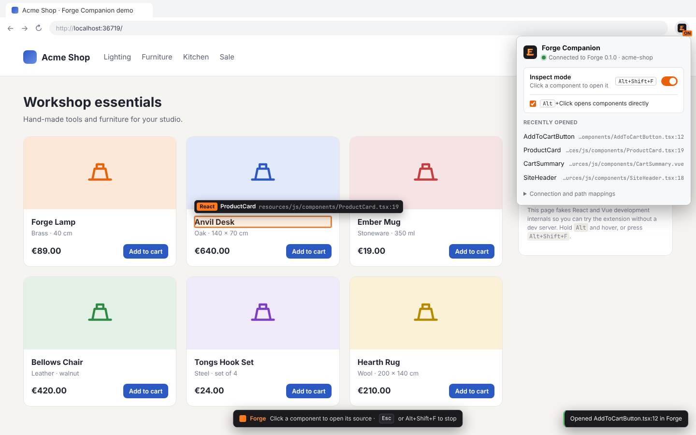
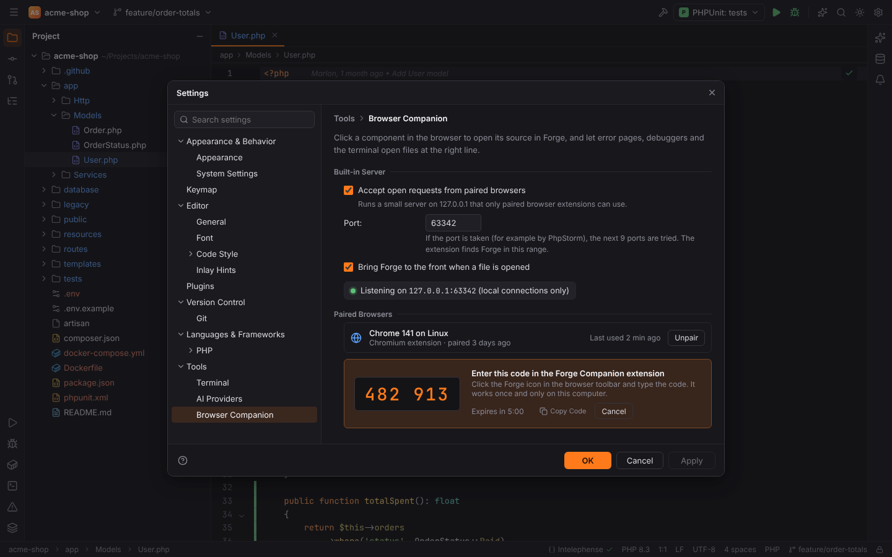
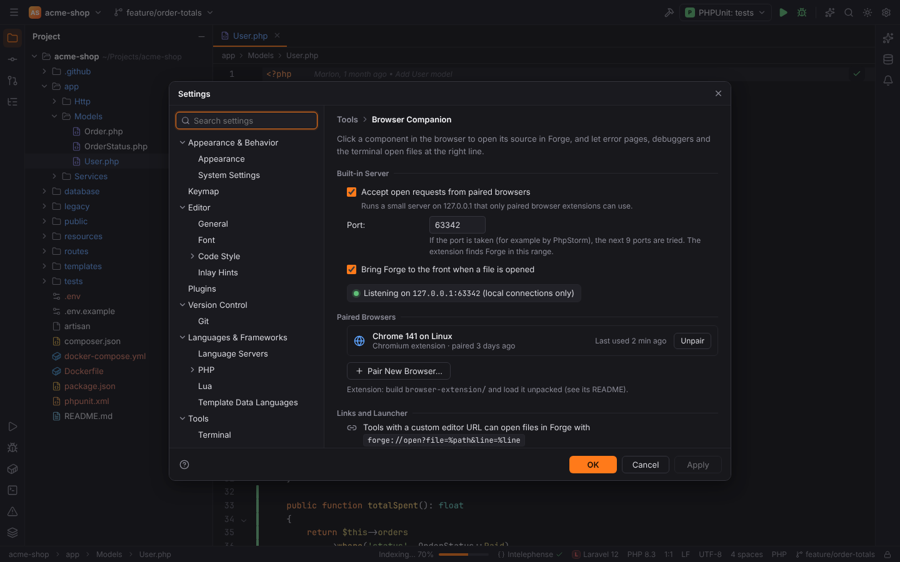
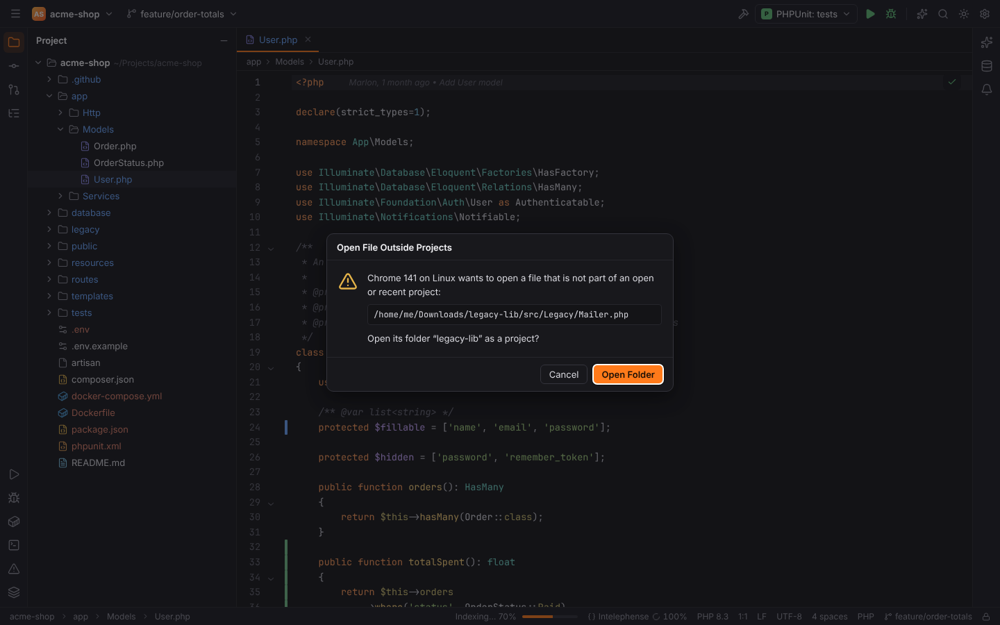
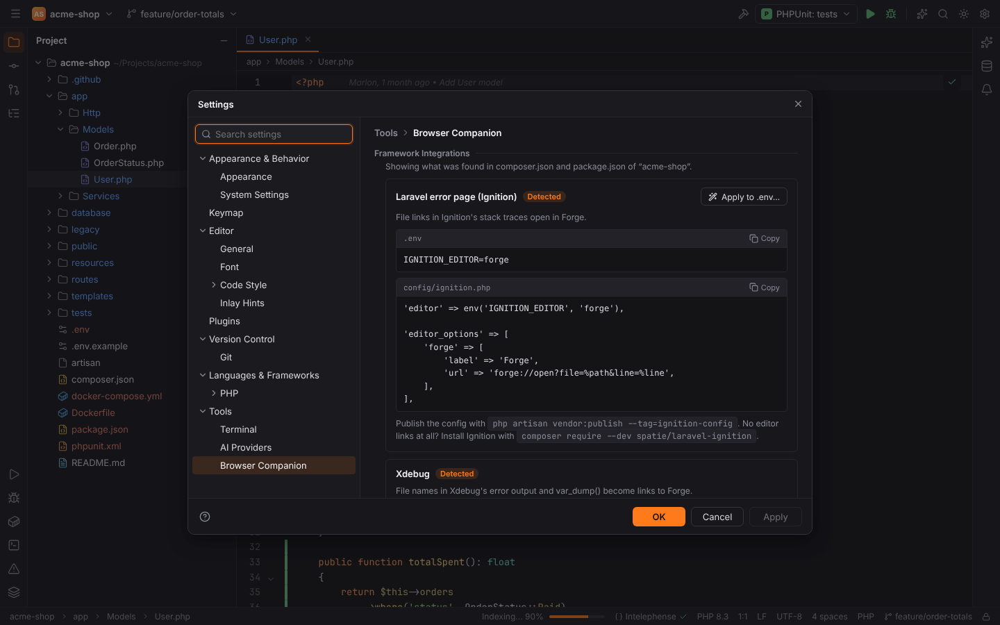

# Browser Companion

The Browser Companion (`forge.browser-companion`) connects Forge with the outside world:

- the **Forge Companion** browser extension: click a React, Vue, Angular or Svelte component in
  your running app and its source opens in Forge at the right line;
- **`forge://` links** from error pages (Laravel Ignition, Symfony, Whoops, Xdebug);
- the **`forge` launcher** used by Vite, Vue DevTools and other "open in editor" features.

## The browser extension



- **Inspect mode**: press `Alt+Shift+F` in the page (or use the toolbar popup), hover to see the
  component and its file, click to open it. `Esc` stops.
- **Alt+Click** opens the component under the cursor directly.
- **Context menu**: "Open Component in Forge", and "Open “…” in Forge" on selected text with a
  `file:line` reference (stack traces, compiler output).
- **Popup**: connection status, pairing, inspect toggle, recently opened files, the Forge port
  and **path mappings** for apps running in Docker or on another machine
  (`/var/www/html => /home/me/shop`).

Supported: Chrome, Chromium, Edge, Brave 111+ and Firefox 128+ (Manifest V3).

| Framework | Source of the location | Precision |
| --- | --- | --- |
| React ≤ 18 (dev) | `_debugSource` from the development JSX transform | element, line and column |
| React 19 (dev) | component name; Forge finds the declaration | component |
| Vue 3 / Vue 2 (dev) | the component's `__file` | component file |
| Angular (`ng serve`) | `ng.getComponent` → class name; Forge finds the class | component class |
| Svelte 4/5 (dev) | `__svelte_meta.loc` | element, line and column |
| Any | `data-source-file`/`data-source-line`, react-dev-inspector, vite-plugin-vue-inspector, code-inspector-plugin attributes | element |

### Installing the extension

The extension is not in the browser stores yet. Build and load it unpacked:

```sh
cd browser-extension
pnpm install
pnpm build            # dist/chrome and dist/firefox
```

- **Chrome, Edge, Brave**: `chrome://extensions` → **Developer mode** → **Load unpacked** →
  `browser-extension/dist/chrome`.
- **Firefox**: `about:debugging#/runtime/this-firefox` → **Load Temporary Add-on…** →
  `browser-extension/dist/firefox/manifest.json`, then allow access to `127.0.0.1` in the
  extension's permissions.

### Pairing

1. In Forge open Settings | Tools | **Browser Companion** and click **Pair New Browser…**.
2. Click the Forge icon in the browser toolbar and type the 6-digit code.



The code works once and expires after five minutes. The browser then keeps a random token;
Forge stores only its SHA-256 hash (in `browser-companion.json` in Forge's config folder) and
lists the browser under **Paired Browsers** with its last use. **Unpair Browser** revokes it
immediately.



### What happens when a file is requested

The request is matched against the open project and your recent projects:

- a file of the **open project** opens right away (and Forge comes to the front, setting
  `browserCompanion.focusWindow`);
- a file of a **recent project** or **outside any project** asks first ("Open the project in
  this window?", **Open Project**, **Open Folder**, **Open File Outside Projects**), because
  links can come from any web page.



### Security

The built-in server listens on `127.0.0.1` only, port **63342** (`browserCompanion.port`; if it
is taken, for example by PhpStorm, the next nine ports are tried). It accepts requests only with
a loopback `Host`, no web-page `Origin` (extension origins only) and, except for ping and
pairing, a valid token. Turn it off with **Accept open requests from paired browsers**
(`browserCompanion.enabled`).

## Framework integrations

The settings page lists ready-made snippets, the ones for frameworks detected in the open
project first (**Show detected only**). Some have an **Apply** button that writes one variable
into `.env` / `.env.local` ("An existing value of the variable is replaced; nothing else in the
file changes").



| Integration | Setup |
| --- | --- |
| Laravel error page (Ignition) | `.env`: `IGNITION_EDITOR=forge`, plus a `forge` entry in `config/ignition.php` `editor_options` with URL `forge://open?file=%path&line=%line` |
| Symfony error page and profiler | `.env.local`: `SYMFONY_IDE="forge://open?file=%f&line=%l"` (or `framework.ide` in `framework.yaml`) |
| Xdebug | `php.ini`: `xdebug.file_link_format = "forge://open?file=%f&line=%l"` |
| Whoops | `$handler->addEditor('forge', 'forge://open?file=%file&line=%line'); $handler->setEditor('forge');` |
| Vite, Vue DevTools, dev overlays (launch-editor) | `export LAUNCH_EDITOR=forge` (Next.js: `REACT_EDITOR=forge`); the `forge` command must be on your `PATH` |
| React 19, Preact, Solid | a dev-only Babel plugin that adds `data-source-file`/`data-source-line` (shown on the page) |
| Angular | nothing to configure with `ng serve` |

## forge:// links and the launcher

```text
forge://open?file=/home/me/shop/app/Models/User.php&line=42&column=5
forge://open-symbol?name=UserCardComponent&kind=component
```

```sh
forge app/Models/User.php:42
forge --line 42 --column 5 app/Models/User.php
forge app/Models/User.php 42 5
```

The scheme is registered by the installers (and at runtime for AppImages and development
builds). A second launch is forwarded to the running Forge window. Files given on the command
line are trusted and open without asking. Full syntax:
[CLI arguments and forge:// links](../reference/cli-and-links.md).

> **Note:** the Browser Companion works with local projects; requests for files of a
> [remote project](remote-development.md) are not supported yet.
