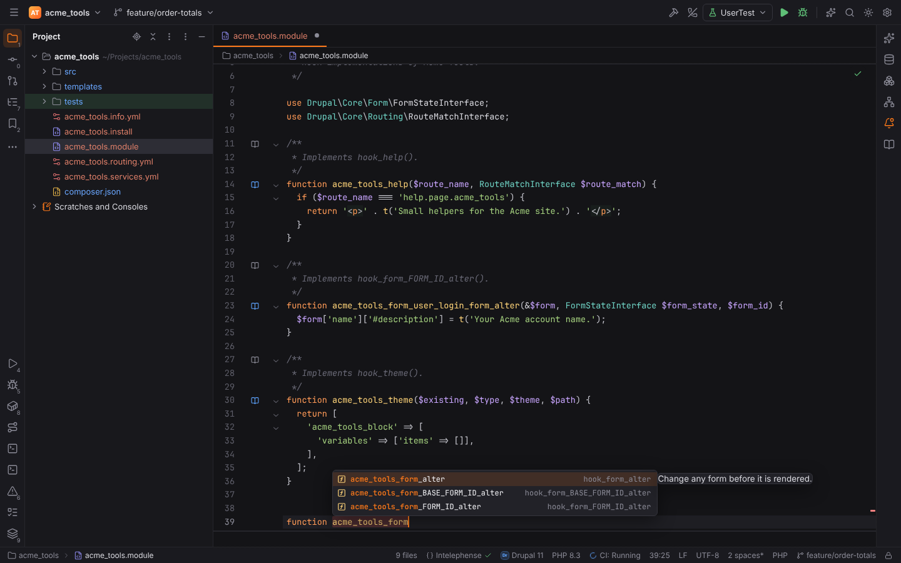

# Drupal, Joomla and Shopware

One plugin, **Drupal, Joomla and Shopware** (`forge.cms`, PHPForge pack), covers the basics
of the three CMS. It is a single plugin because each part is small and shares detection and
the run actions; it activates only when the project uses one of them. WordPress has its own,
larger plugin: see [WordPress](wordpress.md).

## Detection

| CMS | Recognised by |
| --- | --- |
| Drupal | `drupal/core`, `drupal/core-recommended` (composer.json or composer.lock), `core/lib/Drupal.php` (also below `web/`), or a module / theme / profile with a `<name>.info.yml` that has `core_version_requirement` |
| Joomla | `administrator/manifests/files/joomla.xml` (with the version), or an extension's XML manifest `<extension type="component|module|plugin|template|package">` in the project root |
| Shopware 6 | `shopware/core`, `shopware/platform` or `shopware/storefront` in composer.json (the version from composer.lock), or a plugin with `"type": "shopware-platform-plugin"` |
| Shopware 5 | `engine/Shopware/Kernel.php` |

The status bar shows the CMS with its icon and version (for example **Drupal 11**); clicking it
opens Settings | Plugins. Settings live in **Settings | Languages & Frameworks | PHP | Drupal,
Joomla and Shopware**.

## File types and templates

| Files | Opened as |
| --- | --- |
| Drupal `*.module`, `*.install`, `*.theme`, `*.profile`, `*.engine`, `*.inc` | PHP (while the plugin is active) |
| Drupal `*.info.yml`, `*.routing.yml`, `*.services.yml`, `*.libraries.yml` | YAML |
| Drupal and Shopware 6 `*.html.twig` | Twig over HTML; Shopware's `sw_extends`, `sw_include`, `sw_icon`, `sw_thumbnails` and `sw_silent_feature_call` are highlighted as tags |
| Shopware 5 `*.tpl` | Smarty |
| Joomla extension manifests (`*.xml`) | XML |

See [File types](file-types.md) and the template data languages there.

## Drupal hooks

In a module's `.module`, `.install`, `.theme`, `.profile` or `.inc` file, typing a function
name after `function` completes **hook implementations** named `<module>_<hook>`: the module
is the nearest folder with an `.info.yml` (else the file name). Choosing one inserts the
hook's parameters and an empty body, for example

```php
function acme_tools_form_alter(&$form, \Drupal\Core\Form\FormStateInterface $form_state, $form_id) {

}
```

The list holds about 45 frequently used core hooks (`hook_form_alter`,
`hook_form_FORM_ID_alter`, `hook_theme`, `hook_preprocess_HOOK`, `hook_entity_presave`,
`hook_ENTITY_TYPE_insert`, `hook_cron`, `hook_install`, `hook_update_N`, …), each with a short
summary written for Forge.



Existing implementations, including the ones with placeholders (`acme_tools_form_user_login_form_alter`
implements `hook_form_FORM_ID_alter`, `acme_tools_node_presave` `hook_ENTITY_TYPE_presave`), get
a **book** icon in the gutter ("Implements hook_form_alter(): …"). Clicking it, or `Ctrl+B` on
the function name, opens the hook's documentation: the `hook_…` function in the project's own
`*.api.php` files (Drupal core ships them), else the hook's page on api.drupal.org.

| Setting | Default | Meaning |
| --- | --- | --- |
| `cms.drupal.hookCompletion` | on | Complete hook implementations after `function` |
| `cms.drupal.gutterIcons` | on | Gutter icons on hook implementations |

## Drush and the Shopware console

| Action | Opens |
| --- | --- |
| **Tools \| Drush…** | the [Command Line Tools Console](command-line-tools.md) with `drush ` typed in (Drush from `vendor/bin/drush`, else `drush` on `PATH`) |
| **Tools \| Shopware Console…** | the same console with the alias of `bin/console` typed in (Symfony Console format) |

Commands, options and arguments complete from the tool's own command list, cached in Forge's
cache folder. Both run project code and are refused while the project is in
[Safe Mode](project-trust.md).

See also: [WordPress](wordpress.md), [Symfony](symfony.md), [PHP](php.md).
