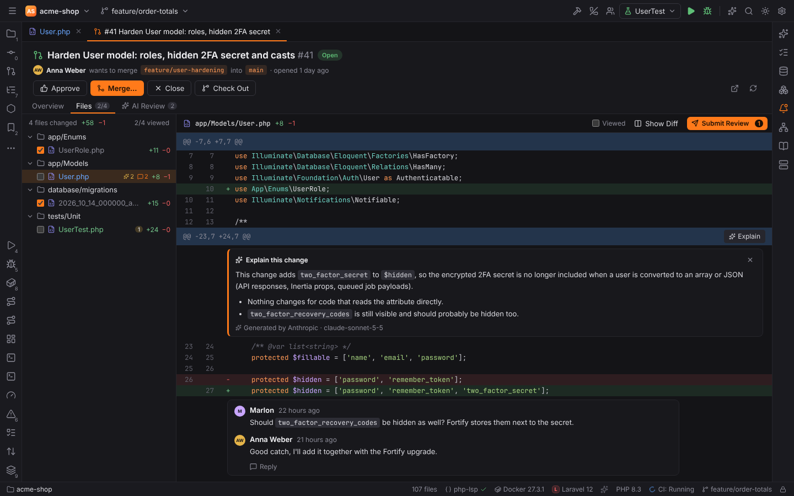
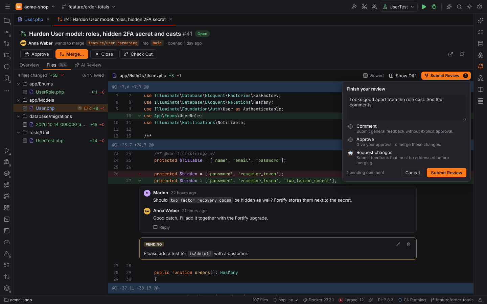
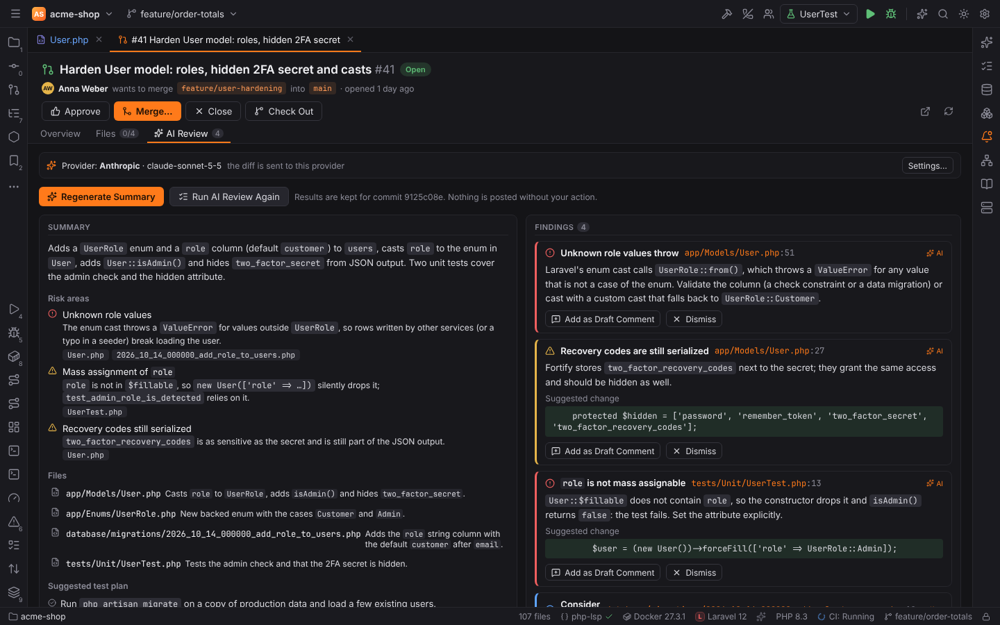
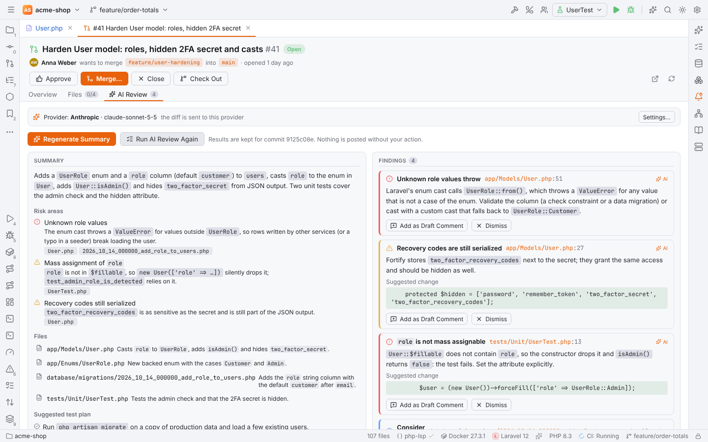
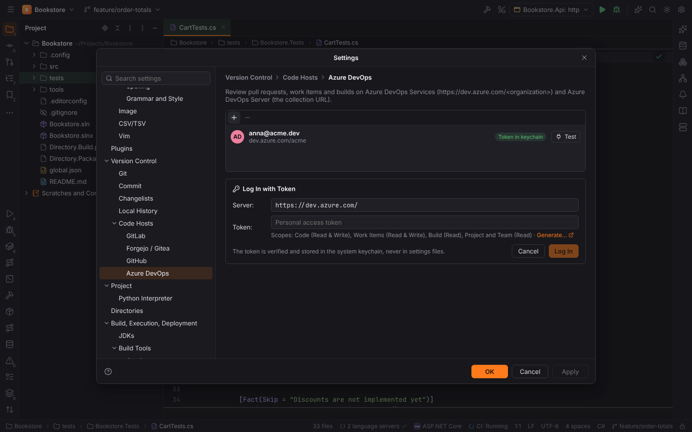

# Code hosts

The plugin **GitLab, Forgejo, GitHub and Azure DevOps** (`forge.code-hosts`) brings code review into Forge:

| Host | API | Number format | Self-hosted |
| --- | --- | --- | --- |
| GitLab | REST v4 | `!12` | yes (self-managed, also with a relative URL root or SSH port) |
| Forgejo / Gitea | `/api/v1` | `#12` | yes (e.g. Codeberg) |
| GitHub | REST + GraphQL for review threads | `#12` | GitHub Enterprise Server |
| Azure DevOps | REST 7.1 | `!12` | Azure DevOps Server (the collection URL) |

The repository is detected from `git remote -v` (https, ssh and scp-style URLs, nested GitLab
groups); in a [remote project](remote-development.md) git runs on the host, while the API calls
go from your machine with your tokens. Wording follows the host: "merge request" on GitLab, "pull request" elsewhere.

## Logging in

Open Settings | Version Control | **GitLab**, **Forgejo / Gitea**, **GitHub** or **Azure DevOps** and click
**Log In with Token…**. Enter the **Server** (for self-hosted instances) and an access token:

| Host | Token permissions |
| --- | --- |
| GitLab | scopes `api`, `read_user` |
| Forgejo / Gitea | read/write for repository and issue, read for user |
| GitHub | scopes `repo`, `read:org`, `workflow` (or a fine-grained token with pull request, issue and actions access) |
| Azure DevOps | a personal access token with Code (Read & Write), Work Items (Read & Write), Build (Read), Project and Team (Read) |

The token is verified first and then stored in the operating system keychain (service
`forge-forges`), never in a settings file. Accounts themselves (server, user) are kept in
`forges.toml` in Forge's config folder. Without an account, the environment variables
`GITLAB_TOKEN`, `FORGEJO_TOKEN` / `GITEA_TOKEN`, `GITHUB_TOKEN` / `GH_TOKEN` and
`AZURE_DEVOPS_EXT_PAT` are used for the public servers ("Token from environment").

Errors are explained in plain words: a rejected token, missing permissions, rate limits (with
the reset time) or an unreachable server.

## Pull Requests tool window

The **Pull Requests** tool window (left stripe, **View Pull/Merge Requests** in Find Action)
has three tabs.

### Pull/Merge Requests

- Search, plus filters for **State** (Open, Merged, Closed, All), **Author**, **Label**,
  **Assignee** and **Reviewer**, and **Quick Filters** such as "Assigned to you" and
  "Review requests".
- Each row shows the title, number, author, age, CI status, comment count and avatar.
- Click a request to open it as an editor tab.
- **+** (or **Create Merge Request…** in Find Action) creates one.

### A pull/merge request tab

- **Overview**: description (Markdown), comments and review threads with **Reply**,
  resolve/unresolve (where the host supports it; Forgejo cannot resolve threads through its
  API), reviewers and approvals, assignees, labels, the pipeline with its jobs, and the merge
  status ("No conflicts with main").
- **Files**: review mode (see below): the changed files with their viewed state and diffs,
  inline threads, pending review comments and **Submit Review**. **Show Diff (side by side)**
  opens the diff viewer.
- **AI Review**: **Summarize PR** and **AI Review** (see [AI summary and AI review](#ai-summary-and-ai-review)).
- Actions: **Approve**, **Merge…** (merge commit, **Squash and merge**, **Rebase and
  merge**, "Mark as ready before merging" for drafts, the commit message), **Close**,
  **Check Out** (fetches the source branch and checks it out locally), **Open in Browser** and
  **Refresh**.

### Review mode

The **Files** tab works like PHPStorm's review mode:

- **Viewed files**: tick the checkbox in front of a file (or **Viewed** above its diff). The
  tab shows how many files you have viewed ("2/4"). The state is kept per request in Forge's
  cache folder, together with a digest of the file's diff: when a new push changes a file, it
  shows as not viewed again.
- **Threads**: existing review threads sit under their line; **Reply** and
  **Resolve**/**Unresolve** (where the host allows it) work in place.
- **New comments**: hover a line and click **+**. Shift+click **+** on a second line of the
  same hunk to comment on a range. **Start Review** / **Add Review Comment** keeps the comment
  as **Pending**; **Add Single Comment** posts it right away. Pending comments can be edited
  and deleted and survive a restart of Forge.
- **Submit Review** (with the number of pending comments) sends all pending comments as one
  review with a summary and a verdict: **Comment**, **Approve** or **Request changes**.
  GitHub and Forgejo/Gitea receive one review; GitLab has no batch API for this in Forge, so the
  comments are posted one by one, then the summary, then the approval (GitLab offers no
  **Request changes**). Azure DevOps turns every comment into a thread (ranges stay ranges),
  the summary into a general thread and the verdict into your vote (**Approve** is "Approved",
  **Request changes** is "Waiting for author"). A pending comment whose line disappeared after a push goes into the
  review summary with its file and line, so nothing you wrote is lost.
- **Check Out** in the header checks out the request's branch (also from forks).

### AI summary and AI review

The **AI Review** tab uses the AI provider of the editor actions (Settings | Tools | AI
Assistant, see [AI](ai.md#ai-code-review)); the bar at the top names the provider and model
and whether the code stays on this machine.

- **Summarize PR** writes an overview, the risk areas (with severity and files), one sentence
  per file and a suggested test plan.
- **AI Review** proposes findings: file, line (or range), severity, explanation and, where it
  helps, a suggested change. Findings also appear in the Files diff under their line. **Add
  as Draft Comment** turns one into a pending review comment (GitHub and GitLab show the
  suggestion as an applicable change); **Dismiss** hides it. Nothing is posted until you
  submit the review.
- **Explain** on a hunk header in the Files diff ("Explain this change") explains that hunk
  inline.

Results are cached per head commit: reopening the request shows them again, a new push needs
a new run (**Regenerate Summary**, **Run AI Review Again**).

What is sent: the request's title and description and its diff, most important files first
(source code, then tests, configuration and documentation). Lock files, minified and generated
files are only named, long files are cut, and big requests are split into up to three parts.
Files excluded by `.aiignore` are never sent or named, and the result lists them ("Not sent").
With AI turned off for the project (`ai.enabled`) or without a provider, the buttons are
disabled and nothing is sent.

### Create a pull/merge request

**Create Merge Request…** asks for the **Head branch** and **Base branch**, **Title**,
**Description** (Markdown), **Reviewers**, **Labels** and whether it is a draft.

### Issues

Search and filter issues, open one as a tab, read and add comments.

### Pipelines

CI runs of the repository (GitLab pipelines, GitHub Actions workflow runs, Forgejo/Gitea
Actions runs, Azure Pipelines builds) with their status and jobs.

## Azure DevOps

- The account's **Server** is the organization, `https://dev.azure.com/<organization>`
  (Azure DevOps Server: the collection URL, such as `https://tfs.example.com/tfs/DefaultCollection`);
  the token is a personal access token of that organization, sent with HTTP Basic
  authentication.
- Remotes are recognized in all their forms: `https://<org>@dev.azure.com/<org>/<project>/_git/<repo>`,
  `git@ssh.dev.azure.com:v3/<org>/<project>/<repo>`, `https://<org>.visualstudio.com/…`
  and `…/_git/<repo>` on a server.
- **Pull requests**: the list (active, completed, abandoned), details with reviewers and
  their votes (approved, waiting for author, rejected), required reviewers, merge status and
  the latest build, the changed files (diffed by Forge from the merge base, since the API has
  no patches), threads with replies and **Resolve** (status *Fixed* / *Active*), **Approve**
  (vote 10), **Complete** (merge commit, squash or rebase, delete the source branch) and
  **Abandon**. **Create Pull Request** sets reviewers, labels, draft and "delete source branch".
- **Issues** are the project's **work items** (found with a WIQL query: open or closed states
  of the Agile, Scrum, CMMI and Basic processes, assignee, author, tag and title search), with
  their type and tags as labels, descriptions and comments; **Comment** adds a work item
  comment.
- **Pipelines** are the builds of the repository (Azure Pipelines), with the status bar's CI
  status of the current branch.

## CI status in the status bar

The status bar shows the CI status of the current branch ("CI: Running", "Passed", "Failed").
Settings | Version Control | **Code Hosts** (the account pages are below it):

| Setting | Default | Meaning |
| --- | --- | --- |
| `vcs.hosts.statusBarPipeline` | `true` | show the CI status of the current branch |
| `vcs.hosts.refreshSeconds` | `120` | refresh requests and pipelines every N seconds; `0` turns automatic refresh off |
