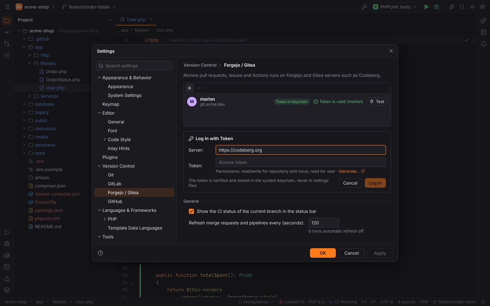
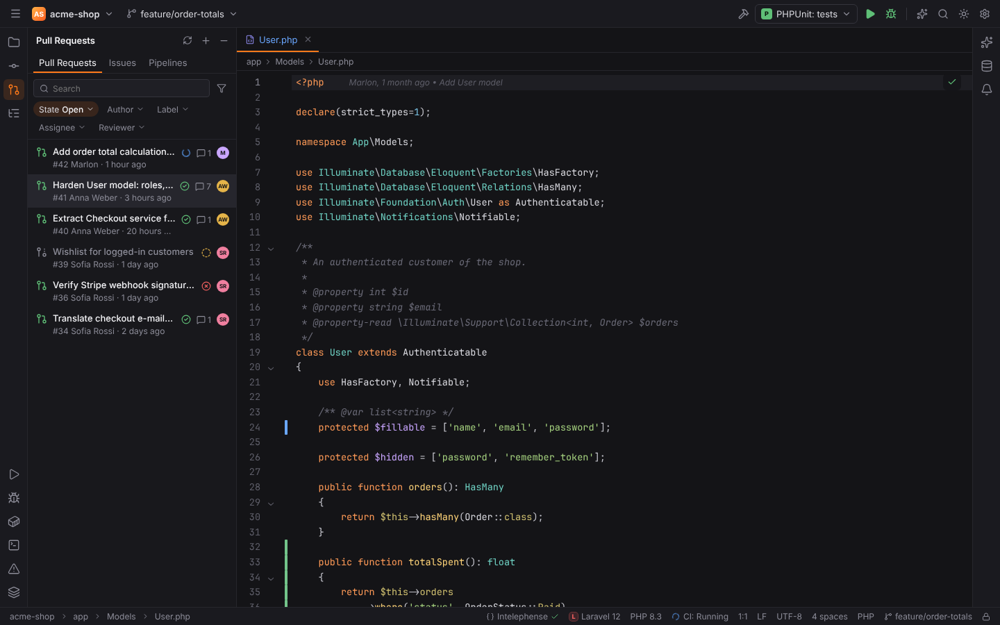
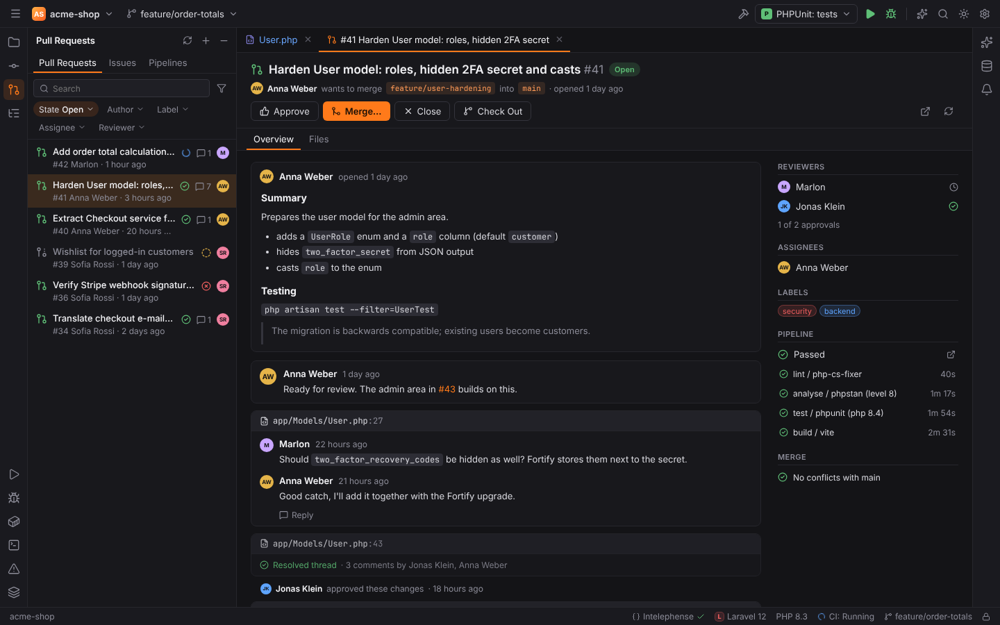
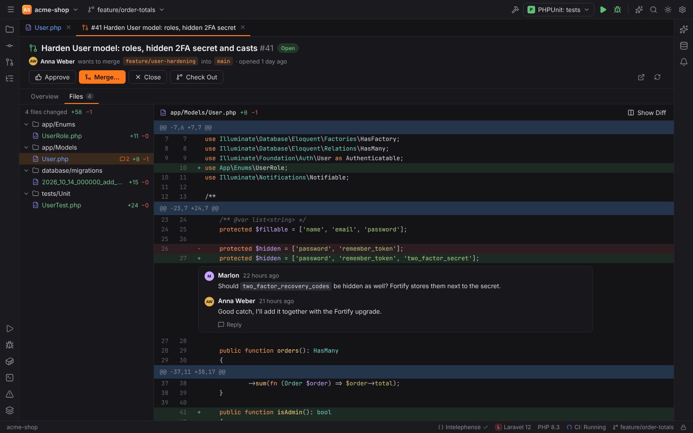
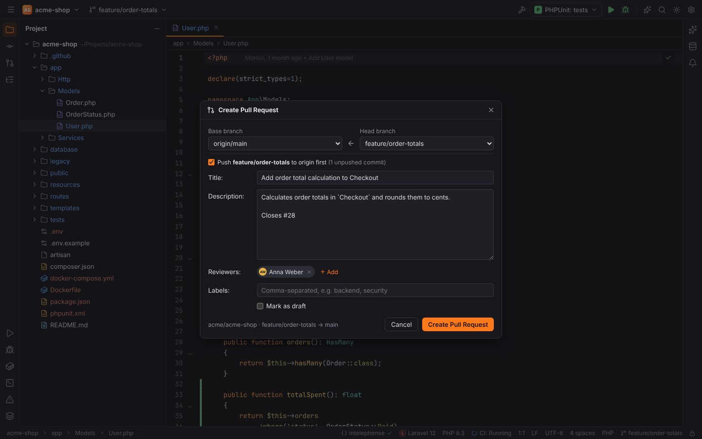
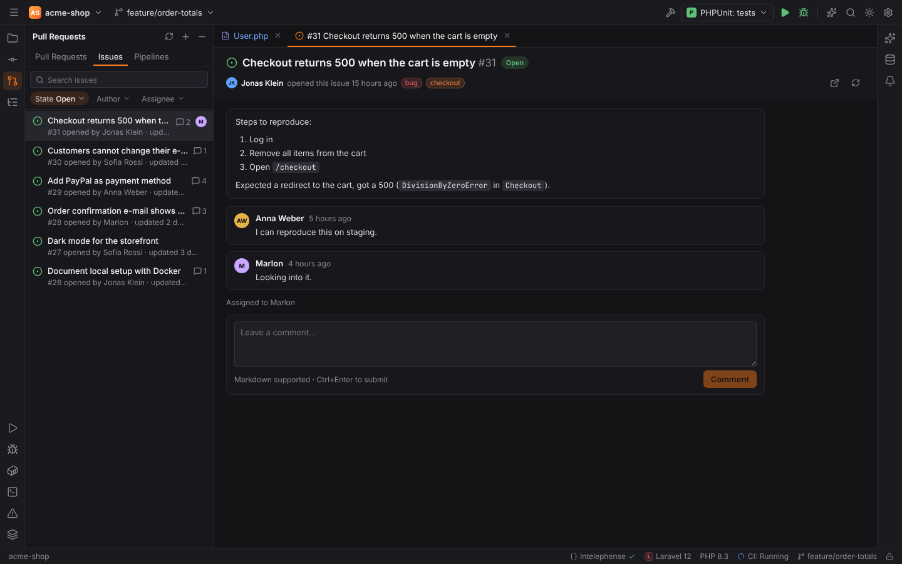

# Code hosts

The plugin **GitLab, Forgejo and GitHub** (`forge.code-hosts`) brings code review into Forge:

| Host | API | Number format | Self-hosted |
| --- | --- | --- | --- |
| GitLab | REST v4 | `!12` | yes (self-managed, also with a relative URL root or SSH port) |
| Forgejo / Gitea | `/api/v1` | `#12` | yes (e.g. Codeberg) |
| GitHub | REST + GraphQL for review threads | `#12` | GitHub Enterprise Server |

The repository is detected from `git remote -v` (https, ssh and scp-style URLs, nested GitLab
groups). Wording follows the host: "merge request" on GitLab, "pull request" elsewhere.

## Logging in

Open Settings | Version Control | **GitLab**, **Forgejo / Gitea** or **GitHub** and click
**Log In with Token…**. Enter the **Server** (for self-hosted instances) and an access token:

| Host | Token permissions |
| --- | --- |
| GitLab | scopes `api`, `read_user` |
| Forgejo / Gitea | read/write for repository and issue, read for user |
| GitHub | scopes `repo`, `read:org`, `workflow` (or a fine-grained token with pull request, issue and actions access) |

The token is verified first and then stored in the operating system keychain (service
`forge-forges`), never in a settings file. Accounts themselves (server, user) are kept in
`forges.toml` in Forge's config folder. Without an account, the environment variables
`GITLAB_TOKEN`, `FORGEJO_TOKEN` / `GITEA_TOKEN` and `GITHUB_TOKEN` / `GH_TOKEN` are used for
the public servers ("Token from environment").

Errors are explained in plain words: a rejected token, missing permissions, rate limits (with
the reset time) or an unreachable server.

## Pull Requests tool window

The **Pull Requests** tool window (left stripe, **View Pull/Merge Requests** in Find Action)
has three tabs.

### Pull/Merge Requests

- Search, plus filters for **State** (Open, Merged, Closed, All), **Author**, **Label**,
  **Assignee** and **Reviewer**, and **Quick Filters** such as "Assigned to you" and
  "Review requests".
- Each row shows the title, number, author, age, CI status, comment count and avatar.
- Click a request to open it as an editor tab.
- **+** (or **Create Merge Request…** in Find Action) creates one.

### A pull/merge request tab

- **Overview**: description (Markdown), comments and review threads with **Reply**,
  resolve/unresolve (where the host supports it; Forgejo cannot resolve threads through its
  API), reviewers and approvals, assignees, labels, the pipeline with its jobs, and the merge
  status ("No conflicts with main").
- **Files**: the changed files with their diffs; comment on a line to start a thread.
  **Show Diff (side by side)** opens the diff viewer.
- Actions: **Approve**, **Merge…** (merge commit, **Squash and merge**, **Rebase and
  merge**, "Mark as ready before merging" for drafts, the commit message), **Close**,
  **Check Out** (fetches the source branch and checks it out locally), **Open in Browser** and
  **Refresh**.

### Create a pull/merge request

**Create Merge Request…** asks for the **Head branch** and **Base branch**, **Title**,
**Description** (Markdown), **Reviewers**, **Labels** and whether it is a draft.

### Issues

Search and filter issues, open one as a tab, read and add comments.

### Pipelines

CI runs of the repository (GitLab pipelines, GitHub Actions workflow runs, Forgejo/Gitea
Actions runs) with their status and jobs.

## CI status in the status bar

The status bar shows the CI status of the current branch ("CI: Running", "Passed", "Failed").
Settings (not shown in the Settings dialog; set them in `settings.toml`, see
[Settings and themes](settings-and-themes.md#settings-files)):

| Setting | Default | Meaning |
| --- | --- | --- |
| `vcs.hosts.statusBarPipeline` | `true` | show the CI status of the current branch |
| `vcs.hosts.refreshSeconds` | `120` | refresh requests and pipelines every N seconds; `0` turns automatic refresh off |
