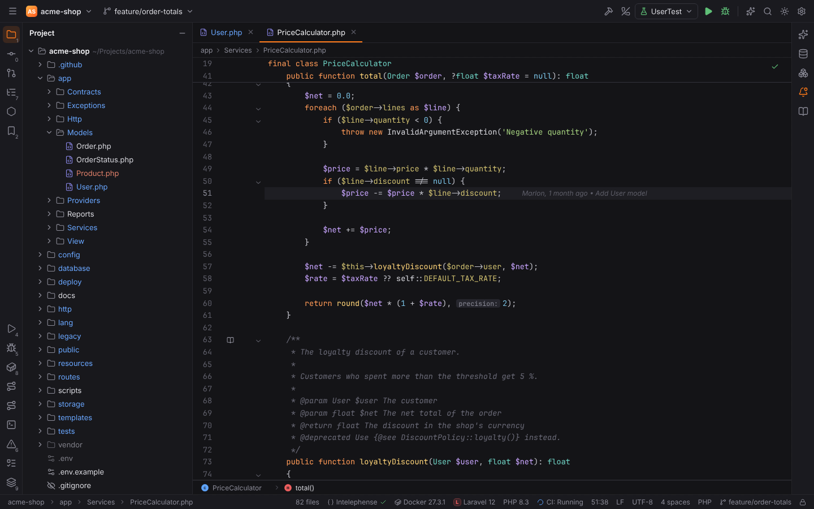
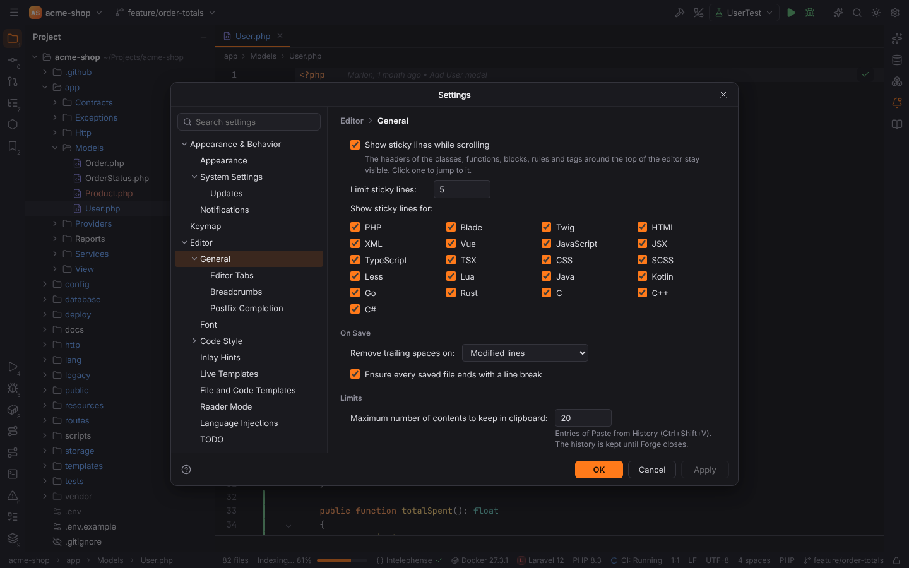
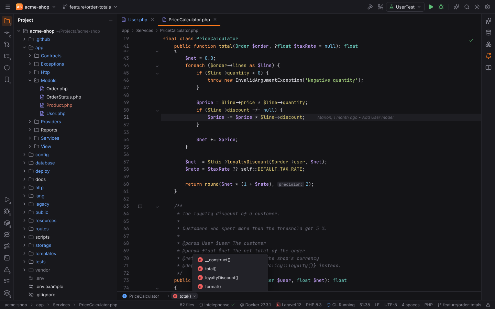
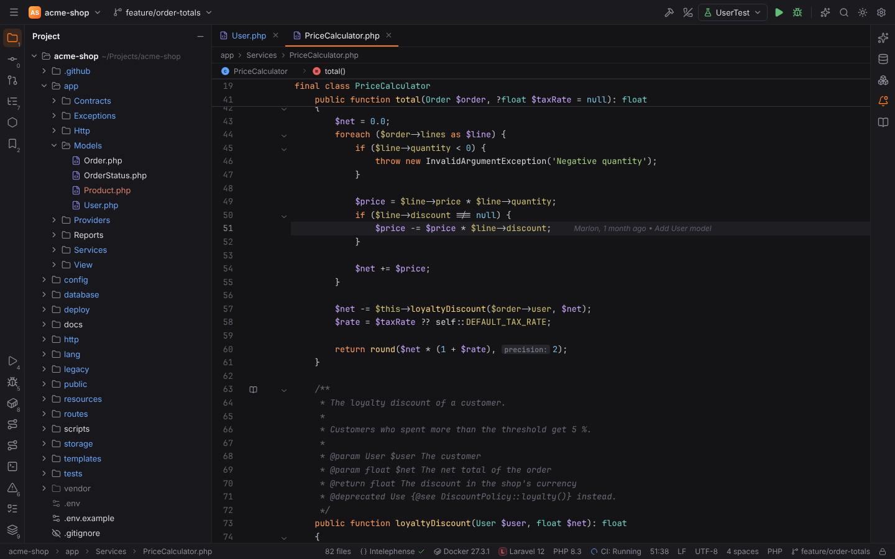
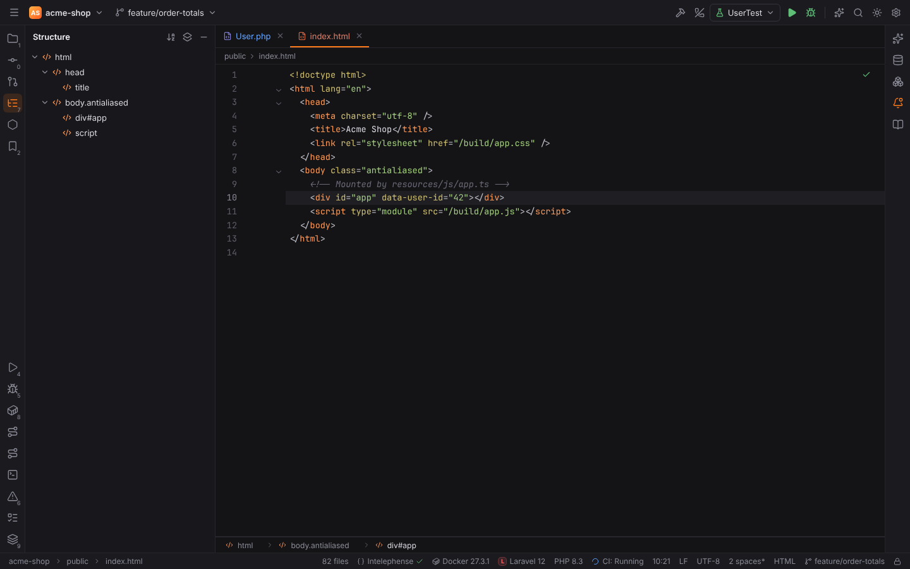
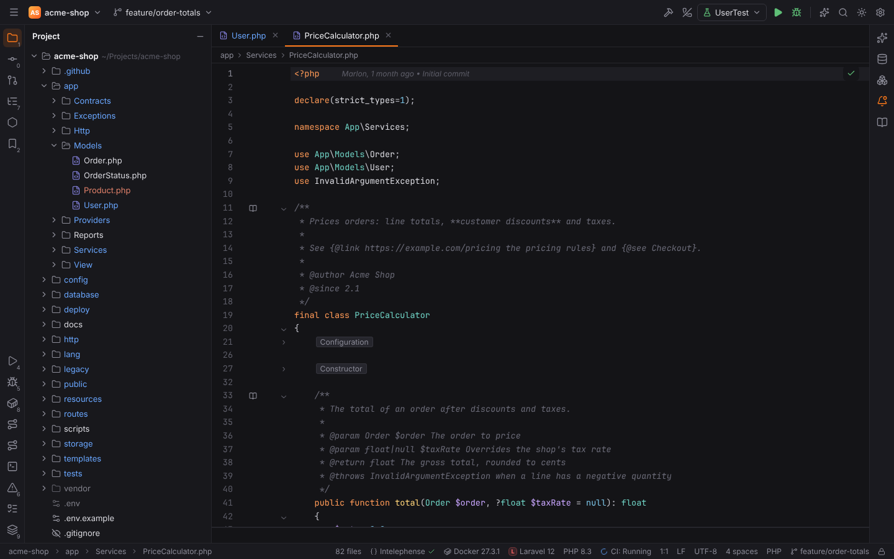
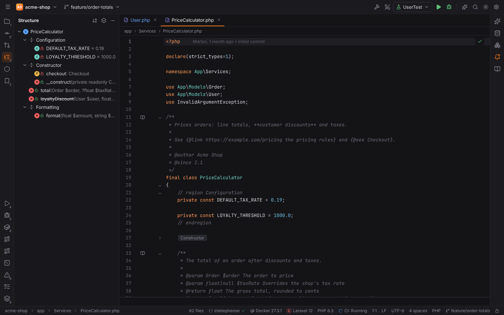
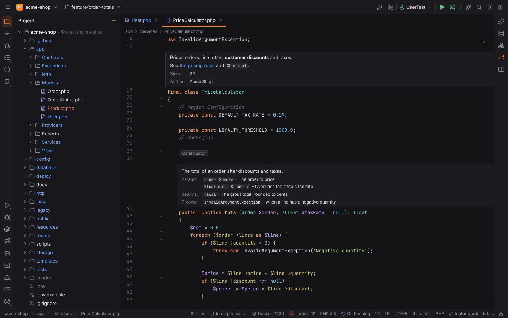
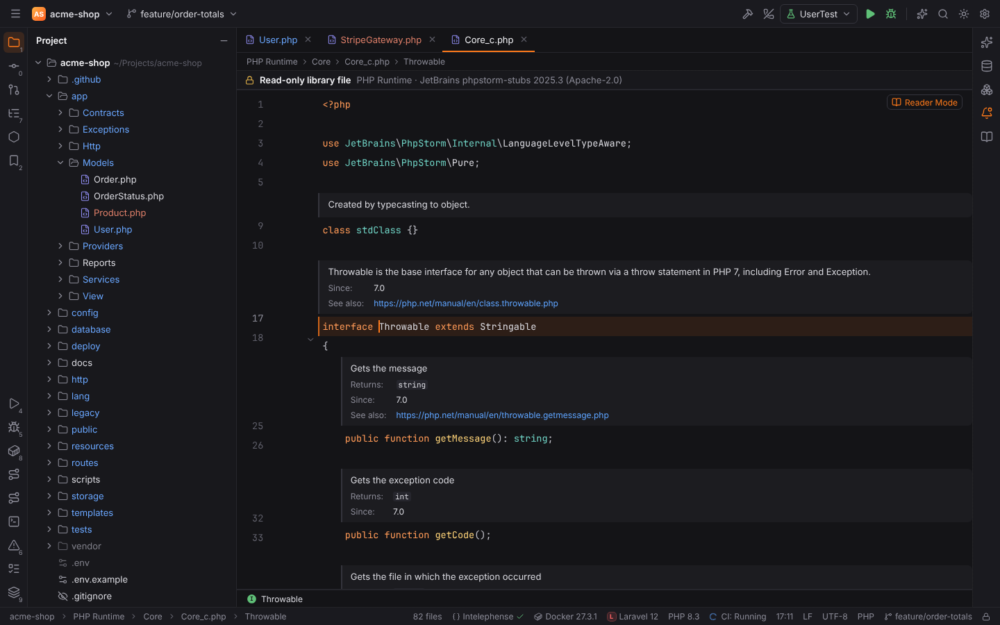
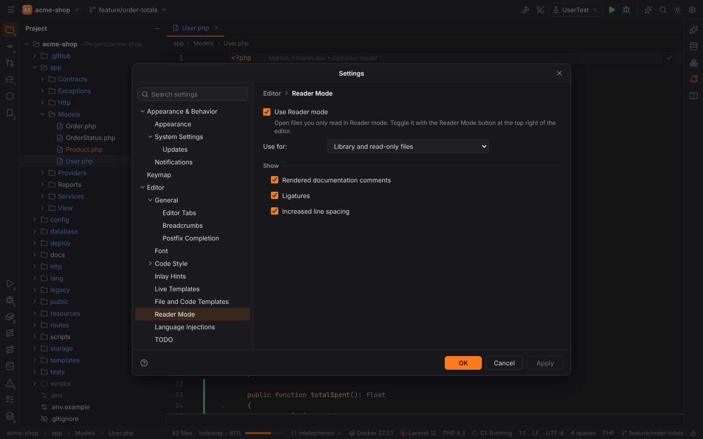

# Sticky lines, breadcrumbs and Reader mode

These editor features show where you are in a file and make code you only read easier to
read. They work for PHP, Blade, Twig, HTML, XML, Vue, JavaScript, TypeScript (and JSX/TSX),
CSS, SCSS, Less and Lua, plus the brace languages Java, Kotlin, Go, Rust, C, C++ and C#.
Forge finds the classes, functions, blocks, rules and tags of a file itself, so they work
without a language server.

## Sticky lines

While you scroll, the first lines of the scopes around the top of the editor stay pinned
there: the namespace, class and method, `if` / `foreach` / `try` / `match` blocks, CSS rules
and at-rules, HTML parent elements and Lua functions and blocks. Each sticky line shows its
line number and keeps its syntax colors.

- **Click** a sticky line to jump to it.
- **Right-click** the sticky lines for **Configure Sticky Lines…** and **Disable Sticky Lines
  for** the file's language.
- **View | Active Editor | Show Sticky Lines** switches them for the current language.

Settings | Editor | General | **Sticky Lines**:

| Setting | Default | |
| --- | --- | --- |
| Show sticky lines while scrolling | on | `editor.stickyLines.enabled` |
| Limit sticky lines | 5 | `editor.stickyLines.maxLines`, 1–20 |
| Show sticky lines for | all languages | one checkbox per language (`editor.stickyLines.disabledLanguages`) |

## Breadcrumbs

The breadcrumbs at the bottom of the editor show the declarations around the caret, e.g.
`PriceCalculator › total()`, `@media (max-width: 600px) › .card` or
`html › body.antialiased › div#app`.

- **Click** a crumb to move the caret to that declaration.
- The small arrow next to a crumb (on hover) lists its **siblings**, e.g. the other methods of
  the class; pick one to go there.
- **View | Active Editor | Show Breadcrumbs** switches them for the current language.

The file path stays in the bar above the editor, which is PHPStorm's navigation bar.

Settings | Editor | General | **Breadcrumbs**: *Show breadcrumbs* (`editor.breadcrumbs.show`),
*Placement* **Top** or **Bottom** (`editor.breadcrumbs.placement`, default Bottom) and one
checkbox per language (`editor.breadcrumbs.disabledLanguages`).

HTML, Vue and template files list elements as `tag#id.class`; `<script>` and `<style>`
blocks contain the functions and rules inside them.

## Custom folding regions

Comments mark regions that fold like any other block and show their name when folded:

| Language | Start | End |
| --- | --- | --- |
| PHP, JavaScript, TypeScript, CSS preprocessors, C-like | `// region Name` or `//region Name` | `// endregion` |
| PHP, C# | `#region Name` | `#endregion` |
| HTML, Vue, Blade, Twig | `<!-- region Name -->`, `{{-- region Name --}}`, `{# region Name #}` | `<!-- endregion -->`, … |
| CSS | `/* region Name */` | `/* endregion */` |
| Lua | `-- region Name` or `--region Name` | `-- endregion` |
| NetBeans style, any language | `// <editor-fold desc="Name">` | `// </editor-fold>` |

- Regions can be nested. A region without a name folds to `...`.
- `<editor-fold desc="Name" defaultstate="collapsed">` regions start folded.
- **Code | Surround With** (`Ctrl+Alt+T`, macOS `Cmd+Alt+T`) › **region...endregion
  Comments** wraps the selected lines in a region (PHP, JavaScript, Lua, HTML and CSS); type
  its name at the caret. See [Live templates](live-templates.md).
- The **Structure** tool window (`Alt+7`, macOS `Cmd+7`) groups the members inside a region
  under the region's name.

## Rendered documentation comments

PHPDoc, JSDoc / TSDoc and LuaDoc (LuaCATS `---@param`) comments can be shown as formatted
text, like Quick Documentation: the description with its Markdown, then the tags as a table
(**Params:**, **Returns:**, **Throws:**, **Properties:**, **Since:**, **See also:**,
**Author:** …) and `@deprecated` as a red note. `{@link https://… text}` becomes a link that
opens in the browser, `{@see Class::method()}` code.

| Action | Windows/Linux | macOS |
| --- | --- | --- |
| Toggle Rendered View of the comment at (or above) the caret | `Ctrl+Alt+Q` | `Ctrl+Alt+Q` |
| Toggle with the mouse | book icon in the gutter; pencil icon on a rendered comment | |
| Render All Doc Comments of the file | Tools \| Render All Doc Comments | |
| Collapse Doc Comments | Code \| Folding \| Collapse Doc Comments | |

Settings | Editor | General | Appearance | **Render documentation comments**
(`editor.renderDocComments`, off by default) renders every comment of the files you open.

## Reader mode

Files you only read open in **Reader mode**: library files (under `vendor/` and
`node_modules/`, and the PHP stubs Go to Declaration opens) and read-only files. Reader mode
renders the documentation comments, turns on font ligatures and increases the line spacing.

The **Reader Mode** button at the top right of the editor switches it off (to read the
comments as code) and on again; **View | Active Editor | Reader Mode** does the same.

Settings | Editor | **Reader Mode**:

| Setting | Default | |
| --- | --- | --- |
| Use Reader mode | on | `editor.readerMode.enabled` |
| Use for | Library and read-only files | `editor.readerMode.applyTo`: library files, read-only files, or both |
| Rendered documentation comments | on | `editor.readerMode.renderDocs` |
| Ligatures | on | `editor.readerMode.ligatures` |
| Increased line spacing | on | `editor.readerMode.increaseLineSpacing` |

