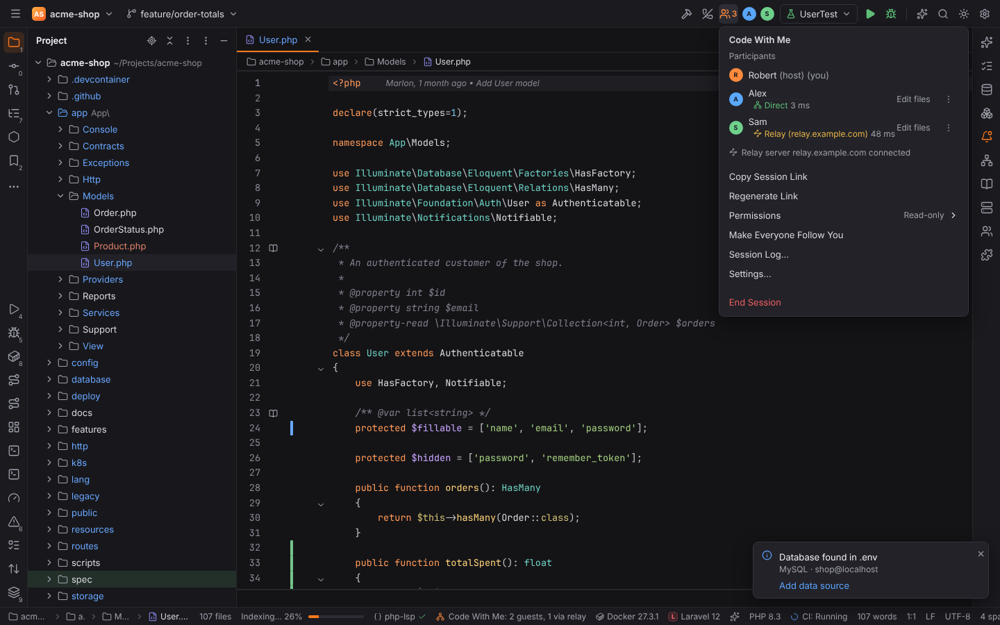
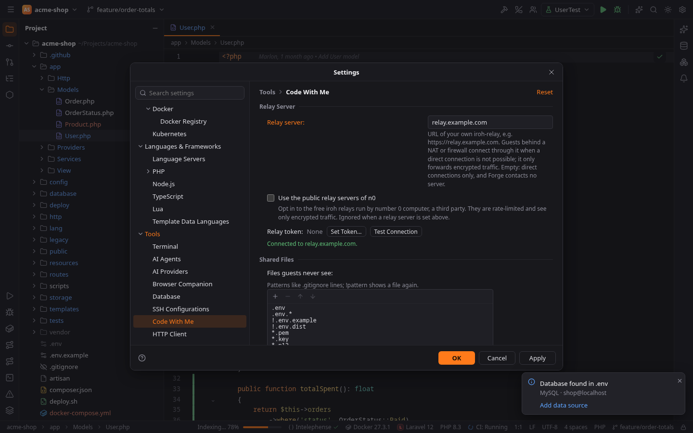

# Code With Me: relay and NAT traversal

Code With Me connects the guest straight to the host. Nothing is contacted besides the host's
addresses from the session link, and Forge runs no service of its own: there is no lobby, no
account and no Forge relay. When guest and host cannot reach each other (different networks,
NAT, firewalls) there are four ways out, from least to most effort:

| Situation | What to do |
| --- | --- |
| Same network or VPN | Nothing. Direct connections work, and **Discover hosts on the local network** finds the host even when its address changed. |
| Host has a public address or a port forward | Set **Port** (Settings \| Tools \| Code With Me) to a fixed UDP port and forward it on the router. |
| Both sides are behind NATs | Set up a **Relay server** (below). Forge first connects through it and then tries to open a direct path (hole punching). |
| Locked-down networks (UDP blocked, corporate firewall) | Join over a VPN such as WireGuard or Tailscale, or tunnel the UDP port (see [SSH tunnel and VPN](#ssh-tunnel-and-vpn)). |

## How a connection is made

Forge uses [iroh](https://www.iroh.computer): QUIC over UDP with TLS 1.3, where every endpoint is
identified by a public key.

1. The host starts a session. It opens a UDP socket and, if a relay server is set, connects to
   it. The **session link** contains the host's key, its addresses and, as `r=`, the relay's URL.
2. The guest dials the host's addresses **and** the relay at the same time. Direct addresses win
   when they work (LAN, port forward, VPN).
3. Otherwise the first packets travel through the relay. Both ends use that channel to exchange
   their public addresses and punch holes through their NATs (hole punching). When it works, the
   connection moves to the direct path by itself, without interruption. About nine out of ten
   connections end up direct. When it does not (symmetric NATs, UDP filters), the connection
   stays on the relay.
4. The relay only forwards packets that are **end-to-end encrypted** between guest and host. It
   sees who connects (IP addresses and the session's temporary endpoint keys) and how much data
   flows, never file contents, keystrokes or the join secret.

A new key pair is generated for every session, so links and relay logs cannot be correlated
between sessions.

## Settings

Settings \| Tools \| Code With Me.

| Setting | Meaning |
| --- | --- |
| **Port** | UDP port for direct connections. 0 picks a free port; set a fixed one for a port forward. |
| **Listen on address** | Bind to one interface only: a VPN address, or `127.0.0.1` for tunnels. |
| **Discover hosts on the local network** | Find the host on the same network with mDNS. Nothing leaves the local network. On by default. |
| **Relay server** | URL of your own `iroh-relay`, e.g. `https://relay.example.com`. **Empty (the default): direct connections only, Forge contacts no server.** |
| **Use the public relay servers of n0** | Opt-in, off by default. n0 (number 0 computer) operates the free public iroh relays. They are rate-limited and run by a third party; they only see encrypted traffic. Ignored when a relay server is set. |
| **Relay token** (Set Token…) | The shared token of a relay that uses access control. Stored in the system keychain, never in settings files or links. |
| **Test Connection** | Connects to the relay as typed in the page and reports whether it works or why not (wrong token, certificate, unreachable). |

Notes:

- A relay URL needs `https://` (or `http://` for a relay inside a trusted network or tunnel).
  Without a scheme Forge assumes `https://`. User names, passwords and tokens do not belong
  into the URL: they would end up in session links. Use **Set Token…**.
- **The guest uses the relay of the link**, not their own setting. Guests only need their own
  settings when the relay requires a token: enter it under **Set Token…** with the same relay
  URL as in the link. A token is only ever sent to the relay it was set for.
- Guests that the link cannot reach directly and that cannot reach the relay get the error
  *The host did not answer*. Open **Test Connection** and the host's connection status first.
- Hosts that use the public relays put one of n0's relay URLs into the link. Guests then
  contact that relay because the link says so, even though they did not opt in themselves.
  Only share such links with people you would let reach that service.

## Seeing how you are connected

- **Status bar**: *Code With Me: Direct · 12 ms* or *Code With Me: Relay (relay.example.com)* for
  guests; hosts see *2 guests, direct* or *2 guests, 1 via relay*. The tooltip lists every
  participant. A warning icon appears when the relay is set but not connected.
- **Code With Me popup** (toolbar, or click the status bar item): below each participant's name
  a **Direct** or **Relay (host)** badge and the round-trip time, plus the state of the relay
  server below the list.

A relayed connection is normal and fully encrypted, only slower (typically 20 to 100 ms more).
The badge changes to **Direct** as soon as hole punching succeeds.





## Running your own relay

A relay is the open-source `iroh-relay` server. It is a single binary, runs on any small VPS
(1 vCPU, 512 MB are plenty for a team) and needs a DNS name pointing at the machine.

Open ports:

| Port | Protocol | Use |
| --- | --- | --- |
| 443 | TCP | HTTPS and the relay connection (WebSocket) |
| 80 | TCP | ACME HTTP challenge (Let's Encrypt) and a captive-portal probe |
| 7842 | UDP | QUIC address discovery (helps hole punching; optional) |

### With Docker Compose

`Dockerfile`:

```dockerfile
FROM rust:1-bookworm AS build
RUN cargo install iroh-relay --version "~1.3" --features server --locked --root /out

FROM debian:bookworm-slim
RUN apt-get update && apt-get install -y --no-install-recommends ca-certificates \
    && rm -rf /var/lib/apt/lists/*
COPY --from=build /out/bin/iroh-relay /usr/local/bin/iroh-relay
ENTRYPOINT ["iroh-relay", "--config-path", "/etc/iroh-relay/relay.toml"]
```

`relay.toml`: HTTPS with an automatic Let's Encrypt certificate and a shared token:

```toml
http_bind_addr = "[::]:80"
enable_quic_addr_discovery = true

[tls]
https_bind_addr = "[::]:443"
cert_mode = "LetsEncrypt"
hostname = "relay.example.com"
contact = "admin@example.com"
cert_dir = "/var/lib/iroh-relay"

# Only clients with this token may use the relay. Several tokens are allowed.
# IROH_RELAY_ACCESS_TOKEN overrides this list with a single token.
access.shared_token = ["change-me-to-a-long-random-string"]
```

`compose.yaml`:

```yaml
services:
  relay:
    build: .
    restart: unless-stopped
    ports:
      - "80:80/tcp"
      - "443:443/tcp"
      - "7842:7842/udp"
    volumes:
      - ./relay.toml:/etc/iroh-relay/relay.toml:ro
      - relay-data:/var/lib/iroh-relay
volumes:
  relay-data:
```

Generate the token with `openssl rand -base64 32 | tr -d '/+='` and start the relay with
`docker compose up -d`. Then, on every machine that uses it:

1. Settings \| Tools \| Code With Me \| **Relay server**: `https://relay.example.com`.
2. **Set Token…**: the token from `relay.toml`.
3. **Test Connection** should say *Connected to relay.example.com*.

Without Docker, install the binary with `cargo install iroh-relay --features server` and run
`iroh-relay --config-path relay.toml` from a systemd unit. For a quick test on your own
network, `iroh-relay --dev` serves plain HTTP on port 3340: use `http://<address>:3340` as the
relay server.

Other access modes in `relay.toml` (`access = "everyone"` is the default): an allow list of
endpoint keys or an HTTP callback. Keys are generated per session, so a shared token is the
practical choice for Code With Me. Rate limits can be set in a `[limits]` section; see the
[iroh-relay documentation](https://docs.rs/iroh-relay).

### Behind a reverse proxy

`iroh-relay` can run with `http_bind_addr` only (no `[tls]` section) behind a proxy that
terminates TLS, as long as the proxy forwards WebSocket upgrades. Leave out
`enable_quic_addr_discovery` then; hole punching still works, a bit less often.

## SSH tunnel and VPN

Code With Me is UDP. A plain `ssh -L` or `ssh -R` forwards TCP only, so it does not work on its
own, and tools that push UDP through a TCP stream (such as `socat`) lose the packet boundaries
QUIC needs. Two recipes work on locked-down networks.

**VPN (recommended).** Put host and guests into one WireGuard or Tailscale network. Start the
session after the VPN is up: the session link then contains the host's VPN address and the
guest connects directly. Set **Listen on address** to the VPN address if the session must not
be reachable from other interfaces. No relay is needed.

**SSH tunnel device.** OpenSSH can carry IP traffic, including UDP, over its own tunnel
(`ssh -w`). It needs root on both machines and `PermitTunnel yes` in the host's `sshd_config`:

```sh
# Guest (as root): open the tunnel to the host and give the tunnel an address.
ssh -f -N -w 0:0 root@host.example.com
ip addr add 10.99.0.2/30 dev tun0 && ip link set tun0 up

# Host (as root): the same tunnel device appears on the host.
ip addr add 10.99.0.1/30 dev tun0 && ip link set tun0 up
```

Then the host starts the session (**Listen on address** empty or `10.99.0.1`). Because the
tunnel is up, the link contains `10.99.0.1`; the guest can join straight away. Without root
access, use a VPN or a relay.

## Troubleshooting

| Message or symptom | Cause |
| --- | --- |
| *Cannot reach the relay server (… a relay token is required)* | The relay uses access control. Set the token with **Set Token…**. |
| *Cannot reach the relay server (… did not answer)* | Wrong URL, DNS, port 443 closed, or a certificate that is not valid for that name. **Test Connection** shows the details. |
| *The host did not answer* | Neither a direct path nor the relay works for this guest. Check the host's status bar for the relay state, then try a VPN. |
| Badge stays on **Relay** | Hole punching failed: usually a symmetric NAT or UDP filtering. The relay path keeps working. Open UDP 7842 on the relay and keep QUIC address discovery enabled to improve the odds. |
