# Code With Me

Code With Me lets you invite guests into the project that is open in your Forge. Everyone edits
the same files at the same time and sees the others' carets and selections. Guests use Forge
itself. Connections go straight from guest to host; no account and no Forge service is needed
(see [relay and NAT traversal](code-with-me-relay.md) for networks where that does not work).

## Hosting a session

1. Click the Code With Me icon in the toolbar (or **Tools | Code With Me | Start Session…**).
2. Pick what guests may do:

   | Level | Guests can |
   | --- | --- |
   | **Read-only** (default) | view files |
   | **Edit files** | edit files, but not use the terminal or run code |
   | **Full access** | edit files, use the terminal and run code on your machine |
   | **Custom…** | what you choose per area (see below) |

3. **Start Session** starts listening and copies the invitation link to the clipboard. Send the
   link to your guest. **Copy Session Link** in the popup copies it again.
4. **End Session** ends the session for everybody and the link stops working.

Nothing listens on your machine before you start a session.

### Custom permissions

**Custom…** opens the **Custom Permissions** dialog with one value per area:

| Area | Values |
| --- | --- |
| Files | Read-only · Edit |
| Terminal | No access · Read-only · Full access |
| Run | No access · Read-only (see output) · Full access (start, stop, rerun) |
| Version control | Read-only (status, diff, blame, log) · Full access (commit, push, checkout, …) |

Files that control what runs on your machine (run configurations, `composer.json`,
`package.json`, `Makefile`, …) can only be changed by guests with Files **Edit** and Run
**Full access**. The list is a setting, see [Files guests never see](#files-guests-never-see).

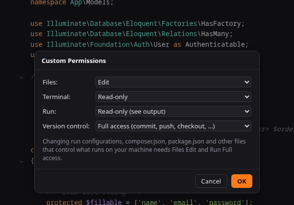

## During a session

The popup lists the participants with their permission and offers:

- **Copy Session Link** copies the invitation link again.
- **Regenerate Link** creates a new link and copies it. The old link stops working at once;
  guests who are already in the session stay.
- **Permissions ▸** changes the permission of the whole session: guests who join later get it,
  and every guest in the session gets it at once.
- **Make Everyone Follow You** asks every guest to follow you (see [Following](#following-participants)).
- **End Session** ends the session for everybody.

The **⋮** button next to a participant (or a right click on the participant) opens the
participant's menu:

- **Follow** / **Stop Following** and **Jump To** (see [Following](#following-participants)).
- **Permissions ▸** (host) changes only this guest's permission (Read-only, Edit files, Full access or
  Custom…).
- **Remove Guest** (host) disconnects the guest at once. The guest is told that the host removed them.
  Removing does not ban: with the same link the guest can ask to join again, so use
  **Regenerate Link** if they should not.

A new permission counts from the guest's next request. When files become read-only for a
guest, their open editors turn read-only and they are told so; changes they send afterwards are
refused by your Forge.

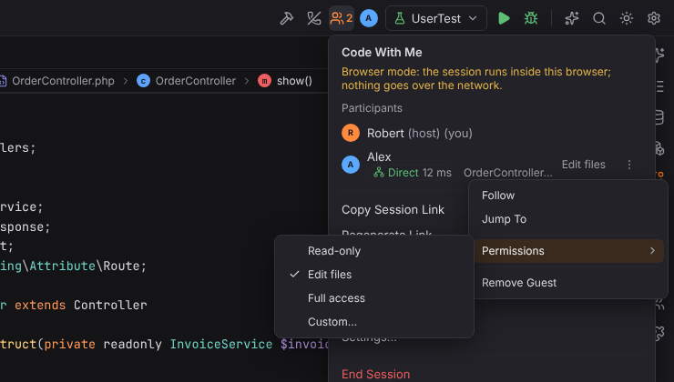

## Following participants

Every participant sees where the others are: the participant list shows the file and line each
one is in (`OrderController.php:27`) and whom they follow ("following you"), and the others'
avatars appear next to the Code With Me icon in the toolbar.

- **Follow**: click a participant in the list or their avatar in the toolbar. Forge opens their
  file and keeps their part of the file in view as they move and switch files. A banner above
  the editor says **Following Alex** in their color. Typing, clicking into the editor or opening
  another file stops following, as does **Stop** in the banner (or **Stop Following**).
- **Jump To**: in the participant's menu, opens their file at their caret once, without
  following.
- **Make Everyone Follow You** (host): every guest follows you, including guests who join later.
  The guests' banner says **Robert asked everyone to follow**; they can still press **Stop**.
  The popup shows how many guests follow you. Choose it again to stop asking.
- Guests follow the host when they join (Settings | Tools | Code With Me | **Follow the host
  when joining**).

A guest is never told the name of a file it may not see: while the host is in `.env` or another
hidden file, guests see the host without a location and following guests stay where they are.

The **Code With Me** tool window (right, while a session runs) lists the participants with the
same actions, **Stop Following** and, for the host, **Make Everyone Follow You** and the
**Session Log** tab.

All of these are also in Find Action and Settings | Keymap under Plugins | Code With Me:
**Follow Participant…** and **Jump To Participant…** (a chooser of the participants), **Stop
Following**, **Make Everyone Follow You** and **Code With Me** (the tool window). PHPStorm binds
no shortcuts to them; you can add your own.

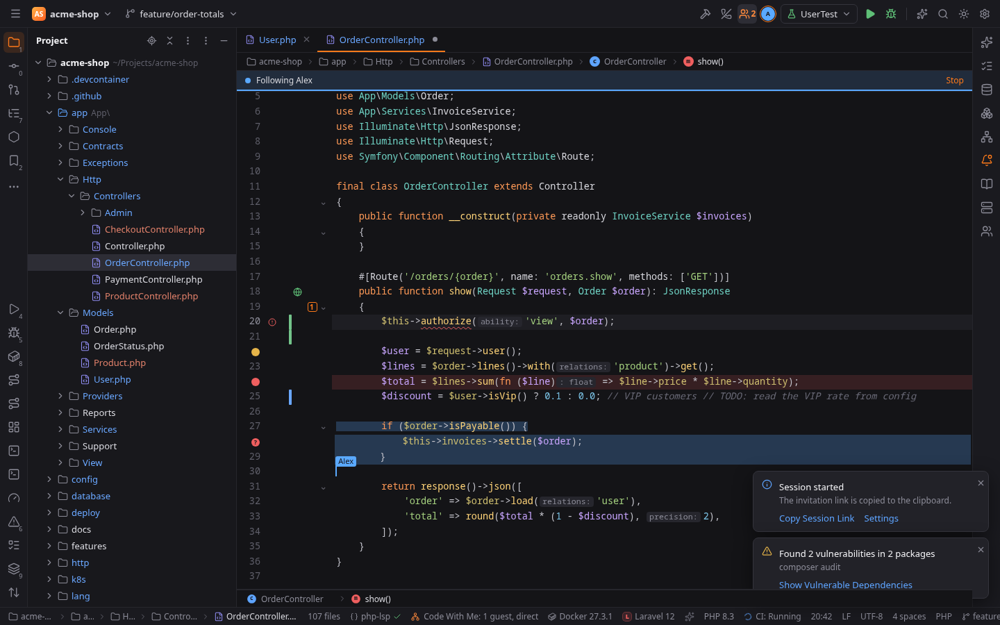

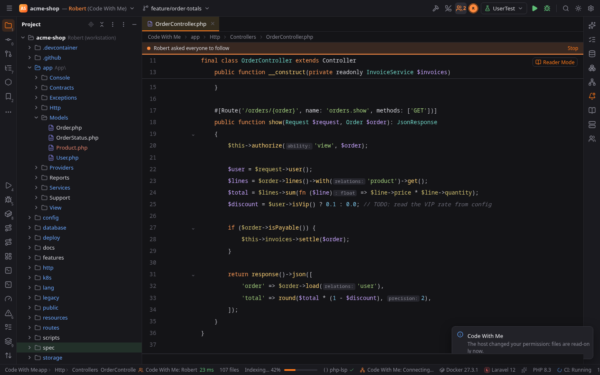

### Carets of the others

Every participant's caret and selection show in their color. The name label above a caret shows
while that participant moves or types and fades out two seconds after they stopped; hover the
caret to see the name again. The right edge of the editor (over the scrollbar) has a mark in the
participant's color where each of the others is in the file; click it to move your caret there.

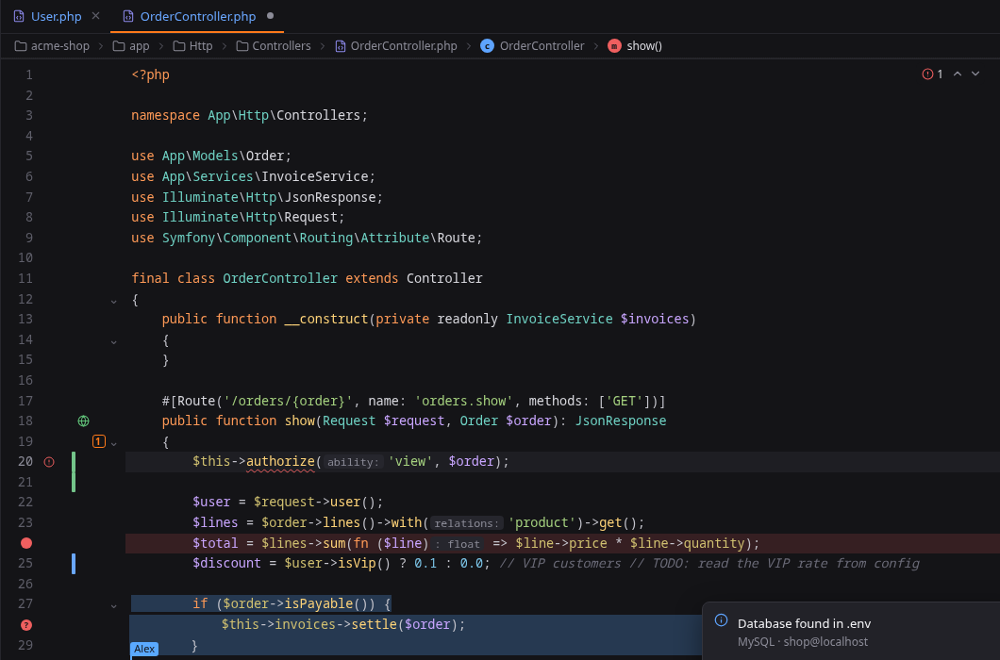

## Terminal and Run

What guests see of your terminals and runs depends on their **Terminal** and **Run** permission:

| Permission | Terminal | Run |
| --- | --- | --- |
| No access | no Terminal tool window | no Run tool window |
| Read-only | watch the terminals you share | watch your runs (console and test results) |
| Full access | type in the terminals you share, open their own terminals on your machine | run, rerun and stop your run configurations, type into the console |

**Sharing a terminal (host).** Right-click a terminal tab and choose **Share with Guests** (also
**Share Terminal with Guests** in Find Action, for the active tab). Shared tabs show the
participants icon; choose it again to stop sharing. Guests see the tab with what it showed so
far (the last 2000 lines) and follow it live, at your terminal's size. When you stop sharing a
terminal, the guest's tab stays with what it showed and the line **[The host stopped sharing
this terminal]**, like a terminal whose shell ended; the guest closes it. Shared again, it
opens fresh. A shell that ends on your machine shows **[Process completed]** in the guest's
tab. To share every terminal
tab you open during a session, turn on **Settings | Tools | Code With Me | Share new terminal
tabs**.

**Guests' terminals.** A guest with Full terminal access opens new terminal tabs on your
machine: the shell is yours (your shell and settings) and starts in the project folder. The tab
shows up in your Terminal tool window as **Alex: Local**, so you always see what runs on your
machine. A guest's terminals close when the guest leaves, is removed, or loses Full terminal
access.

**Runs.** Every run of your Run tool window is shown to guests with Run access, with its console
and test tree; guests who join later see it from the start. A guest with Full run access uses the
Run widget and the Run tool window as usual: Run, Rerun and Stop act on your machine, and Forge
starts your run configuration by its name as if you clicked Run. Guests never send command
lines, and they cannot change run configurations unless they have Full access (the files that
configure what runs are protected). Debugging and Run with Coverage are not available to guests.

The session log records shared and unshared terminals, the terminals guests open and close, that
a guest typed in a terminal or a console (never the keys), and the runs guests start and stop.
Input from a guest without Full access is refused by your Forge.

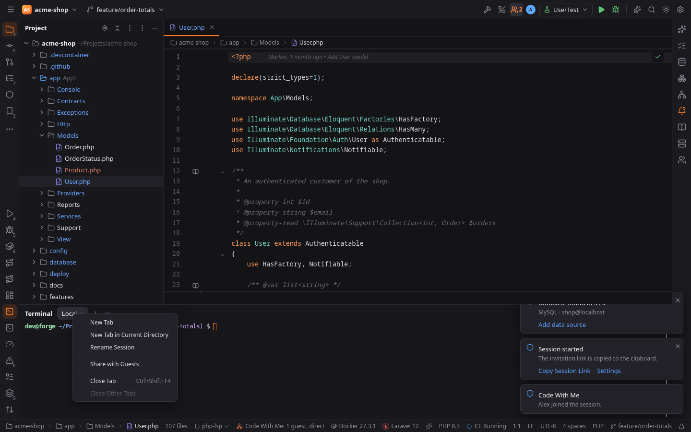

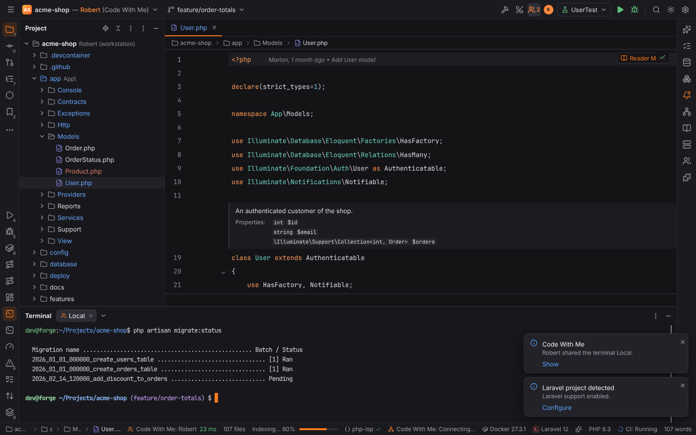

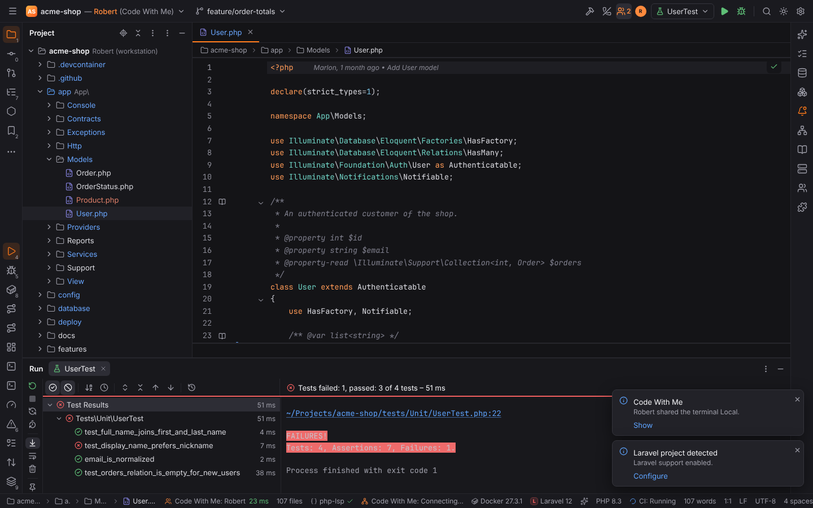

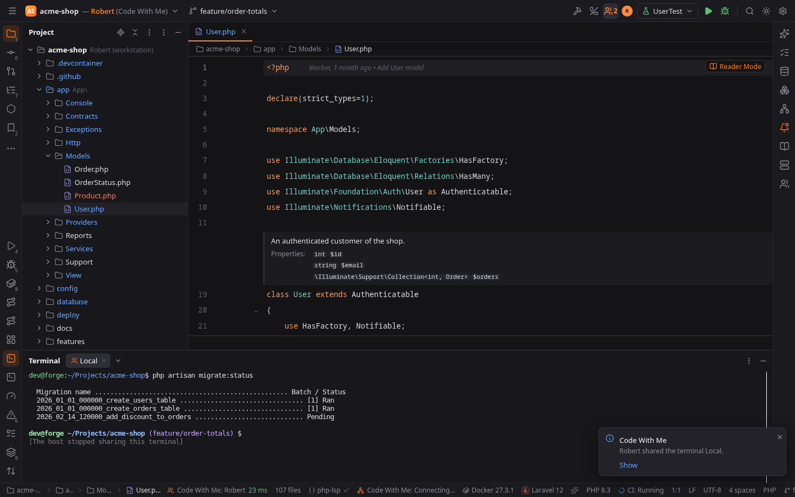

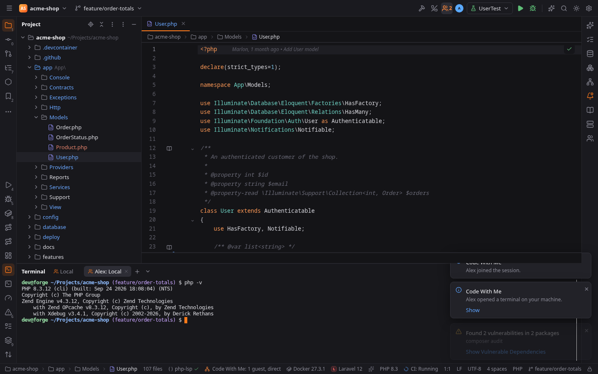

## Session log

**Session Log…** in the popup (also in Find Action and the **Session Log** tab of the Code With
Me tool window) shows what happened in the session you
host, with the time: who joined, declined and unanswered requests, connections without a
valid link, permission changes, Regenerate Link, removed and leaving guests, files guests
saved, created, renamed or deleted, their git actions, and every request your Forge refused
(shown as warnings). Terminal keystrokes and file contents are never logged.

With **Keep a session log** on (the default, Settings | Tools | Code With Me), each session is
also written to a file in Forge's data directory, never into the project:

| OS | Folder |
| --- | --- |
| Linux | `~/.local/share/forge/code-with-me/` |
| macOS | `~/Library/Application Support/forge/code-with-me/` |
| Windows | `%APPDATA%\forge\code-with-me\` |

The file is `<date>-<session>.jsonl`, one JSON object per line. Logs older than 30 days are
deleted when you start a session.

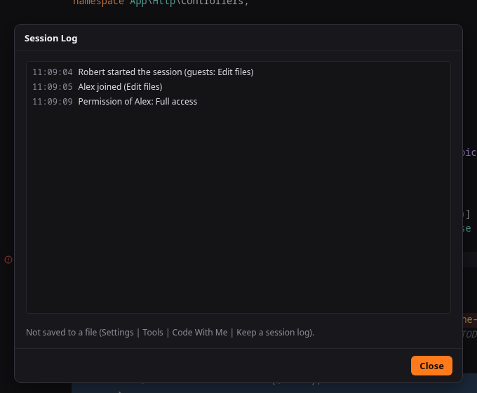

## Accepting guests

Having the link is not enough. When a guest opens it, a balloon appears and stays until you
answer:

> **Alex wants to join the session**
> Make sure the code is 482 913. With Read-only permission Alex can view files.
> **Accept** · **Decline**

The guest sees the same **verification code** while waiting. Compare the two over a call or
chat before you accept: the code is derived from both sides' keys, so somebody who got hold of
the link shows a different code than the person you invited. If the codes differ, decline.

- A guest that is declined is told so. A request that is not answered within two minutes is
  dropped and the guest is told that the host did not answer.
- A guest can have one open request at a time, and at most five requests wait at once. Further
  ones are refused without a prompt.
- Ending the session refuses everyone who is still waiting.

If you close the balloon without answering, the request stays open until it times out.

## Joining a session

1. Click the link (`forge://cwm/join?…`), or choose **Tools | Code With Me | Join Session…**
   and paste it into **Session link**. Without a project open, the Welcome screen has the same
   action under **Remote Development | Code With Me | Join Session…**.
2. The dialog shows where the link leads before anything connects: the **Host** and its
   **Machine** as the link names them, the **Connection** (direct, or through the host's relay
   server) and the name you **Join as** (**Change…** opens Settings | Tools | Code With Me). If a
   project is open, it says that it is closed while you are a guest. Click **Join**.
3. The dialog shows **Waiting for <host> to accept…** with the **verification code** and
   **Cancel**. Tell the host the code; the host sees the same one. If the host declines or does
   not answer, the dialog says so and offers **Try Again**.
4. When the host accepts, the host's project opens in your window and you follow the host. The
   title shows `<project> — <host> (Code With Me)`. **Leave Session** in the popup or the status item
   ends it for you, and the window returns to the Welcome screen.

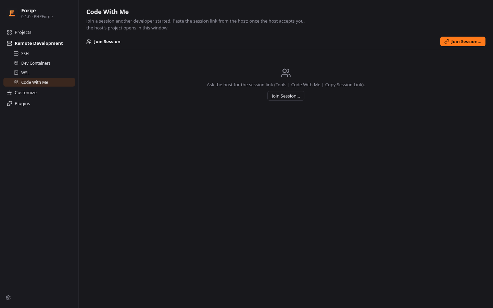

The host's project replaces the project the window had open. Everything the window showed of
that project goes with it: the Project tree shows the host's files right away, and the
problems, Find and Inspection Results tabs and the Safe Mode banner of your own project are
gone. To keep your project open, join from another window: **File | New Window** opens one on
the Welcome screen.

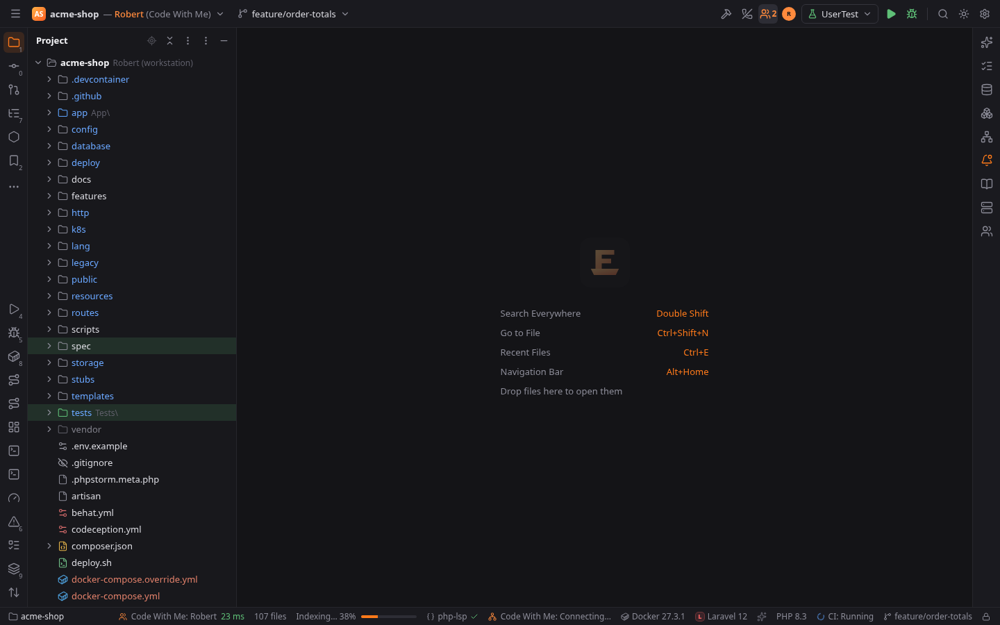

A guest's window is always in Safe Mode, without the banner and without **Trust Project…**:
nothing of the host's project runs on your machine. Terminals and runs the host shares run on
the host (see [Terminal and Run](#terminal-and-run)).

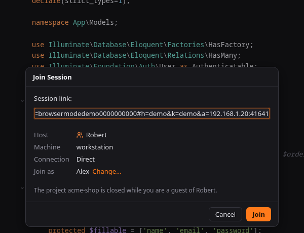

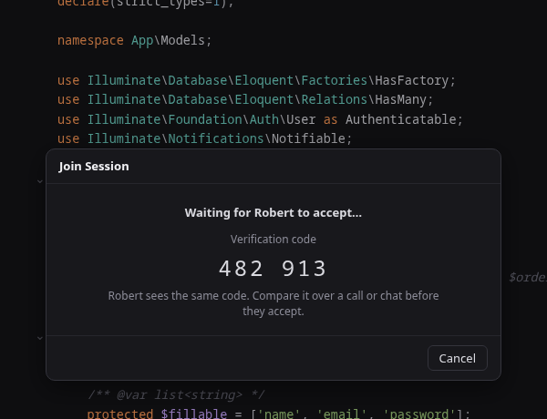

### When the connection drops

If the connection to the host drops (Wi-Fi gone, laptop asleep, VPN reconnecting), the session
is not over:

- Your window keeps the host's project and your open files. The status bar says **Code With Me:
  Reconnecting…**, and a balloon **Connection to <host> lost** stays until the connection is
  back, with **Leave Session**. Forge tries again after 1, 2, 4 and 8 seconds and then every 15
  seconds.
- Keep typing: your edits stay in the editor and are sent when the connection is back; edits
  the others made meanwhile arrive then too, and everything merges. Saving, opening files,
  search and other requests to the host fail while the connection is down. Keys typed into a
  shared terminal or a run's console meanwhile are lost.
- Back again, you see **Reconnected to <host>.** Shared terminals and runs show what you
  missed, and the others see you where you were.
- The host keeps your place (your color, permissions, terminals) for two minutes and shows you
  as **Reconnecting…** in the participant list meanwhile. After about 105 seconds without a
  connection your Forge gives up: the session ends with **The connection to the host was lost and
  could not be restored. Join again with the session link.** Edits that did not reach the host
  are lost then. If the host removed you meanwhile, you are told so.

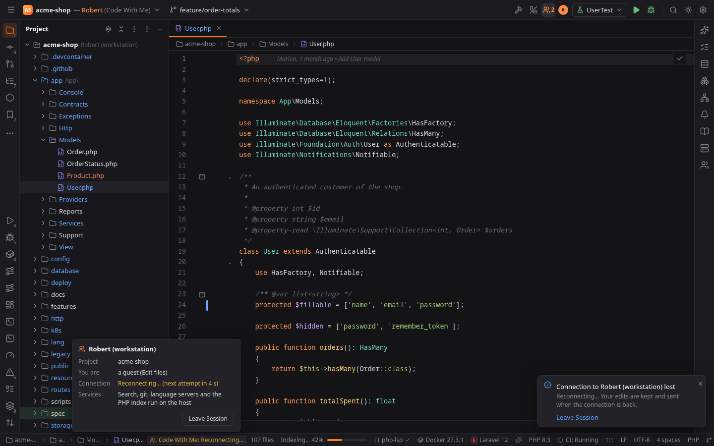

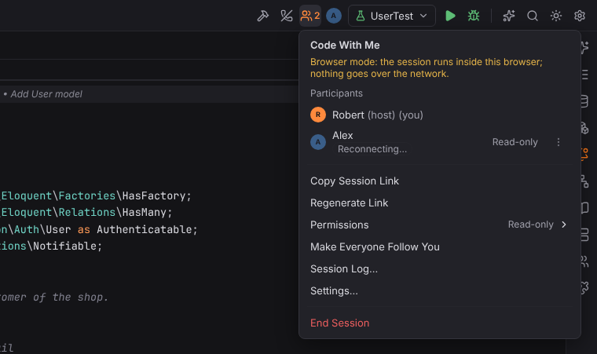

Guests see the Project tree, Structure, Find, Problems, Terminal and Run (with Terminal or Run access, see [Terminal and Run](#terminal-and-run)) and Git (read-only unless the host gave
Full access). AI Chat, Database, Services, Debug and the code host tool windows are not
available in a guest's window, because they would use the host's accounts and secrets.

## Files guests never see

Secret files are invisible to guests whatever their level, in the tree, in search, in Git and
in analysis results: `.env` and `.env.*` (but not `.env.example`), private keys, certificates
and the like. The list is **Settings | Tools | Code With Me | Files guests never see**. Files larger than
**Larger files open read-only (KB)** open read-only.

Files that configure what runs on the host can be changed only by guests with Full access to
Run (with Edit files they open read-only): **Settings | Tools | Code With Me | Files only Full
access may change**. By default these are run configurations (`.forge/runConfigurations*.toml`),
`.forge/settings.toml`, `.vscode/`, `.idea/`, `.husky/`, `composer.json`, `package.json`,
`Makefile`, `artisan` and `bin/console`. The patterns work like the excluded files (`!pattern`
removes a file from the list); changes apply to sessions you start afterwards.

## Settings

Settings | Tools | Code With Me: your name in sessions, the default permission level,
whether ending a session asks for confirmation, whether guests follow the host when joining, whether new terminal tabs are shared,
whether a session log is kept, the files guests never see, the files only Full access may change
and the connection settings of the
[relay page](code-with-me-relay.md).
