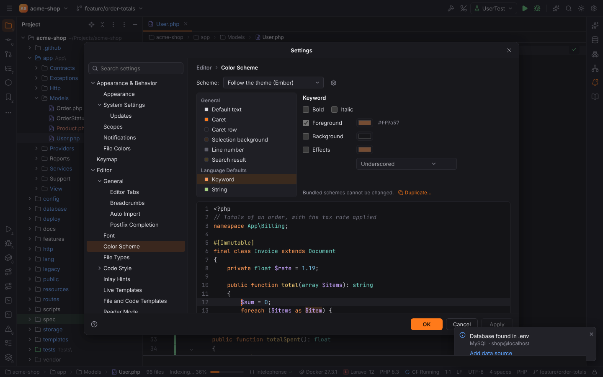
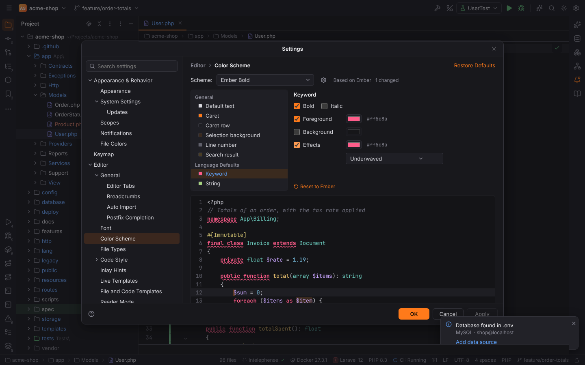

# Color schemes

The color scheme decides how the editor draws code: the colors of keywords, strings, comments
and the other token kinds, the editor background, the caret, the caret row, the selection,
line numbers and search results. Like in PHPStorm it is separate from the UI theme
(Settings | Appearance & Behavior | Appearance | Theme, see
[Settings and themes](settings-and-themes.md#themes)).

## Choosing a scheme

Settings | Editor | **Color Scheme** | **Scheme** (`editor.colorScheme.active`):

| Scheme | Meaning |
| --- | --- |
| Follow the theme | the default: Ember with dark themes, Anvil with light ones, and the theme's own token colors (the Solarized themes bring their own) |
| Ember | Forge's dark scheme |
| Anvil | Forge's light scheme |
| *your schemes* | listed under **Custom** |

A scheme you select explicitly stays the same when you switch the UI theme, so you can, for
example, use the dark Ember editor with the light Anvil UI.

## Your own schemes

Ember and Anvil are bundled and cannot be changed. The **gear** next to the selector has:

- **Duplicate…**: copy the selected scheme into a new one and select it. Change it from there.
- **Rename…**, **Restore Defaults** (back to the colors of its parent, Ember or Anvil) and
  **Delete** for your own schemes.
- **Import Scheme…** and **Export…** (see below).

## Editing attributes

The list on the left holds the attributes in two groups:

- **General**: Default text (editor foreground and background), Caret, Caret row, Selection
  background, Line number, Search result.
- **Language Defaults**: Keyword, String, Number, Comment, Variable, Function, Class name,
  Property and attribute, Operator sign, Markup tag. Every language uses them (PHP, HTML, CSS,
  JavaScript, TypeScript, Lua, SQL, Markdown, …).

For the selected attribute you can set, where it applies:

- **Bold** and **Italic**;
- **Foreground** and **Background**: tick the box and pick a color; untick it to use the
  default text color or no background;
- **Effects**: Underscored, Bold underscored, Underwaved, Strikeout, Dotted line or Bordered,
  with its own color.

Changed attributes are highlighted in the list; **Reset to Ember** (or Anvil) gives one back
its parent's value. Changes are saved as you make them and show up in every open editor right
away.

The **preview** below shows a PHP class and some HTML in the scheme. Click a word in it to
select its attribute.

## Import and export

- **Import Scheme…** reads an IntelliJ color scheme file (`.icls`, as exported by PHPStorm,
  IntelliJ IDEA, WebStorm or downloaded from a theme site) into a new scheme and selects it.
  IntelliJ's attributes are mapped onto Forge's (for example `DEFAULT_KEYWORD` or
  `PHP_KEYWORD` → Keyword, `PHP_VAR` / `DEFAULT_LOCAL_VARIABLE` → Variable,
  `CARET_ROW_COLOR` → Caret row); references to other attributes (`baseAttributes`) are
  followed. What the file does not set comes from Ember when its parent is Darcula (or another
  dark scheme) and from Anvil otherwise.
- **Export…** writes the selected scheme as an `.icls` file with every attribute, so it looks
  the same when you import it into a JetBrains IDE.

> **Note:** attributes Forge does not have (for example language-specific ones such as PHP
> heredoc colors, or the console colors) are ignored on import.

## Where schemes are stored

Your schemes are user settings (`editor.colorScheme.schemes`, one entry per scheme with its
name, its parent and the changed attributes), so they are part of `settings.toml`, of
**Export Settings** (group Editor) and of the [settings reference](../reference/settings.md).
