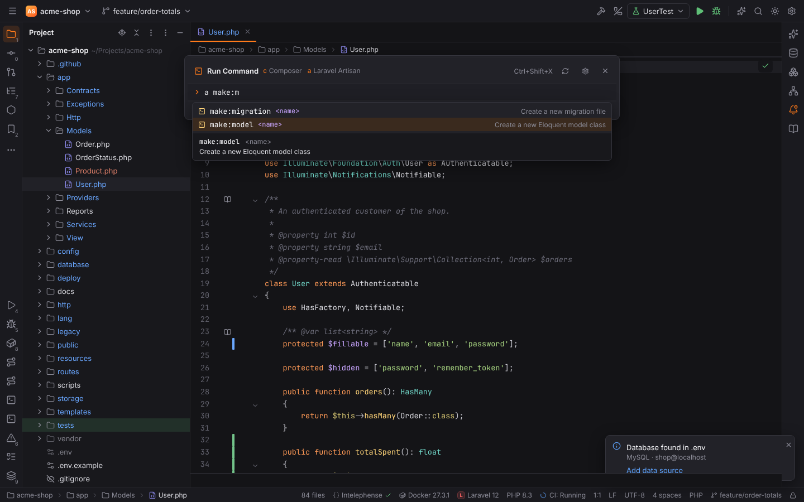
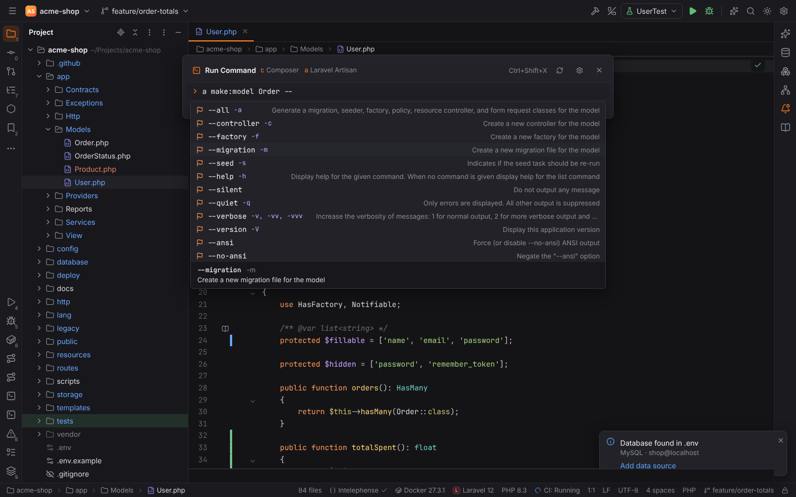
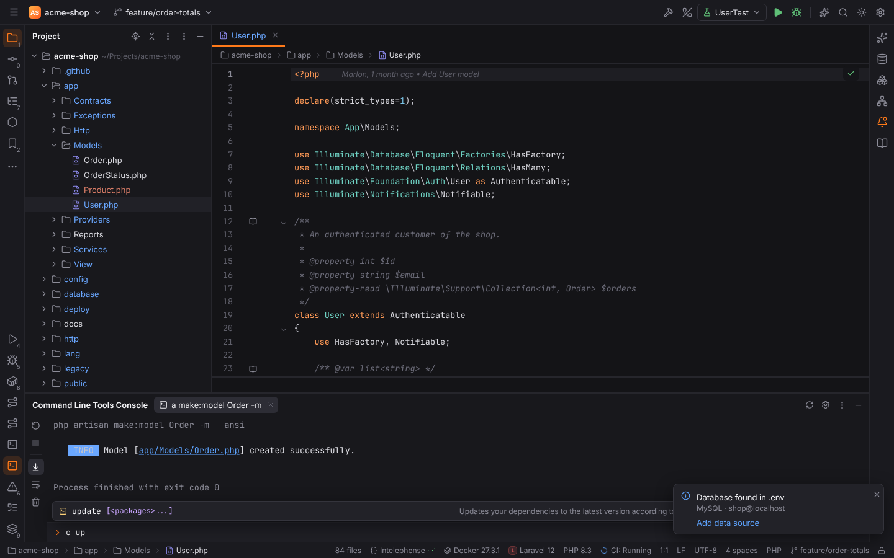
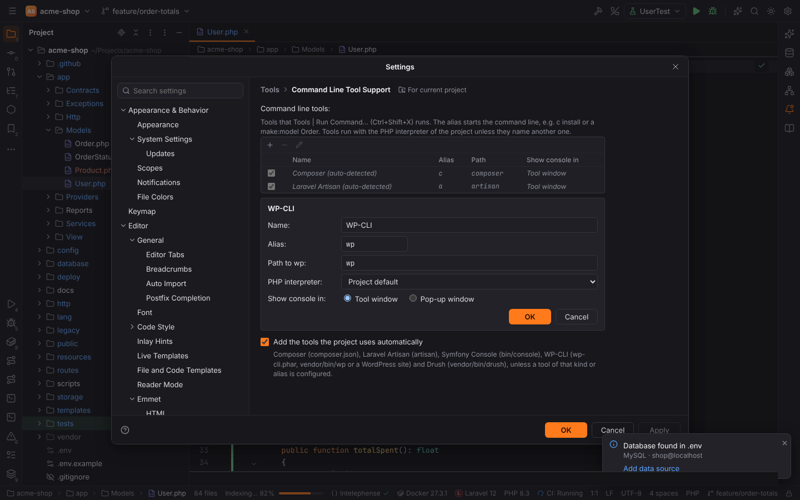

# Command Line Tool Support

The Command Line Tools Console runs the command line tools of a PHP project, like PHPStorm's
Command Line Tool Support: Composer, Laravel Artisan, Symfony Console, WP-CLI, Drush, any tool
built on Symfony Console, and plain PHP scripts. You type a command as
`alias command [arguments]`, for example `c require laravel/sanctum`,
`a make:model Order -m` or `s cache:clear`, and Forge completes commands, options and
arguments as you type.

The feature is the plugin **Command Line Tool Support** (`forge.command-line-tools`) of the
PHPForge pack. It is active in PHP and Composer projects.

## Run Command

**Tools | Run Command…** (`Ctrl+Shift+X`, macOS `Cmd+Shift+X`, action id
`CommandLineToolsAction`) opens the Run Command popup. Its header lists the aliases of the
project's tools.

| Key | Action |
| --- | --- |
| typing | completion of the alias, the command, options, option values and arguments |
| `Tab` | insert the selected (or first) completion item |
| `↓` / `↑` | move through the completion list; with no list, browse the history |
| `Enter` | run the command (or insert the item you moved to with the arrow keys) |
| `Ctrl+C` | stop the running command (when nothing is selected in the input) |
| `Esc` | close the completion list, then the popup |

Completion knows:

- **aliases** of the configured tools (also found by the tool's name),
- **commands**, by prefix, by any part (`model` finds `make:model`) and by Symfony-style
  abbreviations (`m:mi` for `make:migration`, `d:s:u` for `doctrine:schema:update`);
  WP-CLI subcommands word by word (`wp plugin list`),
- **options** (`--migration`, `-m`) of the command, the command's own first and the
  application's global ones (`--help`, `--ansi`, `--env`) after them; options you already used
  are not offered again unless they may repeat,
- **option values** that the tool lists (WP-CLI `--format=table|csv|json|…`),
- **arguments**: the expected argument is shown below the input (`<name>: The name of the
  model`); `help <command_name>` completes command names and `list <namespace>` namespaces.

While you type the arguments of a command, the help of the command is shown under the list:
its description, usage, arguments and options, with the argument or option at the cursor
highlighted. Hovering a completion item shows its description.

## The console and the output

A command's output goes to the **Command Line Tools Console** tool window (one tab per
command), or stays in the popup when the tool's **Show console in** is **Pop-up window**.
The console shows the command line, colored output, clickable file paths (`app/Models/Order.php`
opens in the editor) and URLs, and the exit code (`Process finished with exit code 0`). Input
typed into a running console goes to the command (questions of `make:` commands, `tinker`).

The tool window has an input with completion at the bottom (the completion opens above it),
and a toolbar with **Rerun**, **Stop**, **Scroll to the End**, **Soft-Wrap** and **Clear
All**. Its header has **Reload Command Lists** and a link to the settings. Middle-click or `×`
closes a tab.

Commands run where the project's PHP runs: through the tool's PHP interpreter, or the project
default of Settings | PHP | CLI Interpreter, including Docker, Docker Compose, SSH and WSL
interpreters (see [PHP](php.md)). Container paths in the output are mapped back to project
files, so links work there too. Remote projects run the tools on the remote host.

## Command lists and the cache

Forge reads the commands of a tool by running it once:

| Tool | List command |
| --- | --- |
| Composer, Laravel Artisan, Symfony Console, Drush, Tool based on Symfony Console | `<tool> list --format=json` |
| WP-CLI | `wp cli cmd-dump` |
| Tool based on PHP script | none (no completion of commands) |

The result is cached per project and tool in Forge's cache directory
(`<cache dir>/forge/command-line-tools`) and reused until the tool's path, its interpreter or
`composer.lock` changes, so installing or updating packages brings new commands in. **Reload
Command Lists** (in the popup header and the tool window header) lists all tools again. When
Artisan or the Symfony console cannot run (no `vendor/`, a broken application), the standard
commands of Laravel or Symfony are offered instead.

## Settings | Tools | Command Line Tool Support

The table lists the project's tools. Tools the project uses are **auto-detected** (shown in
italics) as long as no tool of that kind or alias is configured:

| Tool | Detected from | Alias | Path |
| --- | --- | --- | --- |
| Composer | `composer.json` | `c` | the Composer executable of Settings \| PHP \| Composer (`composer`) |
| Laravel Artisan | `artisan` | `a` | `artisan` |
| Symfony Console | `bin/console` | `s` | `bin/console` |
| WP-CLI | `wp-cli.phar`, `vendor/bin/wp`, or a WordPress site (`wp-config.php`) | `wp` | `wp-cli.phar`, `vendor/bin/wp` or `wp` |
| Drush | `vendor/bin/drush` | `drush` | `vendor/bin/drush` |

**+** opens **Choose Tool to Add** with these tools plus **Tool based on Symfony Console** and
**Tool based on PHP script** (any PHP script, run as `php <script> <arguments>`). **−**
removes a tool, the pencil (or a double-click) edits it; editing an auto-detected tool adds it
to the list. The checkbox turns a tool off. Each tool has:

| Field | Meaning |
| --- | --- |
| Name | shown in the table, the popup header and the tool window |
| Alias | the first word of a command line; unique, without spaces |
| Path | a project script (`artisan`, `bin/console`), a `.phar` (run with PHP) or a program name (`composer`, `wp`) |
| PHP interpreter | the CLI interpreter that runs it; **Project default** uses Settings \| PHP |
| Show console in | **Tool window** or **Pop-up window** |

Scripts and `.phar` files always run with the PHP interpreter. Programs such as `composer` or
`wp` run as they are, and inside the interpreter's environment (for example in the Docker
container) when the tool names an interpreter.

The tools are stored in the project settings (`commandLineTools.tools`), so a team can share
them through `.forge/settings.toml`. **Add the tools the project uses automatically**
(`commandLineTools.autoDetect`) turns auto-detection off.

## Laravel and Symfony

**Tools | Laravel | Run Artisan Command…** opens the Run Command popup with the Artisan alias
typed in. The Symfony plugin keeps its own **Run Console Command…** list with the
application's commands and gutter icons (see [Symfony](symfony.md)). For commands you run often
with a debugger, create an **Artisan** or **Composer** run configuration
(see [Run/Debug configurations](run-debug.md)).
