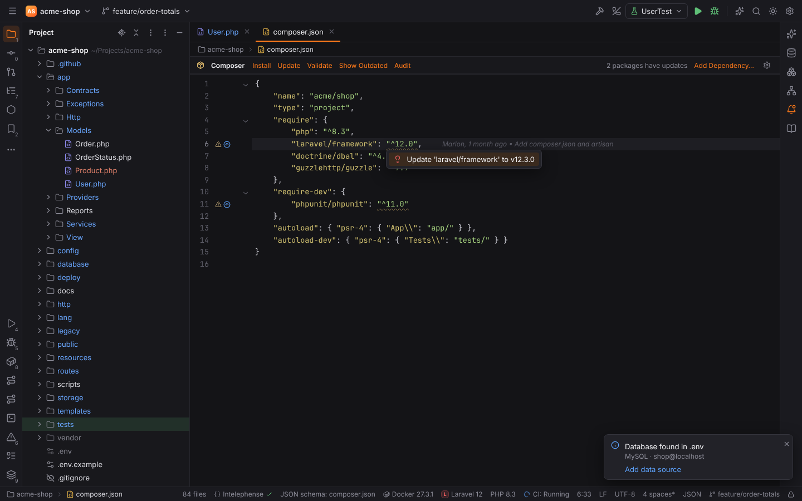
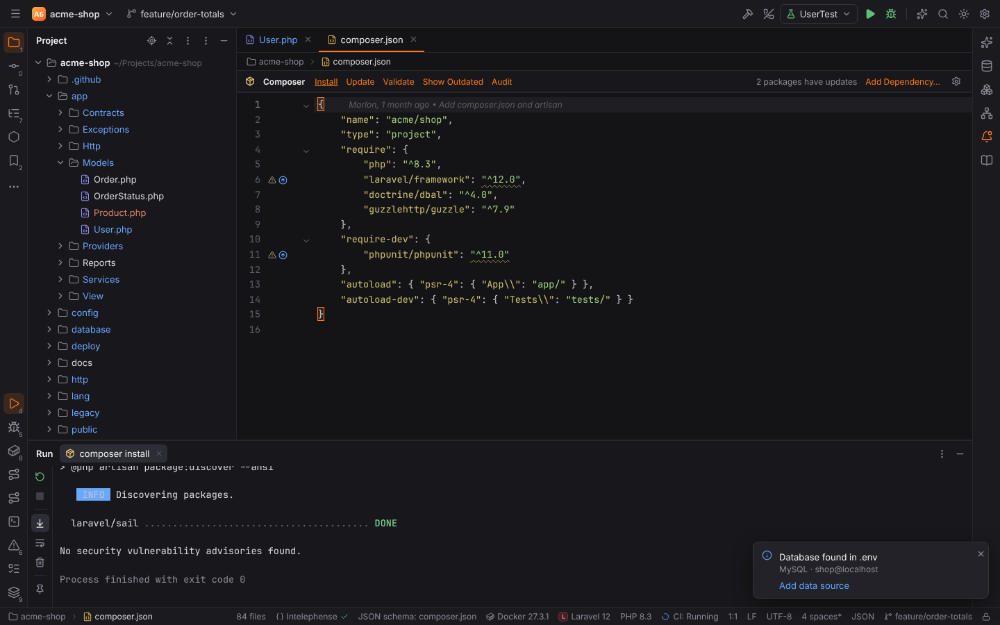
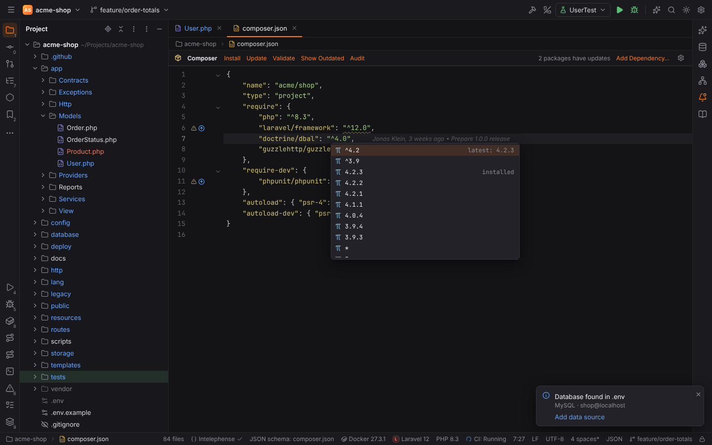
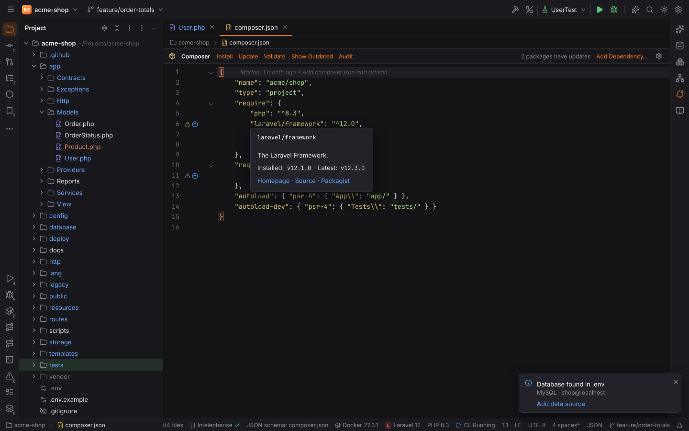
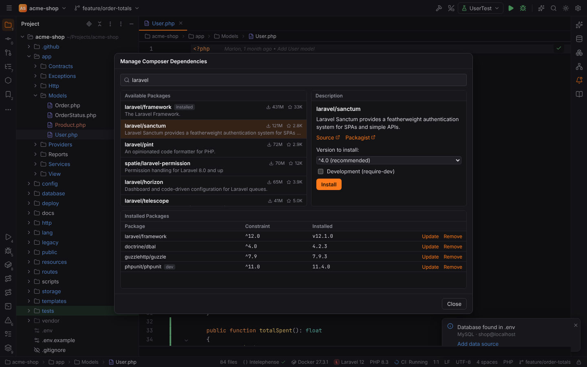
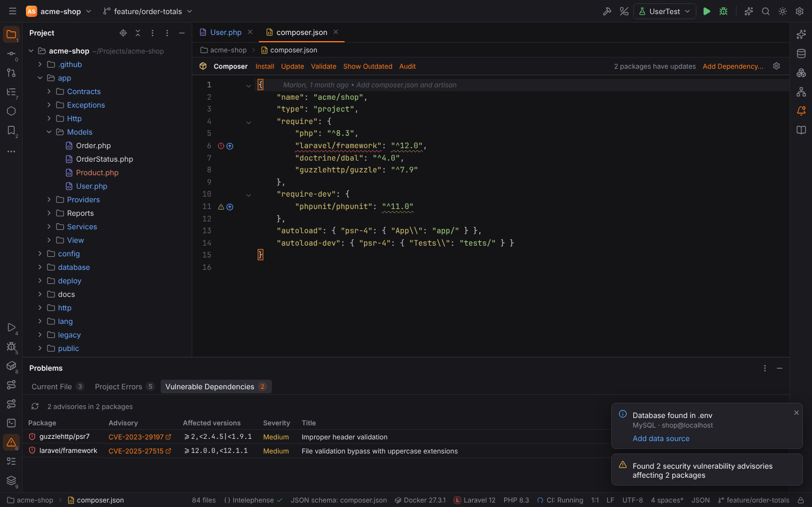
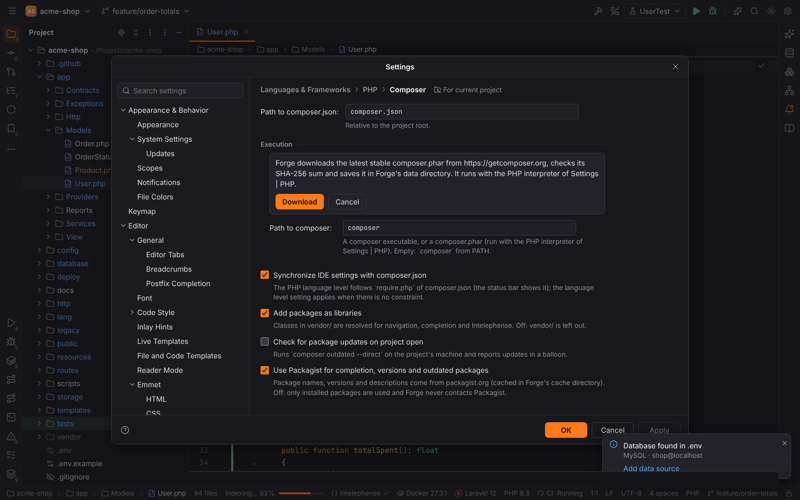

# Composer

Forge works with [Composer](https://getcomposer.org) the way PHPStorm does: composer.json gets
a toolbar with the Composer commands, outdated packages are marked, package names and version
constraints complete from [Packagist](https://packagist.org), Tools | Composer | Add
Dependency… searches and installs packages, and `composer audit` reports security advisories
as problems. The Composer plugin (`forge.composer`, part of PHPForge) is active in projects
with a composer.json.

Composer runs on the project's machine (also in [remote projects](remote-development.md)) and
its output goes to the [Run tool window](run-debug.md). Which composer.json is the project's
and which Composer runs is set in
[Settings | Languages & Frameworks | PHP | Composer](#settings).

## The composer.json toolbar

A composer.json of the project (not the ones inside `vendor/`) shows the Composer toolbar
above the editor:

| Action | Runs | What it does |
| --- | --- | --- |
| Install | `composer install` | installs the packages of composer.lock (creates it when it is missing) |
| Update | `composer update` | updates all packages within their constraints and writes composer.lock |
| Validate | `composer validate` | checks composer.json and composer.lock |
| Show Outdated | `composer outdated --direct` | lists the direct dependencies that have newer releases |
| Audit | `composer audit` | checks the installed packages for security advisories, see [Composer audit](#composer-audit) |
| Add Dependency… | | opens [Manage Composer Dependencies](#manage-composer-dependencies) |

The toolbar also says how many packages have updates, and the gear opens the Composer
settings. The same actions are in **Tools | Composer** and in Find Action (`Ctrl+Shift+A`,
"Composer"); they have no default shortcut, assign one in [Settings | Keymap](keymap.md).

Every command runs in its own tab of the Run tool window ("composer install"); Rerun and Stop
work as for any run. When Composer is done, composer.json and composer.lock reload in open
editors and the markers below are computed again.

## Outdated packages

Forge compares the installed version of every package in `require` and `require-dev`
(from composer.lock, or `vendor/composer/installed.json` when there is no lock file) with the
latest stable release on Packagist. An outdated package gets

- an arrow icon in the gutter; click it to update the package,
- a weak warning on its constraint: "Package 'laravel/framework' is outdated: v12.1.0 is
  installed, v12.3.0 is available",
- the quick fix **Update 'laravel/framework' to v12.3.0** on `Alt+Enter`.

When the constraint allows the new release (Composer's `semver-safe-update`), the update
runs `composer update <package> --with-dependencies`. When it does not
(`update-possible`, e.g. a new major version), it runs `composer require <package>:<new
constraint>` (with `--dev` in `require-dev`), which also rewrites the constraint in
composer.json; the new constraint is what Composer itself would write (`^13.0`).

Platform requirements (`php`, `ext-*`, `lib-*`) are not checked. Without network the markers
use the releases Forge saw last (see [Packagist access](#packagist-access)).

## Completion and documentation

In `require` and `require-dev`:

- **Package names** complete from the installed packages and a Packagist search for what you
  typed (description on the right), plus `php` and `ext-…` extensions. Packages already in
  the file are not offered again. Choosing a package writes `"vendor/package": ""` and
  continues with the version.
- **Version constraints** complete with the recommended constraint of the latest release
  (`^12.3`, "latest: v12.3.0"), one caret constraint per release line (`^11.44`), the released
  versions (the installed one is marked "installed") and `*`.
- **Hover** over a package name or constraint shows the package's description, the installed
  and the latest version and links to its homepage, source repository and Packagist page.

Completion of the other composer.json keys (`autoload`, `config`, …) comes from the
[JSON Schema](json-schema.md) support.

## Manage Composer Dependencies

**Tools | Composer | Add Dependency…** (or "Add Dependency…" in the toolbar) opens PHPStorm's
Manage Composer Dependencies dialog:

- **Search** Packagist as you type; the list shows each package's description, downloads and
  stars, and marks installed and abandoned packages. `Up`/`Down` move through the results.
- **Description**: the selected package's description and links (Homepage, Source,
  Packagist).
- **Version to install**: "Latest (Composer chooses)", the recommended constraint
  (`^4.0 (recommended)`) or any released version.
- **Development (require-dev)** adds the package to `require-dev`.
- **Install** (or `Enter`, or a double click) runs `composer require vendor/package:<version>`
  in the Run tool window.
- **Installed Packages** lists the packages composer.json requires with their constraint and
  installed version. **Update** runs `composer update <package> --with-dependencies`,
  **Remove** runs `composer remove <package>`. The list reloads when Composer is done.

## Composer audit

**Tools | Composer | Audit** (or "Audit" in the toolbar) runs `composer audit --format=json`
(with `--locked` when there is a composer.lock) on the project's machine. The result is shown

- in the **Vulnerable Dependencies** tab of the [Problems tool window](editor.md#problems) (`Alt+6`):
  package, advisory (CVE or Packagist advisory id, linking to the advisory), affected
  versions, severity and title; click a row to go to the package; the refresh button runs the
  audit again,
- as errors on the package in composer.json (direct dependencies) and in composer.lock (every
  affected package), so they also appear under Current File and Project Errors,
- as warnings for abandoned packages ("Package swiftmailer/swiftmailer is abandoned, use
  symfony/mailer instead"),
- in a balloon: "Found 2 security vulnerability advisories affecting 2 packages".

## Settings

Settings | Languages & Frameworks | PHP | Composer:

| Option | Setting | Default | What it does |
| --- | --- | --- | --- |
| Path to composer.json | `php.composer.json` | `composer.json` | relative to the project root; the toolbar, Tools \| Composer and the dialog work on this file |
| Path to composer (Execution) | `php.composer.executable` | `composer` | a composer executable, or a `composer.phar` that runs with the [PHP interpreter](php.md#settings--languages--frameworks--php) (`php.interpreter`) |
| Download composer.phar from getcomposer.org | | | downloads the latest stable composer.phar, see below |
| Synchronize IDE settings with composer.json | `php.composer.syncWithComposerJson` | on | the PHP language level follows `require.php` |
| Add packages as libraries | `php.composer.addPackagesAsLibraries` | on | classes in `vendor/` are resolved for navigation and completion |
| Check for package updates on project open | `php.composer.checkUpdates` | off | runs `composer outdated --direct` when the project opens and lists the updates in a balloon |
| Use Packagist for completion, versions and outdated packages | `php.composer.packagist` | on | see [Packagist access](#packagist-access) |

### Download composer.phar

Without Composer on your machine, click **Download composer.phar from getcomposer.org**.
Forge asks first; after you click **Download** it fetches
`https://getcomposer.org/download/latest-stable/composer.phar`, checks it against the SHA-256
sum getcomposer.org publishes next to it (`composer.phar.sha256sum`), saves it in Forge's data
directory (`<data dir>/forge/composer/composer.phar`, see
[File locations](../reference/file-locations.md)) and puts the path into "Path to composer";
**Apply** saves it. A file with the wrong checksum is not saved. Nothing is downloaded without
your click, and composer.phar is never bundled with Forge.

> **Note:** the downloaded composer.phar is on your machine. For a
> [remote project](remote-development.md) set "Path to composer" to a Composer on the remote
> host.

### Packagist access

Package names, versions, descriptions and the outdated markers come from Packagist's API
(`https://repo.packagist.org/p2/<vendor>/<package>.json` and `https://packagist.org/search.json`).
Forge reaches it from its own process (not from the UI), with the system proxy settings, and
caches the answers in `<cache dir>/forge/packagist` (package metadata for 6 hours, searches
for one hour), never in the project. Without network the cached answers are used; with
nothing cached, completion falls back to the installed packages and the outdated markers stay
away.

Turn off "Use Packagist for completion, versions and outdated packages" and Forge never
contacts Packagist: completion uses the installed packages only, there are no outdated
markers, and the dialog's search is unavailable. Composer itself still downloads packages
when you run it.

## Composer scripts

Scripts of composer.json run with a **Composer Script** run configuration
(`composer run-script <script>`), see [Run/Debug configurations](run-debug.md). It uses the
same "Path to composer", so a downloaded composer.phar works there too.
