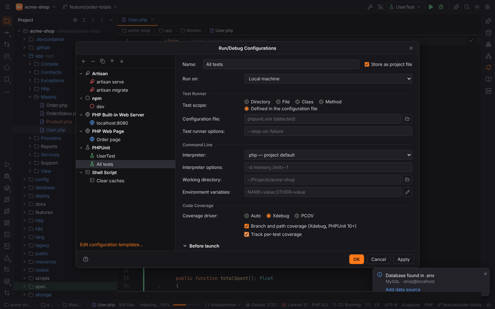
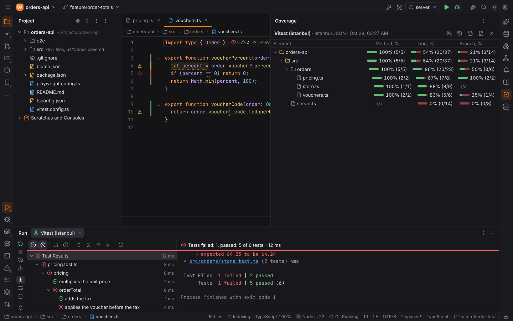
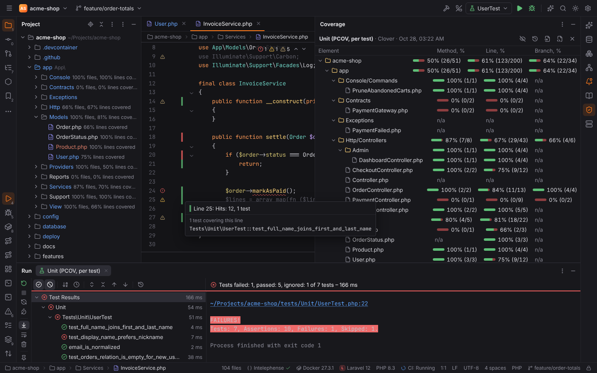
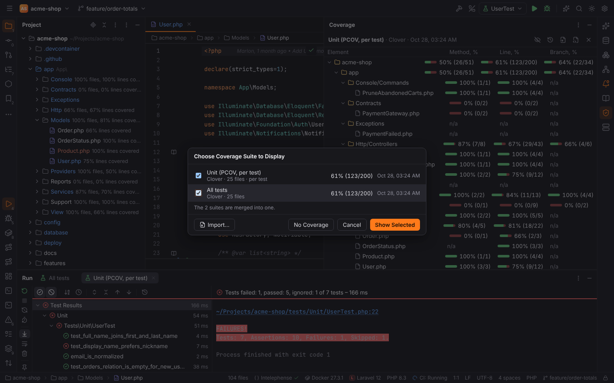
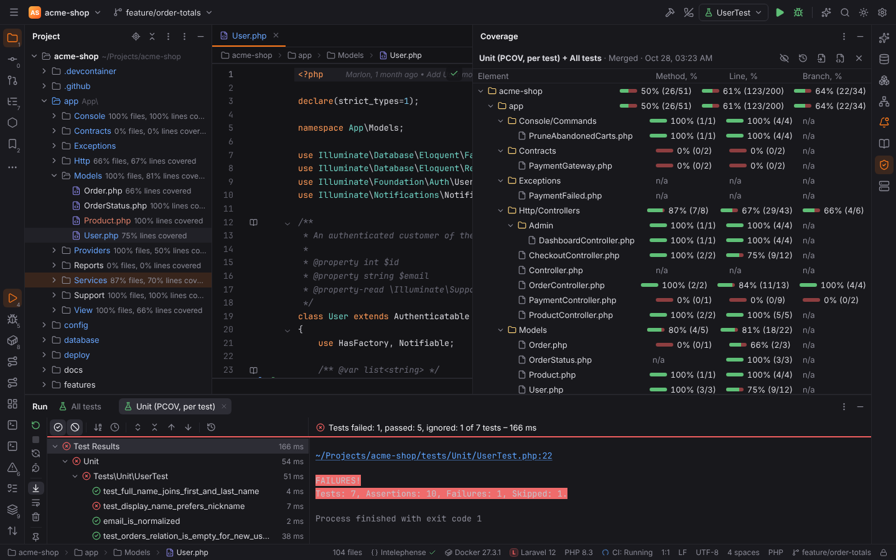
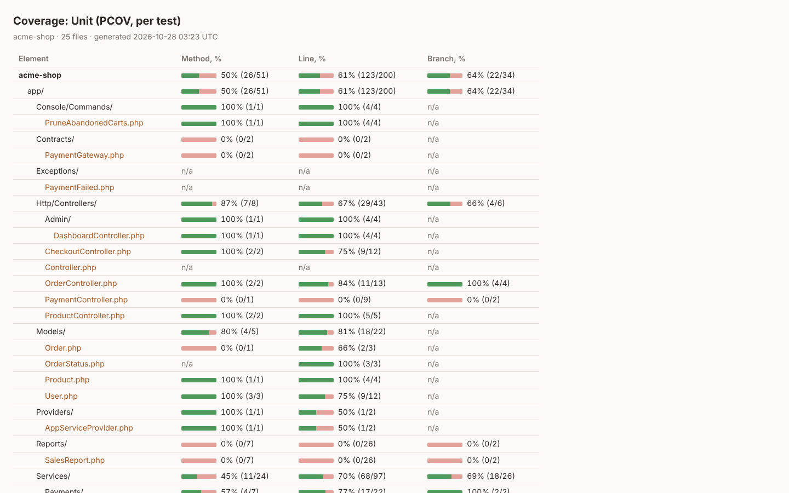

# Code coverage

**Run with Coverage** runs tests (or a Node.js program) and shows which lines they executed,
like PHPStorm:


## Run with Coverage

- the gutter menu of a test: **Run '…' with Coverage**;
- **Run | Run with Coverage** for the selected configuration (action `Coverage`) and
  **Run Context Configuration with Coverage** (`RunCoverage`) for the test at the caret.

When the run ends, Forge reads the report, maps its paths into the project (container and
remote paths through the run's path mappings) and shows the suite. Coverage runs work on
every [run target](run-targets.md) and through every PHP CLI interpreter (Docker, Compose,
SSH, WSL): the report names the container's paths, Forge maps them back. In
[Safe Mode](project-trust.md) they are refused like every run.

## What works per language

| Language | Configurations | How Forge measures | Report | Branches | Methods | Tests per line |
| --- | --- | --- | --- | --- | --- | --- |
| PHP | PHPUnit, Pest | `--coverage-clover` with Xdebug or PCOV ([driver](#php-coverage-driver)); `--path-coverage` on request | Clover XML | Clover `cond` lines (not written by PHPUnit) | yes | yes, with **Track per-test coverage** (`--coverage-xml`) |
| PHP | Codeception | `run --coverage-xml=<file>` (Codeception's Clover); `coverage: enabled: true` in `codeception.yml` | Clover XML | — | yes | yes, with **Track per-test coverage** (`--coverage-phpunit=<dir>`) |
| PHP | Behat | [behat-code-coverage](https://github.com/dvdoug/behat-code-coverage) with a `clover` report in `behat.yml` | Clover XML | — | yes | — |
| PHP | PHPSpec | [phpspec-code-coverage](https://github.com/friends-of-phpspec/phpspec-code-coverage) with a `clover` output in `phpspec.yml` | Clover XML | — | yes | — |
| JavaScript / TypeScript | Vitest | `--coverage.enabled --coverage.reporter=json`; provider v8 or istanbul (configuration or **Coverage provider**) | Istanbul JSON | yes | yes | — |
| JavaScript / TypeScript | Jest | `--coverage --coverageReporters=json`; provider babel or v8 | Istanbul JSON | yes | yes | — |
| JavaScript / TypeScript | Mocha | runs under **c8** (default) or **nyc** (**Coverage tool**) | LCOV | yes | yes | — |
| JavaScript / TypeScript | Node.js Test Runner | `--experimental-test-coverage` with Node's LCOV reporter | LCOV | yes | yes | — |
| JavaScript / TypeScript | Node.js (a program) | runs under c8 or nyc (Code Coverage group) | LCOV | yes | yes | — |
| Python | pytest | pytest-cov (`--cov --cov-report=xml`) | Cobertura | with `--cov-branch` | — | — |
| Python | Unittests | coverage.py inside Forge's runner, branches on | Cobertura | yes | — | — |
| Java, Groovy | JUnit, TestNG, Spock | Gradle `jacocoTestReport` (XML report enabled) or Maven `jacoco:report`, when the build configures JaCoCo | JaCoCo XML | yes | yes | — |
| Kotlin | Kotest (JUnit as Java) | as Java (JaCoCo; Kover's XML report reads the same) | JaCoCo XML | yes | yes | — |
| Go | Go Test | `go test -coverprofile` | Go coverprofile | partly covered lines | — | — |
| Rust | Cargo Test | cargo-llvm-cov (`--lcov`) | LCOV | when branch coverage is on (nightly) | yes | — |
| C, C++ | GoogleTest, Catch2, CTest | gcov (GCC `--coverage`) or llvm-cov (Clang profiles) | LCOV | yes | yes | — |
| Lua | busted | `busted --coverage` with luacov and luacov-reporter-lcov (`.luacov`: `runreport = true`, `reporter = "lcov"`) | LCOV | — | — | — |

Not supported: Playwright and Cypress (browser tests), tox and Django test configurations,
.NET (there is no .NET pack yet). Per-test coverage needs a report that names the tests of
each line: PHPUnit's and Codeception's XML report, and LCOV tracefiles with test names
(`TN:`). JaCoCo sessions, coverage.py contexts and Istanbul reports do not carry it.

### PHP coverage driver

The **Code Coverage** group of a PHP test configuration (Run/Debug Configurations) chooses how
coverage is measured:



| Option | Effect |
| --- | --- |
| **Coverage driver: Auto** | `XDEBUG_MODE=coverage`; php-code-coverage uses PCOV when it is enabled, else Xdebug |
| **Xdebug** | `-dxdebug.mode=coverage -dpcov.enabled=0` |
| **PCOV** | `-dpcov.enabled=1` and `XDEBUG_MODE=off` (PCOV is much faster, lines only) |
| **Branch and path coverage** (PHPUnit, Pest) | `--path-coverage` (PHPUnit 10+, Xdebug only). PHPUnit writes branches and paths to its HTML and XML reports; its Clover report, which Forge reads, keeps lines, so the gutter shows line coverage |
| **Track per-test coverage** (PHPUnit, Pest, Codeception) | also writes PHPUnit's XML report: Forge records the tests of every covered line |

Behat and PHPSpec have no coverage of their own: install their extension, add a Clover
report to its configuration, and Forge reads that file after the run:

```yaml
# behat.yml
default:
  extensions:
    DVDoug\Behat\CodeCoverage\Extension:
      filter:
        include:
          directories:
            'src': ~
      reports:
        clover:
          target: build/coverage-behat/clover.xml
```

```yaml
# phpspec.yml
extensions:
  FriendsOfPhpSpec\PhpSpec\CodeCoverage\CodeCoverageExtension:
    format: [clover]
    output:
      clover: build/coverage.xml
```

### JavaScript and TypeScript

Jest and Vitest write Istanbul's JSON report (`coverage-final.json`), which keeps every
statement, branch and function: a line is partly covered when a branch on it was not taken or
some statements on it did not run.



The **Coverage provider** field of a Vitest (v8 / istanbul) or Jest (babel / v8)
configuration overrides the provider of the configuration file; the provider's package
(`@vitest/coverage-v8`, `@vitest/coverage-istanbul`) must be installed. Mocha and Node.js
configurations run under c8 (or nyc) from the project's `node_modules` (the `c8Package` /
`nycPackage` options name another one).

## Coverage tool window

**View | Tool Windows | Coverage** (on the right, shown once there is coverage data) lists the
directories and files of the suite:

| Column | Shows |
| --- | --- |
| Element | the project, folders (single-child folders compacted: `src/main/java`) and files |
| Method, % | called and total functions and methods (reports that name them) |
| Line, % | covered and total lines: `85% (17/20)` with a bar |
| Branch, % | taken and total branches (Clover conditions, Cobertura, LCOV, Istanbul, JaCoCo) |

Double-click a file to open it, a folder to collapse it. The toolbar **hides / shows** the
coverage in the editor and the Project view, **Show Coverage Data…** chooses suites,
**Import External Coverage Report…** reads a report, **Generate Coverage Report…** writes
HTML and **Close** drops the suite.

## Coverage in the editor and the Project view

While coverage is shown, the editor gutter marks every line of the report:

- green: the line ran (and all its branches were taken);
- yellow: the line ran, but some branches (or, in Go, some blocks on the line; with Istanbul,
  some statements) did not;
- red: the line never ran.

Hovering a mark shows the hits: "Hits: 3, branches: 1 of 2 covered", and with per-test
coverage the number of tests. **Clicking** such a mark lists the tests covering the line;
clicking a test searches for it (Search Everywhere).



The Project view shows "62% lines covered" next to covered files and
"50% files, 62% lines covered" next to folders, at every folder level.


## Show Coverage Data

**Run | Show Coverage Data…** (`Ctrl+Alt+F6`, action `SwitchCoverage`) opens **Choose Coverage
Suite to Display** with the session's last suites. Check one suite to show it, or several to
merge them into a new suite ("Unit + Feature"); **No Coverage** hides the marks.
**Run | Hide Coverage** (`HideCoverageInfo`) hides them as well.





**Import External Coverage Report…** (desktop app: a file dialog; the Project view: right-click
a report, **Show Coverage Data from This Report**) reads:

| Format | Written by |
| --- | --- |
| LCOV (`lcov.info`) | c8, Istanbul / nyc, Jest and Vitest `lcov`, luacov-reporter-lcov, grcov, cargo-llvm-cov |
| Cobertura XML | coverage.py `coverage xml`, Istanbul `cobertura`, cargo-llvm-cov, gcovr |
| Clover XML | PHPUnit `--coverage-clover`, Codeception, Istanbul `clover` |
| JaCoCo XML | JaCoCo, Kover |
| Go coverprofile | `go test -coverprofile` |
| Istanbul JSON (`coverage-final.json`) | Istanbul / nyc `json`, Jest, Vitest, c8 `json` |

The format is recognized from the content.

## Generate Coverage Report

**Run | Generate Coverage Report…** (`GenerateCoverageReport`, also in the Coverage tool
window's toolbar) writes the shown suite as one HTML file: the totals, the folders and files
with method, line and branch coverage, and each file's source with its covered, partly covered
and uncovered lines, hits and tests. The desktop app asks where to save it; in the browser it
is downloaded.


