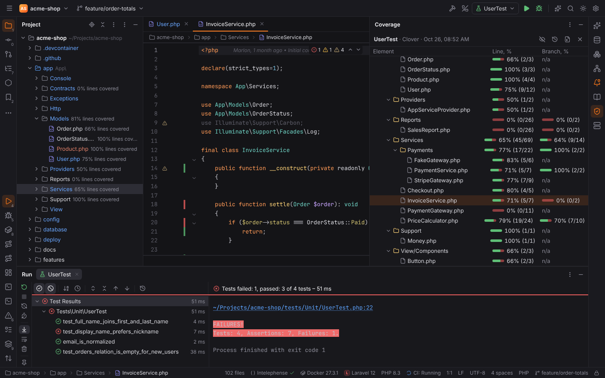
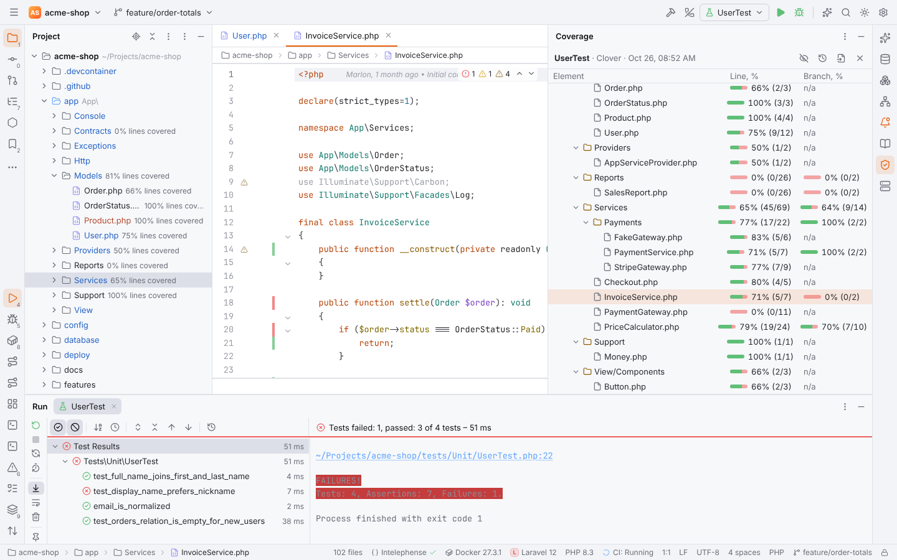

# Code coverage

**Run with Coverage** runs tests and shows which lines they executed, like PHPStorm:

## Run with Coverage

- the gutter menu of a test: **Run '…' with Coverage**;
- **Run | Run with Coverage** for the selected configuration (action `Coverage`) and
  **Run Context Configuration with Coverage** (`RunCoverage`) for the test at the caret.

| Framework | How | Report |
| --- | --- | --- |
| PHPUnit, Pest | `--coverage-clover <file>` with `XDEBUG_MODE=coverage` (Xdebug) or PCOV, whichever the interpreter loads | Clover XML |
| busted (LuaForge) | `busted --coverage` with luacov; `.luacov` sets `runreport = true` and `reporter = "lcov"` (luacov-reporter-lcov) | LCOV (`luacov.report.out`) |
| any manifest framework | its `coverage` arguments | LCOV, Cobertura, Clover, JaCoCo or a Go profile |

When the run ends, Forge reads the report, maps its paths into the project (container and
remote paths through the run's path mappings) and shows the suite. Coverage runs work on
every [run target](run-targets.md) and through every PHP CLI interpreter (Docker, Compose,
SSH, WSL). In [Safe Mode](project-trust.md) they are refused like every run.

## Coverage tool window

**View | Tool Windows | Coverage** (on the right, shown once there is coverage data) lists the
directories and files of the suite:

| Column | Shows |
| --- | --- |
| Element | the project, folders (single-child folders compacted: `src/main/java`) and files |
| Line, % | covered and total lines: `85% (17/20)` with a bar |
| Branch, % | taken and total branches (Clover conditions, Cobertura and LCOV branches, JaCoCo) |

Double-click a file to open it, a folder to collapse it. The toolbar **hides / shows** the
coverage in the editor and the Project view, **Show Coverage Data…** switches between the
session's last 10 suites, **Import External Coverage Report…** reads a report, and **Close**
drops the suite.

## Coverage in the editor and the Project view

While coverage is shown, the editor gutter marks every line of the report:

- green: the line ran (and all its branches were taken);
- yellow: the line ran, but some branches (or, in Go, some blocks on the line) did not;
- red: the line never ran.

Hovering a mark shows the hits: "Hits: 3, branches: 1 of 2 covered". The Project view shows
"62% lines covered" next to covered files and folders.

## Show Coverage Data

**Run | Show Coverage Data…** (`Ctrl+Alt+F6`, action `SwitchCoverage`) picks one of the
session's suites; **Run | Hide Coverage** (`HideCoverageInfo`) hides the marks and hints.
**Import External Coverage Report…** (desktop app: a file dialog; the Project view: right-click
a report, **Show Coverage Data from This Report**) reads:

| Format | Written by |
| --- | --- |
| LCOV (`lcov.info`) | c8, Istanbul / nyc, Jest and Vitest `lcov`, luacov-reporter-lcov, grcov, cargo-llvm-cov |
| Cobertura XML | coverage.py `coverage xml`, Istanbul `cobertura`, cargo-llvm-cov, gcovr |
| Clover XML | PHPUnit `--coverage-clover`, Istanbul `clover` |
| JaCoCo XML | JaCoCo, Kover |
| Go coverprofile | `go test -coverprofile` |

The format is recognized from the content.
