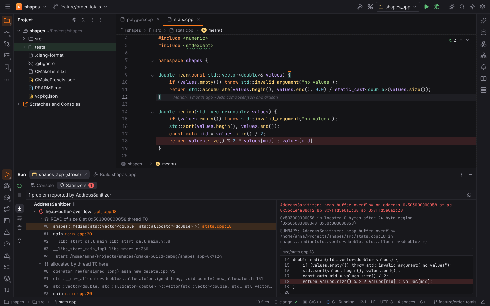
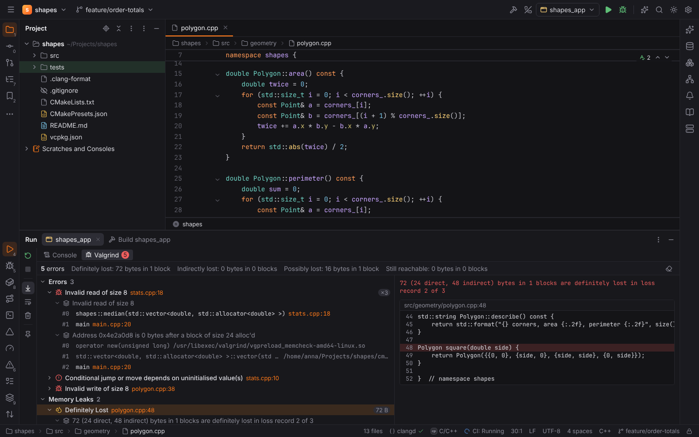
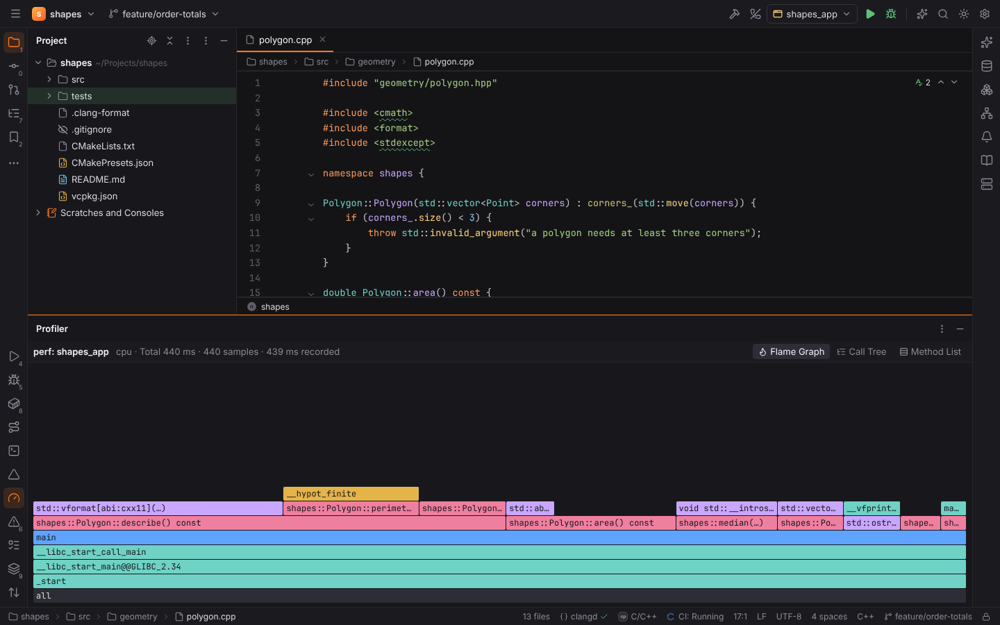

# C/C++ dynamic analysis and packages

These features of [CForge](cpp.md) find memory errors, data races, undefined behavior and
hot spots while a C or C++ program runs, like CLion's dynamic analysis tools, and connect the
vcpkg and Conan package managers to CMake. Every report is parsed in Rust
(`packs/cforge/analyzers`); Forge never downloads Valgrind, perf, vcpkg or Conan.

All of them start programs of the project, so [Safe Mode](project-trust.md) refuses them in
untrusted projects.

## Sanitizers

### Enabling sanitizers in a CMake profile

Settings | Build, Execution, Deployment | CMake has a **Sanitizers** row for every profile:
**ASan** (AddressSanitizer), **UBSan** (UndefinedBehaviorSanitizer), **TSan**
(ThreadSanitizer), **MSan** (MemorySanitizer, Clang only) and **LSan** (LeakSanitizer).
A profile with sanitizers configures with:

- `-fsanitize=<list> -fno-omit-frame-pointer` in `CMAKE_C_FLAGS` and `CMAKE_CXX_FLAGS`
  (appended to flags the profile's CMake options set; MSan adds
  `-fsanitize-memory-track-origins`);
- `-fsanitize=<list>` in `CMAKE_EXE_LINKER_FLAGS` and `CMAKE_SHARED_LINKER_FLAGS`.

ThreadSanitizer and MemorySanitizer cannot be combined with AddressSanitizer, LeakSanitizer
or each other; the page shows why under the checkboxes. CMake Application runs of a
sanitized profile get `UBSAN_OPTIONS=print_stacktrace=1` and `ASAN_OPTIONS=detect_leaks=1`
unless the environment sets them, so every report has a stack.

> **Note:** Rebuild after changing the sanitizers: CMake reconfigures the profile with the
> new flags (Reload CMake Project or Build).

### The Sanitizers tab

The output of every CMake Application, Google Test, Catch2 and CTest run is searched for
sanitizer reports when the program exits. When there are any, the Run tool window shows a
**Sanitizers** tab next to **Console**, with the number of problems:

- problems grouped by sanitizer, each with its kind (`heap-buffer-overflow`, `data race`,
  `Direct leak`, `signed integer overflow`, `use-of-uninitialized-value`) and where it
  happened in the project;
- its stacks: the access ("READ of size 8 …"), where the memory was allocated and freed,
  the previous access of a race and where the threads were created; LeakSanitizer reports
  each leak on its own;
- frames of project files are highlighted and link to their line; toolchain, C library and
  sanitizer runtime frames are dimmed;
- on the right, the full message, extra lines ("… is located 0 bytes after 24-byte
  region …"), the SUMMARY and a preview of the selected frame's code.

Selecting a problem highlights its line in the editor (red) and the other project frames of
its stacks (yellow), with the message on hover. **Clear Highlights** (the eraser) removes
them; double-click a frame to open it.



## Valgrind Memcheck

**Run | Run with Valgrind Memcheck** runs the selected CMake Application, Google Test or
Catch2 configuration (building its target first) under

```sh
valgrind --tool=memcheck --xml=yes --xml-file=<temp file> --leak-check=full <options> <program> <args>
```

When the program exits, Forge reads Memcheck's XML (protocol 4) and the Run tool window
shows a **Valgrind** tab:

- the header with the number of errors and the **leak summary** (definitely, indirectly,
  possibly lost and still reachable bytes and blocks);
- **Errors** (`Invalid read of size 8`, `Conditional jump or move depends on uninitialised
  value(s)`, …) with how often they happened, and **Memory Leaks** by size;
- each error's stacks: the error itself and every `auxwhat` stack ("Address … is 0 bytes after
  a block of size 24 alloc'd", "Uninitialised value was created by a heap allocation"),
  with the same navigation, preview and editor highlights as the Sanitizers tab.



Settings | Build, Execution, Deployment | **Dynamic Analysis Tools**:

| Setting | Default | Meaning |
| --- | --- | --- |
| `cpp.valgrind.path` | `""` | The Valgrind executable (empty: `valgrind` on the PATH). |
| `cpp.valgrind.options` | `--leak-check=full --track-origins=yes` | Memcheck options; Forge adds `--tool`, `--xml` and `--xml-file`. |

> **Note:** Valgrind runs local projects on Linux (on Windows, open the project in
> [WSL](dev-containers-and-wsl.md)). The XML file is written to the system temp folder and
> deleted after it was read.

## Profile with perf

**Run | Profile with perf** runs the configuration under Linux perf:

```sh
perf record -o <temp file> --call-graph dwarf -F 999 -- <program> <args>
```

When the program exits, Forge runs `perf script` (with source lines), builds the call tree in
Rust and opens it in the shared [Profiler tool window](go.md#profiler) as the **perf**
source: **Flame Graph** (click a frame to zoom, double-click to open its source), **Call
Tree** and **Method List** (self and total time). Frames of project files are highlighted.



| Setting | Default | Meaning |
| --- | --- | --- |
| `cpp.perf.path` | `""` | The perf executable (empty: `perf` on the PATH). |
| `cpp.perf.frequency` | `999` | Samples per second (`-F`). |
| `cpp.perf.callGraph` | `dwarf` | Call stacks: DWARF, frame pointers (needs `-fno-omit-frame-pointer`) or Intel LBR. |
| `cpp.perf.options` | `""` | Extra `perf record` options. |

> **Note:** perf is Linux only, and `/proc/sys/kernel/perf_event_paranoid` must allow
> profiling (2 or lower). On macOS, profile with Instruments or DTrace outside Forge; on
> Windows, use WSL or the Visual Studio profiler. Forge says so instead of starting the run.

## Package managers

### vcpkg

A CMake project with a `vcpkg.json` uses vcpkg in **manifest mode**. Forge finds the vcpkg
root in `cpp.vcpkg.root`, else `VCPKG_ROOT` or `VCPKG_INSTALLATION_ROOT`, and passes
`-DCMAKE_TOOLCHAIN_FILE=<root>/scripts/buildsystems/vcpkg.cmake` to every CMake profile that
does not set its own toolchain file. In `vcpkg.json`, port names of the local vcpkg's `ports/`
folder complete in the `dependencies` array (and in `"name"` of dependency objects).

### Conan 2

A project with a `conanfile.txt` or `conanfile.py` gets **Tools | Conan Install** for the
active CMake profile:

```sh
conan install . -of <profile's build folder> -s build_type=<profile's build type> --build=missing
```

After it finished, the profile configures with the generated `conan_toolchain.cmake` (in the
build folder, its `generators/` folder or `build/<type>/generators` with `cmake_layout`) and
the CMake project reloads. Saving `vcpkg.json` or a Conan recipe reloads the CMake project
too.

Settings | Build, Execution, Deployment | **Package Managers**:

| Setting | Default | Meaning |
| --- | --- | --- |
| `cpp.vcpkg.root` | `""` | The vcpkg installation. |
| `cpp.vcpkg.useToolchain` | `true` | Pass vcpkg's toolchain file to CMake profiles. |
| `cpp.conan.path` | `""` | Conan 2 (empty: `conan` on the PATH). |
| `cpp.conan.profile` | `""` | Conan profile (`-pr`). |
| `cpp.conan.arguments` | `""` | Extra `conan install` arguments. |
| `cpp.conan.useToolchain` | `true` | Configure with `conan_toolchain.cmake` once it exists. |

## Browser mode

On the `shapes` demo (`?project=cpp`), the configuration **shapes_app (stress)** prints an
AddressSanitizer report, and Run with Valgrind Memcheck and Profile with perf show canned
results of `shapes_app`, parsed by the same Rust code through WebAssembly. The demo has a
`vcpkg.json` and a **Debug-ASan** profile.
