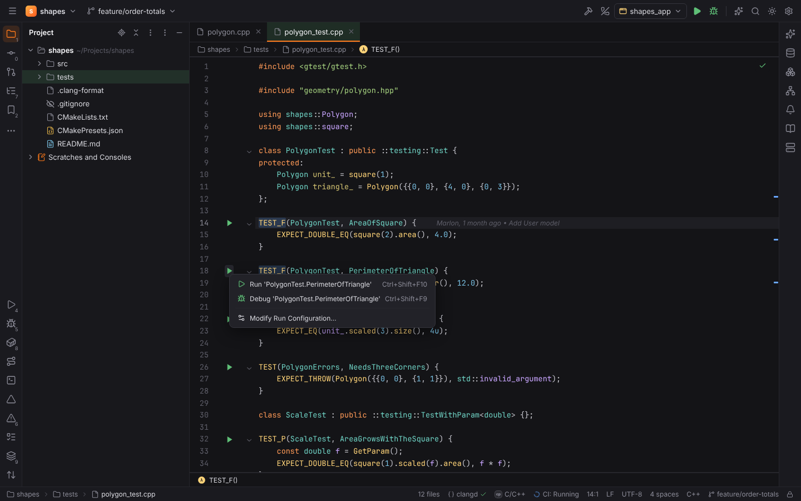
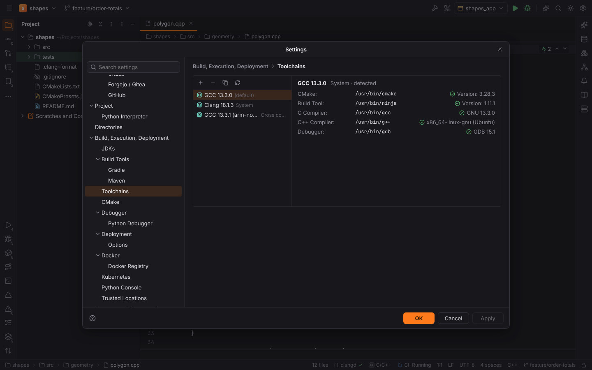
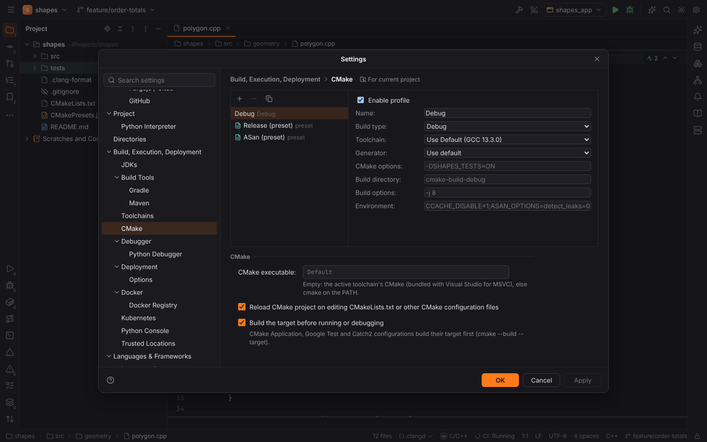
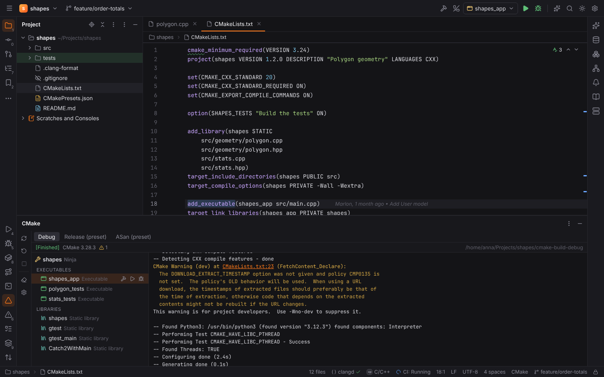
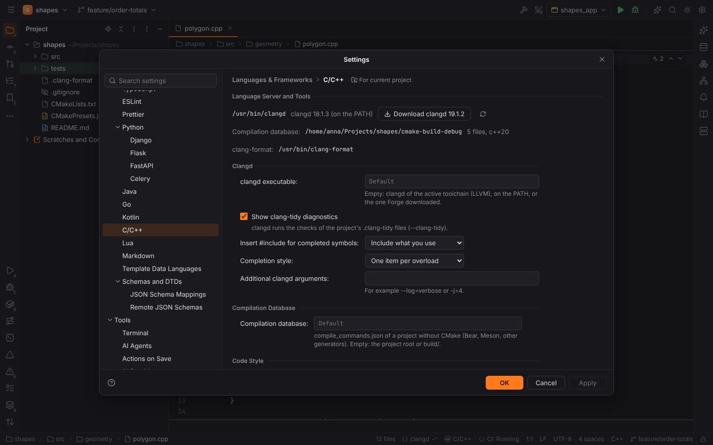
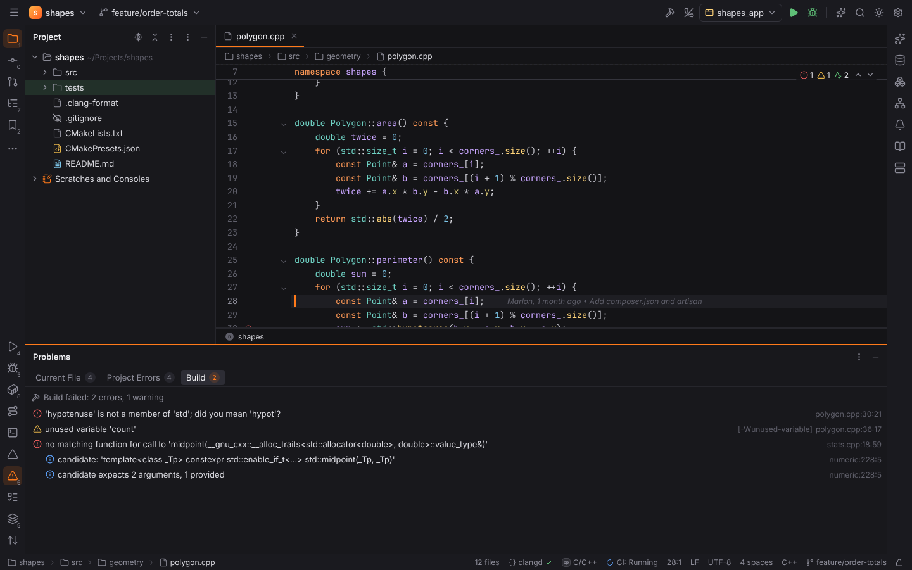
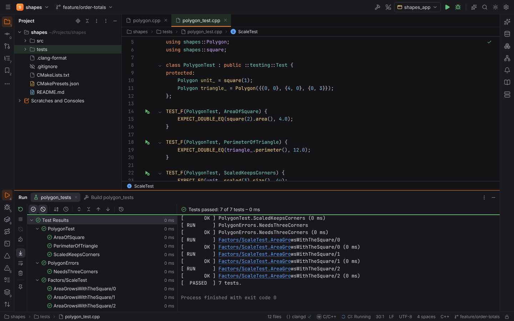
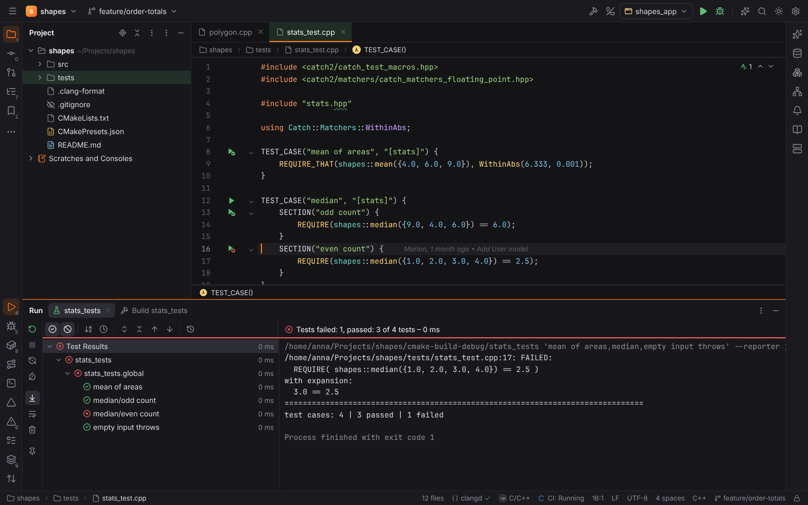
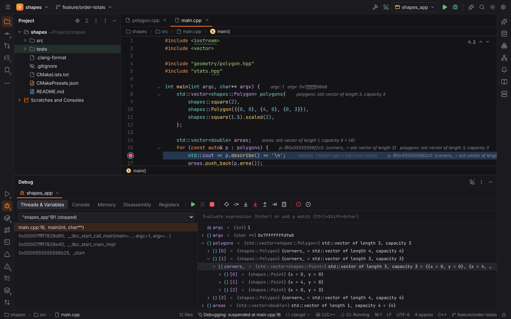

# CForge (C and C++)

**CForge** brings CLion's C and C++ support to Forge. Its plugin **C/C++** (`forge.cpp`) is
active in [C and C++ projects](../getting-started/project-detection.md): a `CMakeLists.txt`,
a `compile_commands.json` (in the root or `build/`), a `meson.build`, a `Makefile` next to
C/C++ sources (or with them in `src/`), C/C++ files in the root, or two or more in a folder.

- Highlighting of C, C++ and CMake files is bundled (CodeMirror's C++ grammar and the CMake
  mode); completion, navigation, hover, rename, code actions and diagnostics (with
  clang-tidy) come from **clangd** (Apache-2.0 WITH LLVM-exception).
- Everything else — toolchain detection, CMake presets and profiles, the CMake code model,
  build problems, test discovery and command lines, coverage and debugger setup — is
  computed in Rust (`packs/cforge/*`).

Two more pages cover the rest of CForge:

- [C/C++ dynamic analysis and packages](cpp-tools.md): sanitizers in CMake profiles and the
  Sanitizers tab, Run with Valgrind Memcheck, Profile with perf, vcpkg and Conan.
- [Embedded development](embedded.md): PlatformIO, ESP-IDF, Zephyr, OpenOCD Download & Run,
  Embedded GDB Server and the SVD Peripherals view.

## Toolchains

**Settings | Build, Execution, Deployment | Toolchains** lists the toolchains of the machine,
like CLion: a C and C++ compiler with CMake, a build tool (Ninja or Make) and a debugger.
Forge reads every version itself (`gcc -v`, `clang -v`, MSVC's `cl` banner, `--version` of
the tools) and shows what is missing.

| Toolchain | Found as |
| --- | --- |
| System GCC / Clang | `gcc` / `g++`, `clang` / `clang++` on the `PATH`, and versioned ones (`gcc-14`, `clang-19`) |
| Cross compilers | `<triple>-gcc` / `<triple>-g++` on the `PATH` (`arm-none-eabi-gcc`, `aarch64-linux-gnu-gcc`), with `<triple>-gdb` or `gdb-multiarch` |
| MinGW-w64 | MSYS2's `ucrt64`, `mingw64` and `clang64`, `C:\mingw64`, `C:\MinGW`, or a GCC on the `PATH` that targets `*-w64-mingw32` |
| Visual Studio | every installation with the C++ tools that `vswhere` reports: the newest `cl.exe`, `vcvarsall.bat` and the CMake and Ninja Visual Studio bundles |

- The debugger of a toolchain is GDB for GCC and LLDB (`lldb-dap`) for Clang, the other one
  when only that is installed. GDB needs version 14 or newer (its DAP server, `gdb -i dap`).
  Microsoft's debugger is not redistributable: MSVC programs are debugged with LLDB.
- **+** adds your own toolchain (`cpp.toolchains`): name, kind, CMake, build tool, C and C++
  compilers, debugger and an environment script (a cross SDK's `environment-setup-*`). Empty
  fields are detected. The page checks the entry while you type. The first toolchain of the
  list is the default; **Copy** turns a detected toolchain into an editable one.
- Remote projects use the compilers of the remote host; the page lists this machine's.

## CMake

### Profiles and presets

**Settings | Build, Execution, Deployment | CMake** holds the project's **profiles**
(`cmake.profiles`, stored with the project): name, build type (Debug, Release,
RelWithDebInfo, MinSizeRel), toolchain, generator, CMake options, build directory (default
`cmake-build-<name>`), build options (`-j 8`) and environment. Without a profile the project
has CLion's **Debug** profile.

The configure presets of `CMakePresets.json` and `CMakeUserPresets.json` become profiles too
(read-only; **Copy** turns one into a profile). Forge reads them in Rust: schema versions 1
to 10, `include` files, `inherits` chains, `hidden` presets, `condition`s (`equals`,
`inList`, `anyOf`, `not`, …) and the macros `${sourceDir}`, `${presetName}`,
`${hostSystemName}`, `$env{…}` and `$penv{…}`. Preset profiles configure with
`cmake --preset=<name>`.

- **Reload CMake project on editing CMakeLists.txt** (`cmake.reloadOnChange`) reloads after
  saving a CMake file or a presets file.
- **Build the target before running or debugging** (`cmake.buildBeforeRun`).
- **CMake executable** (`cmake.executable`): empty uses the toolchain's CMake.

### The CMake tool window

The **CMake** tool window shows one tab per enabled profile (the active one is selected;
clicking another one switches the active profile, `cmake.activeProfile`), the targets of the
profile's code model and the configure output.

- **Reload CMake Project** writes a query for CMake's file API
  (`<build>/.cmake/api/v1/query/client-forge/query.json`), runs the configure with the
  toolchain's compilers and `-DCMAKE_EXPORT_COMPILE_COMMANDS=ON`, and reads the reply:
  configurations, projects, targets (executables, libraries, utilities) with their sources,
  artifacts and the line of `CMakeLists.txt` that defines them. Double-click a target to go
  there; its row has Build, Run and Debug buttons.
- **Reset Cache and Reload Project** deletes `CMakeCache.txt` and `CMakeFiles` first;
  **Stop** ends a configure; **Clean** runs the `clean` target.
- `CMake Error at CMakeLists.txt:6 (find_package):` and warning lines of the log link to the
  file and line; the summary counts errors and warnings.
- Forge loads the CMake project when a trusted project opens. Configuring runs project code,
  so it is refused in [Safe Mode](project-trust.md); a model an earlier configure wrote is
  shown anyway.

CMake files get completion of commands (with their signatures), of the keywords of the
command the caret is in (`PRIVATE`, `REQUIRED`, `STATIC`, …) and of `${VARIABLES}` (CMake's
and the ones the file sets).

## Compilation database projects

A folder with a `compile_commands.json` (written by Bear, Meson or another generator) opens
as a C/C++ project without CMake. clangd reads the database in the project root or in
`build/`; **Settings | Languages & Frameworks | C/C++ | Compilation database**
(`cpp.compileCommands`) points at another one. The page shows how many files it lists and
which language standards they use.

## clangd

**Settings | Languages & Frameworks | C/C++** shows the clangd in use, the compilation
database it reads and clang-format.

- clangd comes from **clangd executable** (`cpp.clangd.path`), the toolchain's LLVM
  (`clangd` next to `clang++`), the `PATH`, or Forge's download.
- **Download clangd** fetches the pinned release (`19.1.2`) from the official
  [clangd releases](https://github.com/clangd/clangd/releases) after you agree, checks its
  SHA-256 and unpacks it into `<data dir>/forge/langservers/clangd/<version>`. The release
  publishes no checksum files: the SHA-256 is read from the GitHub API's asset digest of the
  pinned release (`api.github.com/repos/clangd/clangd/releases/tags/19.1.2`), and a download
  without one is refused. When a C/C++ project opens without clangd, a balloon offers the
  download.
- clangd starts with `--compile-commands-dir` set to the active profile's build folder (or
  the compilation database), `--background-index`, `--clang-tidy`
  (`cpp.clangd.clangTidy`; the project's `.clang-tidy` files choose the checks),
  `--header-insertion` (`cpp.clangd.headerInsertion`), `--completion-style`
  (`cpp.clangd.completionStyle`) and `--query-driver` with the toolchain's compilers, so
  cross compilers' system headers are found. **Additional clangd arguments**
  (`cpp.clangd.arguments`) adds more. It restarts after a CMake reload, so it reads the new
  database.

### Reformat Code

**Reformat Code** (`Ctrl+Alt+L`) and **Actions on Save | Reformat code** run clang-format
(`cpp.formatter`): it reads the `.clang-format` of the file's folder; **Style without a
.clang-format file** (`cpp.clangFormat.fallbackStyle`) applies otherwise. **clangd** formats
through the language server, **Do not format** leaves C and C++ files alone. `.clang-format`,
`.clang-tidy` and `.clangd` files are highlighted as YAML.

## Build

| Action | Shortcut | What it runs |
| --- | --- | --- |
| Build Project | `Ctrl+F9` (macOS `Cmd+F9`) | `cmake --build <build dir>` |
| Rebuild Project | | `cmake --build <build dir> --clean-first` |
| Clean | | `cmake --build <build dir> --target clean` |
| Build Target… | | `cmake --build <build dir> --target <target>` |

The build runs in the Run tool window. When it finishes, Forge parses the compiler and
linker messages in Rust — GCC and Clang (`file:line:col: error: …`, with their notes), MSVC
(`file(line,col): error C2065: …`) and the linkers (`ld`, `lld`, Apple's `ld`, `link.exe`) —
and shows them in the **Build** tab of the Problems tool window and as editor diagnostics.
Notes (candidates, declarations) are nested under their message; a click opens the line.

Build Project in other projects (JavaForge) keeps its own meaning.

## Run configurations

**CMake Application** runs an executable target of the active profile: **Target**, an
optional **Executable**, **Program arguments**, working directory (default: the folder of
the executable), environment and **Debugger** (the toolchain's, GDB or LLDB). The target is
built first. The CMake tool window's Run and Debug buttons create one.

**OpenOCD Download & Run** and **Embedded GDB Server** flash and debug boards; see
[Embedded development](embedded.md). CMake Application, Google Test and Catch2 configurations
also run under [Valgrind Memcheck and perf](cpp-tools.md), and their output is searched for
[sanitizer reports](cpp-tools.md#sanitizers).

## Tests

| Framework | Run configuration | How it runs | Gutter |
| --- | --- | --- | --- |
| GoogleTest | Google Test | the target's executable with `--gtest_filter` and `--gtest_output=xml:<report>` | `TEST`, `TEST_F`, `TEST_P`, `TYPED_TEST` |
| Catch2 | Catch2 | the target's executable with a test spec, `-c <section>` and `--reporter junit --out <report>` | `TEST_CASE`, `TEST_CASE_METHOD`, `SCENARIO`, `TEMPLATE_TEST_CASE` and their `SECTION`s / `GIVEN` / `WHEN` / `THEN` |
| CTest | CTest | `ctest --test-dir <build dir> --output-junit <report>` with `-R`, `-L` and `-j` | — |

- The test executable is the configuration's **Target**, else the CMake target that compiles
  the test file. It is built first (CTest builds the project).
- Results come from the JUnit XML reports into the test tree, with the file and line of every
  GoogleTest test; disabled tests show as ignored. **Rerun Failed Tests** runs
  `--gtest_filter=*.<test>:…`, the failed Catch2 test cases, or `ctest -R '^(…)$'`.
- Test discovery finds the macros with a small tokenizer that skips comments and keeps string
  literals; a file that includes `gtest/` or `catch2/` belongs to that framework.

### Coverage

**Run with Coverage** works for all three: build the profile with coverage instrumentation
(CMake options `-DCMAKE_CXX_FLAGS=--coverage` for GCC, or
`-DCMAKE_CXX_FLAGS="-fprofile-instr-generate -fcoverage-mapping"` for Clang). Forge clears old
`.gcda` files before the run and turns the data into an LCOV report afterwards: Clang's
`.profraw` files (`LLVM_PROFILE_FILE`) with `llvm-profdata merge` and `llvm-cov export
-format=lcov`, else gcov's `.gcda` files with `gcov --json-format` (the `gcov` that belongs to
the toolchain's GCC). Only project files are kept. The result opens in the
[Coverage](coverage.md) tool window. Coverage is collected for local projects.

## Debugging

Debug (`Shift+F9`) on a CMake Application, Google Test or Catch2 configuration builds the
target and starts it under the built-in [LLDB or GDB adapter](debugging.md) of the
toolchain (cross toolchains use their own GDB, for example `gdb-multiarch`). Breakpoints,
stepping, watches, the Memory, Disassembly and Registers views, Attach to Process and core
dumps work as for every native program.

**Show STL containers with their elements** (`cpp.debugger.stlRenderers`): GDB registers
libstdc++'s Python pretty printers of the toolchain before the program loads
(`-iex "python …register_libstdcxx_printers…"` from `<prefix>/share/gcc*/python`) and prints
structures on several lines; LLDB uses its built-in C++ formatters (libc++, libstdc++, MSVC
STL). A `std::vector` shows its length and elements, which expand like any other variable.

## Settings

| Key | Page | Default | What it does |
| --- | --- | --- | --- |
| `cpp.toolchains` | Toolchains | `[]` | Your own toolchains; the first is the default |
| `cmake.profiles` | CMake | `[]` | The project's CMake profiles (a Debug profile without any) |
| `cmake.activeProfile` | CMake tool window | `""` | The profile builds, runs, tests and clangd use |
| `cmake.executable` | CMake | `""` | CMake to run; empty: the toolchain's |
| `cmake.reloadOnChange` | CMake | `true` | Reload after saving CMake files |
| `cmake.buildBeforeRun` | CMake | `true` | Build the target before running, testing or debugging |
| `cpp.clangd.path` | C/C++ | `""` | clangd executable |
| `cpp.clangd.clangTidy` | C/C++ | `true` | clang-tidy diagnostics |
| `cpp.clangd.headerInsertion` | C/C++ | `iwyu` | `#include` insertion of completion |
| `cpp.clangd.completionStyle` | C/C++ | `detailed` | One item per overload or bundled |
| `cpp.clangd.arguments` | C/C++ | `""` | More clangd arguments |
| `cpp.compileCommands` | C/C++ | `""` | Compilation database of projects without CMake |
| `cpp.formatter` | C/C++ | `clangFormat` | clang-format, clangd or none |
| `cpp.clangFormat.path` | C/C++ | `""` | clang-format executable |
| `cpp.clangFormat.fallbackStyle` | C/C++ | `LLVM` | Style without a `.clang-format` |
| `cpp.debugger.stlRenderers` | C/C++ | `true` | STL pretty printers / formatters |

The settings of Valgrind, perf, vcpkg and Conan are in
[C/C++ dynamic analysis and packages](cpp-tools.md); the embedded ones in
[Embedded development](embedded.md#settings).

## Browser mode

`?project=cpp` opens the `shapes` demo: a C++20 library with an app, GoogleTest and Catch2
tests, CMake presets and a `.clang-format`. `&build=broken` makes its build fail with
compiler errors. Toolchains, the CMake model and all output are canned; the parsing and the
command lines run the Rust crates through WebAssembly. `?project=pio` opens the PlatformIO
demo `blinky` ([Embedded development](embedded.md#browser-mode)).
