# Database tools and SQL console

The plugin **Database Tools and SQL** (`forge.database`) is Forge's DataGrip part. Drivers are
built into Forge — there are no JDBC drivers to download:

| Engine | Driver | Tree | Console |
| --- | --- | --- | --- |
| MySQL, MariaDB | `sqlx` | schemas, tables, views, columns (generated), keys, indexes, checks, triggers, routines with arguments, users | SQL, transactions |
| PostgreSQL | `sqlx` | database, schemas, tables, views, materialized views, sequences, routines with arguments, enum/domain/composite types, columns (identity, generated), keys, indexes, checks, triggers, roles | SQL, transactions |
| SQLite | `sqlx` | tables, views, columns, keys, indexes, checks, triggers | SQL, transactions |
| SQL Server, Azure SQL | `tiberius` (pure-Rust TDS over rustls) | database, schemas, tables, views, sequences, alias types, columns (computed), keys, indexes, checks, triggers, procedures and functions with parameters, logins and server roles | T-SQL (`GO` separates batches), transactions |
| ClickHouse | HTTP interface (port 8123, 8443 with TLS), JSON results | databases, tables, views, materialized views, columns (materialized, alias), primary key, data skipping indexes, users and roles | SQL; every statement on its own |
| Oracle | SQL\*Plus or SQLcl **installed by you** (see [Oracle](#oracle)) | schemas, tables, views, materialized views, sequences, object types, columns, keys, indexes, checks, triggers, procedures, functions (with arguments) and packages | SQL and PL/SQL blocks ending with `/`; every statement on its own |
| Redis | `redis-rs` | databases → keys with type and TTL | Redis commands, one per line |
| MongoDB | official MongoDB driver | databases → collections → fields | shell calls: `db.users.find({...})`, `aggregate`, … |
| DDL data source | SQL files of the project, parsed by Forge (see [DDL data sources](#ddl-data-sources)) | the same tree as the files' dialect | none (no database) |

ODBC is not supported: no permissive Rust crate makes generic ODBC drivers work without a
system driver manager, so Forge supports the engines above natively instead.

## Database tool window

The **Database** tool window (right stripe) is DataGrip's Database Explorer. It shows your data
sources as a tree: data source → database (PostgreSQL, SQL Server) → schemas → tables, views,
materialized views, sequences, routines and types → columns, keys, foreign keys, indexes,
checks and triggers, and the **server objects** (roles and users).


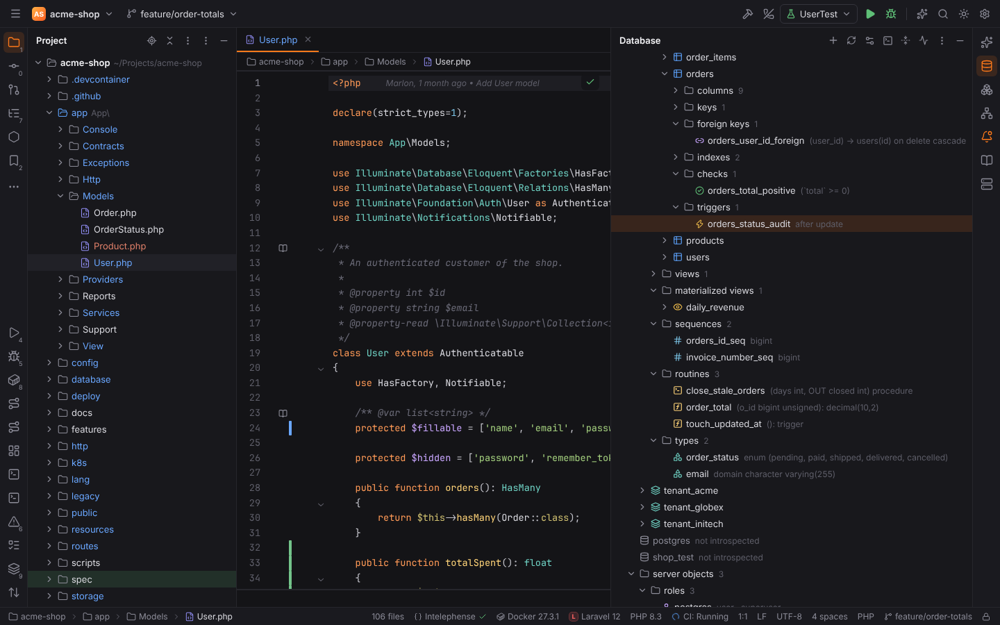

- **Routines** show their arguments and result: `close_stale_orders (days int, OUT closed int)
  procedure`, `order_total (o_id bigint): numeric`.
- **Types** list enums with their labels, domains with their base type and composite types.
- Other databases of the server are listed below the connected one (`not introspected`); create
  another data source to browse them.
- **Lazy loading**: schemas are introspected when you open them (the current schema right
  away). Forge caches the model of every data source in its cache folder
  (`<cache dir>/forge/db-models/`, see [File locations](../reference/file-locations.md)), so
  after a restart the tree shows at once, without connecting.
- **Refresh** works per node: on a table it re-reads only that table (columns, keys, indexes,
  checks, triggers), on a schema that schema, on the data source the schema list, the server
  objects and every loaded schema. The toolbar's **Refresh** refreshes the selected data source.

Toolbar: **+** (add data source), **Refresh**, **Data Source Properties** (`Shift+Enter`),
**Jump to Query Console…** (`Ctrl+Shift+F10`), **Collapse All**, **Sessions** (see
[Sessions](#sessions)). Context menu of a node: **Quick Documentation**, **Full-Text Search…**,
**New Query Console**, **Edit Data** (tables), **Go to DDL**, **Copy Name**, **Add Virtual
Foreign Key…** (columns), **Add Virtual Column…** (tables), **Schemas…**, **Properties**,
**Refresh**, **Disconnect**, **Delete**.

### Quick Documentation

`Ctrl+Q` (or double-click on a routine, sequence or type) on a node shows its documentation:
the kind and location, the comment, properties (type, nullability, default, auto-increment,
primary key, references and referencing tables, arguments, language, enum labels) and the DDL —
the routine or trigger source when the database keeps it, otherwise generated from the model.
`Escape` closes it.

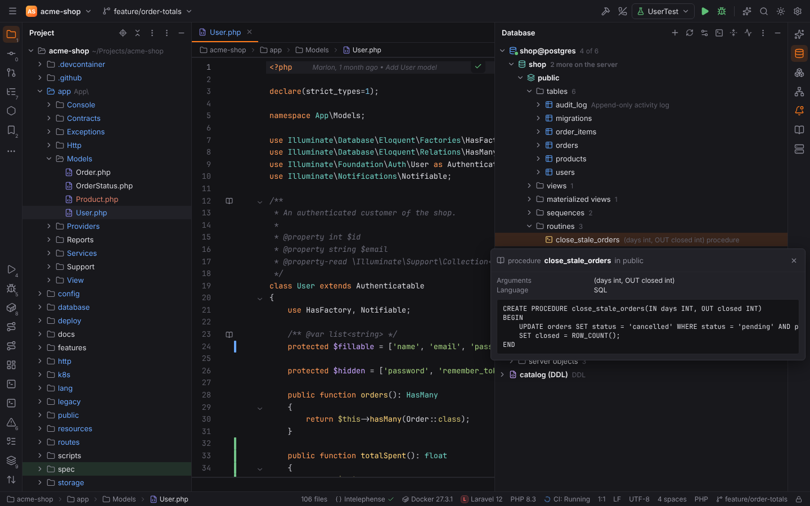

### Schema filter

The **Schemas** tab of a data source (context menu **Schemas…**) chooses which schemas (MySQL and
ClickHouse: databases; Redis and MongoDB: databases) Forge introspects and shows, like
DataGrip's introspection scope. Hidden schemas are never introspected.

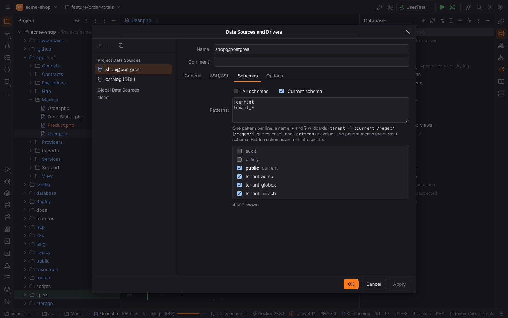

One pattern per line:

| Pattern | Selects |
| --- | --- |
| `shop` | the schema `shop` (names ignore case) |
| `*`, `tenant_*`, `db_?` | wildcards: every schema, schemas starting with `tenant_`, … |
| `:current` | the connection's current schema |
| `/tenant_\d+/`, `/sales/i` | a regular expression (with `i`: ignoring case) |
| `!pattern` | excludes what `pattern` selects, e.g. `*` and `!pg_*` |

No pattern means `:current` (the first schema when there is no current one); only exclusions
start from every schema. **All schemas** and **Current schema** add `*` and `:current`; the
list below shows the result for the server's schemas, and its check boxes add or exclude single
schemas. The tree shows `4 of 6` next to the data source when schemas are hidden.

### Virtual foreign keys and columns

Databases without declared foreign keys (MyISAM tables, legacy schemas, `user_id` columns
without constraints) can get **virtual foreign keys**: right-click a column → **Add Virtual
Foreign Key…**, choose the referenced table and column. **Add Virtual Column…** on a table adds a
computed column (`price * quantity`).

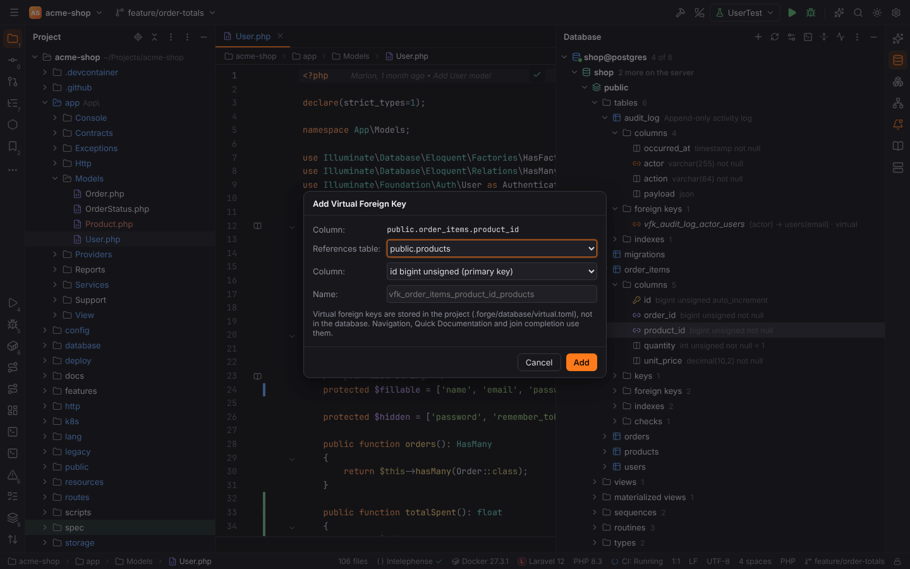

They are stored in the project in `.forge/database/virtual.toml` (share it with your team) and
merged into the model: the tree shows them in italics with the accent colour, Quick
Documentation lists them, the data grid marks their columns, and the console's completion
offers joins over them (see [completion](#query-console)). **Remove Virtual Foreign Key** /
**Remove Virtual Column** delete them. The file looks like this:

```toml
[[foreignKey]]
dataSource = "shop-local-1f3a"
schema = "shop"
table = "orders"
columns = ["customer"]
refTable = "users"
refColumns = ["id"]

[[column]]
dataSource = "shop-local-1f3a"
schema = "shop"
table = "order_items"
name = "line_total"
expression = "quantity * unit_price"
type = "decimal(10,2)"
```

### Full-text search

**Full-Text Search…** (`Ctrl+Alt+Shift+F` in the Database tool window, or the context menu)
finds a text in the **data** of tables and views. It opens a tab with the text, the mode
(**Contains**, **Exact match**, **Regular expression**), **Match case**, **All column types**
(also numbers and dates; otherwise text columns only), **Rows per table** (default 100), table
patterns (`users, order_*, !audit_*`) and the scope: data sources and their schemas (none
checked means all shown schemas).

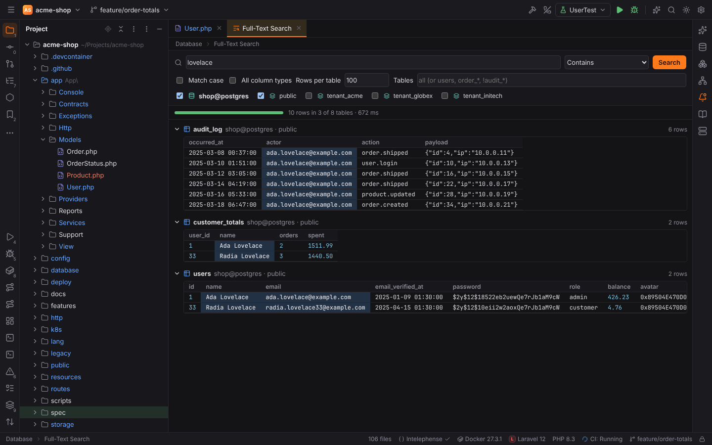

Forge searches table by table with read-only `SELECT`s and shows each table with matches as
soon as it is done, the matching cells highlighted; the progress bar shows how far it is, and
**Cancel** stops it. Double-click a table or row to open the table. The text is always sent as a
quoted literal, with a per-dialect condition: `ILIKE`/`~*` (PostgreSQL), `LIKE`/`REGEXP_LIKE`
(MySQL, Oracle), `LIKE … ESCAPE` (SQLite, SQL Server), `positionCaseInsensitiveUTF8`/`match`
(ClickHouse). SQLite and SQL Server have no regular expressions; Redis, MongoDB and DDL data
sources cannot be searched.

Data sources with a colour tint their rows (see [Colours](#read-only-and-production-data-sources));
`read-only` and the SSH host appear next to the name.

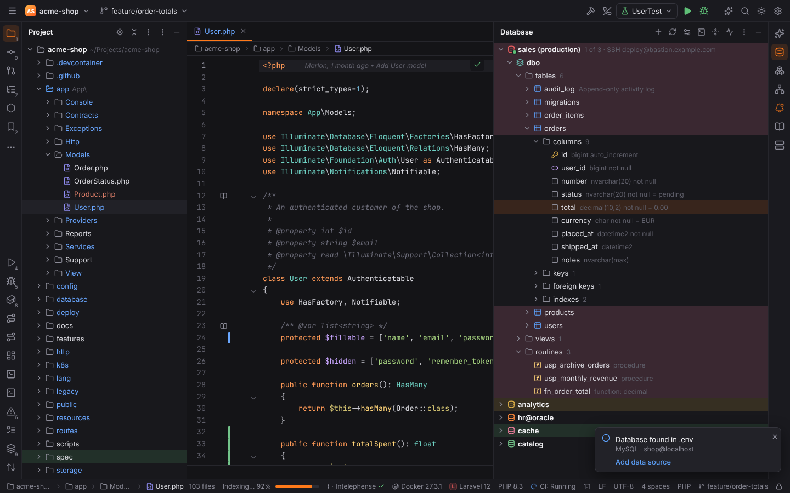

## Data sources

**New Data Source…** (the **+** button or Find Action) opens **Data Sources and Drivers**:


| Field | Notes |
| --- | --- |
| Name, Comment | |
| Driver | MySQL, MariaDB, PostgreSQL, SQLite, SQL Server, ClickHouse, Oracle, Redis, MongoDB, [DDL Data Source](#ddl-data-sources) |
| Host, Port, Database / SQLite file | SQLite files are chosen with a file picker. Oracle: **Service** (e.g. `FREEPDB1`); Redis: **Database index** (`0`); MongoDB: also a full `mongodb://` or `mongodb+srv://` URL as the host |
| Authentication | User & Password, or none |
| Password | stored in the OS keychain (service `forge-db`), never in project files |
| SSH/SSL tab | SSH tunnel and SSL/TLS, see below |
| Schemas tab | the [schema filter](#schema-filter): which schemas are introspected and shown |
| Options | read-only, colour, transaction control (Auto / Manual), single session mode, connect timeout, startup script |
| Scope | **Project Data Sources** (`<project>/.forge/dataSources.toml`, shareable) or **Global Data Sources** (`dataSources.toml` in Forge's config folder) |

**Test Connection** shows success with the server version, or the error.

### SSH tunnel and SSL/TLS

The **SSH/SSL** tab reaches databases that are only visible from a bastion host and secures
the connection itself.

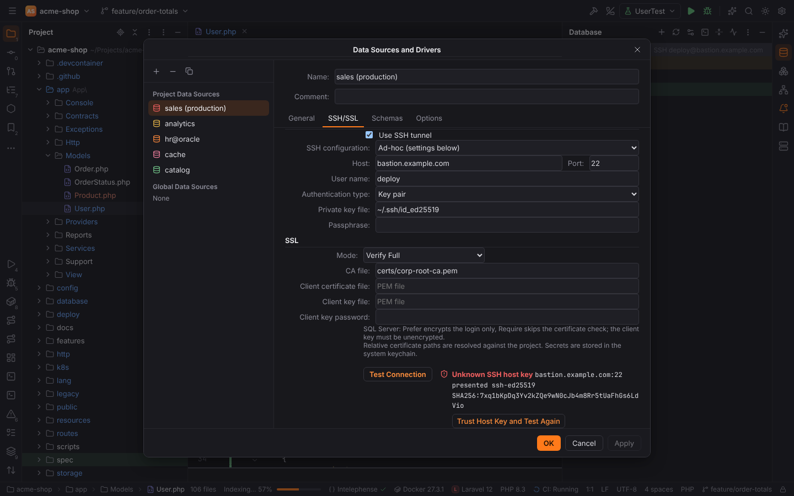

**Use SSH tunnel**: Forge opens the SSH connection itself (the same SSH client as
[remote development](remote-host-and-ssh.md)) and forwards a local port to the database
**host and port as the SSH host sees them** — `localhost:5432` is the database on the bastion.

- **SSH configuration**: one of your saved configurations (Settings | Tools | SSH
  Configurations), which brings its own host, user, authentication and stored secret, or
  **Ad-hoc** with the fields below.
- Ad-hoc: **Host** (also a `~/.ssh/config` alias, with its `HostName`, `Port`, `User`,
  `IdentityFile` and `ProxyJump`), **Port**, **User name** and **Authentication type**:
  **Password**, **Key pair** (private key file and passphrase) or **OpenSSH config and
  authentication agent**.
- The SSH password or key passphrase is stored in the OS keychain (account `<id>#ssh`).
- The first connection to an unknown host shows its key fingerprint: **Trust Host Key and Test
  Again** adds it to `~/.ssh/known_hosts`. A changed key is reported and refused until you trust
  it again.

**SSL** **Mode**:

| Mode | Meaning |
| --- | --- |
| Disable | no TLS |
| Prefer | TLS when the server offers it, certificate not checked (ClickHouse and Redis: plain) |
| Require | TLS, certificate not checked |
| Verify CA | TLS, certificate signed by the CA file (or the system roots) |
| Verify Full | like Verify CA, and the certificate must name the host |

**CA file**, **Client certificate file** and **Client key file** are PEM files; relative paths
are resolved against the project. An encrypted client key (PKCS#8 `ENCRYPTED PRIVATE KEY`) is
decrypted in memory with the **Client key password**, which is stored in the keychain (account
`<id>#ssl-key`); legacy OpenSSL-encrypted keys must be converted with
`openssl pkcs8 -topk8`. What each driver does with them:

| Driver | SSL/TLS |
| --- | --- |
| MySQL, MariaDB | `ssl-mode` Disabled / Preferred / Required / Verify CA / Verify Identity, CA and client certificate |
| PostgreSQL | `sslmode` with `sslrootcert`, `sslcert`, `sslkey` |
| SQL Server | Prefer encrypts the login, Require encrypts everything without checking the certificate, Verify uses the CA; client certificate and **unencrypted** key files |
| ClickHouse | HTTPS from Require on (use the HTTPS port, usually 8443); Verify CA also checks the host name |
| Redis | `rediss://` from Require on, CA and client certificate |
| MongoDB | TLS from Require on; the client certificate **and its key in one PEM file** (set as the client certificate) |
| Oracle | configured in the Oracle client (`sqlnet.ora`, wallet) |

Through an SSH tunnel, Verify Full checks the certificate against the configured database host
for SQL Server, Redis and MongoDB; for MySQL and PostgreSQL use Verify CA.

### Oracle

Forge does not bundle Oracle's client and there is no permissive pure-Rust driver for Oracle's
network protocol, so Oracle data sources run through **SQL\*Plus** (from the Oracle Instant
Client "SQL\*Plus" package) or **SQLcl**, which you install yourself; Forge finds `sqlplus` (or
SQLcl's `sql`) on `PATH`. Every statement starts `sqlplus -S -L /nolog`, logs in through the
process's input (the password never appears on a command line), prints CSV and exits, so:

- each statement is committed on its own; there are no manual transactions,
- **Cancel** stops the process,
- PL/SQL blocks (`BEGIN … END;`, `CREATE PROCEDURE …`) end with a line containing only `/`.

### DDL data sources

A **DDL data source** (**+** → **DDL Data Source**) has no database: Forge builds its model from
SQL DDL files of the project — a `schema.sql`, a dump without data, or a folder of SQL migrations
(Flyway `V1__…`, `V2__…`). It needs no server and works offline.

- **Files**: one file or folder per line, relative to the project. Folders are read with their
  subfolders in natural name order (`V2` before `V10`), and the statements are applied in
  order: `CREATE TABLE`/`VIEW`/`MATERIALIZED VIEW`/`INDEX`/`SEQUENCE`/`TYPE`/`DOMAIN`/
  `FUNCTION`/`PROCEDURE`/`TRIGGER`/`SCHEMA`, `ALTER TABLE` (add/drop/rename columns and
  constraints, rename tables), `DROP` and `COMMENT ON`, so migrations give the final schema.
- **Dialect**: PostgreSQL, MySQL / MariaDB, SQLite, SQL Server, Oracle or ClickHouse; MySQL
  scripts may use `DELIMITER`.
- **Default schema**: where unqualified names go (by default `public`, `main` or `dbo`).

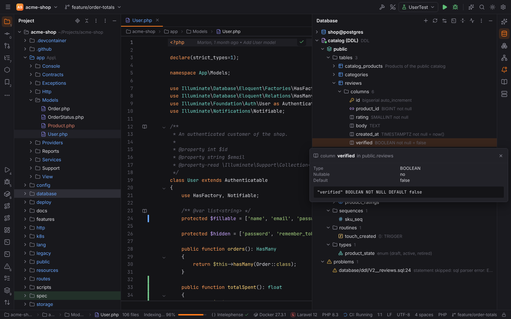

The tree, Quick Documentation, **Go to DDL** and SQL completion of consoles use the parsed
model. Statements Forge cannot parse are skipped and listed under **problems** with their
file and line (double-click opens it). Forge parses the files again when they change on disk.
Consoles of a DDL data source complete names but cannot run queries.

### From `.env`

When a project's `.env` has Laravel's `DB_*` variables or Symfony's `DATABASE_URL`, Forge shows
a balloon "Database found in .env" with **Add data source**; the tree also offers **Data
Source from .env**. Turn this off with Settings | Tools | Database | **Suggest data sources
from .env files** (`database.suggestFromEnv`).

## Query console

**New Query Console** on a data source (or **Open Query Console**) opens a console tab:


- SQL highlighting for the data source's dialect and completion of keywords, tables and
  columns.
- After `JOIN`, completion offers the tables related to the ones already in the statement by a
  foreign key — real or [virtual](#virtual-foreign-keys-and-columns) — with the whole
  condition: `JOIN ` → `users u ON u.id = o.user_id`.
- **Execute** (`Ctrl+Enter`, macOS `Cmd+Enter`) runs the statement at the caret, or the
  selection. Several statements separated by `;` run one after another.
- SQL in PHP and JavaScript strings runs the same way: `Ctrl+Enter` in an injected SQL string
  opens a console with it (see [Language injections](language-injections.md#run-injected-sql)).
- Results appear below in tabs (**Output** plus one tab per result set), paged by
  **Result set page size** (`database.pageSize`, 500).
- **Cancel Running Statements** stops a long query (MySQL `KILL QUERY`, PostgreSQL
  `pg_cancel_backend`, ClickHouse `KILL QUERY`, SQL Server by closing and reopening the
  console's connection).
- **Tx: Auto / Manual** switches the transaction mode; in manual mode use **Commit** and
  **Rollback**. ClickHouse, Oracle, Redis and MongoDB consoles run every statement on its own.
- **New session / Shared session** chooses the console's connection, see [Sessions](#sessions).
- The schema selector at the top right sets the current schema.

SQL [scratch files](scratches-and-http.md) attached to a data source open as consoles too.

Consoles are full [SQL editors](sql-editor.md): names resolve against the data source with the
SQL inspections and their quick fixes, `Ctrl+B` jumps to a table or column in the tree,
`Shift+F6` renames aliases, user parameters (`:id`, `?`, …) are asked before running, and
**Browse Query History** (`Ctrl+Alt+E`, the clock icon) searches, inserts or re-runs every
statement the data source ran.

### Sessions

Every console runs in a **session** (an open connection). By default each console has its own
session, so transactions in one console are invisible to the others. **Shared session** in the
console toolbar (or **Single session mode** in the data source's Options) makes all consoles of
the data source share one connection and its transaction.

**Sessions** (the pulse icon in the Database tool window toolbar) lists the open sessions with
their data source, transaction mode, open transaction (statements and age), the running or
last statement, and **Commit**, **Rollback**, **Cancel** and **Close Session**.

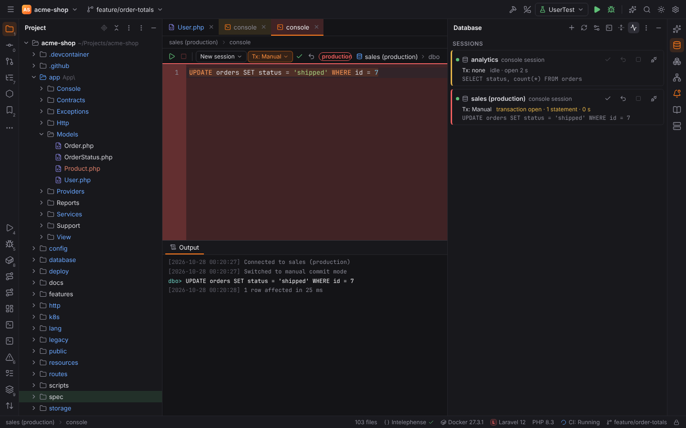

### Redis

A Redis data source shows its databases (`db0`, … from `INFO keyspace`). Expanding one lists the
keys matching the **key pattern** at the top (`*`, `user:*`, …; `Enter` reloads) with their type
and TTL; at most 1000 keys are listed. Double-click a key to open its **value viewer**: strings
as text (JSON pretty-printed), lists and sets as numbered rows, hashes as field/value rows,
sorted sets with scores and streams as JSON.

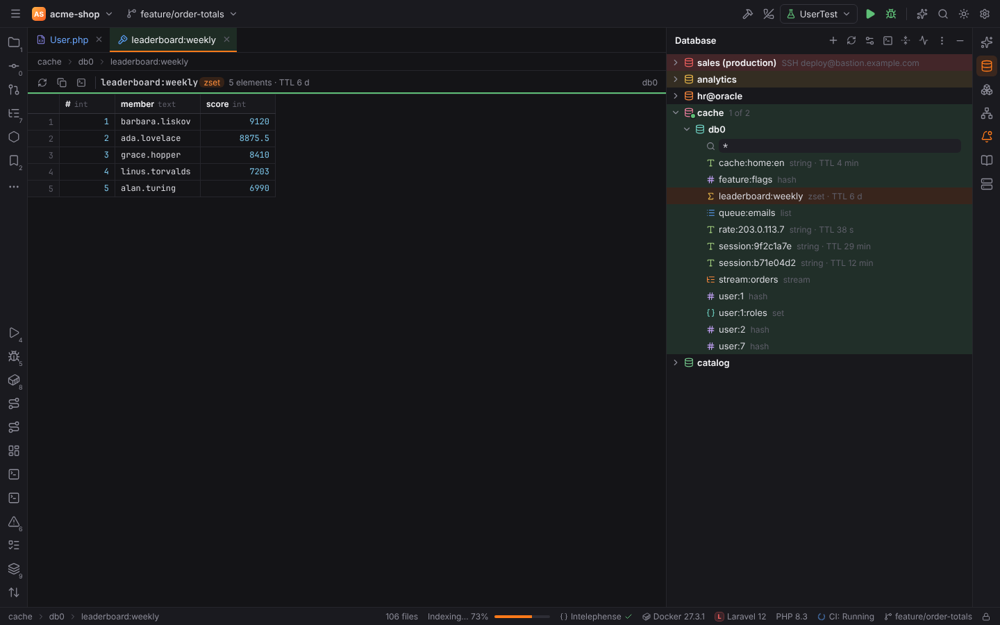

The console runs one command per line (`GET user:1`, `HGETALL user:1`, `SCAN 0 MATCH s*`,
quotes for spaces: `SET motd "hello world"`).

### MongoDB

A MongoDB data source shows databases → collections → fields (sampled from the first documents,
with their BSON types). Double-click a collection to open a console that finds its documents;
**JSON** in the result toolbar shows them as documents instead of a grid.

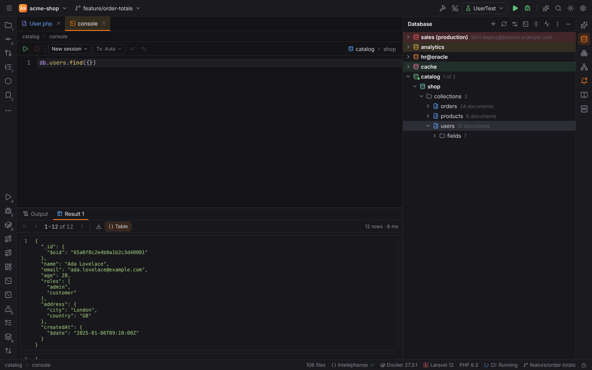

The console understands the shell calls you would type in `mongosh`:

```text
db.users.find({ age: { $gt: 30 } }, { name: 1, email: 1 }).sort({ age: -1 }).limit(5)
db.orders.aggregate([{ $group: { _id: "$status", n: { $sum: 1 } } }])
db.orders.countDocuments({ status: "paid" })
db.users.distinct("address.country")
db.users.insertOne({ name: "Ada" })   db.users.updateMany({...}, { $set: {...} })   db.users.deleteMany({...})
db.users.getIndexes()   db.getCollectionNames()   show dbs   show collections   use shop
```

Arguments are relaxed JSON: unquoted keys, single quotes, `ObjectId("…")`, `ISODate("…")`,
`NumberLong(…)`, `NumberDecimal("…")` and `/regex/i`.

## Read-only and production data sources

**Read-only** (Options tab) protects a data source: the console refuses statements that change
data or schema (DML and DDL, Redis write commands, MongoDB writes) with a clear message, and the
driver refuses them too — MySQL and PostgreSQL sessions are `READ ONLY`, SQLite opens the file
read-only, ClickHouse gets `readonly=2`, Oracle `SET TRANSACTION READ ONLY`, SQL Server declares
`ApplicationIntent=ReadOnly`, Redis and MongoDB connections only accept reads.

**Colour** marks a data source as development (**green**), staging (**yellow**) or production
(**red**); the tree, its console and table tabs and the console editor are tinted, and the
console shows a badge. Before running `UPDATE` or `DELETE` without `WHERE`, `TRUNCATE`,
`FLUSHDB`/`FLUSHALL`, `deleteMany({})`/`updateMany({}, …)` or `drop()` on a **production**
data source, Forge asks for confirmation:

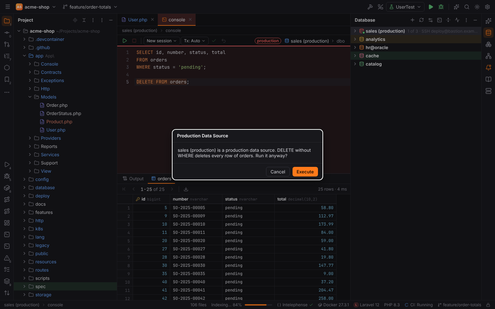

## Data grid and table editor

**Edit Data** (or double-click a table) opens the table in an editor tab with paging (**First,
Previous, Next, Last Page**), a **WHERE** filter and an **ORDER BY** field.


| Action | Windows/Linux | macOS |
| --- | --- | --- |
| Edit a cell | double-click or `Enter` | same |
| Value Editor | `Shift+Enter` | `Shift+Enter` |
| Go to Referenced Data | `Ctrl+B` | `Cmd+B` |
| Find Referencing Rows | `Alt+F7` | `Alt+F7` |
| Add Row | `Alt+Insert` | `Cmd+N` |
| Delete Rows | `Ctrl+Y` | `Cmd+Backspace` |
| Revert Selected | `Ctrl+Alt+Z` | `Cmd+Alt+Z` |
| Submit | `Ctrl+Enter` | `Cmd+Enter` |
| Reload Page | toolbar | toolbar |

Cell context menu: **Copy**, **Copy with Header**, **Edit**, **Set NULL**, **Edit Value…**,
**Set DEFAULT**, **Filter by** the cell's value, **Go to** the referenced table and **Find
Referencing Rows…**. Changes are applied in one transaction on **Submit**.

NULL is displayed as `<null>` (**Show NULL as**, `database.showNullAs`). Binary values are shown
as hex.

## Data editor

The table editor and console results work like DataGrip's data editor. Everything that needs
the database runs there (sort, filter, the DML), and everything else is computed by Forge's Rust
core (crate [`forge-dataedit`](../developer/crates/forge-dataedit.md)).

### Sort and filter

- **Click a column header** to sort by it: ascending, descending, then off. **Ctrl+Click**
  (`Cmd+Click`) adds the column to the sort, so several columns sort in order (the header shows
  the position). The header context menu has **Sort Ascending**, **Sort Descending**, **Add to
  Sort**, **Clear Sort** and `IS NULL` / `IS NOT NULL` filters.
- **WHERE** takes any condition of the database's SQL. Column names are completed while you
  type (`↑`/`↓`, `Enter` or `Tab`); `Enter` applies the filter.
- **Filter by value** in a cell's context menu adds a condition such as `status <> 'cancelled'`
  or `shipped_at IS NULL`. The conditions show as chips under the filter row; `×` removes one.

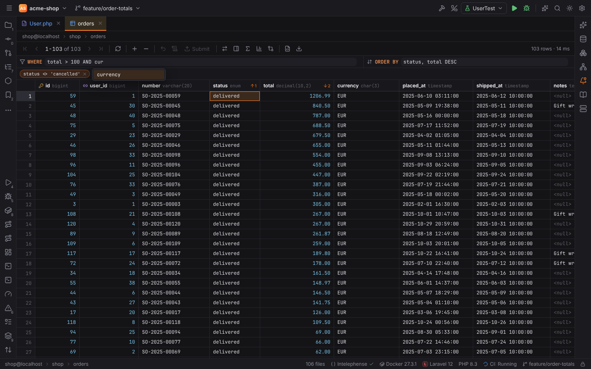

Table editors sort and filter **on the server**: Forge builds the `SELECT … WHERE … ORDER BY`
for the data source's dialect (quoting, `LIMIT`/`OFFSET` or `OFFSET … FETCH`) and shows it in the
status. The typed condition must stay one read-only condition: Forge refuses it when it holds a
`;`, unbalanced brackets, an unclosed quote or comment, or writes (`DELETE`, `UPDATE`,
`INSERT`, `DROP`, `SELECT … INTO`, …, also in subqueries).

Console results come from arbitrary queries, so header sort and **Filter by value** run
**locally** on the fetched rows (NULLs first, numbers and decimals numerically).

### Value editor

**Shift+Enter** (or the panel icon, or **Edit Value…**) opens the value editor of the current
cell at the right. It picks the editor from the column type and the value:

| Value | Editor |
| --- | --- |
| Text | multi-line text |
| JSON (`json`, `jsonb`, or text that holds JSON) | formatted, validated while you type (line and column of the error), **Reformat** and **Minify**; the key order is kept |
| XML | indented and checked for well-nested tags |
| Binary | size, hex dump and an image preview for PNG, JPEG, GIF, WebP and BMP |
| `date`, `datetime`, `timestamp`, `time` | a date/time picker plus the text, normalized on **Apply** (`2025-1-6 9:05` → `2025-01-06 09:05:00`) |
| `enum(…)`, `set(…)` | a list of the allowed values (check boxes for `set`) |
| Boolean, number | a selector or a number field |

**Apply** writes the value into the grid as a pending change. **Set NULL** and **Set DEFAULT**
(for columns with a default or auto increment) are there too. In console results the value
editor is a read-only viewer.

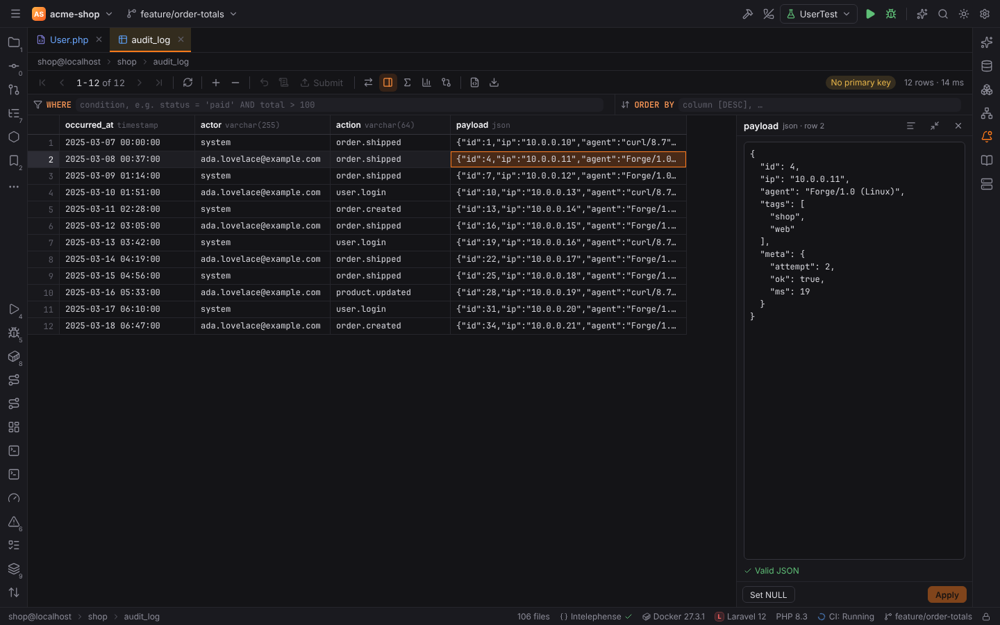

### Pending changes and the DML preview

Edits, new rows, deleted rows, `NULL` and `DEFAULT` stay **pending** until you **Submit** them;
**Revert** drops them. **Preview Pending Changes** (the list icon next to Submit) shows the
statements Forge will run, generated for the dialect:

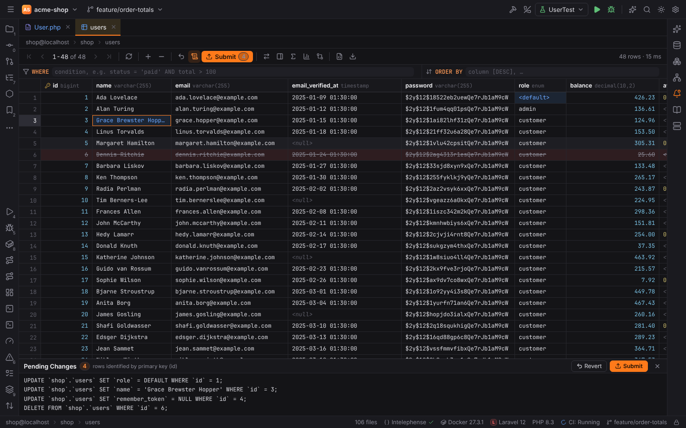

Rows are identified by the **primary key**; a table without one uses a **unique key whose columns
are all NOT NULL**. A table with neither refuses updates and deletes (new rows still work):
edit it with an `UPDATE` in a console instead. A statement that would change more than one row
rolls the whole batch back.

Writes honour the data source: **read-only** data sources refuse them, and on **production** (red)
data sources Submit shows the statements and asks for confirmation first.

### Foreign-key navigation

**Ctrl+B** on a cell of a foreign-key column opens the referenced table filtered to the
referenced row (`id = 23`); with several keys on the column, a popup lets you choose.
**Alt+F7** (**Find Referencing Rows…**) goes the other way: it lists the tables whose foreign
keys reference this table and opens the rows that reference the current one. Both work with real
and [virtual foreign keys](#virtual-foreign-keys-and-columns).

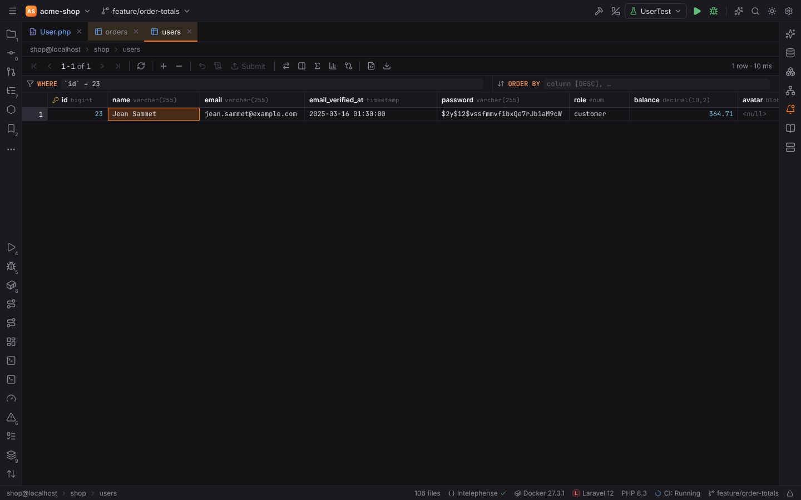

### Transpose

**Transpose** shows each row as a column, with one line per column of the table — handy for wide
tables. Click a cell to select it; double-click opens it in the value editor.

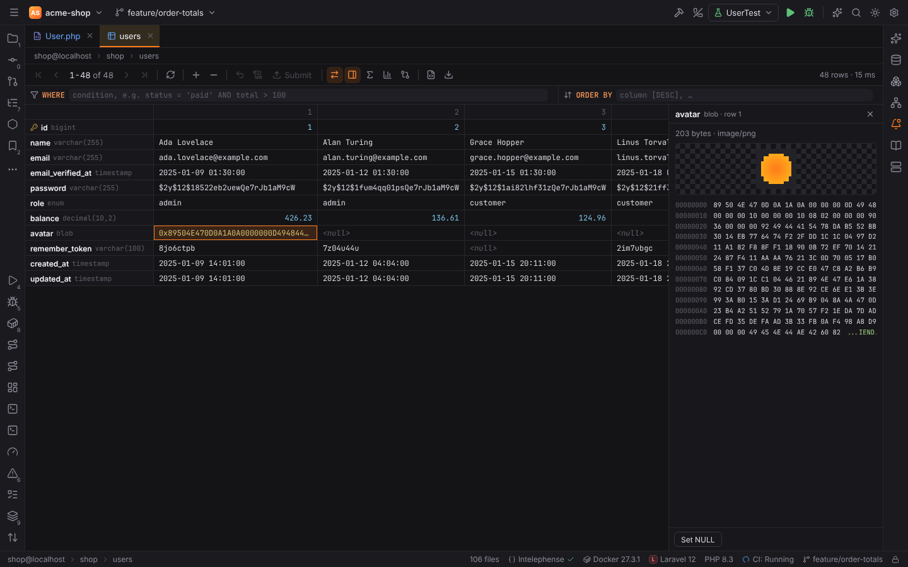

### Aggregates

When several cells are selected, the line under the grid shows their **Count**, **Sum**, **Avg**,
**Min**, **Max**, **Distinct** count and NULLs. Decimals are summed exactly. **Aggregate View**
(the Σ icon, or a click on the line) lists the aggregates per selected column.

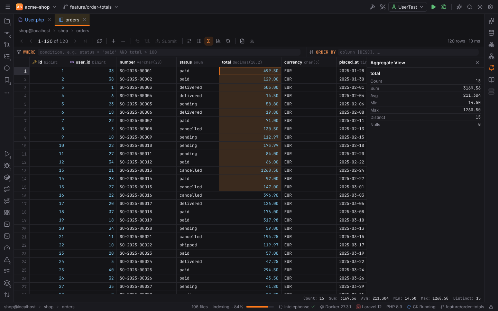

### Compare data

**Compare With…** (toolbar or context menu, in table editors and console results) compares the
rows with another open result, an open table or any table of a connected data source. Pick the
**key** columns (the primary key is preselected); Forge matches rows by key and opens a
comparison tab with **changed** rows (old → new in each changed cell), **added** and **removed**
rows. The counters filter the rows; **unchanged** rows are hidden at first. Without a key, whole
rows are matched. Tables are compared on their first 5,000 rows.

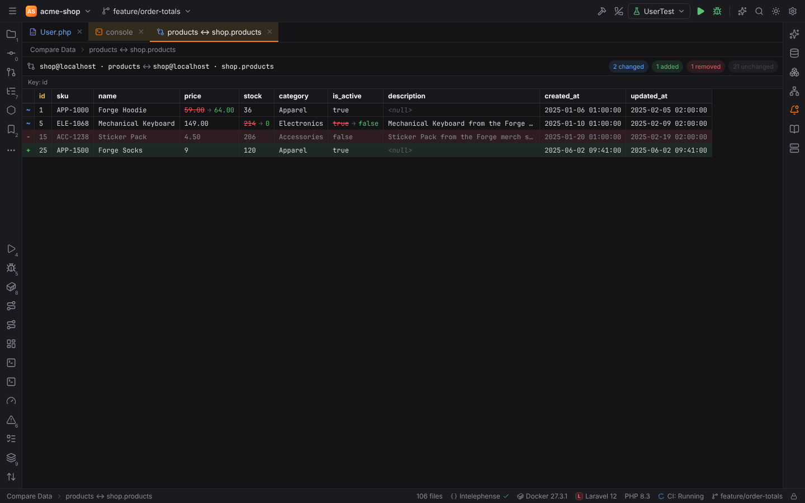

### Charts

**Show Chart** turns the result into a chart: **bar**, **line**, **area**, **pie** or
**scatter**. Pick the **X** column, one or more **Y** columns, an optional **Group by** column
(one series per value) and how values of the same X are combined (**SUM**, **AVG**, **MIN**,
**MAX** or **COUNT**). Numbers and dates on the X axis are sorted.

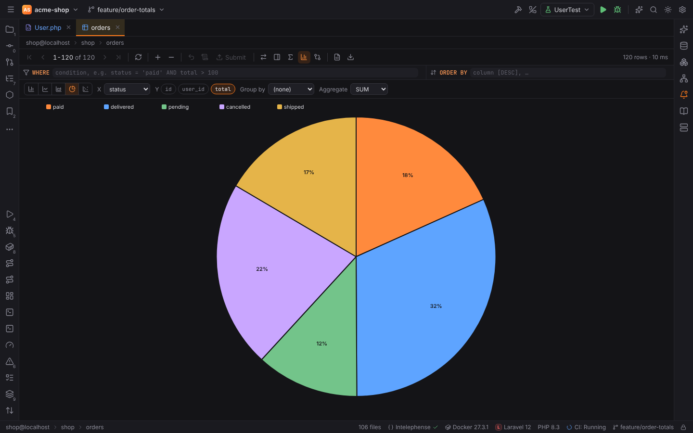

## Export

**Export Data** (the download icon in a result or table) writes the rows as **CSV**, **JSON**
or SQL **INSERT** statements for the dialect.

## Settings | Tools | Database

| Option | Setting | Default |
| --- | --- | --- |
| Result set page size | `database.pageSize` | 500 |
| Show NULL as | `database.showNullAs` | `<null>` |
| Suggest data sources from .env files | `database.suggestFromEnv` | on |
| User parameters `?`, `:name`, `$1`, `${name}`, `#{name}` | `database.parameters.*` | on |
| Query history entries per data source | `database.history.limit` | 1000 |
| Run SQL Script: stop at the first error | `database.runFile.stopOnError` | on |

## Remote projects

In a [remote project](remote-development.md), project data sources (and the `.env`
suggestions) are read from the host, and Forge connects to them through an SSH tunnel to their
host and port **as the remote host sees them** — `localhost:3306` means the database on the
server. The data source shows which host it goes through. Global data sources connect directly
from your machine.

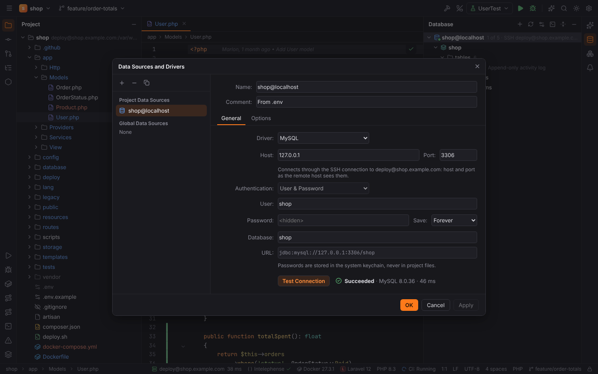

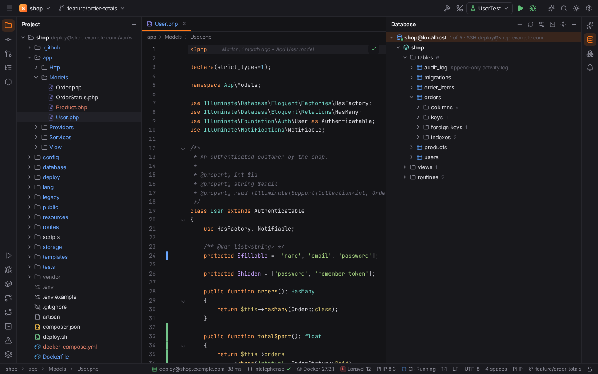

A data source with its own SSH tunnel uses that tunnel instead.

> **Note:** SQLite files on the remote host cannot be opened.
