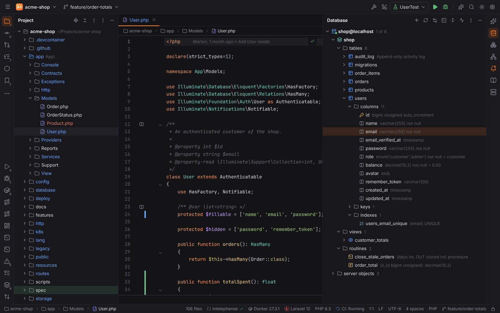
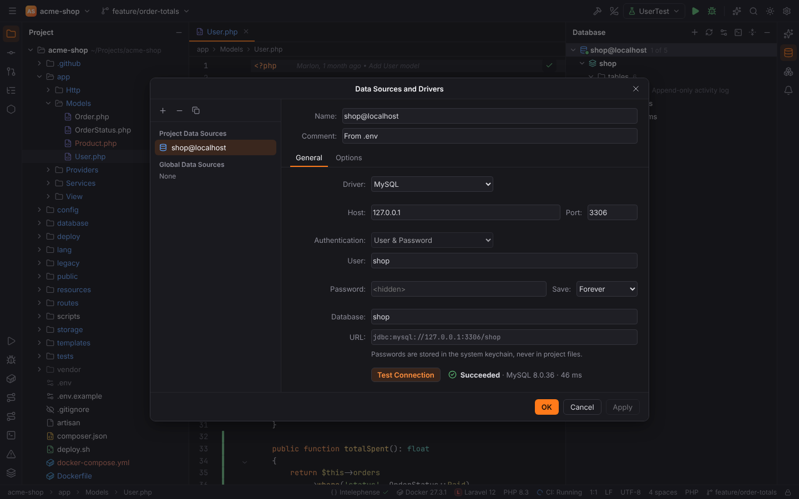
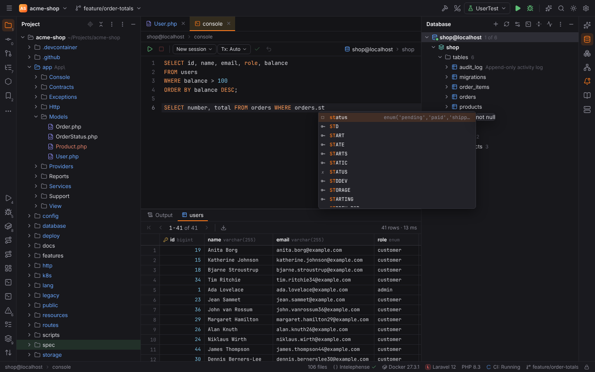
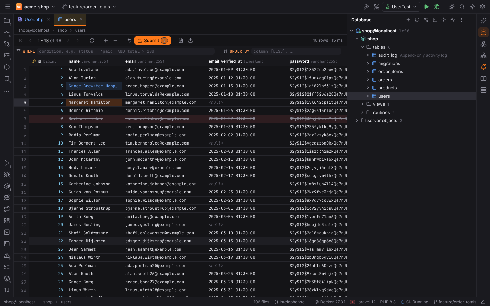

# Database tools and SQL console

The plugin **Database Tools and SQL** (`forge.database`) is Forge's DataGrip part. It supports
**MySQL/MariaDB**, **PostgreSQL** and **SQLite** (through `sqlx`, no JDBC drivers to download).

## Database tool window

The **Database** tool window (right stripe) shows your data sources as a tree:
data source → schema → tables (with comments) → columns, keys and indexes.

Toolbar: **+** (add data source), **Refresh**, **Data Source Properties** (`Shift+Enter`),
**Jump to Query Console…** (`Ctrl+Shift+F10`), **Collapse All**. Context menu of a node: **New
Query Console**, **Edit Data** (tables), **Go to DDL**, **Copy Name**, **Properties**,
**Refresh**, **Disconnect**, **Delete**.

## Data sources

**New Data Source…** (the **+** button or Find Action) opens **Data Sources and Drivers**:

| Field | Notes |
| --- | --- |
| Name, Comment | |
| Driver | MySQL, MariaDB, PostgreSQL, SQLite |
| Host, Port, Database / SQLite file | SQLite files are chosen with a file picker |
| Authentication | User & Password, or none |
| Password | stored in the OS keychain (service `forge-db`), never in project files |
| SSL mode | Disable, Prefer, Require |
| Options | read-only, transaction control (Auto / Manual), connect timeout, startup script |
| Scope | **Project Data Sources** (`<project>/.forge/dataSources.toml`, shareable) or **Global Data Sources** (`dataSources.toml` in Forge's config folder) |

**Test Connection** shows success with the server version, or the error.

### From `.env`

When a project's `.env` has Laravel's `DB_*` variables or Symfony's `DATABASE_URL`, Forge shows
a balloon "Database found in .env" with **Add data source**; the tree also offers **Data
Source from .env**. Turn this off with Settings | Tools | Database | **Suggest data sources
from .env files** (`database.suggestFromEnv`).

## Query console

**New Query Console** on a data source (or **Open Query Console**) opens a console tab:

- SQL highlighting for the data source's dialect and completion of keywords, tables and
  columns.
- **Execute** (`Ctrl+Enter`, macOS `Cmd+Enter`) runs the statement at the caret, or the
  selection. Several statements separated by `;` run one after another.
- Results appear below in tabs (**Output** plus one tab per result set), paged by
  **Result set page size** (`database.pageSize`, 500).
- **Cancel Running Statements** stops a long query.
- **Tx: Auto / Manual** switches the transaction mode; in manual mode use **Commit** and
  **Rollback**.
- The schema selector at the top right sets the current schema.

SQL [scratch files](scratches-and-http.md) attached to a data source open as consoles too.

## Data grid and table editor

**Edit Data** (or double-click a table) opens the table in an editor tab with paging (**First,
Previous, Next, Last Page**), a **WHERE** filter and an **ORDER BY** field.

| Action | Windows/Linux | macOS |
| --- | --- | --- |
| Edit a cell | double-click or `Enter` | same |
| Add Row | `Alt+Insert` | `Cmd+N` |
| Delete Rows | `Ctrl+Y` | `Cmd+Backspace` |
| Revert Selected | `Ctrl+Alt+Z` | `Cmd+Alt+Z` |
| Submit | `Ctrl+Enter` | `Cmd+Enter` |
| Reload Page | toolbar | toolbar |

Cell context menu: **Copy**, **Copy with Header**, **Set NULL**. Changes are applied in one
transaction on **Submit**. Tables without a primary key cannot identify changed rows: only new
rows can be submitted there.

NULL is displayed as `<null>` (**Show NULL as**, `database.showNullAs`). Binary values are shown
as hex.

## Export

**Export Data** (the download icon in a result or table) writes the rows as **CSV**, **JSON**
or SQL **INSERT** statements for the dialect.

## Settings | Tools | Database

| Option | Setting | Default |
| --- | --- | --- |
| Result set page size | `database.pageSize` | 500 |
| Show NULL as | `database.showNullAs` | `<null>` |
| Suggest data sources from .env files | `database.suggestFromEnv` | on |

> **Note:** database tools are not available in [remote projects](remote-development.md) yet.
> Connect to a remote database through an SSH tunnel (`ssh -L 3306:localhost:3306 host`) and
> a local data source.
