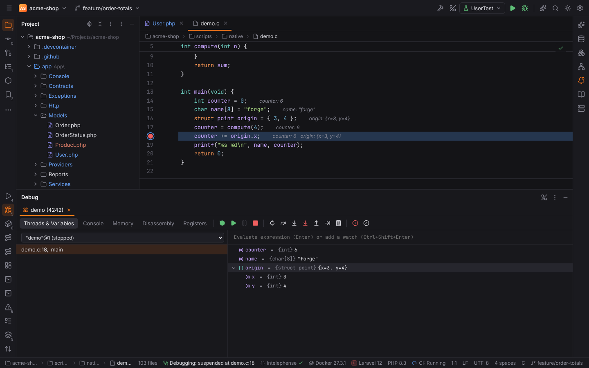
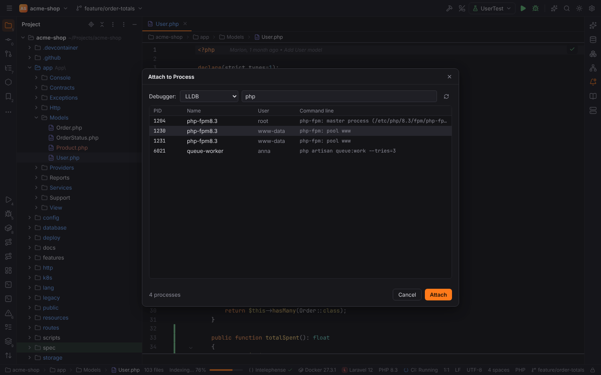
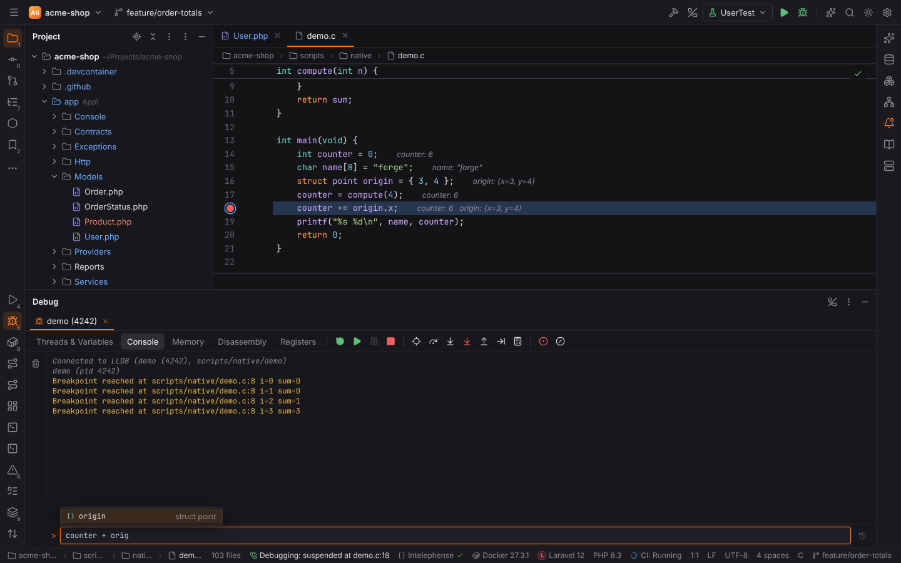
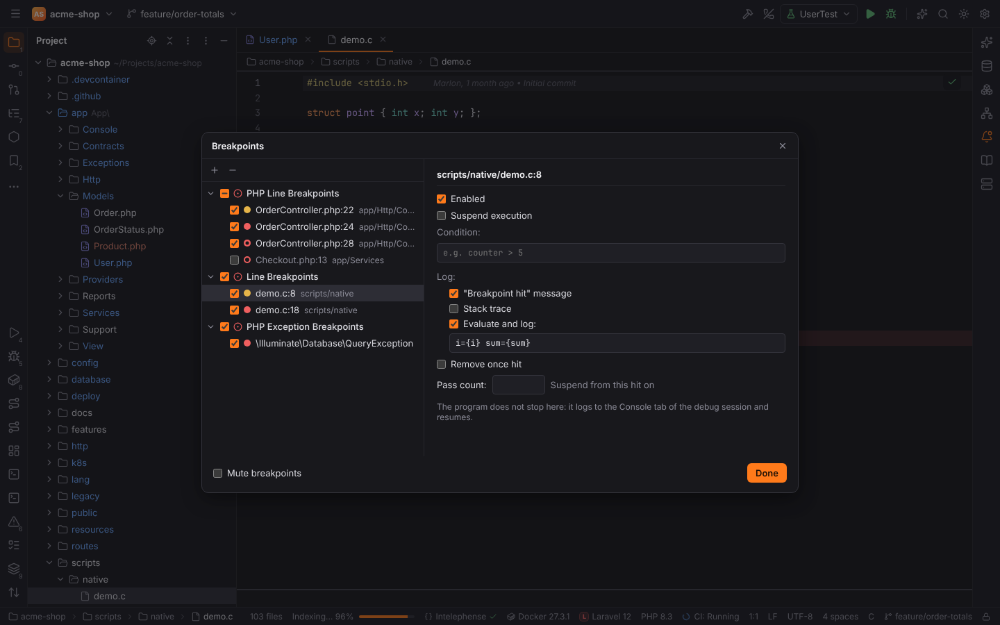
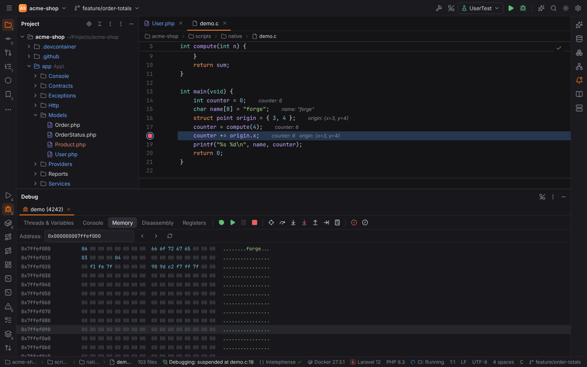
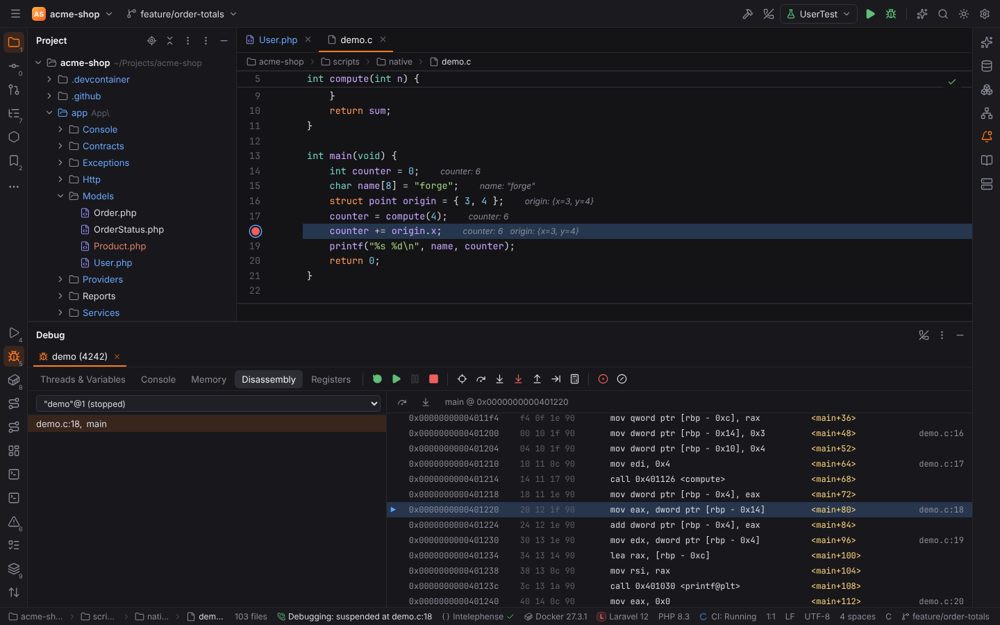
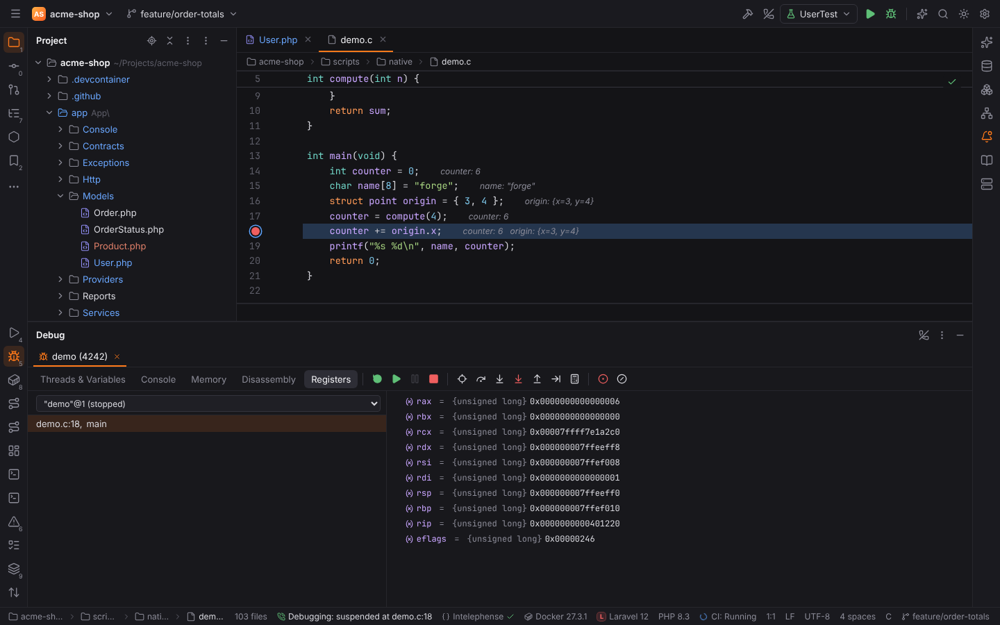

# Debugging

Forge has one debugger for every language. The **Debug** tool window (`Alt+5`), breakpoints in
the editor, stepping, variables, watches, Evaluate Expression and the console work the same
for every session; only how a session starts differs:

- **PHP** uses the Xdebug plugin (`forge.xdebug`, PHPForge pack): a DBGp server for **Xdebug 3**
  that accepts any number of connections at once, from the CLI, a web server, Docker
  containers or another machine.
- **Every other language** uses a **debug adapter** that speaks the
  [Debug Adapter Protocol](https://microsoft.github.io/debug-adapter-protocol/) (DAP), through
  the Debugger plugin (`forge.debugger`). **LLDB** (`lldb-dap`) and **GDB** (14 or newer,
  `gdb -i dap`) are built in for C, C++, Rust, Go and other native code; language packs add
  their own adapters. Adapters are programs installed on your machine; Forge does not bundle
  them. See [Debug adapter sessions](#debug-adapter-sessions) below.

The sections up to [Debug adapter sessions](#debug-adapter-sessions) describe Xdebug; the
breakpoints and the Debug tool window are shared.

## Preparing PHP

Install Xdebug 3 and enable step debugging in your `php.ini` (or the container's):

```ini
zend_extension=xdebug
xdebug.mode=debug
xdebug.client_port=9003
; for web requests: start on every request, or use a browser extension / XDEBUG_SESSION cookie
xdebug.start_with_request=trigger
; when PHP runs in Docker or on another machine
; xdebug.client_host=host.docker.internal
```

Forge listens on port **9003** (`php.debug.port`).

## Two ways to start

### Debug a run configuration

Press **Debug** (`Shift+F9`) on a PHP Script, PHPUnit, Artisan or Composer configuration (or a
gutter ▶ menu). Forge starts listening and runs the process with:

```text
XDEBUG_MODE=debug
XDEBUG_SESSION=FORGE
XDEBUG_CONFIG=client_host=127.0.0.1 client_port=9003 idekey=FORGE
PHP_IDE_CONFIG=serverName=<server>   (when a server is chosen)
```

so no `php.ini` change is needed for CLI scripts and tests.

### Listening for connections

For web requests, click the telephone icon **Start Listening for PHP Debug Connections** in
the main toolbar (action `PhpListenDebugAction`). The status bar shows that Forge is listening;
click again to stop. Then open the page with Xdebug triggered (`XDEBUG_SESSION` cookie, query
parameter or browser extension).


### Debugging web pages and HTTP requests

These configurations start listening by themselves when you press **Debug** (`Shift+F9`):

| Configuration | Debug |
| --- | --- |
| **PHP Built-in Web Server** | runs `php -S host:port -t <document root> [router script]` with the Xdebug environment and `-dxdebug.start_with_request=yes`, so every request it serves is debugged; opens the page in the browser |
| **PHP Web Page** | opens the start URL on a server of Settings \| PHP \| Servers with `?XDEBUG_SESSION_START=FORGE` (Xdebug then sets the `XDEBUG_SESSION` cookie for the following requests) |
| **PHP HTTP Request** | sends the request (method, URL, headers, body) with the cookie `XDEBUG_SESSION=FORGE` |
| Requests in `.http` files | click the gutter ▶ and choose **Debug '…' with Xdebug**: the request is sent with the cookie |


The Run tool window shows the cookie of a debugged request:


When a connection comes from an unknown server whose script is not a project file, the
**Incoming Connection From Xdebug** dialog asks which project file the server file maps to and
creates a server with that path mapping. Turn on **Ignore external connections through
unregistered server configurations** (`php.debug.ignoreExternalConnections`) to detach such
connections silently.

## Breakpoints

- Click a line number in a PHP file, or in a file of a debug adapter's languages (`.c`, `.cpp`,
  `.rs`, `.go`, …), or press **Toggle Line Breakpoint** (`Ctrl+F8`, macOS `Cmd+F8`).
- Right-click a breakpoint to set a **condition** (an expression of the file's language; the
  program suspends only when it is true) or disable it.
- **View Breakpoints…** (`Ctrl+Shift+F8`) lists all breakpoints: **PHP Line Breakpoints**,
  **Line Breakpoints** of other languages, **Function Breakpoints**, **Watchpoints**, **PHP
  Exception Breakpoints** (an exception class, or `*` for any) and the exception filters of
  debug adapters (for example LLDB's "C++: on throw").
- **Mute Breakpoints** turns all of them off temporarily.


Breakpoints are stored in `<project>/.forge/breakpoints.json`.

### Breakpoint properties, logpoints and temporary breakpoints

The right side of **View Breakpoints…** (and the popup of a right-click on a breakpoint) has
PHPStorm's properties:

| Property | Effect |
| --- | --- |
| **Enabled** | off keeps the breakpoint without stopping |
| **Suspend execution** | off makes a **logpoint**: Forge logs and lets the script run on (yellow dot) |
| **Condition** | an expression; Xdebug or the debug adapter stops only when it is true |
| **Log: "Breakpoint hit" message** | prints `Breakpoint reached at <file>:<line>` to the session's Console |
| **Log: Stack trace** | prints the frames |
| **Evaluate and log** | evaluates an expression in the frame and prints its value (debug adapters: `{expr}` in the text is replaced, e.g. `i={i} sum={sum}`) |
| **Remove once hit** | a **temporary breakpoint**: removed after it suspended once (dot with a ring) |
| **Pass count** | stops only from the n-th hit on (Xdebug's hit condition `>=`, a DAP hit condition) |

- **Shift+click** on a line number adds a logpoint ("Breakpoint hit" message, no suspend) and
  opens its properties.
- **Toggle Temporary Line Breakpoint** (`Ctrl+Alt+Shift+F8`, macOS `Cmd+Alt+Shift+F8`) adds a
  breakpoint that is removed once hit.
- **PHP Exception Breakpoints** (**+** in the dialog) stop when an exception of the class (or
  a subclass) is thrown; `*` stops on any exception. They have the same log options.


Logged lines appear in the **Console** tab of the debug session:


## The Debug tool window


While paused, the execution point is highlighted in the editor and variable values are shown
inline at the end of lines (`php.debug.showInlineValues`). The **Debug** tool window (`Alt+5`)
has a tab per session with:

- **Threads & Variables**: the frames on the left (click to switch), variables on the right.
  Arrays and objects expand lazily.
- **Console**: the script's output, logpoint messages, and a field at the bottom that
  evaluates PHP expressions in the selected frame (see below).
- The evaluate field at the top: type an expression and press `Enter` to evaluate it, or
  `Ctrl+Shift+Enter` to add it as a watch.

| Action | Windows/Linux | macOS |
| --- | --- | --- |
| Resume Program | `F9` | `Cmd+Alt+R` |
| Pause Program | toolbar | toolbar |
| Step Over | `F8` | `F8` |
| Step Into | `F7` | `F7` |
| Smart Step Into | `Shift+F7` | `Shift+F7` |
| Force Step Into | `Alt+Shift+F7` | `Alt+Shift+F7` |
| Step Out | `Shift+F8` | `Shift+F8` |
| Run to Cursor | `Alt+F9` | `Alt+F9` |
| Force Run to Cursor | `Ctrl+Alt+F9` | `Cmd+Alt+F9` |
| Evaluate Expression… | `Alt+F8` | `Alt+F8` |
| Quick Evaluate Expression | `Ctrl+Alt+F8` | `Cmd+Alt+F8` |
| Show Execution Point | `Alt+F10` | `Alt+F10` |
| Stop | `Ctrl+F2` | `Cmd+F2` |
| Add to Watches | context menu | context menu |
| Set Value… | `F2` | `F2` |
| Toggle Temporary Line Breakpoint | `Ctrl+Alt+Shift+F8` | `Cmd+Alt+Shift+F8` |


### Variables: Set Value and Copy Value

Right-click a variable or watch for **Set Value…** (`F2`), **Copy Value** (arrays and objects
as `print_r` output), **Copy Name**, **Evaluate Expression…** and **Add to Watches**. Set Value
edits the value in place: type a PHP expression (`'paid'`, `42`, `null`, `$other`) and press
`Enter` (Xdebug's `property_set`); `Escape` cancels. The variables and watches reload after the
change.


### Evaluate Expression and the debugger console

The **Evaluate** dialog (`Alt+F8`) and the field at the bottom of the **Console** tab evaluate a
PHP expression in the selected frame (Xdebug's `eval`). Both complete variable names after `$`
and properties after `->` (from the suspended script, `Enter` or `Tab` accepts) and keep a
history of evaluated expressions: `Up` / `Down` in the field, or the history button. Console
results are trees that expand like variables.


Smart Step Into currently behaves like Step Into. Pause depends on the engine and may
report "Pause is not supported by this engine".

## Debug adapter sessions

A debug adapter session drives the same Debug tool window as Xdebug. What the window offers
depends on the adapter (its capabilities): threads, memory, disassembly and registers appear
only when the adapter supports them.



### Starting a session

| How | Where |
| --- | --- |
| **Debug** a run configuration (`Shift+F9`) | a **Native Application** configuration (executable, program arguments, working directory, debugger, "Stop at the beginning of the program", launch options as JSON), or a configuration type of a language pack that uses an adapter |
| **Attach to Process…** (`Ctrl+Alt+F5`, macOS `Cmd+Alt+F5`) | Run menu: pick a local process (filter by name, command line or PID) and an adapter that can attach |
| **Attach to DAP Server…** | Run menu: connect to an adapter that already listens on a TCP port (`dlv dap --listen 127.0.0.1:4711`, `debugpy --listen 5678`), with optional attach options as JSON |
| **Debug Core Dump…** | Run menu: open a core file with the executable that crashed (LLDB); nothing runs, frames, variables, memory and registers show the state at the crash |



> **Note:** starting a program under the debugger runs project code, so it is refused in
> [Safe Mode](project-trust.md). Attaching to a running process or DAP server and opening a
> core dump are allowed.

Program output and the adapter's messages appear in the **Console** tab. Programs that need a
terminal (the adapter's `runInTerminal` request) are started by Forge with their output in the
console; adapters that start child sessions (`startDebugging`, e.g. for subprocesses) get a
session tab per child.

### Threads, variables and the console

- The frames pane has a thread selector; the thread that stopped is marked "(stopped)".
- Variables expand lazily. Scopes other than the locals (globals, statics) are groups at the
  end of the tree.
- Watches belong to the debugger: PHP sessions keep their watches, a C session has its own.
- The console and Evaluate (`Alt+F8`) evaluate in the adapter's language (LLDB also accepts
  its commands) and complete names while you type.
- Values are shown inline in the editor (`debugger.showInlineValues`).
- **Rerun** in the toolbar restarts the session (in place when the adapter supports it).

### Logpoints and watchpoints

Logpoints (**Suspend execution** off, `Shift`+click on a line number) are evaluated by the
adapter when it supports them, so the program does not stop at all; otherwise Forge logs and
resumes. In **Evaluate and log**, `{expression}` is replaced by its value: `i={i} sum={sum}`
prints `i=2 sum=1`; a plain expression `counter` prints `counter = 6`.





**Add Watchpoint** in the context menu of a variable adds a data breakpoint: the program stops
when the value changes. It is listed under **Watchpoints** in View Breakpoints…, where
**Suspend on** chooses write, read or both (as far as the adapter supports it). **Function
Breakpoints** (**+** in the dialog) stop when a function is entered (`main`,
`MyClass::method`).

### Memory, disassembly and registers

| Tab | Shows |
| --- | --- |
| **Memory** | hex and ASCII from an address; type an address or `&variable`, page with the arrows, or choose **View Memory** on a variable. Double-click a byte to change it (when the adapter can write memory). |
| **Disassembly** | the instructions around the selected frame's instruction pointer with symbols and source lines; **Step Over Instruction** and **Step Into Instruction** step one machine instruction |
| **Registers** | the registers of the selected frame |







| Action | Default shortcut |
| --- | --- |
| Attach to Process… | `Ctrl+Alt+F5` (macOS `Cmd+Alt+F5`) |
| Attach to DAP Server…, Debug Core Dump… | Run menu |
| Step Over Instruction, Step Into Instruction | Disassembly tab (assign keys in Settings \| Keymap) |
| Add Watchpoint, Set Execution Point to Cursor | context menu / Find Action |
| Rerun Debug Session | Debug toolbar |

### Settings | Build, Execution, Deployment | Debugger

| Option | Setting | Default |
| --- | --- | --- |
| LLDB DAP executable | `debugger.lldb.path` | empty: `lldb-dap` on the PATH |
| GDB executable | `debugger.gdb.path` | empty: `gdb` on the PATH |
| Debug adapter request timeout (ms) | `debugger.dap.requestTimeout` | 10000 |
| Log Debug Adapter Protocol messages | `debugger.dap.trace` | off |
| Show variable values in editor while debugging | `debugger.showInlineValues` | on |
| Memory view: bytes per row | `debugger.memory.bytesPerRow` | 16 |

Language packs add their adapters to the same settings page and dialogs (see
[contribution points](../developer/contribution-points.md)).

## Servers and path mappings

When PHP runs in a container or on another machine, its file paths differ from yours. Define a
**server** in Settings | Languages & Frameworks | PHP | **Servers**: **Name**, **Host**,
**Port**, **Debugger** (Xdebug) and **Use path mappings**: the project's folders as a tree,
with the **Absolute path on the server** of each mapped folder (usually just the project root,
e.g. `/var/www/html`; a deeper mapping such as `vendor` wins for its files).


A session finds its server from `PHP_IDE_CONFIG=serverName=<name>`, otherwise from
`$_SERVER['SERVER_NAME']` and `SERVER_PORT`. Servers are stored in
`<project>/.forge/php-servers.json`.

## Web Server Debug Validation

**Run | Web Server Debug Validation…** (PHPStorm's "Validate Debugger Configuration on Web
Server") checks whether PHP can connect to Forge:

- **Local Web Server or Shared Folder**: Forge writes a temporary script
  `forge_xdebug_validator_*.php` into the project folder that the web server serves (**Path to
  create validation script**, e.g. `public`), requests it under **URL to validation script**
  and deletes it right after the check. Nothing is written before you press **Validate**.
- **CLI Interpreter**: reads `php -i` of a [CLI interpreter](php.md#cli-interpreters) (also
  Docker, Compose, SSH or WSL ones).

Each check shows ✓ (fine), ⚠ (works with conditions) or ✗ (must be fixed) with a hint: the
Xdebug version, `xdebug.mode` (must include `debug`), `xdebug.client_host` (localhost cannot
reach Forge from a container or another machine), `xdebug.client_port` (must be Forge's
`php.debug.port`), `xdebug.start_with_request` (`trigger` needs the cookie or
`XDEBUG_SESSION_START`) and the server name used to find path mappings. For CLI interpreters,
Forge sets mode, host, port and session itself for debug runs, so only the extension matters.
The path and URL are remembered per project (`php.debug.validation.documentRoot`,
`php.debug.validation.url`).


## Settings | Languages & Frameworks | PHP | Debug


| Option | Setting | Default |
| --- | --- | --- |
| Debug port | `php.debug.port` | 9003 |
| Ignore external connections through unregistered server configurations | `php.debug.ignoreExternalConnections` | off |
| Break at first line in PHP scripts | `php.debug.breakAtFirstLine` | off |
| Step out of files that are not mapped into the project | `php.debug.ignoreUnmappedFiles` | on |
| Show variable values in editor while debugging | `php.debug.showInlineValues` | on |
| Max. children (array elements / properties per page) | `php.debug.maxChildren` | 100 |
| Max. depth (levels fetched at once) | `php.debug.maxDepth` | 1 |
| Max. string length (bytes) | `php.debug.maxData` | 65536 |
| Path to create validation script | `php.debug.validation.documentRoot` | `public` |
| URL to validation script | `php.debug.validation.url` | `http://localhost:8080` |

## Remote projects

In a [remote project](remote-development.md), **Start Listening** listens on a free local port
and asks the remote host, over SSH, to listen on `127.0.0.1:<php.debug.port>` (9003) and forward
connections to Forge (a reverse tunnel, re-established after reconnects). Configure Xdebug on
the host with `xdebug.client_host=127.0.0.1`. Xdebug's paths are the host's paths, which are the
project's, so no path mappings are needed. The status bar shows that the listener goes through
the host.


> **Note:** JavaScript and Node.js debugging are not built in; see
> [WebForge](webforge.md#debugging-scripts).
