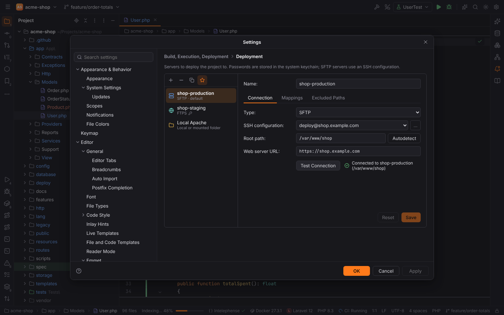
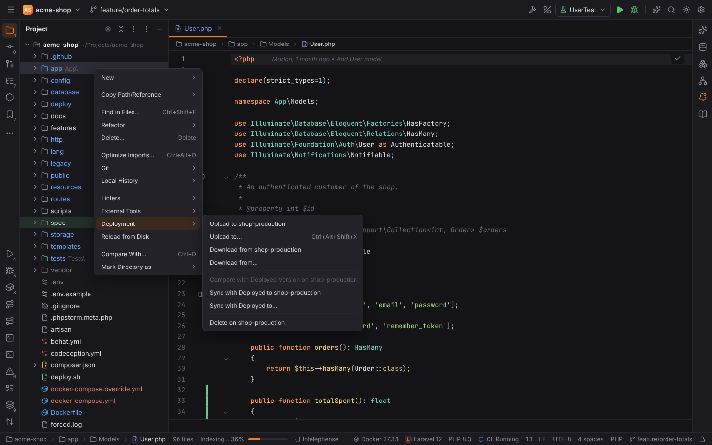
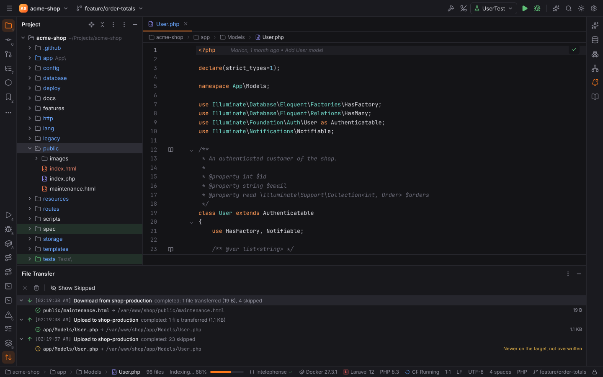
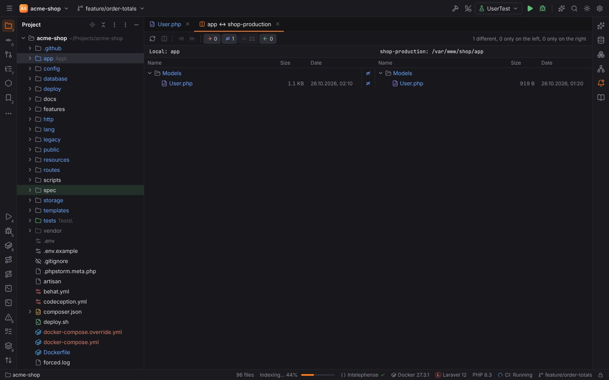
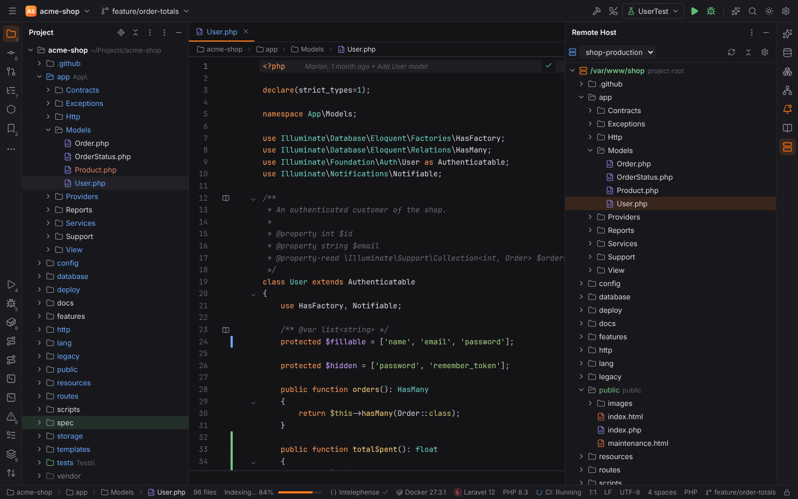

# Deployment

Forge deploys project files to a server like PHPStorm's **Tools | Deployment**: you configure
servers once per project, then upload, download, compare and sync files or folders. Files can
be uploaded automatically every time you save.

## Servers

Settings | Build, Execution, Deployment | **Deployment** (or Tools | Deployment |
Configuration…) lists the project's servers. **+** adds one of these types:

| Type | Connects with |
| --- | --- |
| **SFTP** | an SSH configuration from Settings | Tools | SSH Configurations, so host keys, `~/.ssh/config` aliases, keys, the ssh-agent, `ProxyJump` and passwords work as in [Remote development](remote-development.md) |
| **FTP** | host, port (21), user name and password, or an anonymous login; passive mode is on by default |
| **FTPS** | FTP over explicit TLS (`AUTH TLS`); the server certificate must be valid for the host |
| **Local or mounted folder** | a folder on this machine: a local web server's document root, a mounted network share, a build folder |

The ★ button (**Use as Default**) makes a server the project's **default server**: the actions
"…to Default Server" and automatic upload use it. The first server you add becomes the default.

### Connection tab

| Field | Notes |
| --- | --- |
| SSH configuration | SFTP only. **…** opens SSH Configurations. Trust an unknown host key there with Test Connection first. |
| Host, Port, Username, Password, Anonymous login, Passive mode | FTP and FTPS. The password is stored in the OS keychain (service `forge-deploy`, account `ftp://user@host:port`). |
| Root path | The folder on the server every deployment path is relative to, e.g. `/var/www/shop`. Empty: the login folder. **Autodetect** fills in the login folder. |
| Folder | Local servers: the target folder. A folder inside the project is never uploaded into itself; the project folder itself is refused. |
| Web server URL | `https://shop.example.com`; with the web paths of the mappings it gives each file's URL. |

**Test Connection** connects with the values in the form (also a password you have not saved
yet) and checks that the root path exists.

### Mappings tab

Each mapping says where a project folder goes:

| Column | Meaning |
| --- | --- |
| Local path | a project folder, empty for the project root |
| Deployment path | relative to the root path; `/` is the root path itself |
| Web path | relative to the web server URL |

The longest matching local path wins, so `public` → `/htdocs` and `public/assets` →
`/cdn/assets` can live side by side. Without mappings the project root is deployed to the
root path. Paths with `..` are never mapped.

### Excluded Paths tab

**Add Local Path** excludes a project folder or file (e.g. `storage`, `node_modules`), **Add
Deployment Path** a path on the server (e.g. `/public/uploads`, user content that must not be
overwritten or deleted). Excluded paths are never uploaded, downloaded, compared or deleted.

The configuration is saved in the project as `.forge/deployment.toml`, without passwords, so it
can be shared with the team.

## Uploading and downloading

Tools | Deployment and **Deployment** in the Project view's context menu work on the files and
folders selected in the Project view, or on the file in the editor:

| Action | Shortcut | What it does |
| --- | --- | --- |
| Upload to *default server* | | uploads to the default server |
| Upload to… | `Ctrl+Alt+Shift+X` (macOS `Cmd+Alt+Shift+X`) | asks for the server first |
| Download from *default server* / Download from… | | copies the deployed files into the project |
| Compare with Deployed Version | | opens the diff viewer: the deployed file on the left, the project file (editable) on the right |
| Sync with Deployed to… | | compares a folder with its deployed copy, see below |
| Delete on *default server* | | deletes the deployed files and folders (after a confirmation); the root path itself is never deleted |
| Automatic Upload (Always) | | switches automatic upload between Always and Never for this project |

Folders are transferred with everything in them. Files and folders matching "Exclude items by
name" (`.git`, `.idea`, `.DS_Store`, `.forge`, … by default) and excluded paths are skipped.

When the target of a file is newer than the source and differs from it ("Warn when uploading
over newer file"), Forge does not overwrite it and asks first: **Overwrite** transfers those
files too.

## File Transfer tool window

Every upload, download and delete appears in the **File Transfer** tool window (bottom
stripe): a line per operation with its time, server and result ("3 files transferred
(12.4 KB), 40 skipped"), and below it every transferred, deleted or failed file with its
deployment path. **Show Skipped** also lists files that were up to date, excluded or not
mapped. **Cancel** stops a running transfer after the current file; **Clear All** removes the
finished operations. Automatic uploads are marked *automatic*.

## Sync with Deployed

Sync with Deployed to… opens the folder diff of a project folder (left) and its deployed
folder (right) in an editor tab, like Compare Directories: equal files, different files and
files on one side only, with filters for each state. Double-click (or `Ctrl+D`) a file to see
its diff; **Upload** (→) and **Download** (←) copy the selected file or folder to the other
side. What counts as different is "Sync with Deployed compares by" in the options: contents
and size (the default; files of equal size are read on both sides), size, or size and
timestamp.

## Options

Settings | Build, Execution, Deployment | Deployment | **Options** (Tools | Deployment |
Options…):

| Option | Default | Notes |
| --- | --- | --- |
| Exclude items by name | `.svn;.cvs;.idea;.DS_Store;.git;.hg;.forge` | `;`-separated, `*` and `?` work |
| Overwrite up-to-date files | off | off: files whose deployed copy has the same size and is not older are skipped |
| Preserve files timestamps | on | the copy gets the source's modification time (FTP servers need `MFMT`) |
| Delete target items when source ones do not exist | off | uploading or downloading a folder deletes what exists only on the target |
| Create empty directories | off | |
| Warn when uploading over newer file | Compare timestamp & size | or Compare content, or No |
| Sync with Deployed compares by | Contents and size | or Size, or Size and timestamp |
| Upload changed files automatically to the default server | Never | **Always** (every save, also automatic saves when switching windows), **On explicit save action** (`Ctrl+S`, Save All) or **Never** |

The keys are `deployment.*` (see the [settings reference](../reference/settings.md)); like in
PHPStorm they are usually set for the project.

## Safe Mode

Uploading, downloading and comparing only copy files; they never run project code, so you can
deploy an untrusted project you opened in [Safe Mode](project-trust.md). **Automatic upload is
off in Safe Mode**: the servers and the option come from the project's own `.forge` files, and
an untrusted project must not upload anything (possibly with your SSH configurations) without
you choosing to.

> **Note:** Deployment works with projects on this machine. In a [remote
> project](remote-development.md) the files already are on the server; the Deployment actions
> report that they are not available there.

## Browse Remote Host

Tools | Deployment | **Browse Remote Host** opens the **Remote Host** tool window with the
files of a server: a lazy tree with the mapped folders highlighted, Edit Remote File (a
temporary copy uploaded back on save, with a check for changes on the server), Download from
Here, Upload to Here, Compare with Local Version, New File / New Directory, Rename, Delete and
Copy Path. See [Remote Host and SSH sessions](remote-host-and-ssh.md); the same page describes
SSH terminal sessions to the SFTP servers of the project (Tools | Start SSH Session…).

