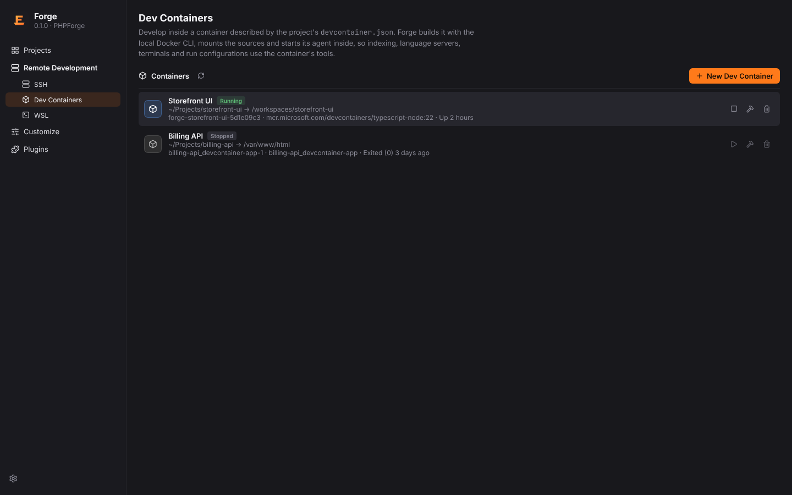
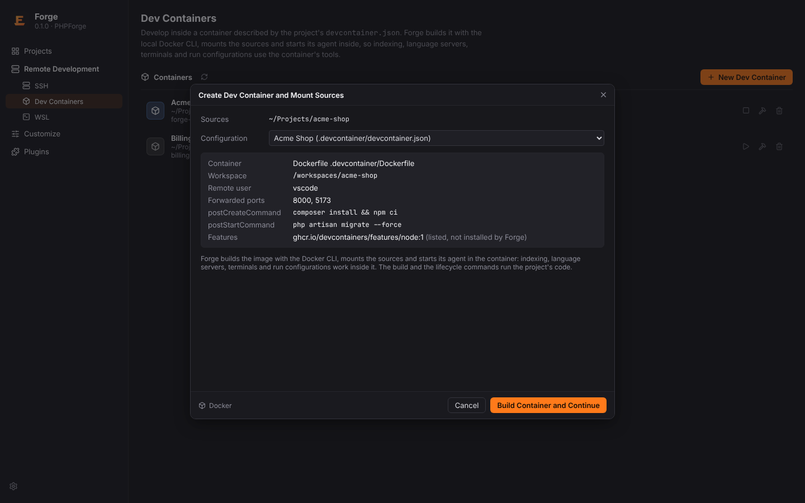
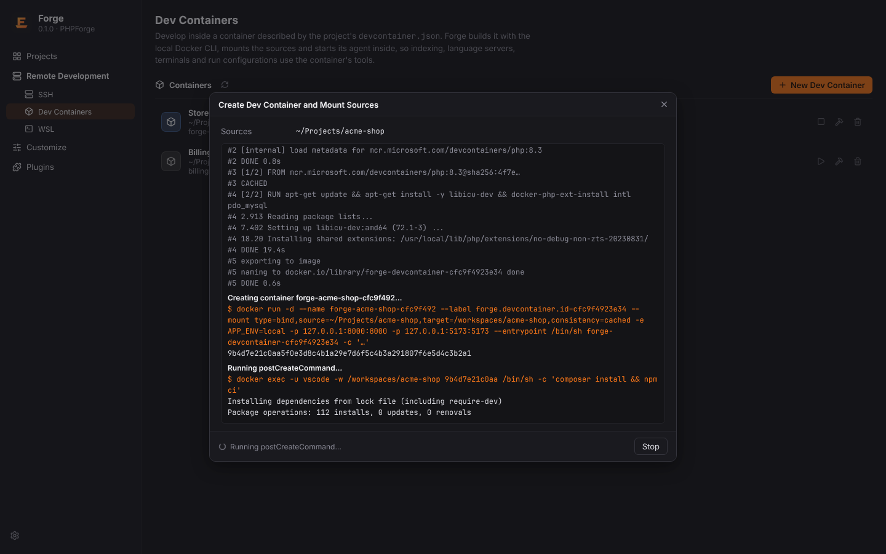
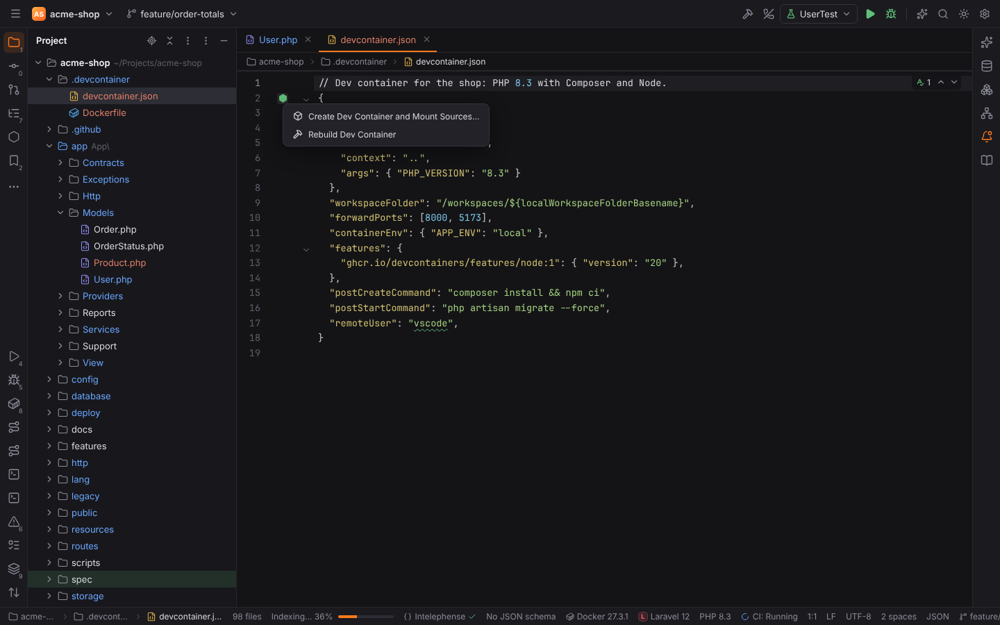
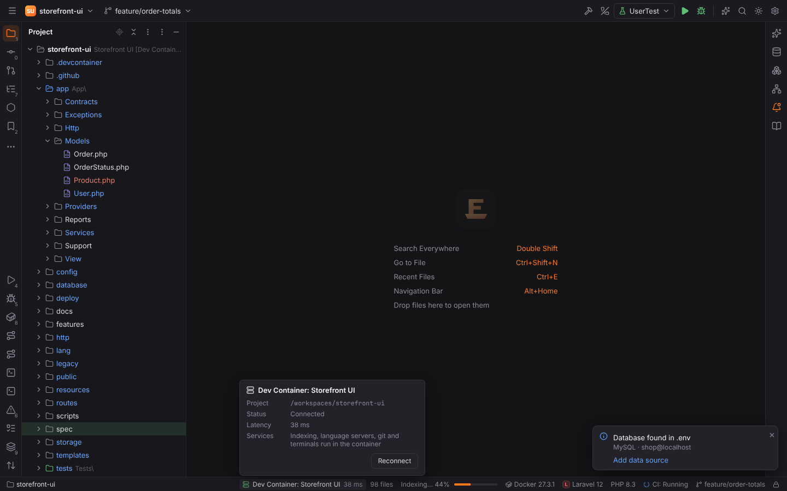
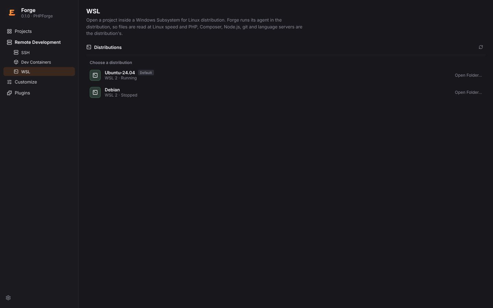
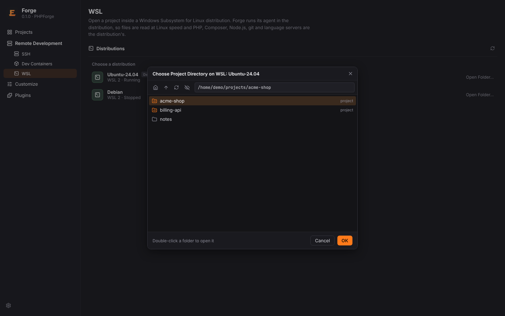

# Dev Containers and WSL

Besides [SSH hosts](remote-development.md), Forge opens projects **inside a dev container** or
**inside a WSL distribution**, like PHPStorm and JetBrains Gateway. In both cases Forge starts its
headless agent (the same one it uses over SSH) in the container or the distribution and talks to
it over the stdio of `docker exec` or `wsl.exe` instead of an SSH channel. The project then opens
like a remote project: indexing, Intelephense and other language servers, Git, terminals and run
configurations all happen in the container or the distribution, with its PHP, Composer, Node.js
and tools.

## Dev Containers

A dev container is described by the project's `devcontainer.json`
([containers.dev](https://containers.dev)). Forge looks for it in the usual places:

| Location | |
| --- | --- |
| `.devcontainer/devcontainer.json` | the default configuration |
| `.devcontainer.json` | in the project root |
| `.devcontainer/<name>/devcontainer.json` | one of several named configurations |

### Requirements

| Side | Needs |
| --- | --- |
| This machine | the Docker CLI (`docker`, Settings \| Build, Execution, Deployment \| Docker \| **Docker executable**, `docker.cliPath`) and a running Docker Engine (Docker Desktop, Podman with the Docker CLI, Rancher Desktop, …) |
| The container | Linux on x86_64 or aarch64 with `/bin/sh`; nothing else: Forge copies its agent in |
| Forge | a build that bundles the agents, as for SSH (see [Remote development](remote-development.md#requirements)) |

### Create a dev container

- Welcome screen → **Remote Development** → **Dev Containers** → **New Dev Container**, then
  choose the project folder, or
- in an open local project: **Create Dev Container and Mount Sources…** (Find Action), or the
  dev container icon in the gutter of `devcontainer.json`.

The dialog lists the folder's configurations and shows what the selected one does: how the
container is made (image, Dockerfile or Docker Compose service), the workspace folder in the
container, the remote user, forwarded ports, `postCreateCommand` / `postStartCommand` and the
features.

**Build Container and Continue** asks "Trust and Open Project?" for an untrusted folder first:
building the image and the lifecycle commands run the project's code. Forge then runs the
Docker CLI and streams every step, command line and line of output into the build log:

1. `docker pull` the image, `docker build` the Dockerfile (with `build.args`, `build.target`),
   or `docker compose up -d --build` the service with Forge's override file (labels, extra
   mounts, `containerEnv`, the keep-alive command),
2. `docker run -d` with the sources mounted (`workspaceMount`, default
   `type=bind,source=<folder>,target=/workspaces/<folder name>`), `mounts`, `containerEnv`,
   `runArgs`, `containerUser` and the forwarded ports published on `127.0.0.1`,
3. `onCreateCommand`, `postCreateCommand` and `postStartCommand` with `docker exec` as the
   remote user in the workspace folder (strings run with `/bin/sh -c`, arrays without a shell,
   objects one after the other),
4. the agent is copied into the container (`~/.cache/forge-agent/<version>/` of the remote
   user) and started; the workspace folder opens as the project.

**Stop** cancels the build (the running `docker` process ends). A failed step shows its exit
code; **Retry** runs it again.

### What Forge reads from devcontainer.json

The file may contain `//` and `/* */` comments and trailing commas (JSONC). The editor treats
it as JSON with comments.

| Property | Support |
| --- | --- |
| `name` | the container's name in Forge (default: the folder name) |
| `image` | pulled, then run |
| `build.dockerfile`, `build.context`, `build.args`, `build.target` (and the old `dockerFile` / `context`) | built with `docker build`; paths relative to `devcontainer.json` |
| `dockerComposeFile` (one or several), `service`, `runServices` | `docker compose up`; the compose files mount the sources |
| `workspaceFolder`, `workspaceMount` | the project folder in the container and the sources' mount |
| `forwardPorts` | numbers are published on `127.0.0.1:<port>`; `service:port` entries are listed only |
| `onCreateCommand`, `postCreateCommand`, `postStartCommand` | run after creating / on every start |
| `remoteUser`, `containerUser` | the user of the agent, terminals and commands / of the container |
| `containerEnv`, `remoteEnv` | the container's environment / the agent's (`${containerEnv:…}` entries are left to the container) |
| `mounts` | strings in `--mount` syntax or `{ source, target, type }` objects |
| `runArgs`, `overrideCommand` | extra `docker run` arguments; keep the container alive with a sleep loop (default for image and Dockerfile) |
| `features` | **listed only**: Forge does not install features yet and says so in the build log |
| `${localWorkspaceFolder}`, `${localWorkspaceFolderBasename}`, `${containerWorkspaceFolder}`, `${containerWorkspaceFolderBasename}`, `${localEnv:NAME[:default]}`, `${devcontainerId}` | replaced |

### Your dev containers

The Dev Containers page lists every container Forge created (Docker labels
`forge.devcontainer.id` and the Dev Containers CLI's `devcontainer.local_folder` /
`devcontainer.config_file`). Click a container to open it (a stopped one is started first), or
use its buttons:

| Button | Does |
| --- | --- |
| Start / Stop | `docker start` (then `postStartCommand`) / `docker stop` |
| Rebuild | removes the container and builds it again without cache (the dialog opens with **Rebuild Container**) |
| Delete | `docker rm -f`; the sources stay on your machine |

Recent Projects show dev container projects with a **Container** badge; opening one starts its
container, or offers to build it again when it is gone. The status bar shows
`Dev Container: <name>`; when the agent ends (container stopped or restarted) Forge starts it
again with a backoff of 1 to 30 seconds and re-attaches the project.

## WSL

On Windows, Forge opens projects that live inside a WSL distribution and runs its agent there
(`wsl.exe -d <distro> --exec …`), so files are read at Linux speed and PHP, Composer, Git and
the language servers are the distribution's.

- Welcome screen → **Remote Development** → **WSL** lists the distributions of `wsl.exe -l -v`
  (state, WSL version, the default one; Docker Desktop's internal distributions are hidden).
  Choose one, then the project folder in the distribution's file system.
- **Open** a folder under `\\wsl$\<distro>\…` or `\\wsl.localhost\<distro>\…`: Forge opens it
  in that distribution instead of reading it over the network share.

The project is shown as `\\wsl.localhost\<distro>\home\…` and kept in Recent Projects with a
**WSL** badge. Trust is kept for that path, see
[Project trust and Safe Mode](project-trust.md#remote-projects).

Paths are mapped between the two views as WSL does:

| Windows | Linux (in the distribution) |
| --- | --- |
| `C:\Users\me\shop` | `/mnt/c/Users/me/shop` |
| `\\wsl$\Ubuntu\home\me\shop`, `\\wsl.localhost\Ubuntu\home\me\shop` | `/home/me/shop` |

### Terminal › WSL

In a local project on Windows, the arrow next to **+** in the Terminal tool window offers a
`WSL: <distro>` entry per distribution: a shell in the distribution
(`wsl.exe -d <distro> --cd <project folder>`), started in the project folder when it is on a
Windows drive.

## Troubleshooting

| Problem | Fix |
| --- | --- |
| "Docker is not available" on the Dev Containers page | start Docker Desktop / the Docker Engine, or set the Docker executable in Settings \| Build, Execution, Deployment \| Docker |
| "The Forge agent for Linux … is not part of this build" | use a release build or build the agents with `pnpm --dir app/ui agents` (static musl binaries, they run in any Linux container) |
| A feature from `features` is missing in the container | install it in the Dockerfile; Forge lists features but does not install them yet |
| "… is not available in Safe Mode" when building | trust the folder: the build runs the project's code |
| WSL page says "WSL is only available on Windows" | WSL projects need Windows with WSL installed (`wsl --install`) |
