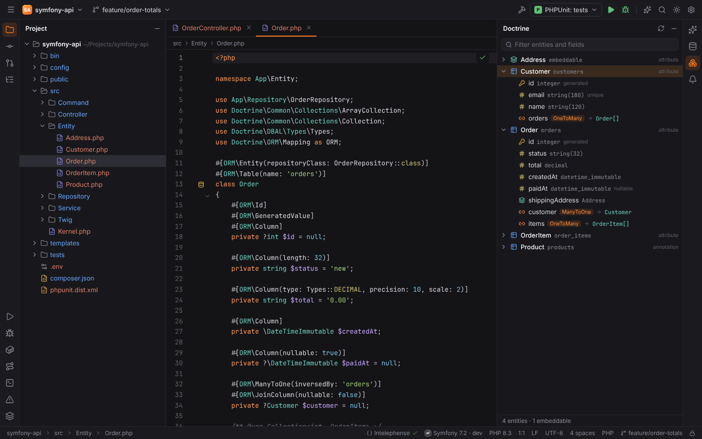
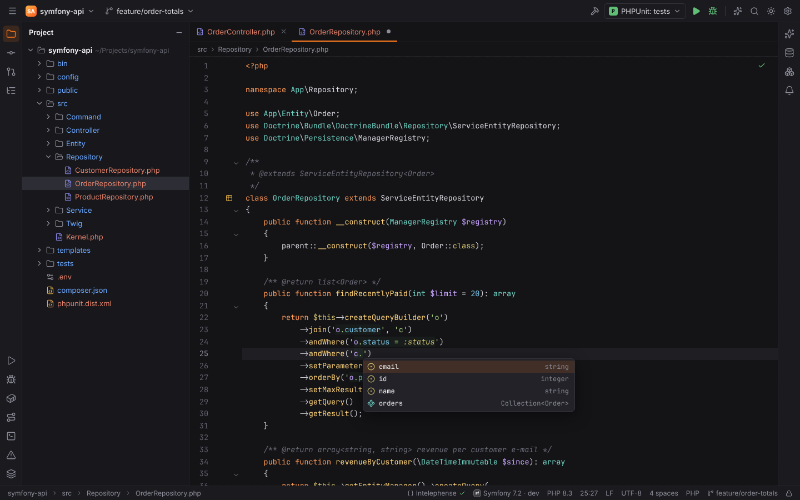
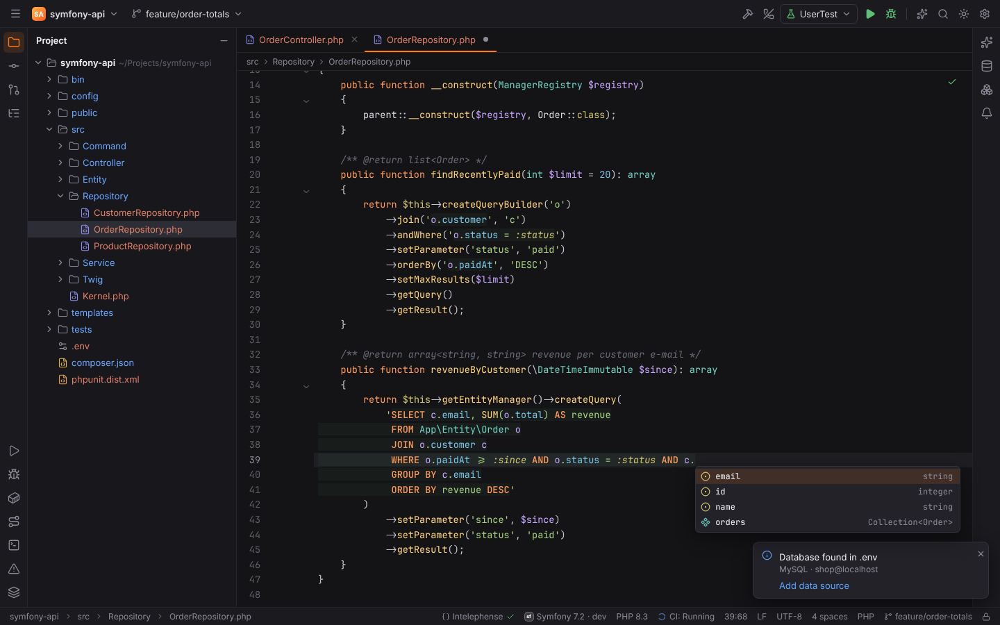
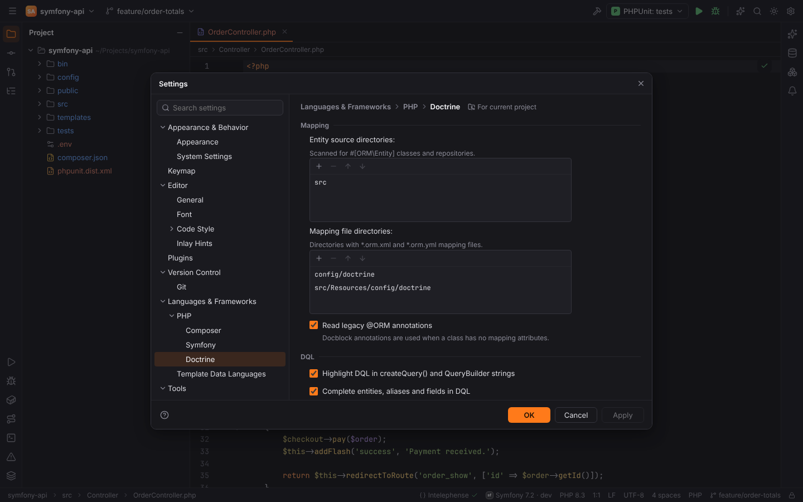

# Doctrine and DQL

The Doctrine plugin (`forge.doctrine`, PHPForge pack) activates in projects that require
`doctrine/orm`, with or without Symfony.

## Entity mappings

Forge reads entity mappings from:

- PHP 8 attributes (`#[ORM\Entity]`, `#[ORM\Column]`, `#[ORM\ManyToOne]`, …),
- legacy docblock annotations (`@ORM\Entity`, `@ORM\Column`, …) when a class has no mapping
  attributes (setting **Read legacy @ORM annotations**, `doctrine.annotations`),
- XML (`*.orm.xml`) and YAML (`*.orm.yml`) mapping files,

including embeddables, mapped superclasses, fields with type, column, length, nullable,
unique, id and generated flags, and associations (`ManyToOne`, `OneToMany`, `ManyToMany`,
`OneToOne`) with `mappedBy`/`inversedBy`. Repositories are linked to their entity.

## Doctrine tool window

The **Doctrine** tool window (right stripe) lists every entity with its table, fields and
associations. Filter by entity or field name; click an entry to open its declaration;
**Refresh** re-reads the mappings (also **Refresh Doctrine Entities** in Find Action).

## DQL in PHP strings

DQL is recognized inside:

- `createQuery('…')`, including concatenated strings, heredocs and `Entity::class`
  interpolation;
- QueryBuilder calls such as `select`, `from`, `join`/`leftJoin`/`innerJoin`, `where`/`andWhere`/
  `orWhere`, `orderBy`, `groupBy`, `having`, and `expr()` fragments, with the aliases that the
  builder chain declares (`createQueryBuilder('o')`, `join('o.customer', 'c')`).

There it provides:

| Feature | Setting |
| --- | --- |
| DQL highlighting of keywords, entities, aliases, fields, parameters | `doctrine.dqlInjection` |
| Completion of entities, aliases, fields, associations, embedded fields, keywords and functions | `doctrine.dqlCompletion` |
| Warnings for unknown entities and fields | `doctrine.dqlInspections` |
| `Ctrl+B` on an entity, alias or field opens its mapping | — |

The highlighting is computed in the background shortly after each edit, so it may lag a
keystroke behind while you type.

## Line markers

Entities and repositories get gutter icons that link them: entity → repository and
repository → entity.

## Settings | Languages & Frameworks | PHP | Doctrine

| Option | Setting | Default |
| --- | --- | --- |
| Entity source directories — scanned for `#[ORM\Entity]` classes and repositories | `doctrine.sourceDirectories` | `src` |
| Mapping file directories — `*.orm.xml` and `*.orm.yml` | `doctrine.mappingDirectories` | `config/doctrine`, `src/Resources/config/doctrine` |
| Read legacy @ORM annotations | `doctrine.annotations` | on |
| Highlight DQL in createQuery() and QueryBuilder strings | `doctrine.dqlInjection` | on |
| Complete entities, aliases and fields in DQL | `doctrine.dqlCompletion` | on |
| Report unknown entities and fields | `doctrine.dqlInspections` | on |

The directory settings and annotations can be stored per project.

> **Note:** Doctrine analysis is not available in [remote projects](remote-development.md) yet.
