# DotNetForge (.NET)

**DotNetForge** brings Rider's .NET support to Forge, inside Forge's PHPStorm-style layout.
Its plugin **.NET** (`forge.dotnet`) is active in [.NET projects](../getting-started/project-detection.md):
a solution (`.sln`, `.slnx`), a project file (`.csproj`, `.fsproj`, `.vbproj`) in the root or
one level below, `global.json`, a C# or F# file in the root, or two or more in a folder.

- C#, F# and Visual Basic files are highlighted out of the box. MSBuild files (`.csproj`,
  `.fsproj`, `.vbproj`, `.props`, `.targets`, `.slnx`, `.nuspec`, `.runsettings`, `.resx`)
  are XML, Razor (`.razor`, `.cshtml`) is HTML with C# (see [Razor and Blazor](#razor-and-blazor)),
  and `.sln` solutions have their own highlighting (sections, GUIDs, configurations).
- Completion, navigation, hover, rename, code actions and diagnostics for C# come from the
  **Roslyn language server** (see [below](#roslyn-language-server)), F# from FsAutoComplete
  when it is installed (`dotnet tool install --global fsautocomplete`).
- Everything else is computed in Rust (`packs/dotnetforge/*`): solutions and project files,
  launch profiles, SDK selection, build output, test discovery, TRX reports, command lines
  and NuGet answers.

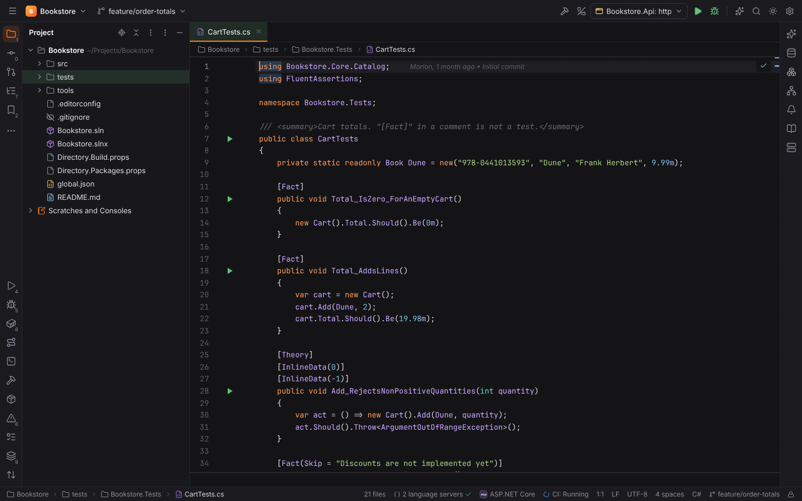

## .NET SDK

**Settings | Languages & Frameworks | .NET** shows the `dotnet` host, its SDKs and runtimes,
and the SDK the solution builds with.

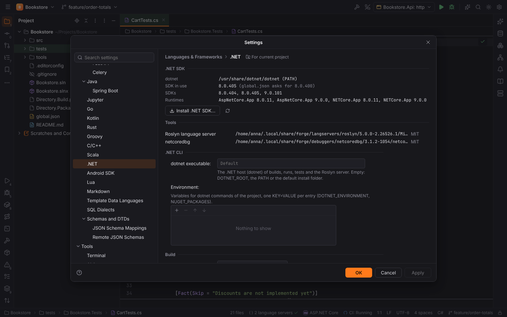

- The host is the **dotnet executable** of the page, else `DOTNET_ROOT`, the `PATH`, the
  default install folders (`/usr/share/dotnet`, `/usr/lib/dotnet`, `/usr/local/share/dotnet`,
  Homebrew, `C:\Program Files\dotnet`) or `~/.dotnet`.
- SDKs and runtimes come from `dotnet --list-sdks` and `dotnet --list-runtimes`, run outside
  the project, or from the host's `sdk/` and `shared/` folders.
- **SDK in use** follows the dotnet host's rules: `global.json`'s `version`,
  `rollForward` (`patch`, `feature`, `minor`, `major`, `latestPatch`, `latestFeature`,
  `latestMinor`, `latestMajor`, `disable`) and `allowPrerelease`. When `global.json` asks
  for an SDK that is not installed, the page says so.
- Without an SDK, a balloon offers **Install .NET SDK…**: the platform's package manager
  (`apt`, `dnf`, `pacman`, Homebrew, winget) in the Terminal, or the download page. Forge
  never installs an SDK on its own.

## Solutions and projects

Forge reads the solution and its projects from the files, the way Rider shows them before a
design-time build:

- `.sln` (Visual Studio 2005+) and `.slnx` solutions: projects, solution folders and
  configurations (`Debug|Any CPU`). With several solutions, the Build tool window picks the
  active one (stored per project, `dotnet.solution`).
- Project files with the nearest `Directory.Build.props` and `Directory.Packages.props`:
  the SDK (`Microsoft.NET.Sdk.Web` makes a web project), `OutputType`, `TargetFramework(s)`,
  `AssemblyName`, `RootNamespace`, project, framework and package references, F# compile
  order, and properties such as `Nullable`, `LangVersion` and `Version`.
- `$(Property)` references are expanded, and simple conditions
  (`'$(Configuration)' == 'Release'`) are evaluated with the active configuration;
  conditions that depend on the target framework keep their references listed.
- **Central package management**: versions from `PackageVersion` items,
  `VersionOverride`, and implicit references (`FSharp.Core`).
- Launch profiles from `Properties/launchSettings.json` (comments and trailing commas are
  fine).
- A test project is one with `IsTestProject`, the `MSTest.Sdk`, or `Microsoft.NET.Test.Sdk`
  with xUnit, NUnit or MSTest.

The solution reloads when you save a solution, project, `Directory.*.props`,
`launchSettings.json` or `global.json` file, and with **Reload Solution**.

## Build tool window

The **Build** tool window (bottom) shows the solution on the left and the last build on the
right, like Rider's.

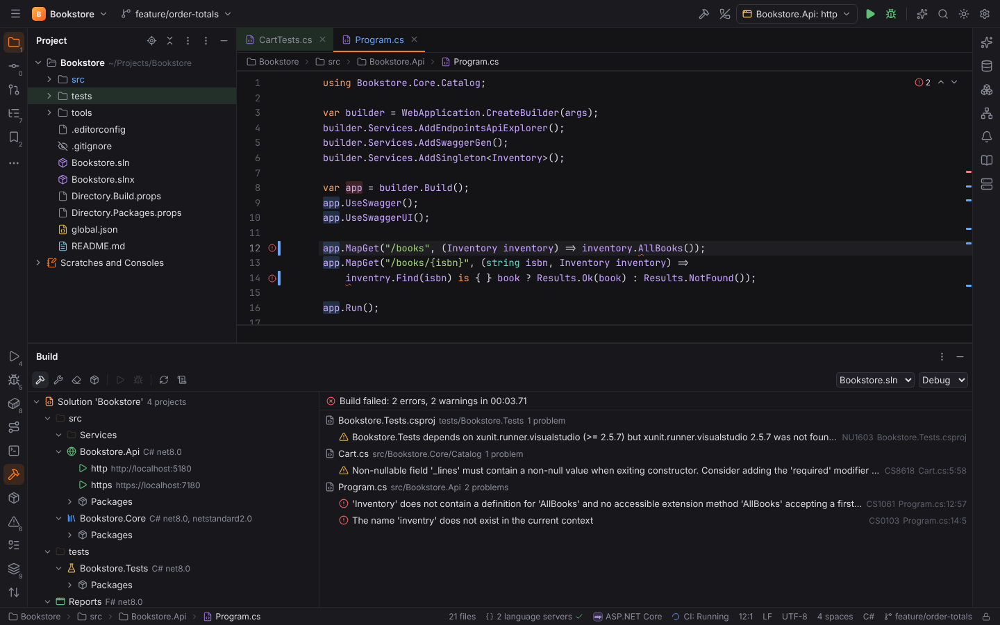

- **Solution tree**: solution folders, projects with their language and target frameworks,
  launch profiles and package references. Double-click runs a project or a launch profile.
- Toolbar: **Build**, **Rebuild**, **Clean** and **Restore NuGet Packages** of the solution
  (or the selected project), **Run** and **Debug** of the selected project or profile,
  **Reload Solution**, **Show Build Output**, the active solution and the build
  configuration (**Debug** / **Release**).
- Builds run `dotnet build` in the Run tool window. Their output is parsed in Rust: the
  compiler (C#, F#, VB), NuGet and MSBuild problems, each once, grouped by file, with the
  summary (errors, warnings, time). Click a problem to open its location; the editor shows
  the same problems (inspection *Build errors and warnings*, source `dotnet-build`). A file
  outside the project (a `.targets` file of the SDK, a file of a NuGet package) opens as a
  read-only library file.
- **Build | Build Project** (`Ctrl+F9`) builds the solution in .NET projects; the Build menu
  also has **Build Solution**, **Rebuild Solution**, **Clean Solution**, **Restore NuGet
  Packages** and **Reload Solution**.

## Run configurations

The **.NET Project** configuration type runs a project with `dotnet run`:

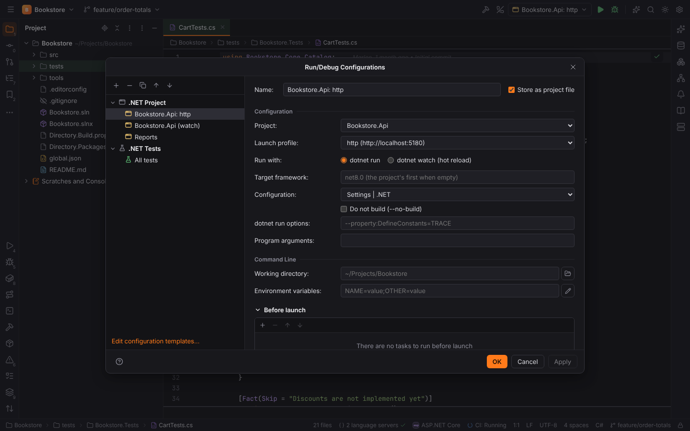

- **Project**: the runnable projects (`Exe`, `WinExe` and web projects).
- **Launch profile**: a profile of `launchSettings.json` (`--launch-profile`), the default
  (the first one) or **None** (`--no-launch-profile`). Profiles of other kinds (IIS
  Express, Docker) are listed in the Build tool window but `dotnet run` cannot start them.
- **Run with**: `dotnet run`, or `dotnet watch` with [Hot Reload](#hot-reload) (rude edits
  restart the program).
- **Target framework**, **Configuration** (else Settings | .NET), **Do not build** and more
  `dotnet run` options; program arguments go after `--`.
- **Build before running tests and debugging** (Settings | .NET) builds the solution through
  the Build tool window first, so its problems show up there.

## Testing

The **.NET Tests** configuration type runs xUnit, NUnit and MSTest tests with `dotnet test`
on the [shared test runner](testing.md):

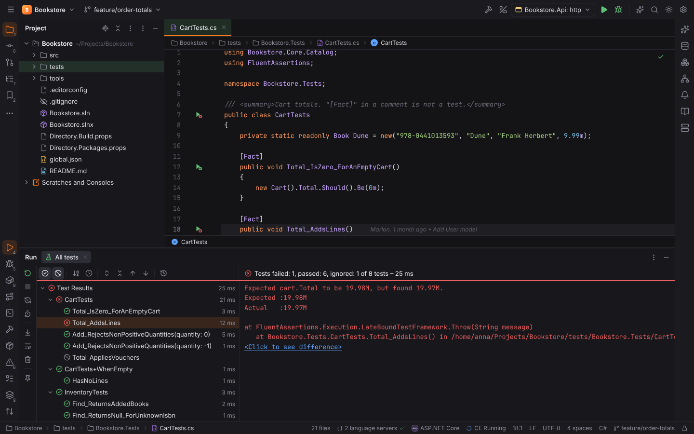

- Gutter icons on test classes and methods: xUnit `[Fact]` / `[Theory]`, NUnit `[Test]` /
  `[TestCase]` / `[TestCaseSource]`, MSTest `[TestMethod]` / `[DataTestMethod]` in C#, and
  `[<Fact>]` / `[<Test>]` functions and members in F#. Nested classes count (`Outer+Inner`);
  skipped tests (`Skip =`, `[Ignore]`) are marked.
- Scopes: the solution, a test project, a class, a method or a `--filter` expression. Class
  and method runs use `FullyQualifiedName` filters (data rows included).
- Results come from the **TRX report** (`--logger trx`) that `dotnet test` writes into
  Forge's report folder: suites per class, tests per data row, durations, output, failure
  messages with stack traces, and **Click to see difference** for xUnit, NUnit, MSTest and
  FluentAssertions comparisons. The gutter icons show the results.
- **Rerun Failed Tests** runs only the failed methods.
- `global.json` with `"test": { "runner": "Microsoft.Testing.Platform" }` switches to the new
  platform's options (`--report-trx`).
- **Debug** runs the tests with `VSTEST_HOST_DEBUG=1` and attaches netcoredbg to the test
  host when it waits for a debugger.

## Debugging

Debugging uses **netcoredbg** (MIT, Samsung), a Debug Adapter Protocol server for .NET:

- **Debug** on a .NET Project configuration builds the project, finds the built assembly in
  the build output and starts `dotnet <assembly>` under netcoredbg with the launch profile's
  arguments, working folder and environment (including `ASPNETCORE_URLS` from
  `applicationUrl`). **Step through my code only** (Just My Code) is on by default.
- netcoredbg comes from Settings | .NET's path, Forge's download, or the `PATH`. **Download…**
  fetches the pinned release from GitHub after you agree and checks the SHA-256 GitHub
  publishes for it; without one, the download is refused.

## NuGet

The **NuGet** tool window (bottom) searches the feed and manages the solution's packages.

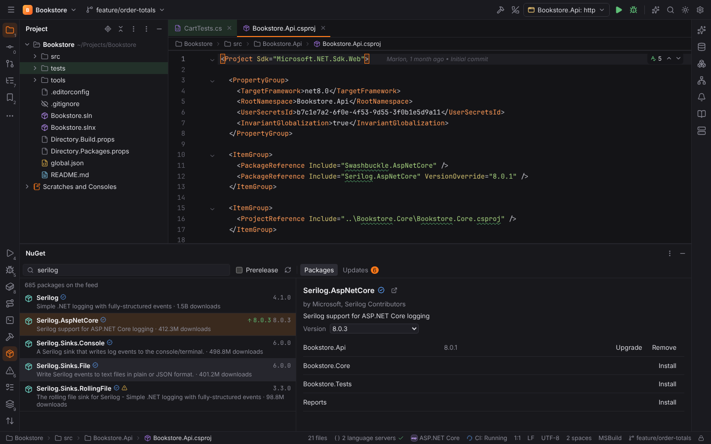

- Without a search term, the list shows the packages installed in the solution, with their
  upgrades. A search asks the feed (nuget.org by default, Settings | .NET | NuGet feed)
  through Forge's Rust client; **Prerelease** includes prerelease versions.
- The details of a package show its versions and every project with the version it uses:
  **Install**, **Upgrade** and **Remove** run `dotnet add <project> package <id> --version
  <v>` / `dotnet remove <project> package <id>` in the Run tool window. With central package
  management, `dotnet` updates `Directory.Packages.props`.
- **Updates** lists the installed packages with a newer version (`Upgrade All`).
- Versions are cached in the user cache folder for six hours and used when the feed cannot
  be reached.

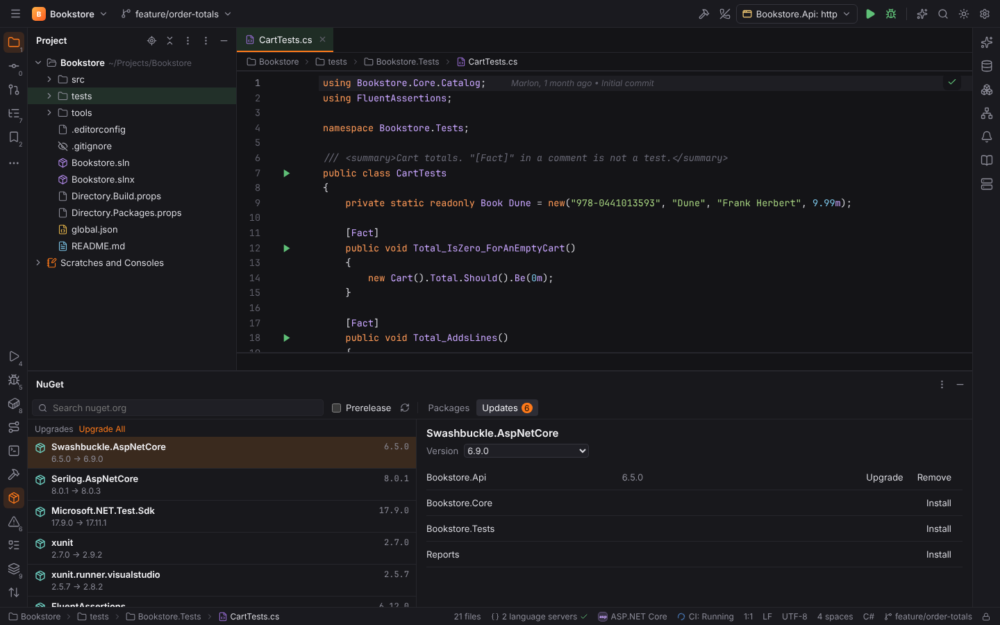

## Templates

- **File | New Project | .NET Project** creates a solution with a project from a `dotnet
  new` template (console, class library, ASP.NET Core, Blazor, worker, xUnit, NUnit, MSTest,
  or any other template's short name), in C#, F# or Visual Basic, for a chosen framework.
- **Tools | Add Project from Template…** lists the templates `dotnet new list` reports
  (including those added with `dotnet new install`), creates the project in `src/` or
  `tests/` and adds it to the solution (`dotnet sln add`).

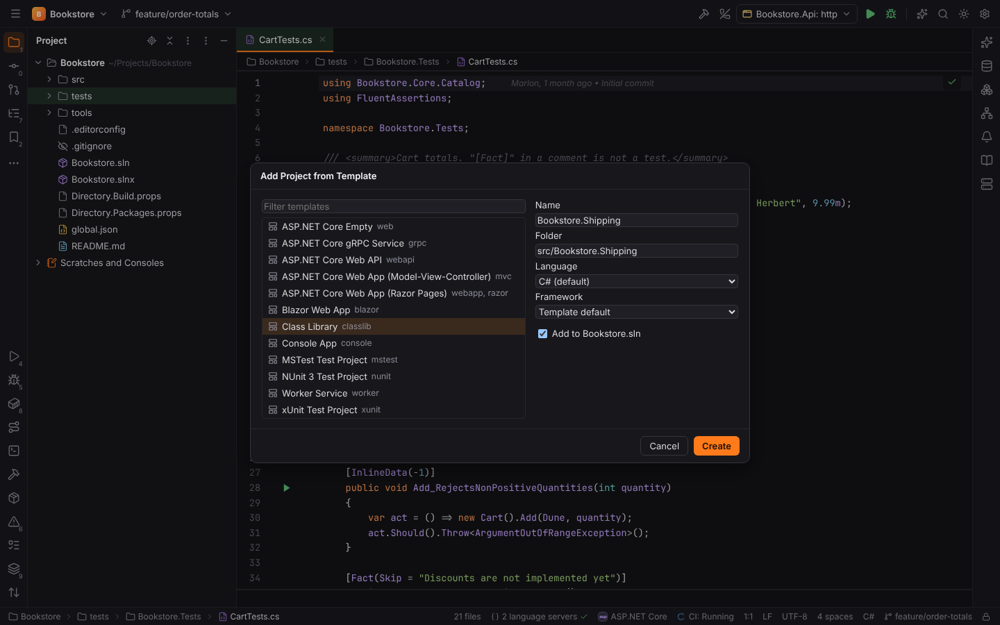

## Code Cleanup and formatting

- **Code | Code Cleanup…** in a .NET project runs `dotnet format` on the current file, its
  folder or the whole solution. Every rule comes from the project's `.editorconfig` files:
  whitespace, code style (`IDE*`) and analyzers (`CA*`). Settings | .NET chooses what it fixes
  (all, whitespace, style, analyzers) and the minimum severity; a balloon reports how many
  fixes `dotnet format` made.
- **Code | Reformat Code** (`Ctrl+Alt+L`) uses the Roslyn server by default. With *Reformat
  Code with: dotnet format*, Forge formats the editor text with `dotnet format whitespace`
  in a temporary copy that has the same `.editorconfig` files, so the project is not touched.

## Roslyn language server

C# code insight comes from **Microsoft.CodeAnalysis.LanguageServer** (MIT), the server of
VS Code's C# extension. It is never bundled:

- When it is missing, a balloon offers **Download…**. Forge downloads the pinned version for
  your platform from Microsoft's public `vs-impl` NuGet feed, checks it against the SHA-256
  recorded for that version, and keeps it in Forge's data folder. It runs on your .NET
  runtime (9 or newer); **Download the Roslyn Language Server…** is also in Find Action.
- Forge starts it for local projects and opens the active solution (`solution/open`), or the
  project files without one. It replaces csharp-ls while it runs.
- Settings: **Analyze** open files, the whole solution or nothing; parameter and type hints.

## Razor and Blazor

Razor files (`.razor`, `.cshtml`) keep their HTML highlighting, and Razor is a layer on top,
like Rider's template data language: `@expressions`, `@(…)`, `@{ … }` and `@code { … }`
blocks, `@if` / `@foreach` and the other control blocks, directives (`@page`, `@inject`,
`@using`, …), directive attributes (`@onclick`, `@bind-Value`) and `@* comments *@`, with C#
colored inside.

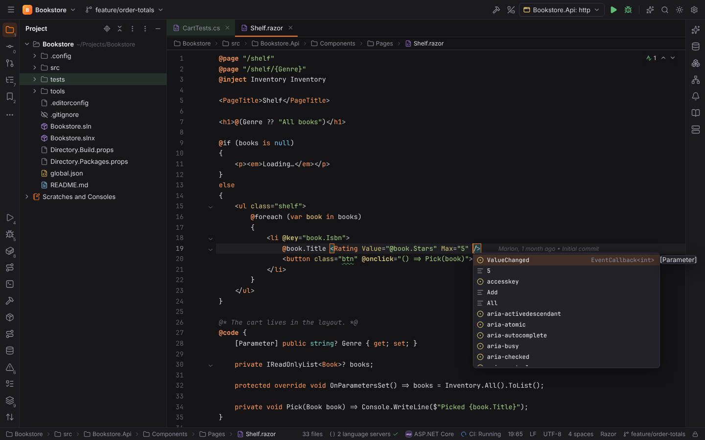

- **Blazor components**: every `.razor` file is a component named after the file. **Go to
  Declaration** (`Ctrl+B`) on `<Rating>` opens `Rating.razor`.
- **Completion**: after `<` the components; inside a component's tag its `[Parameter]`
  properties (from `@code` blocks and the `.razor.cs` code-behind) with their types,
  `[EditorRequired]` ones first; cascading parameters are left out.
- The components (names, parameters, `@page` routes, `@namespace` from `_Imports.razor`) are
  read in Rust and refreshed when a `.razor` file is saved.

## ASP.NET Core endpoints

In solutions with a web project the **Endpoints** tool window has an **ASP.NET Core** view,
like Rider's Endpoints:

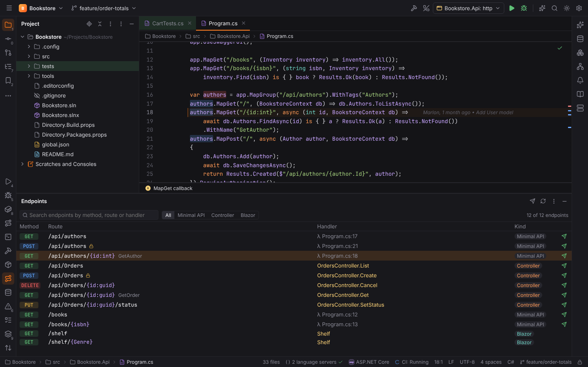

- **Minimal APIs**: `MapGet`, `MapPost`, `MapPut`, `MapDelete`, `MapPatch`, `Map`,
  `MapMethods` and `MapHealthChecks`, with the prefixes of route groups (`var api =
  app.MapGroup("/api")`, chained `MapGroup(…).MapGet(…)`), `WithName` and
  `RequireAuthorization` (a lock).
- **Controllers**: classes with `[ApiController]` or a `Controller` / `ControllerBase` base,
  `[Route]` on the class and the action, `[HttpGet("{id}")]` and the other verbs,
  `[AcceptVerbs]`, `[controller]`, `[action]` and `[area]` tokens and `~/` routes.
- **Blazor** `@page` routes and **Razor Pages** (`Pages/Books/Edit.cshtml` with `@page
  "{id:int}"` is `/Books/Edit/{id:int}`).
- Parameters come from the handler: route values, `[FromQuery]`, `[FromBody]` and the other
  binding attributes, simple types as query parameters and complex ones as the body of `POST`
  / `PUT` / `PATCH`.
- Click a row to open its handler; search by method, route or handler and filter by kind.
- **Generate HTTP Request** (the row's ▶ or its context menu) opens an `.http` request in the
  [HTTP Client](scratches-and-http.md#http-client-http-files): against the URL of the project's launch profile
  (`applicationUrl`), route values as `{{variables}}`, query parameters listed, a JSON body
  for body parameters.

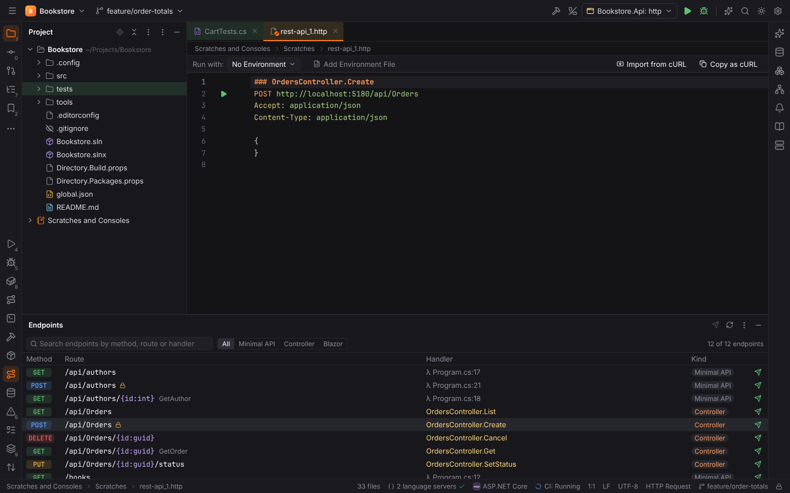

## Entity Framework Core

The **EF Core** tool window (bottom) appears when a project references EF Core:

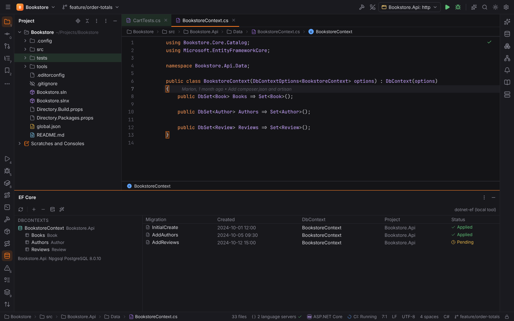

- **DbContexts** of the sources with their `DbSet`s, the provider of each EF Core project.
- **Migrations** of the sources (`[Migration("…")]` with its `[DbContext]`), with their
  creation time. **Refresh** runs `dotnet ef migrations list --json` and marks each one
  **Applied** or **Pending** (and lists those only the database knows).
- **Add Migration…**, **Remove Last Migration…**, **Update Database…** (to the latest, a
  chosen migration, or `0`), **Scaffold DbContext…** (connection string, provider, tables,
  output folder, data annotations): each opens a dialog with the DbContext project, the
  **startup project** (Settings | .NET | EF Core startup project, else the first application
  that references EF Core) and the DbContext, then runs `dotnet ef` in the Run tool window.
  The same actions are in **Tools | Entity Framework Core** and Find Action; a migration's
  context menu has **Update Database to This Migration**.
- `dotnet ef`'s output is read in Rust: failures get a hint (a missing
  `Microsoft.EntityFrameworkCore.Design` package, a DbContext that cannot be created, a build
  error, an unreachable database). When `dotnet-ef` is missing, a balloon offers **Install
  dotnet-ef** (`dotnet tool install --global dotnet-ef`, after you confirm); a local tool in
  `.config/dotnet-tools.json` is used as is.

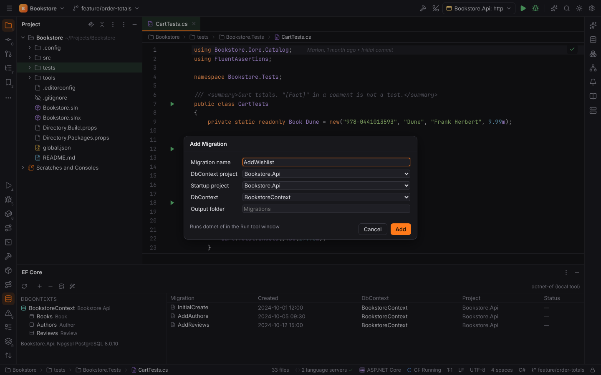

## .NET Aspire

AppHost projects (`IsAspireHost`, the `Aspire.AppHost.Sdk` or the `Aspire.Hosting.AppHost`
package) get the **.NET Aspire** run configuration type (`dotnet run` of the AppHost with a
launch profile):

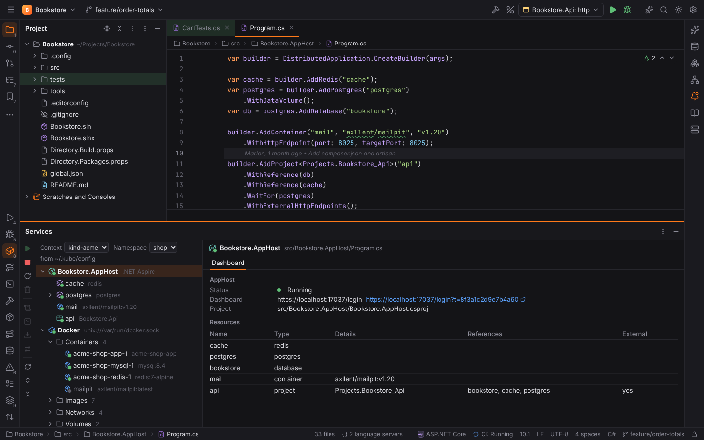

- The **Services** tool window lists each AppHost with the resources its `Program.cs`
  declares: projects (`AddProject<Projects.Bookstore_Api>("api")`, linked to their project),
  containers with their image, Redis, PostgreSQL and other servers with their databases, npm
  apps and executables, with `WithReference` / `WaitFor` references and external endpoints.
  **Start**, **Stop** and **Restart** use the run configuration.
- While the AppHost runs, Forge reads the **dashboard URL** from its output (`Login to the
  dashboard at …`): a balloon offers **Open Dashboard**, the Services details link it, and
  **Open Aspire Dashboard** is in Find Action. Settings | .NET | *Open the Aspire dashboard
  when an AppHost starts* opens it right away.

## Docker

**Tools | Add Docker Support…** writes a Dockerfile for an application project, like Rider's:

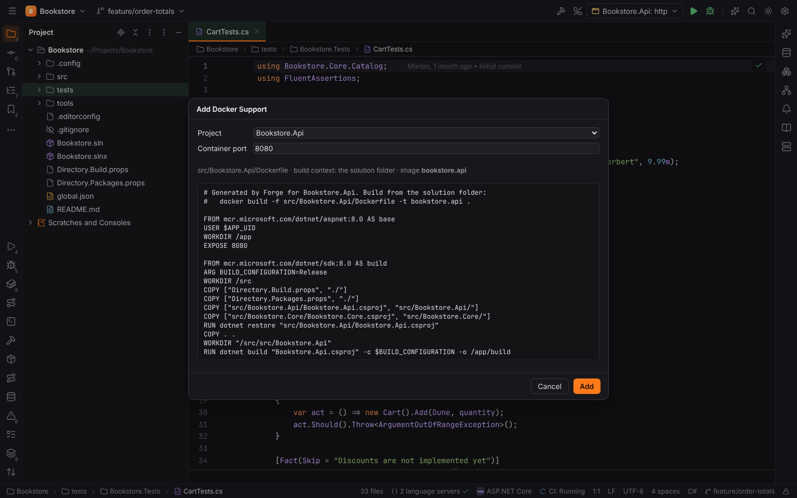

- A multi-stage build (`sdk` → `build` → `publish` → `aspnet` or `runtime` of the project's
  .NET version) next to the project, built from the **solution folder** so project references,
  `Directory.Build.props`, `Directory.Packages.props` and `NuGet.config` are copied before
  `dotnet restore`; `EXPOSE` of the container port; `ENTRYPOINT` of the assembly.
- A `.dockerignore` in the solution folder (`bin`, `obj`, `.git`, …) unless there is one.
- A **.NET Docker** run configuration: `docker build -f <Dockerfile> -t <image> <context>`
  in its own tab, then `docker run --rm` with the **ports** (`8080:8080`), **environment**
  and options. The container appears in the [Services](services.md) tool window.

## Hot Reload

A **.NET Project** configuration with **Run with: dotnet watch** runs with Hot Reload, like
Rider's:

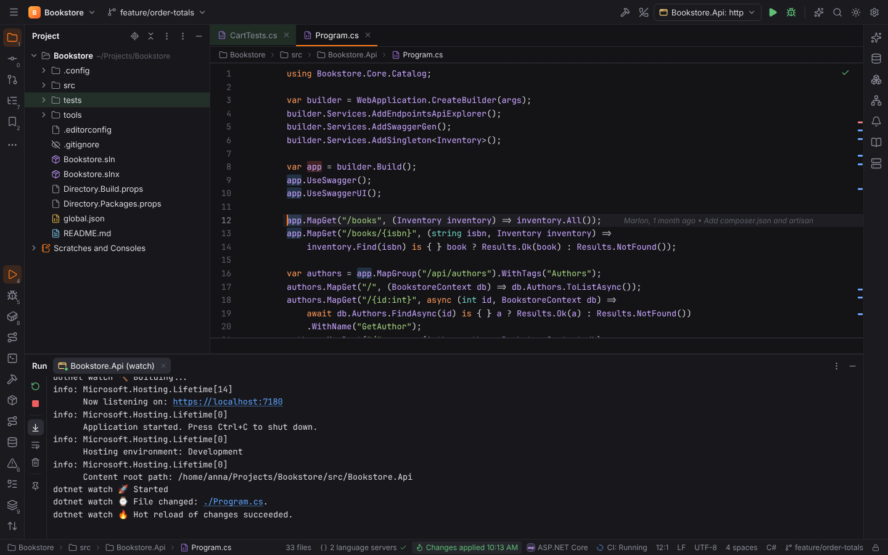

- The status bar shows the Hot Reload state of the running application, read from `dotnet
  watch`'s output in Rust: watching, applying, **Changes applied** (with the time), no
  changes, a **rude edit** that needs a restart, or a failed build.
- **Run | Apply Changes (Hot Reload)** (`Ctrl+F10`, IntelliJ's *Update Running Application*)
  saves the edited files so `dotnet watch` applies them; after a rude edit it answers `dotnet
  watch`'s restart question. Forge starts `dotnet watch` with
  `DOTNET_WATCH_RESTART_ON_RUDE_EDIT`, so rude edits usually restart on their own.

## User secrets

**Tools | Manage User Secrets** opens the project's `secrets.json` in an editor tab, like
Rider:

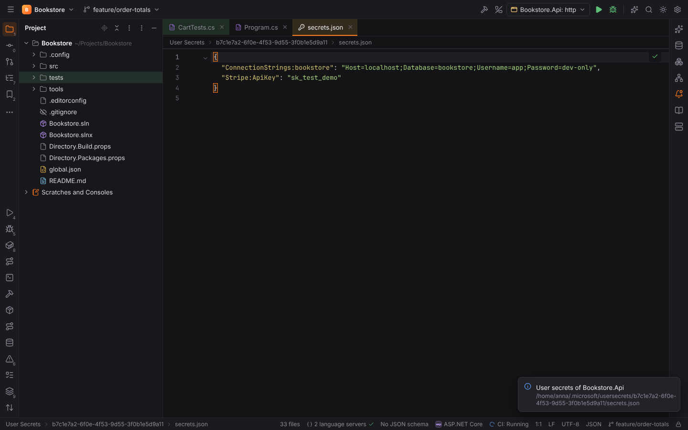

- The file lives in your user profile, not in the project, so it is never committed:
  `~/.microsoft/usersecrets/<UserSecretsId>/secrets.json` (Linux, macOS) or
  `%APPDATA%\Microsoft\UserSecrets\<UserSecretsId>\secrets.json` (Windows). On Unix it is
  created readable only by you.
- The project is the one of the current file, the only application of the solution, or one
  you choose. A project without a `UserSecretsId` gets one after you confirm (what `dotnet
  user-secrets init` does, without running anything) and an empty `secrets.json`.
- Remote projects keep their secrets on the remote machine; use `dotnet user-secrets` in its
  terminal.

## Unity and Godot

Unity and Godot projects get their own plugins on top of this one: the Unity Hub's editors, the
Forge editor bridge, Unity tests, GDScript with the Godot editor's language server, Godot run
configurations and debugging. See [Unity and Godot](unity-godot.md).

## Azure DevOps

Repositories on Azure DevOps (`dev.azure.com`, `*.visualstudio.com`, Azure DevOps Server) get
pull requests, work items and builds in the Pull Requests tool window; see [Code
hosts](code-hosts.md#azure-devops).

## Project trust

Building, running, testing, restoring, formatting and debugging run project code (MSBuild
targets, source generators, analyzers), so [Safe Mode](project-trust.md) refuses them, and
the Roslyn server and FsAutoComplete do not start. The same goes for `dotnet ef` (it builds
and starts the startup project), the .NET Aspire and .NET Docker configurations (`docker
build`) and `dotnet watch`. Reading the solution, project files and launch profiles, the
endpoints, components, migrations and Aspire resources, generating a Dockerfile, user secrets
and searching NuGet stay available.

## Browser mode

`?project=dotnet` opens the `Bookstore` demo solution (an ASP.NET Core API, a class library
with two target frameworks, xUnit tests and an F# tool, with central package management);
`&build=broken` makes its build fail with compiler errors, `&roslyn=missing` starts without
the Roslyn server. The demo has minimal APIs, a controller, Blazor components, EF Core
migrations, an Aspire AppHost, user secrets (kept in memory) and an Azure DevOps remote;
`dotnet ef`, `docker` and the AppHost print canned output.
