# Editor

Forge's editor is built on CodeMirror 6. Markdown, SVG, image and CSV/TSV files open in
editors of their own with a preview, zoom or a table view: see
[Markdown, images and CSV](markdown-images-csv.md). Language intelligence (completion, hover, diagnostics,
Go to Declaration, formatting) comes from [language servers](language-servers.md) and from
Forge's own indexes for PHP, Lua and the frameworks. Shortcuts below are the Windows/Linux
defaults with macOS in parentheses; the full list is in the
[keymap reference](../reference/keymap.md).

## Code completion

- Completion pops up while you type, from the language server(s) of the file and, in
  framework projects, from Forge's framework sources (Laravel routes and views, Symfony
  services, Twig, DQL, …). Each item has a kind icon (class, method, property, variable,
  keyword, …).
- **Basic Completion** `Ctrl+Space` (also `Shift+Space`) opens it explicitly. Then words
  that already occur in the document are offered as well; this works in every file, even
  without a language server.
- `Enter` or `Tab` accepts. Functions are inserted with parentheses and the caret between
  them; snippet placeholders from the server can be filled in with `Tab`.
- Brackets and quotes are closed automatically.

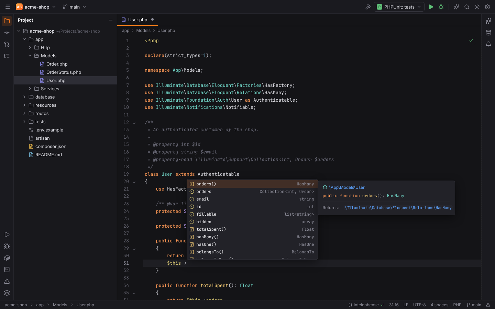

### Postfix completion

Postfix templates wrap the expression you just typed: type a dot and the template key after
an expression, as in PHPStorm. In PHP, `$user->isAdmin().if` becomes

```php
if ($user->isAdmin()) {
    |
}
```

- The templates appear in the completion popup after `expr.` (below the members of the
  expression), with their description. Typing the full key and pressing `Tab` expands the
  template directly.
- Templates such as `.if`, `.return`, `.var` or `.foreach` take the whole statement before
  the dot (`$a > 0.if` → `if ($a > 0)`); `.not`, `.par`, `.isset` or `.await` take the
  closest expression (`$x = $valid.not` → `$x = !$valid`).
- `.var`, `.foreach` and the other templates that introduce a name suggest one from the
  expression and select it (`$this->getUsers().foreach` → `foreach ($this->getUsers() as
  $user)`), so you can type over it.
- Templates are not offered in strings and comments.

| Language | Templates |
| --- | --- |
| PHP | `.echo`, `.else`, `.empty`, `.for`, `.forek`, `.foreach`, `.forr`, `.if`, `.isset`, `.new`, `.not`, `.notnull`, `.null`, `.par`, `.return`, `.sprintf`, `.switch`, `.throw`, `.try`, `.unset`, `.var`, `.while` |
| JavaScript and TypeScript | `.await`, `.const`, `.else`, `.for`, `.fori`, `.forin`, `.forof`, `.if`, `.let`, `.log`, `.new`, `.not`, `.notnull`, `.null`, `.par`, `.return`, `.switch`, `.throw`, `.typeof`, `.undefined`, `.var`, `.while` |
| Lua | `.else`, `.for`, `.if`, `.ipairs`, `.local`, `.nil`, `.not`, `.notnil`, `.pairs`, `.par`, `.print`, `.return`, `.while` |

**Settings | Editor | General | Postfix Completion** switches postfix completion on and off,
hides the templates from the completion autopopup, chooses the expand key (`Tab`, `Space`
or `Enter`) and switches single templates off. Selecting a template shows its description
and a before/after example.

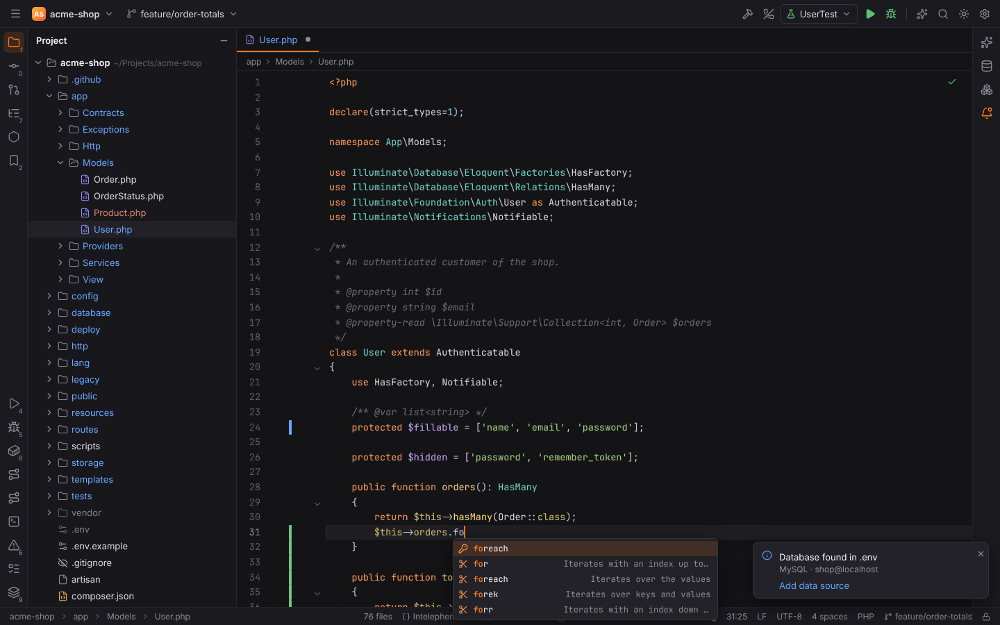

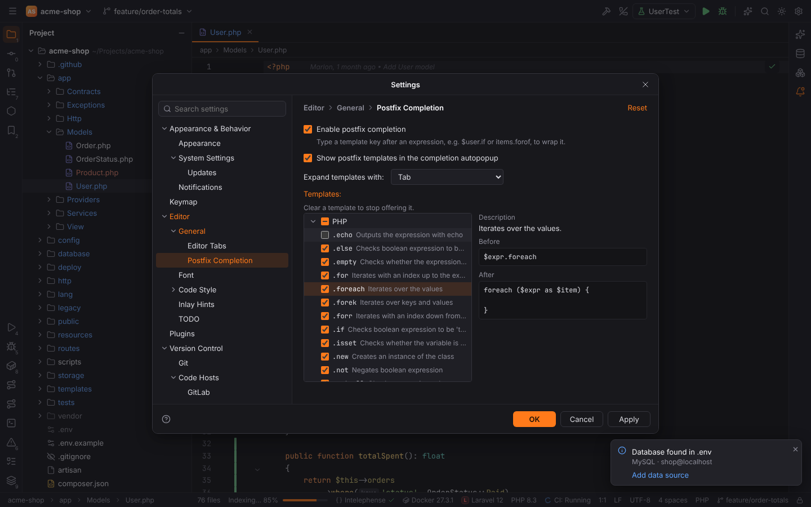

### Complete Current Statement

**Complete Current Statement** (`Ctrl+Shift+Enter`, macOS `Cmd+Shift+Enter`) finishes the
statement at the caret and puts the caret where you continue typing:

- closes the parentheses and brackets the line left open and adds the missing `;` in PHP,
  JavaScript and TypeScript (`$a = foo(bar(1` → `$a = foo(bar(1));`). Inside multi-line
  arrays, calls and object literals, and before a chained `->where(…)` line, no `;` is
  added;
- opens the block of `if`, `elseif`, `else`, `for`, `foreach`, `while`, `switch`, `try`,
  `catch` and function or class declarations and moves the caret into it. PHP functions and
  classes get their brace on the next line (PSR-12); an existing block is entered instead
  of adding a second one;
- in Lua adds `then` / `do` and the matching `end` (`if ready` → `if ready then … end`),
  and closes `function … end` and `repeat … until`;
- starts a new line when the statement is already complete.

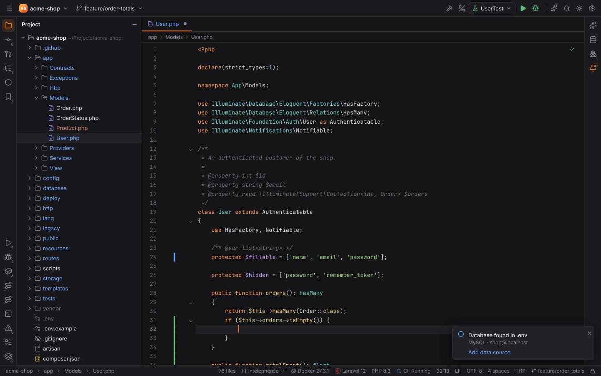

### Cyclic Expand Word

**Cyclic Expand Word** (`Alt+/`) completes the word at the caret with a word that already
occurs in the file, the nearest one above the caret first, then the ones below, then the
words of the other open files. Press `Alt+/` again to cycle through the other matches;
**Cyclic Expand Word (Backward)** (`Alt+Shift+/`) cycles the other way and, when it starts,
looks below the caret first. It works in every file type, without a language server.

## Quick documentation on hover

Hold the mouse over a symbol to see its documentation: signature, description, parameters
and return value, deprecation notes and links, rendered PHPStorm-style. Problems at that
position are shown in the same popup.

For PHP, Forge merges the language server's answer with its own index (PHPDoc, attributes,
inherited documentation) and falls back to the index when no server runs. Lua uses LuaForge's
index until lua-language-server answers.

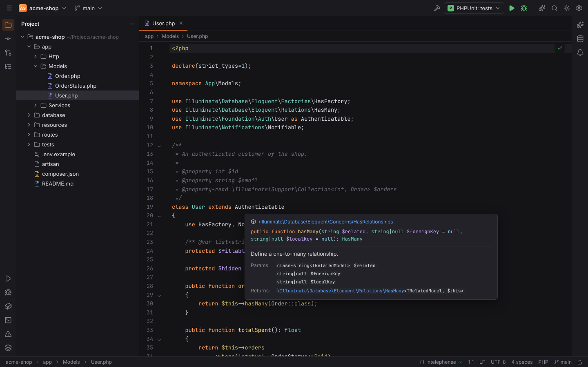

## Quick Documentation

**View | Quick Documentation** (`Ctrl+Q`, macOS `F1` or `Ctrl+J`) shows the same documentation
for the symbol at the caret, without the mouse. The popup closes when you move the caret, type
or press `Escape`. Its toolbar has three buttons:

- **Open in Documentation Tool Window** (pin; or press `Ctrl+Q` a second time) moves the
  documentation to the Documentation tool window.
- **External Documentation** (`Shift+F1`) opens the symbol's page in the browser.
- **Edit Source** (`F4`) jumps to the declaration.

When there is nothing to show, a hint says "No documentation found".

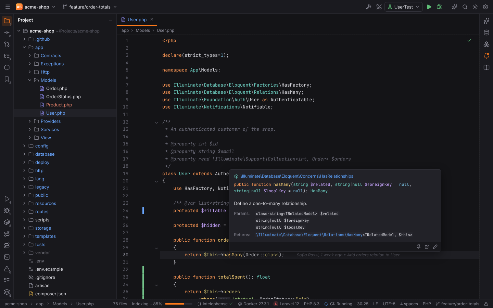

### Documentation tool window

The **Documentation** tool window (right stripe, View | Tool Windows | Documentation) keeps the
documentation open while you work. With **Auto-Update from Source** (the crosshair button,
on by default) it follows the caret and shows the documentation of each symbol you move to;
while it is open, `Ctrl+Q` updates it instead of opening the popup. Its toolbar also has
External Documentation and Edit Source.

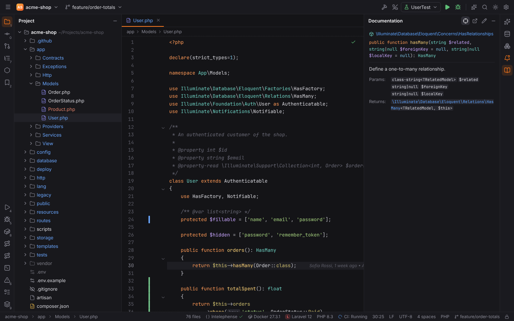

## External Documentation

**View | External Documentation** (`Shift+F1`) opens the online documentation of the symbol at
the caret in your browser:

| Symbol | Page |
| --- | --- |
| PHP functions, classes, methods and keywords of PHP itself | php.net manual |
| Laravel framework classes and methods (`Illuminate\…`) | Laravel API reference |
| JavaScript built-ins (`Array`, `JSON.parse`, `Promise`), DOM and Web APIs (`document`, `fetch`, `console.log`), keywords | MDN |
| HTML tags, CSS properties, at-rules and pseudo-classes | MDN |
| Vue Composition API (`ref`, `computed`, `onMounted`, `defineProps`) in files that import `vue` | vuejs.org API |
| React hooks and APIs (`useState`, `memo`, `createRoot`) in files that import `react` | react.dev reference |
| Lua standard functions and libraries (`print`, `string.format`, `table`) | Lua 5.4 reference manual |

Your own project's classes have no external page; the hint "No external documentation
found" appears instead. PHP symbols are resolved like Go to Declaration (language server,
PHP index, PHP stubs), so `$date->format()` opens `DateTime::format`.

## Quick Definition

**View | Quick Definition** (`Ctrl+Shift+I`, macOS `Alt+Space` or `Cmd+Y`) shows the source of
the declaration at the caret in a popup, with its docblock and attributes, up to the closing
brace (Lua: `end`), without leaving the file. The header names the symbol and its file and
line; **Edit Source** (pencil) opens it. When there are several declarations (an interface
method, a class declared twice), the arrows switch between them. On a declaration itself,
the popup shows that declaration. Declarations in the PHP stubs and other library files work
too. Long declarations are cut after 80 lines.

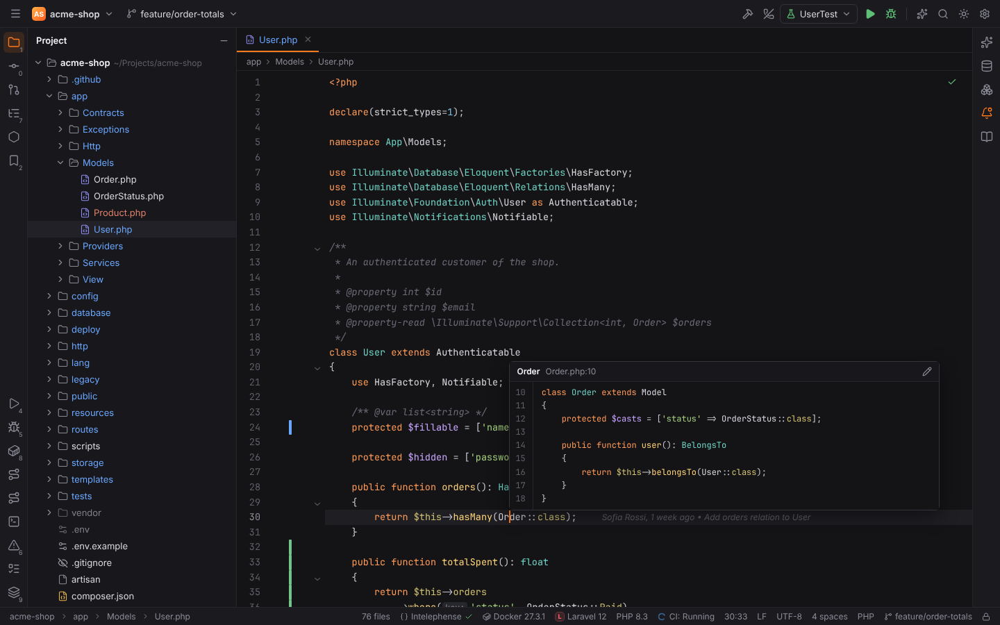

## Type Info, Context Info and Error Description

- **Type Info** (`Ctrl+Shift+P`) shows the type of the expression at the caret in a small hint:
  a variable's or property's type, a method's return type, a class's name. It comes from the
  language server's hover, in PHP also from the PHP index.

  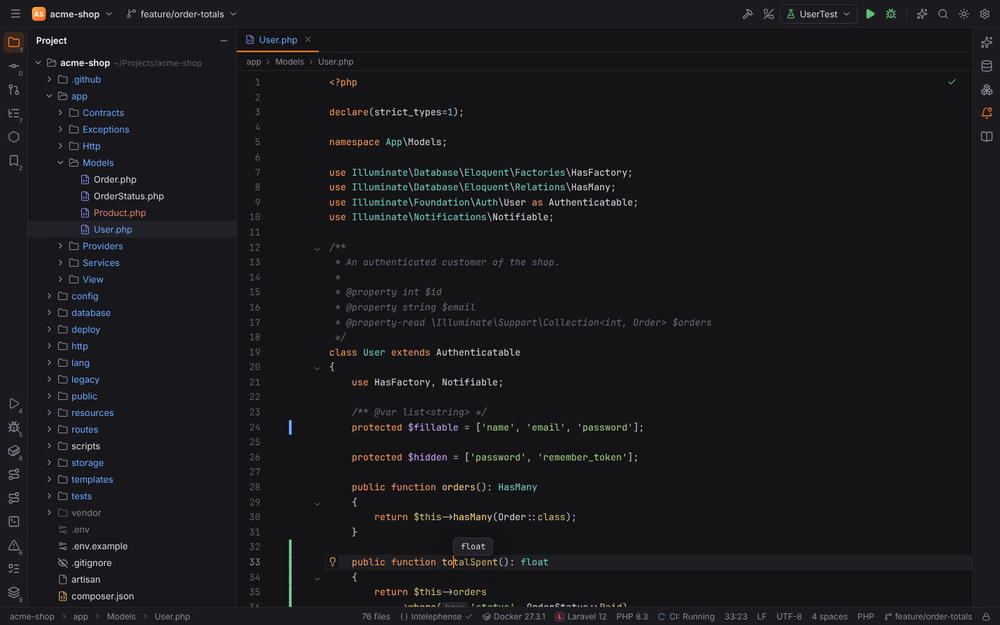

- **Context Info** (`Alt+Q`, macOS `Ctrl+Shift+Q`) shows, at the top of the editor, the
  headers of the class, function or method (in CSS: the rules and `@media` blocks) that
  enclose the caret, with their line numbers. Useful when they are scrolled out of view.

  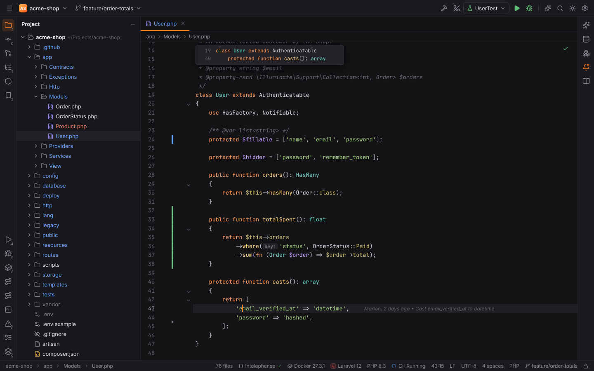

- **Error Description** (`Ctrl+F1`, macOS `Cmd+F1`) shows the full text of the problems at
  the caret, with their severity and the inspection or language server that reported them.

  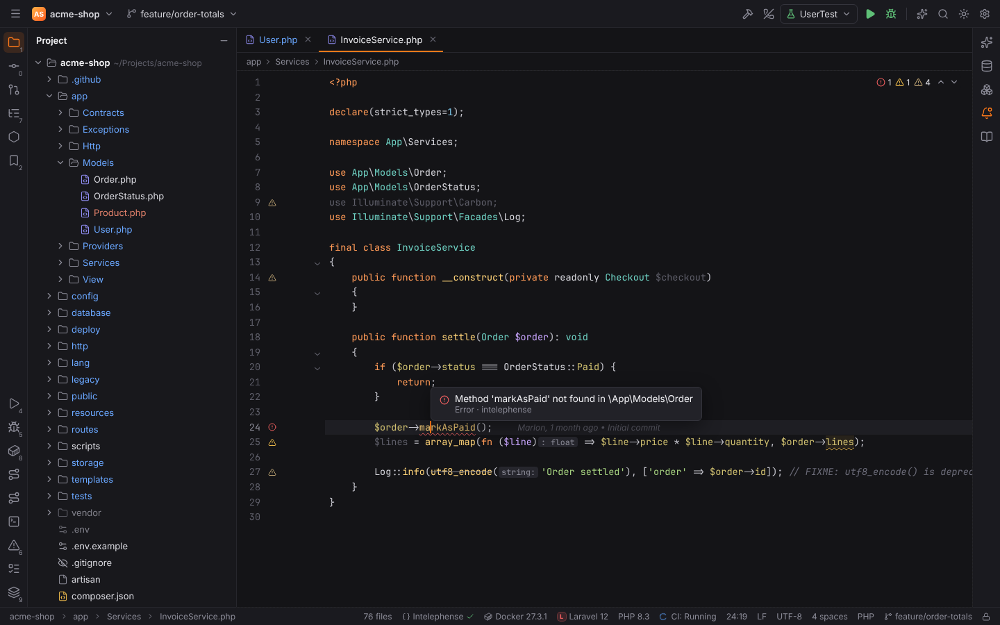

## Parameter Info

**Parameter Info** (`Ctrl+P`, macOS `Cmd+P`) shows the parameters of the call at the caret,
the current one in bold, with its documentation. It also opens automatically after you type
`(` and follows you as you type `,`.

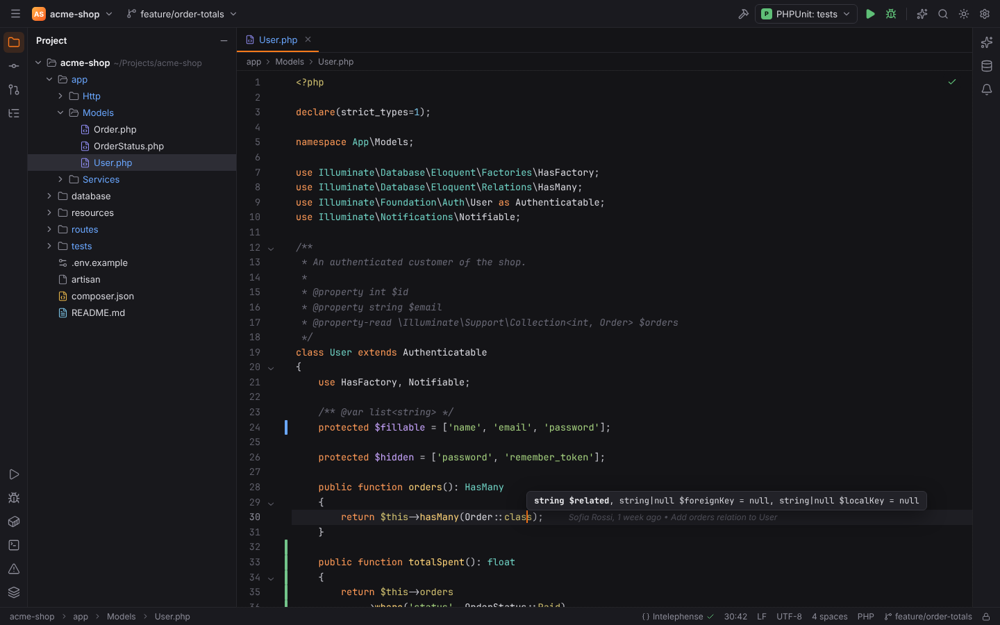

## Go to Declaration

**Go to Declaration or Usages** (`Ctrl+B`, macOS `Cmd+B`), `Ctrl+Click` (macOS `Cmd+Click`)
or a middle click jumps to the declaration of the symbol at the caret. While `Ctrl` is held,
the symbol under the mouse is underlined like a link, with a small tooltip that shows where it
is declared (in PHP: the namespace or class and the declaration).

Forge first asks its framework providers, which know things a language server cannot
resolve: Laravel route names, views, config keys and Eloquent attributes; Symfony service ids,
routes and Twig templates; Doctrine entities and DQL fields; React/Vue/Angular components and
props; Lua modules. Then it asks the language server and, in PHP files, Forge's PHP index and
the PHP stubs (see [PHP navigation](php.md#navigation)).

On a declaration itself (a class, method or function name), Go to Declaration shows its
**usages** instead, as in PHPStorm; a single usage opens directly.

When there are several targets — from a framework provider (a view that exists in two places, a
component used in many templates) or from the language server — the **Choose Declaration**
popup lists them at the caret with file, line and the code of each target (or the symbol name
and its namespace), as in PHPStorm. Pick one with the arrow keys and `Enter`, or `Escape` to
cancel. The same popup is used by line markers with several targets, in every language pack
(PHP and its frameworks, WebForge, LuaForge).

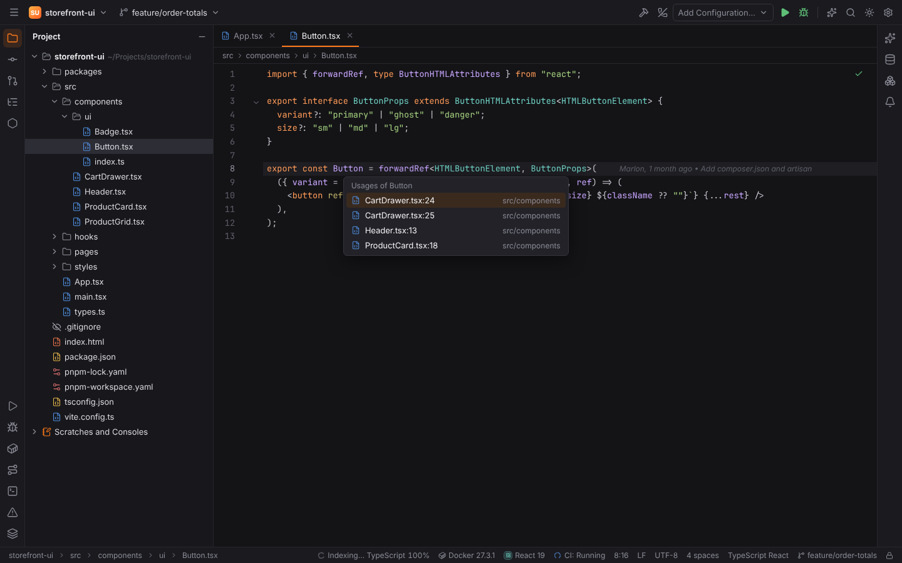

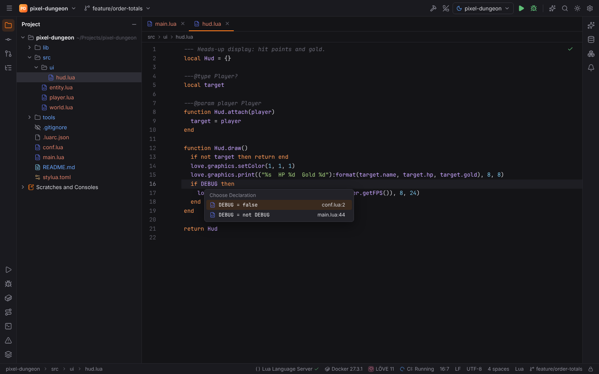

If nothing is found, a hint "Cannot find declaration to go to" appears at the caret.

Declarations outside the project (PHP's own classes in the PHP stubs, files a language server
points to outside the project) open in a **read-only** tab with a "Read-only library file"
banner and breadcrumbs such as `PHP Runtime › Core › Core_c.php › Throwable`.

**Back** / **Forward** (`Ctrl+Alt+Left` / `Ctrl+Alt+Right`, macOS `Cmd+[` / `Cmd+]`) return
to where you were.

### Implementation, Type Declaration, Super Method

| Action | Shortcut | macOS |
| --- | --- | --- |
| Implementation(s) | `Ctrl+Alt+B`, `Ctrl+Alt+Click` | `Cmd+Alt+B`, `Cmd+Alt+Click` |
| Type Declaration | `Ctrl+Shift+B` | `Cmd+Shift+B` |
| Super Method | `Ctrl+U` | `Cmd+U` |

They ask the language servers (`textDocument/implementation`, `typeDefinition`) and fall back
to the PHP index in PHP files. When a server lacks the feature (Go to Implementation in
Intelephense without a licence) and the index finds nothing, the hint says so.

> **Note:** Go to Test (`Ctrl+Shift+T`) is not available yet. In React and Vue projects, Go to
> Declaration on a component's own name lists its usages through the framework provider.

## Find Usages and Show Usages

**Show Usages** (`Ctrl+Alt+F7`, macOS `Cmd+Alt+F7`) opens a popup at the caret with every
usage of the symbol: its code line with the reference highlighted, the file and the line,
grouped by usage type (import, new instance, method call, static access, extends/implements,
type declaration, PHPDoc, …). `Up`/`Down` select, `Enter` opens, `Escape` closes, the pin
button opens the result in the Find tool window.

**Find Usages** (`Alt+F7`) shows the usages in the **Find** tool window (`Alt+3`, macOS
`Cmd+3`), one tab per search, as a tree by usage type and file; **Group by Usage Type**,
**Expand All** and **Collapse All** are on its toolbar. The Find stripe button appears once
there is a result.

Usages come from the language servers (`textDocument/references`); in PHP files without a
server answer, from the PHP index. Unsaved changes in open editors are taken into account.

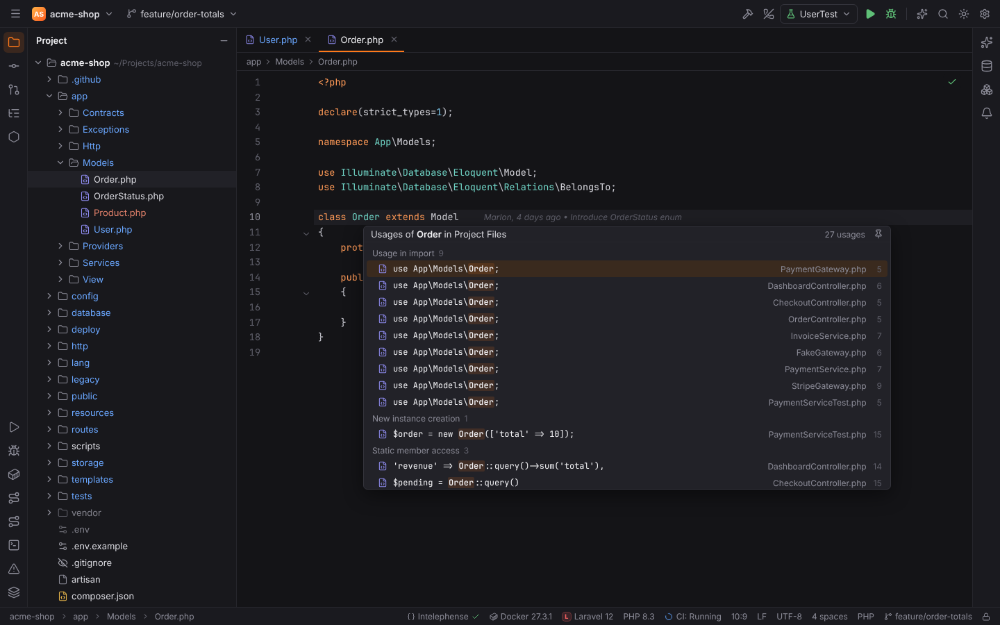

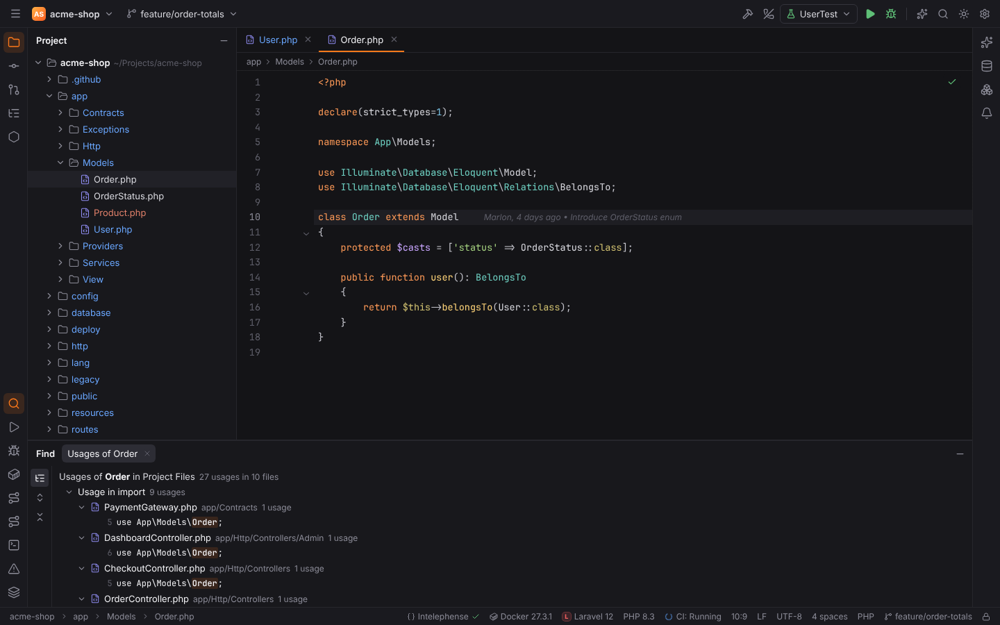

### Find Usages settings

**Find Usages Settings…** (`Ctrl+Alt+Shift+F7`, macOS `Cmd+Alt+Shift+F7`, or the **Settings**
button of the Find tool window and the Show Usages popup) opens the **Find Usages** dialog for
the element at the caret. What it offers depends on the element, like in PHPStorm:

| Element | Find | Options |
| --- | --- | --- |
| Class, trait, enum | Usages, Usages of methods, Usages of fields, Derived classes (classes) | Search in comments and strings, Search for text occurrences |
| Interface | Usages, Usages of methods, Implementing classes, Derived interfaces | Search in comments and strings, Search for text occurrences |
| Method | Usages, Overriding methods (implementing methods of interfaces and abstract methods) | Search in comments and strings, Search for text occurrences |
| Property | Read access, Write access | Search in comments and strings, Search for text occurrences |
| Variable | Read access, Write access | — (searched in its file) |
| Function, constant, other symbols | Usages | Search in comments and strings, Search for text occurrences |

**Scope** is one of Project Files (the default; `vendor/` and `node_modules/` left out),
Project and Libraries, Open Files, Current File, Recently Changed Files (the working tree's
changes and unsaved editors), Directory (with **Include subdirectories**) or Custom (a pattern
in PHPStorm's scope language such as `file:app//*.php&&!test:*..*`, or file globs separated by
`;` where `!` excludes, e.g. `app/**/*.php; !app/Legacy/**`). Below them the list offers
Project Production Files, Project Test Files and your named scopes from Settings | Appearance &
Behavior | Scopes (`findUsages.scope.name`; see [Scopes and file colors](scopes-and-file-colors.md)),
and **…** opens that page. **Open in new tab** off
replaces the active usages tab of the Find tool window instead of adding one.

**Find** saves the choices as settings (`findUsages.*`, see the
[settings reference](../reference/settings.md)), so later Find Usages (`Alt+F7`) and Show
Usages (`Ctrl+Alt+F7`) runs use them too, and searches. **Search for text occurrences** adds
the name in files of other languages (configuration, templates, Markdown) as **Non-code
usages**; **Search in comments and strings** adds it in comments and string literals. The
filtering and the extra occurrences are computed in Rust next to the files, so remote projects
work the same.

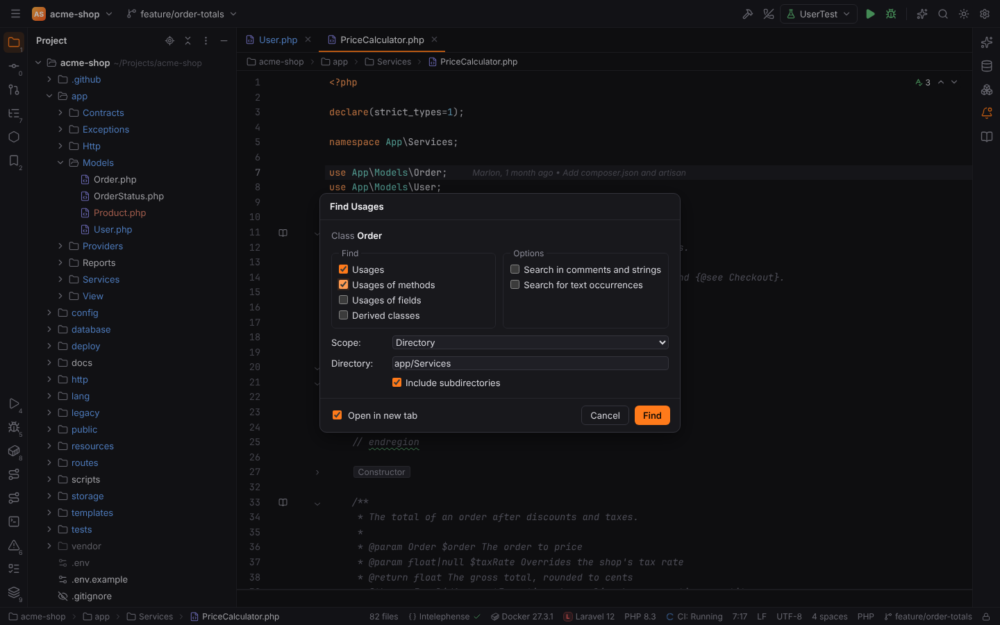

### Find Usages in File

**Find Usages in File** (`Ctrl+F7`, macOS `Cmd+F7`) finds the usages of the element at the
caret in the current file and shows them in the Find tool window, like Find Usages with the
scope Current File ("Usages of Order in File 'PriceCalculator.php'").

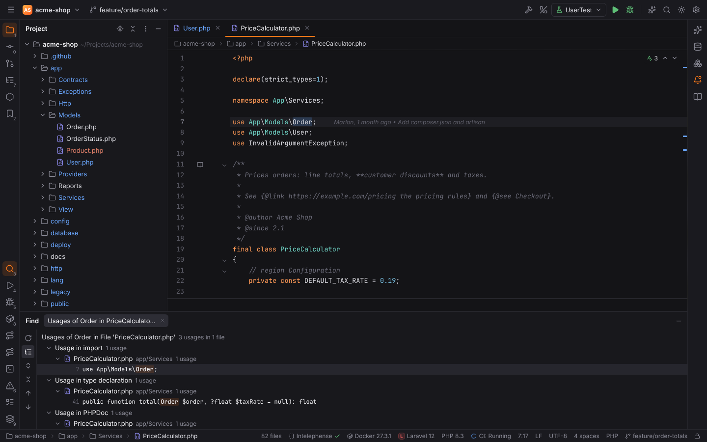

## Highlight usages

When the caret rests on a symbol, its usages in the file are highlighted: reads in blue, writes
(assignments, declarations, parameters) in red, also as marks on the right edge of the editor
(the error stripe; a click moves the caret there). Turn it off with **Settings | Editor |
General | Highlight on Caret Movement | Highlight usages of element at caret**
(`editor.highlightUsagesAtCaret`).

**Highlight Usages in File** (`Ctrl+Shift+F7`, macOS `Cmd+Shift+F7`) keeps the highlighting
until you press `Escape`; `F3` / `Shift+F3` jump to the next / previous usage, and the status
bar says "4 usages of '$price' found (Press Escape to remove the highlighting)". Pressing it
again on the same element removes the highlighting. Like PHPStorm it also highlights:

- the **exit points** of a function or method (every `return` and `throw`, closures left out)
  when the caret is on `return` or `throw`;
- the **implementing methods** when the caret is on `implements`, and the overriding methods on
  `extends` (PHP).

The usages come from the language servers (`textDocument/documentHighlight`), in PHP files
without a server answer from the PHP index (read and write access of properties and
variables), else from a lexical search for the identifier in its scope (variables in their
function; comments and strings left out).

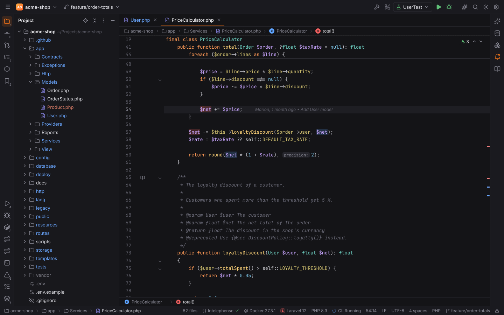

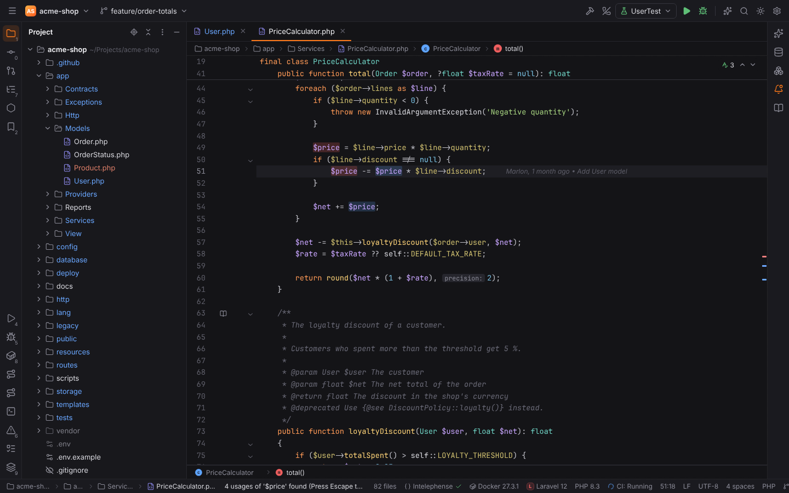

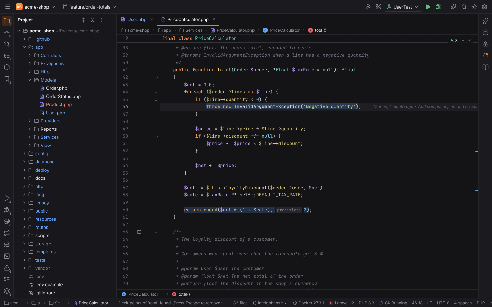

## Problems

Diagnostics from language servers (and Forge's own syntax checks for YAML, JSON, INI, dotenv,
Bash, Python, Postfix and similar files) appear as:

- squiggles: red for errors, yellow for warnings, a weaker underline for weak warnings; unused
  code is grayed, deprecated usages are struck through;
- markers in the gutter;
- the **inspection widget** in the top-right corner of the editor: a ✓ when the file is clean,
  otherwise the number of errors and warnings. Click it to open the Problems tool window.

Typos and grammar problems in comments, strings, names, text files and commit messages are
inspections of their own (green and blue underlines, `Alt+Enter` for suggestions and the
dictionaries); see [Spelling and grammar](spelling-and-grammar.md).

JSON and YAML files with a JSON schema (`composer.json`, `package.json`, Compose files, CI
pipelines, your own mappings) are checked against it, with schema-driven completion and hover;
see [JSON Schema](json-schema.md).

**Next Highlighted Error** `F2` and **Previous Highlighted Error** `Shift+F2` move the caret
between problems.

The **Problems** tool window (`Alt+6`, macOS `Cmd+6`) has two tabs: **Current File** and
**Project Errors**, each a file → problem tree. Click a problem to open it.

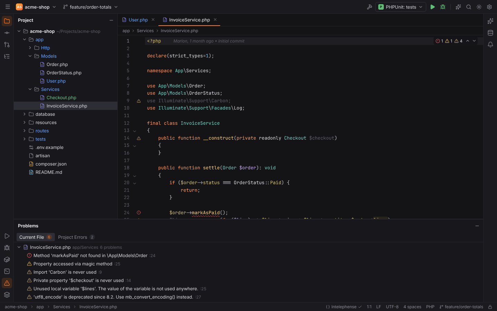

## Rename

**Rename…** (`Shift+F6`) renames the symbol at the caret everywhere, like PHPStorm's in-place
rename:

1. The name gets an edit box and every occurrence in the file is highlighted. Type the new name;
   the occurrences change as you type.
2. **Enter** (or `Tab`, or moving the caret out of the box) renames it in the whole project,
   including files that are not open. **Escape** puts the old name back.
3. `Shift+F6` again opens the **Rename** dialog: the new name, **Rename file** for classes and
   **Preview**, which lists every change before anything is written.

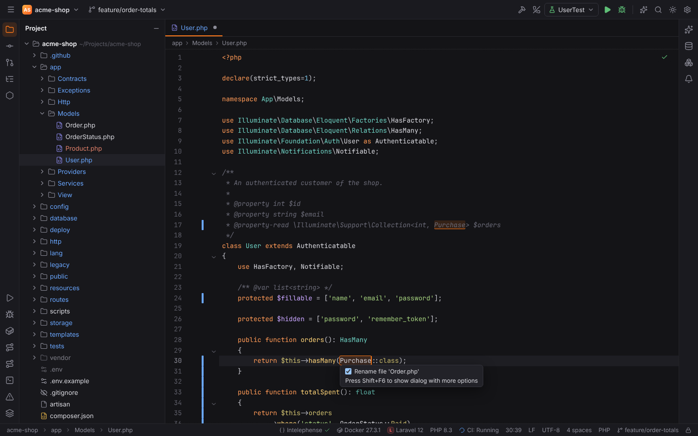

When the rename would break something, the **Problems Detected** dialog lists the problems
first (a class or member with the new name already exists, a file with the new name is in the
way) together with every occurrence; **Continue** renames anyway, **Cancel** keeps the old name
and **Show in View** cancels and lists the problems in the Find tool window. In PHP files the
check also runs when a language server computes the rename.

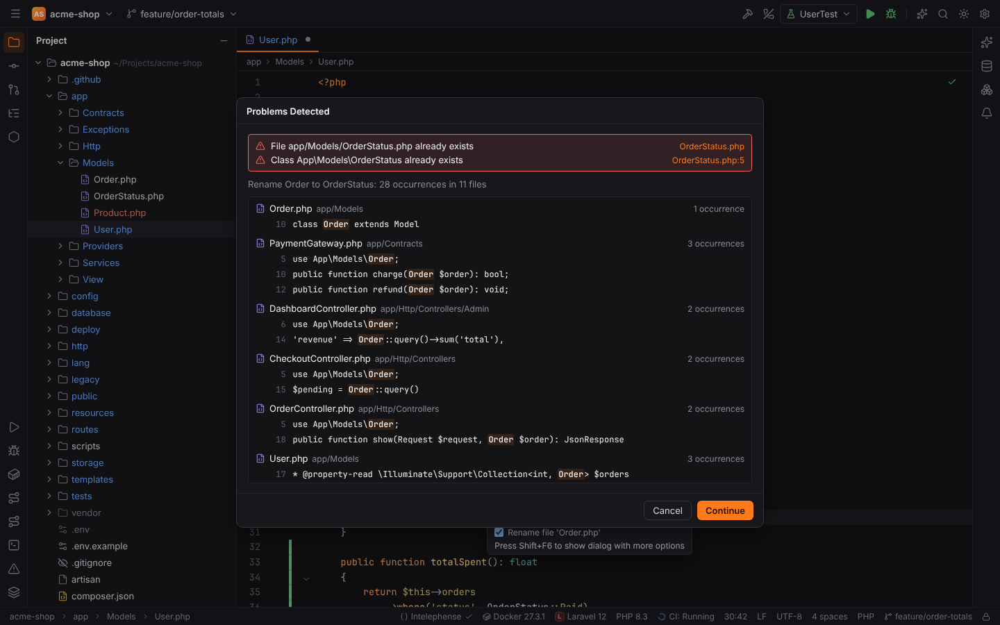

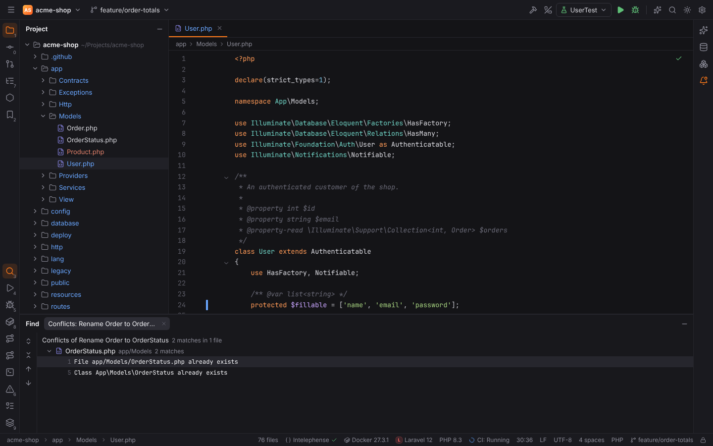

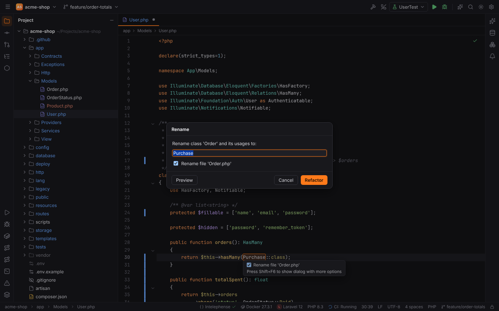

- The language server computes the rename where it can (TypeScript, Vue, Lua, Intelephense
  Premium, …); PHP files fall back to Forge's PHP index, see [PHP](php.md#rename).
- Renaming a class whose file is named after it (`Order.php` declaring `class Order`) also
  renames the file, like PHPStorm; untick **Rename file** in the hint below the edit box or in
  the dialog to keep the name. Open tabs follow the file.
- An invalid name ("'2fa' is not a valid identifier") keeps the edit box open.
- **Undo:** the whole rename is one step. `Ctrl+Z` (macOS `Cmd+Z`) in any editor the rename
  changed undoes it in every file: open editors, files that were not open (written back
  through the project, also on remote hosts) and a renamed file. `Ctrl+Shift+Z` redoes it.
  Files edited after the rename are left alone and a balloon names them. Redo is not
  available in a tab that undo reopened under its old name.
- Open files keep the change as unsaved edits; files that were not open are saved directly.
- In the **Project** view, `Shift+F6` renames the selected file or folder.
  **Refactor | Rename File…** renames the file of the current editor.

## Show Context Actions

**Show Context Actions** (`Alt+Enter`) opens PHPStorm's intention popup at the caret:

- **Quick fixes** (red bulb) from the language servers, for example "Remove unused import" or
  "Add method 'markAsPaid()' to class 'Order'";
- **Intentions** (yellow bulb) from the language servers and Forge's own PHP intentions;
- refactorings and source actions, and links like **Generate…** (`Alt+Insert`) last.

In strings, the popup also offers **Inject language or reference**, **Edit &lt;language&gt;
Fragment** and **Un-inject Language** (see [Language injections](language-injections.md)).

On an undeclared PHP name, the quick fixes include **Create method / field / constant /
function / class**, see [PHP: Create from usage](php.md#create-from-usage).

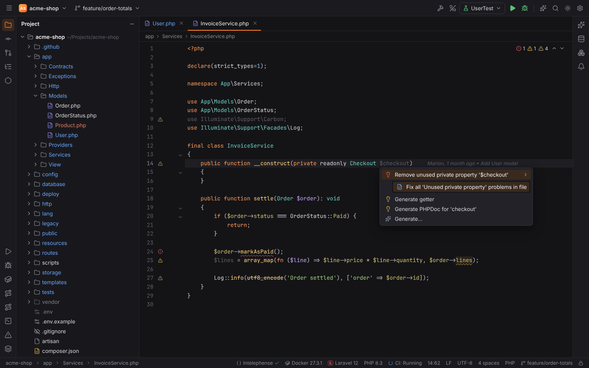

Use `Up` / `Down` and `Enter`, or click. An entry with `›` has more options ("Fix all '…'
problems in file"): open them with `Right`, go back with `Left`. Typing filters the list.
`Escape` closes it. A chosen fix is applied as one undo step, also when it changes other files.

When actions are available at the caret line, a **light bulb** appears at the start of the line
after a short pause (red when a quick fix is available); click it to open the popup.

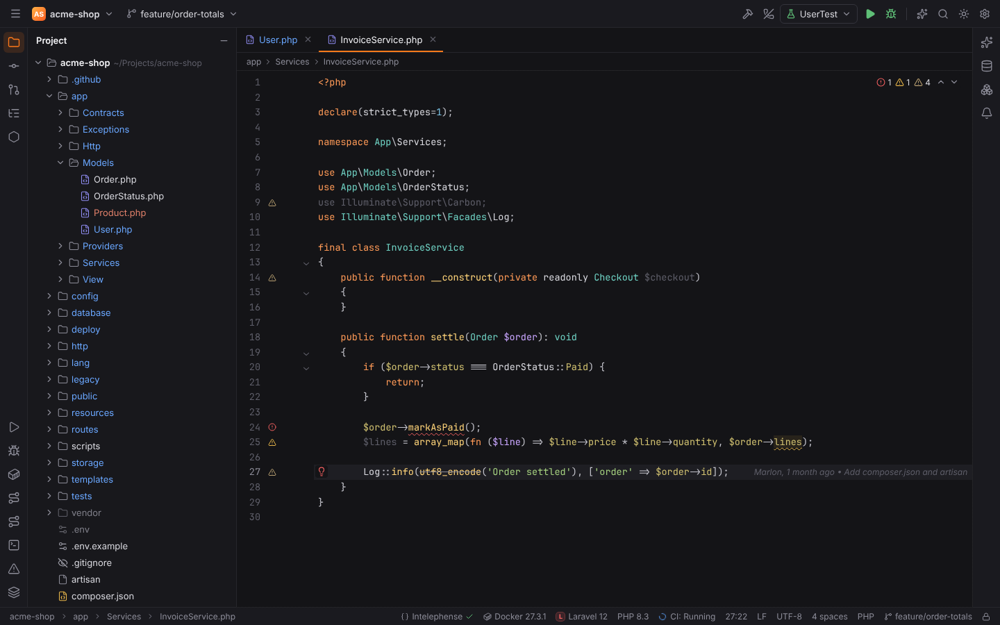

## Reformat Code

**Reformat Code** (`Ctrl+Alt+L`, macOS `Cmd+Alt+L`) formats the file with the language
server's document formatting. Lua files use StyLua when it is installed (see
[LuaForge](luaforge.md)). The server gets the [code style](#code-style) of the file's
language, and Forge then applies the options the server does not know (see
[Code style](#code-style)).

## Editing actions

| Action | Windows/Linux | macOS |
| --- | --- | --- |
| Duplicate Line or Selection | `Ctrl+D` | `Cmd+D` |
| Delete Line | `Ctrl+Y` | `Cmd+Backspace` |
| Comment with Line Comment | `Ctrl+/` | `Cmd+/` |
| Comment with Block Comment | `Ctrl+Shift+/` | `Cmd+Alt+/` |
| Move Line Up / Down | `Alt+Shift+Up` / `Down` | same |
| Move Statement Up / Down (moves the line) | `Ctrl+Shift+Up` / `Down` | `Cmd+Shift+Up` / `Down` |
| Extend / Shrink Selection | `Ctrl+W` / `Ctrl+Shift+W` | `Alt+Up` / `Alt+Down` |
| Add Selection for Next Occurrence | `Alt+J` | `Ctrl+G` |
| Unselect Occurrence | `Alt+Shift+J` | `Ctrl+Shift+G` |
| Select All Occurrences | `Ctrl+Alt+Shift+J` | `Ctrl+Cmd+G` |
| Join Lines | `Ctrl+Shift+J` | `Ctrl+Shift+J` |
| Toggle Case | `Ctrl+Shift+U` | `Cmd+Shift+U` |
| Split Line | `Ctrl+Enter` | `Cmd+Enter` |
| Start New Line | `Shift+Enter` | `Shift+Enter` |
| Start New Line Before Current | `Ctrl+Alt+Enter` | `Cmd+Alt+Enter` |
| Complete Current Statement | `Ctrl+Shift+Enter` | `Cmd+Shift+Enter` |
| Cyclic Expand Word / Backward | `Alt+/` / `Alt+Shift+/` | same |
| Auto-Indent Lines | `Ctrl+Alt+I` | `Ctrl+Alt+I` |
| Move Caret to Matching Brace | `Ctrl+Shift+M` | `Ctrl+M` |
| Scroll Up / Down | `Ctrl+Up` / `Ctrl+Down` | — |
| Go to Line/Column | `Ctrl+G` | `Cmd+L` |
| Undo / Redo | `Ctrl+Z` / `Ctrl+Shift+Z` | `Cmd+Z` / `Cmd+Shift+Z` |
| Copy Absolute Path | `Ctrl+Shift+C` | `Cmd+Shift+C` |
| Copy Reference (`path:line`) | `Ctrl+Alt+Shift+C` | `Cmd+Alt+Shift+C` |

Without a selection, **Copy** and **Cut** take the whole line, as in PHPStorm.

## Multiple carets and column selection

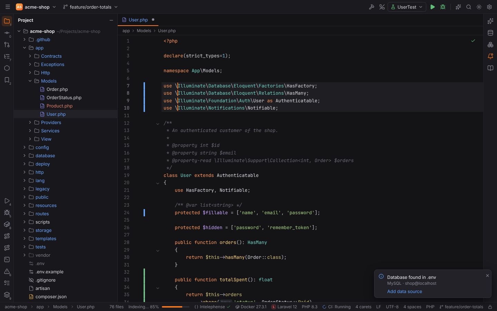

Everything you type, delete, copy or paste applies at every caret. The status bar shows
`3 carets` instead of the caret position while there are several; `Escape` returns to one caret.

| Action | Windows/Linux | macOS |
| --- | --- | --- |
| Clone Caret Above / Below | `Ctrl` twice, hold, then `Up` / `Down` | `Alt` twice, hold, then `Up` / `Down` |
| Add or remove a caret | `Alt+Shift`+click | `Alt+Shift`+click |
| Add Carets to Ends of Selected Lines | `Alt+Shift+G` | `Alt+Shift+G` |
| Add Selection for Next Occurrence | `Alt+J` | `Ctrl+G` |
| Unselect Occurrence | `Alt+Shift+J` | `Ctrl+Shift+G` |
| Select All Occurrences | `Ctrl+Alt+Shift+J` | `Ctrl+Cmd+G` |
| Rectangular selection | `Alt`+drag or middle-button drag | `Alt`+drag or middle-button drag |
| Column Selection Mode | `Alt+Shift+Insert` | `Cmd+Shift+8` |

- **Clone Caret Above / Below** adds a caret on the line above or below every caret, in the same
  column (short lines get the caret at their end, the column is kept for longer lines further
  on). Keep `Ctrl` down and press the arrow again for more carets; the other arrow takes the
  last clones back. The actions are also in Settings | Keymap | Editor Actions, where you can
  give them ordinary shortcuts.
- **Alt+Shift+click** adds a caret, or removes the caret you click on; `Alt+Shift`+drag adds a
  selection.
- **Add Selection for Next Occurrence** selects the word at the caret first, then adds the next
  occurrence as another selection. **Select All Occurrences** works without a selection too.
- **Column Selection Mode** (Edit | Column Selection Mode, also in the editor context menu) makes
  `Shift`+arrow keys and mouse drags select rectangles, one selection per line, until you turn it
  off again. It is per editor; the status bar shows **Column** while it is on (click it to turn
  the mode off). In this mode `Alt`+drag makes an ordinary selection.
- A middle-button **click** still goes to the declaration; only a drag selects a rectangle.

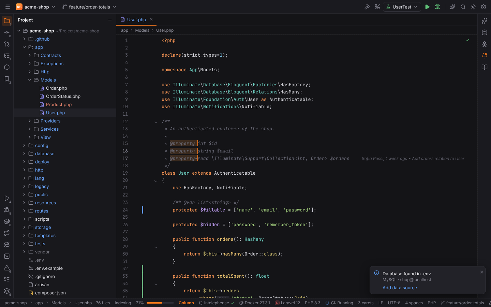

### Copy and paste with multiple carets

Copying with several carets remembers the text of each caret. Pasting with the same number of
carets puts one part at each caret, like PHPStorm, even when the parts span several lines; with
another number of carets the whole text is pasted at every caret. Text with as many lines as
there are carets is spread one line per caret.

## Paste from History

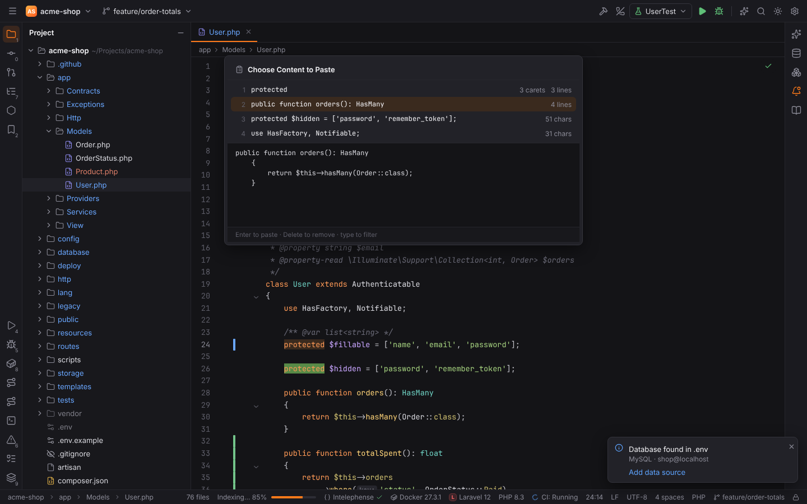

**Edit | Paste Special | Paste from History…** (`Ctrl+Shift+V`, macOS `Cmd+Shift+V`) lists the
texts copied or cut in Forge during this session, newest first, with a preview of the selected
entry. Type to filter the list, `Enter` (or a click) pastes, `Delete` removes the entry, `Escape`
closes the popup. The pasted entry moves to the top and becomes the clipboard content again. An
entry copied with several carets shows the number of carets and pastes one part per caret.

The history lives in memory until Forge closes; it is never written to disk. Its size is
**Maximum number of contents to keep in clipboard** in Settings | Editor | General | Limits
(default 20). Paste from History also works in text fields such as the commit message.

**Paste as Plain Text** (`Ctrl+Alt+Shift+V`) pastes the clipboard text unchanged. Forge does not
reformat pasted code or add imports on paste, so it behaves like **Paste**, including the
one-part-per-caret rule.

## Folding

Click the fold markers in the gutter, or use:

| Action | Windows/Linux | macOS |
| --- | --- | --- |
| Expand / Collapse | `Ctrl+=` / `Ctrl+-` | `Cmd+=` / `Cmd+-` |
| Expand / Collapse Recursively | `Ctrl+Alt+=` / `Ctrl+Alt+-` | `Cmd+Alt+=` / `Cmd+Alt+-` |
| Expand All / Collapse All | `Ctrl+Shift+=` / `Ctrl+Shift+-` | `Cmd+Shift+=` / `Cmd+Shift+-` |

Custom folding regions (`// region Name` … `// endregion`, `#region`, `<!-- region -->`,
`// <editor-fold desc="…">`) fold too and show their name. Sticky lines, breadcrumbs, rendered
doc comments and Reader mode are described in
[Sticky lines, breadcrumbs and Reader mode](code-structure.md).

## Find and replace in a file

**Find** (`Ctrl+F`, macOS `Cmd+F`) and **Replace** (`Ctrl+R`, macOS `Cmd+R`) open the search
panel of the editor (CodeMirror's search panel) with match case, regular expression and
whole word options. **Find Next**
`F3` and **Find Previous** `Shift+F3` (macOS `Cmd+G` / `Cmd+Shift+G`) move between matches.
Other occurrences of the selected text are highlighted automatically.

To search the whole project, use [Find in Files](search-everywhere.md#find-in-files)
(`Ctrl+Shift+F`, macOS `Cmd+Shift+F`).

Replace in Files (`Ctrl+Shift+R`, macOS `Cmd+Shift+R`) opens the Find tool window with a
**Replace with** field (see [Search](search-everywhere.md)). The Find tool window also shows
[usages](#find-usages-and-show-usages) and the Find in Files results you open there (see
[Find tool window](workbench.md#find-tool-window)).

## Gutter

Left of the text, from outside in: line numbers, feature icons, Git change markers, fold
markers.

- **Git change markers** show added, modified and deleted lines compared with `HEAD`. Click
  one to see the change, roll it back or open the diff. See [Git](git.md#in-the-editor).
- **Line markers** of plugins: routes on controller actions, "go to template", entity ⇄
  repository, Angular component ⇄ template, compose services, and more. Click to navigate.
- **Implemented / overridden markers** in PHP: ↓ on classes with subclasses, interfaces and
  methods with implementations or overrides, ↑ on methods that implement or override one. See
  [PHP](php.md#gutter-icons).
- **Run icons** ▶ next to PHPUnit tests, `package.json` scripts, Lua main chunks, scratch
  files, `.http` requests, compose services and Dockerfiles.
- **Breakpoints**: click a line number in a PHP file to toggle a breakpoint (drawn over the
  number, as in the New UI), or press `Ctrl+F8` (macOS `Cmd+F8`). Right-click it to edit its
  condition. See [Xdebug debugging](debugging.md).
- **Bookmarks**: a bookmark icon, or the bookmark's mnemonic, on bookmarked lines (`F11`,
  `Ctrl+F11`). See [Bookmarks](workbench.md#bookmarks).
- **Annotate with Git Blame**: right-click the gutter. See [Git](git.md#blame).
- **Color swatches** next to colors in CSS, markup and scripts; click one to open the color
  picker. See [Emmet and color previews](emmet-and-colors.md#color-previews).

## Context menu

Right-click in the editor (or press the `Menu` key on Windows/Linux keyboards) to open the
editor context menu:

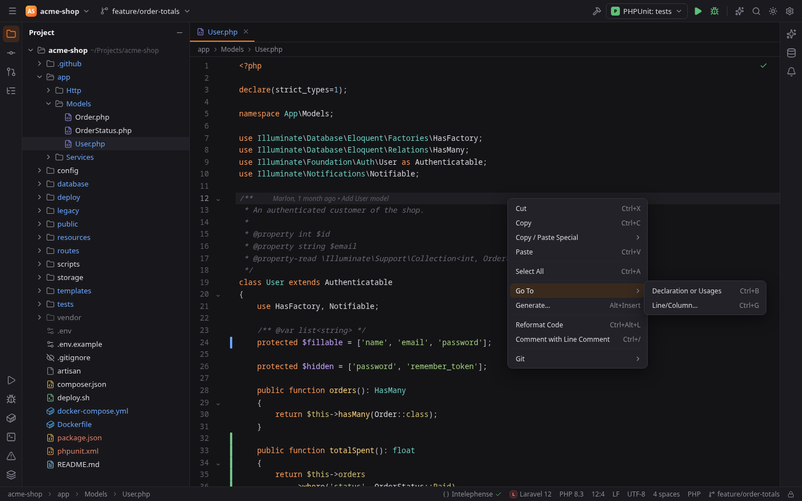

| Entry | Status |
| --- | --- |
| Show Context Actions | works, see [Show Context Actions](#show-context-actions) |
| Paste from History… | not available yet |
| Cut, Copy, Paste | works |
| Copy / Paste Special > Copy Absolute Path, Copy Reference, Paste as Plain Text | works |
| Select All | works |
| Column Selection Mode | not available yet (use `Alt`+drag) |
| Find Usages | works |
| Refactor > Rename… | works, see [Rename](#rename) |
| Refactor > Refactor This… | works, see [Refactoring shortcuts](shortcuts/refactoring.md#refactor-this) |
| Refactor > Extract/Introduce > Variable…, Constant…, Field…, Parameter…, Method… | works, see [PHP](php.md#extract-introduce-and-inline) |
| Refactor > Inline… | works, see [PHP](php.md#extract-introduce-and-inline) |
| Refactor > Extract/Introduce > Interface…, Superclass…, Pull Members Up…, Push Members Down… | works in PHP classes, see [PHP](php.md#extract-interface-and-superclass-pull-members-up-and-push-members-down) |
| Go To > Declaration or Usages, Line/Column | works |
| Go To > Implementation(s) | works |
| Generate… | works in PHP files, see [PHP](php.md#generate) |
| Reformat Code | works |
| Optimize Imports | not available yet |
| Comment with Line Comment | works |
| Git > Annotate with Git Blame | works |

Right-clicking outside the current selection moves the caret there first, like PHPStorm.

## Files changed on disk

When a file changes on disk (a checkout, a pull, a rollback, an AI agent's edit, a change in
another editor), the open tab is reloaded with the new content. The reload is not an undo
step: `Ctrl+Z` does not go back across it.

Line endings and encodings are preserved: a file with Windows line endings (CRLF) stays CRLF
when you save it, a Windows-1252 file stays Windows-1252. Forge detects both when it opens a
file (UTF-8 with or without BOM, UTF-16 LE/BE, ISO-8859-1, Windows-1252). Change them in the
status bar, see [Line separator, encoding and indent](#line-separator-encoding-and-indent).

## Saving

Files are saved with `Ctrl+S` (Save All) and automatically (Settings | Appearance & Behavior |
System Settings | Autosave): when Forge loses the focus (`system.autosave.onFrameDeactivation`,
on by default) and, if enabled, after `system.autosave.idleSeconds` seconds without typing or
clicking (`system.autosave.onIdle`).

Saving applies Settings | Editor | General | On Save, like PHPStorm:

| Option | Setting | Default |
| --- | --- | --- |
| Remove trailing spaces on: None / Modified lines / All lines | `editor.stripTrailingSpaces` | Modified lines |
| Ensure every saved file ends with a line break | `editor.ensureNewlineAtEof` | on |

"Modified lines" are the lines changed since the file was opened or last saved. Lines with a
caret keep their spaces, so saving never moves what you are typing. An `.editorconfig` with
`trim_trailing_whitespace` or `insert_final_newline` overrides both options for its files.

Settings | Tools | [Actions on Save](actions-on-save.md) adds Reformat code, Optimize
imports, Rearrange code, code cleanup and external tools (ESLint, Prettier, PHP CS Fixer,
Laravel Pint) to an explicit save (`Ctrl+S`), and optionally to autosave.

When Forge gets the focus back it re-reads the open files that changed on disk and refreshes
the Project view and Git status (`system.syncExternalChanges`).

## Code style

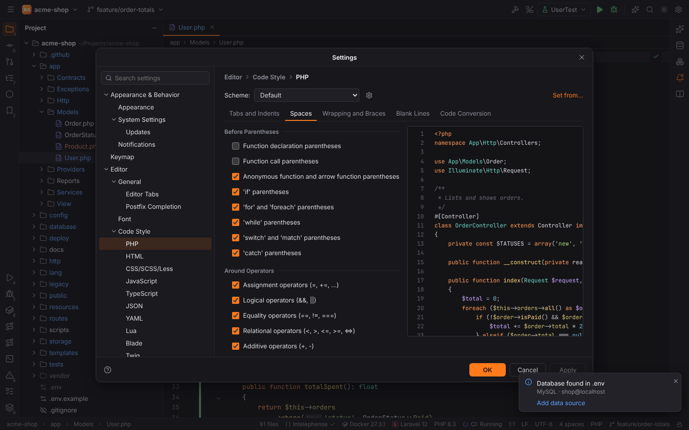

Settings | Editor | Code Style works like PHPStorm's: a **scheme** holds every option, the
**Code Style** page sets the general ones and each language has a page of its own (PHP,
HTML, CSS/SCSS/Less, JavaScript, TypeScript, JSON, YAML, Lua, Blade, Twig, SQL, XML,
Markdown).

### Schemes

The **Scheme** box at the top of every page selects the scheme the project uses, and the
pages edit the selected scheme:

- **Default** (stored in the IDE, in your user settings) applies to projects that have no
  scheme of their own.
- **Project** (stored in the project, `.forge/settings.toml`, so it can be committed) is the
  project's own scheme. Options it does not set come from Default.
- More IDE schemes come from **Duplicate…**, **Copy to IDE…** and **Import Scheme**.

The ⚙ button next to the box opens the scheme actions: **Copy to Project…** (the current IDE
scheme becomes the Project scheme), **Copy to IDE…**, **Duplicate…**, **Rename…** and
**Delete** (for your own IDE schemes), **Reset** (the built-in defaults; the Project scheme
goes back to Default's values), **Export** and **Import Scheme**. Schemes are exported as
**IntelliJ IDEA code style XML** (the `<code_scheme>` format of PHPStorm's
`.idea/codeStyles/*.xml`; options PHPStorm has no name for are kept in a
`<ForgeCodeStyleSettings>` element) or as **Forge code style JSON** with every option.
Importing reads either format, also a PHPStorm `Project.xml`, into the current scheme or a new
one. Like every page of the Settings dialog, the changes apply with **Apply** or **OK**.

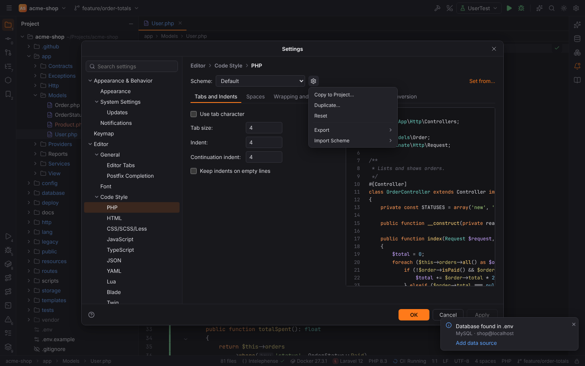

The settings keys did not change: the Default scheme is stored under `<language>.codeStyle.*`
(`php.codeStyle.indent`) and `editor.codeStyle.*` in the user settings, the Project scheme
under the same keys in the project settings, other IDE schemes under
`editor.codeStyle.schemes.<id>.*`, and `editor.codeStyle.scheme` names the project's scheme.
Settings files of older versions keep working; their single PHP brace option
(`php.codeStyle.braces`) becomes the three brace options of the PHP page.

### General

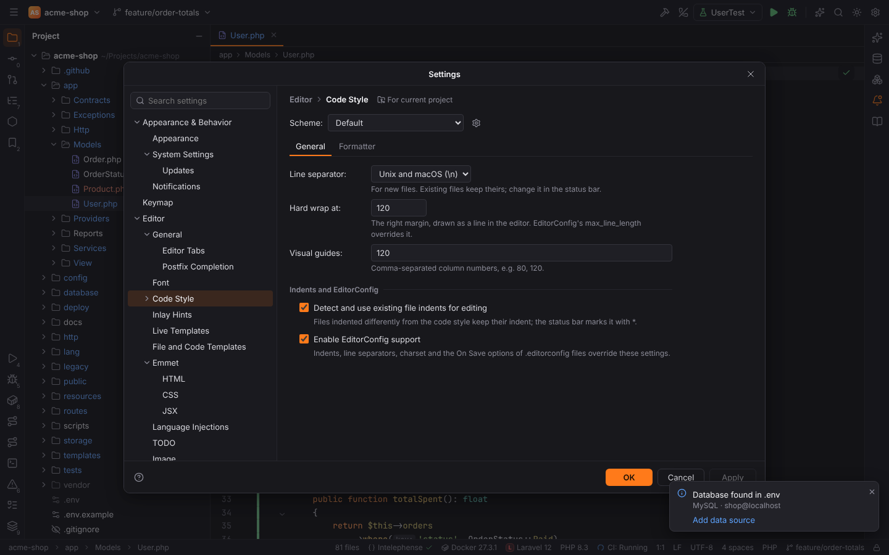

- **Line separator** for new files (LF, CRLF or the system's); existing files keep theirs.
- **Hard wrap at** (120) draws the right margin, **Visual guides** (e.g. `80, 120`) more
  vertical lines.
- **Detect and use existing file indents for editing** (`editor.codeStyle.detectIndents`): a
  file indented differently from the code style (2 spaces in a 4-space project, tabs) keeps
  its indent while you edit it.
- **Enable EditorConfig support** (`editor.codeStyle.useEditorConfig`): `.editorconfig` files
  from the project root down to the file set `indent_style`, `indent_size`, `tab_width`,
  `end_of_line` (for new files), `max_line_length`, `trim_trailing_whitespace` and
  `insert_final_newline`; they win over the scheme. A `charset` the file does not have is
  named in the encoding tooltip.
- The **Formatter** tab: **Turn formatter on/off with markers in code comments**. Lines
  between a comment with `@formatter:off` and one with `@formatter:on` (the markers can be
  changed) keep their text when you reformat; the preview shows it.

### Language pages

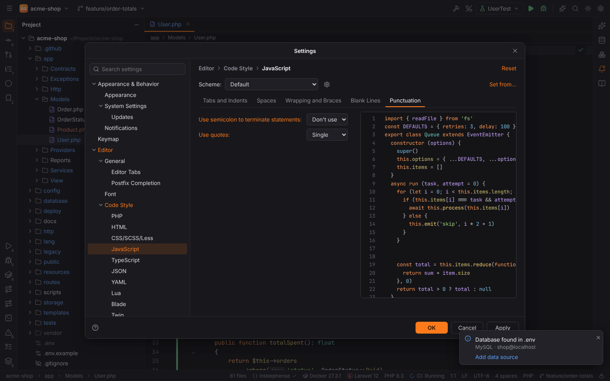

Each language page has PHPStorm's tabs, the options on the left and a preview on the right
that is formatted again as you change an option:

- **Tabs and Indents**: Use tab character, Tab size, Indent, Continuation indent and Keep
  indents on empty lines (YAML: Indent sequence value). Enter, `Tab`, the status bar's indent
  and Reformat Code use them.
- **Spaces**: before parentheses, around operators, within parentheses, brackets and braces,
  before and after commas and colons, … (as far as the language has them).
- **Wrapping and Braces**: brace placement (End of line / Next line), `else`/`catch`/`finally`
  on a new line (PHP), one selector per line (CSS), wrapping of objects and arrays (JSON),
  attributes (HTML, XML), long text (YAML), simple statements on one line (Lua).
- **Blank Lines**: Keep maximum blank lines in code, plus minimums (PHP: after namespace,
  after imports, around methods, before `return`; CSS: around rules; Markdown: around headers
  and block elements).
- Language tabs: **Code Conversion** (PHP: short or long array syntax, a comma after the last
  element of multi-line arrays, the case of `true`/`false`/`null`), **Punctuation**
  (JavaScript/TypeScript: semicolons, quotes), **Case** (SQL keywords), **Other** (CSS hex
  color case, YAML quotes, HTML "Do not indent children of", Lua quotes and call parentheses
  for StyLua and lua-language-server).

**Set from…** (top right) sets a language's options from a predefined style: PHP **PSR-12**,
**PER Coding Style 2.0**, **Symfony**, **Laravel**, **WordPress** and **Drupal**; JavaScript
and TypeScript **JavaScript Standard Style**, **Airbnb-like** and **Prettier defaults**;
CSS **stylelint-config-standard**; Lua **StyLua defaults** and **2 spaces, single quotes**;
SQL **Upper case keywords**.

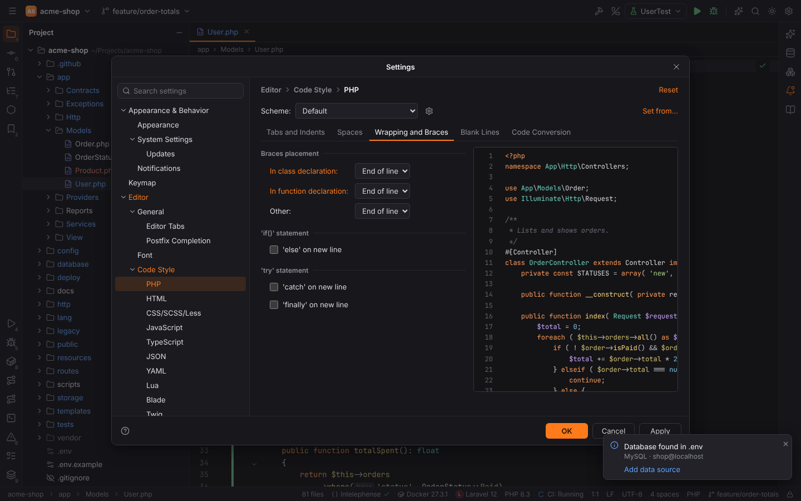

### What Reformat Code uses

Indents come from the scheme unless EditorConfig or the detected indent of the file wins
(see above). Then:

- The language server gets the options in its settings before it formats: Intelephense the
  brace placement, typescript-language-server the spaces, braces, semicolons and quote
  preference (`typescript.format` / `javascript.format`), the CSS, HTML, JSON, YAML and XML
  servers their `format` settings, lua-language-server its `Lua.format.defaultConfig`.
  StyLua gets indent, column width, quotes, call parentheses and simple statements on its
  command line when the project has no `stylua.toml`.
- Forge then applies what the formatter does not know, on the lines as they are: in PHP the
  spaces, brace and `else`/`catch`/`finally` placement and the code conversions (and the blank
  lines, see [PHP](php.md#code-style)); quotes in `.js`/`.ts` files without JSX; hex colors in
  CSS; SQL keyword case; Markdown's spaces and blank lines; the spaces inside Blade and Twig
  delimiters; Keep maximum blank lines; Keep indents on empty lines; and the formatter
  markers. Strings, heredocs, comments and code blocks keep their text.

## Line separator, encoding and indent

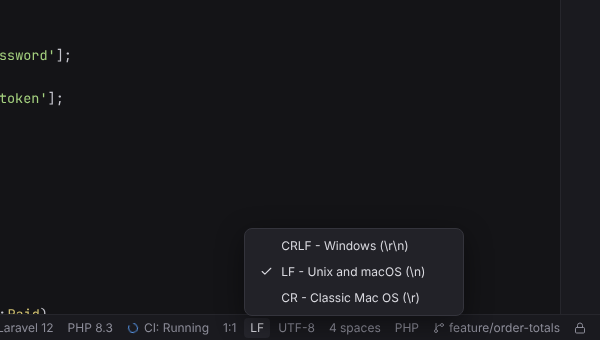

The status bar shows the active file's line separator, encoding and indent. Click them:

- **Line separator** (`LF`, `CRLF`, `CR`): pick another one; the file is converted and saved
  right away.
- **Encoding** (`UTF-8`, `UTF-8 BOM`, `UTF-16LE`, `ISO-8859-1`, `windows-1252`, …): pick
  another one and choose **Reload** (read the file again in that encoding, for a file that
  was detected wrongly; only without unsaved changes) or **Convert** (save the text in the
  new encoding). **Add BOM** / **Remove BOM** for UTF-8 files. Characters the encoding cannot
  hold stop the conversion with a message.
- **Indent** (`4 spaces`, `2 spaces*`, `Tab`): where it comes from is in the tooltip (code
  style, EditorConfig, or detected in the file, marked with `*`). The popup opens **Configure
  Indents for PHP…** or turns indent detection off for the project.

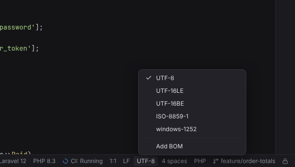

## Inlay hints

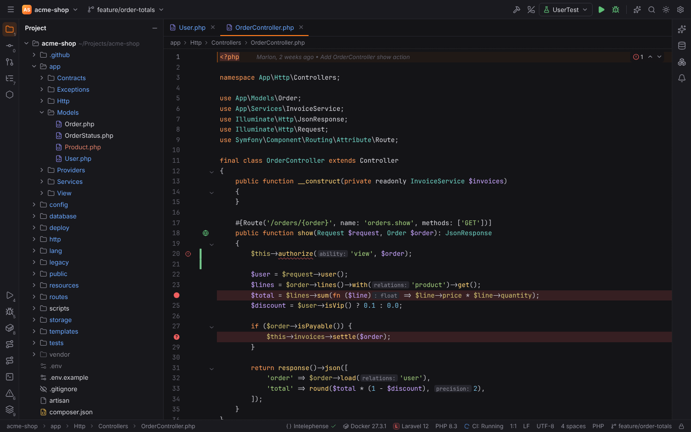

Language servers show parameter names at call sites (`precision: 2`) and inferred types
(`fn ($line): float`) inside the code. Settings | Editor | Inlay Hints:

| Option | Setting | Default |
| --- | --- | --- |
| Parameter names (literal and null arguments) | `editor.inlayHints.parameterNames` | on |
| Inferred variable types | `editor.inlayHints.types` | off |
| Return types of closures and functions | `editor.inlayHints.returnTypes` | on |
| Implementations and inheritors (Code Vision) | `editor.inlayHints.implementations` | on |
| Per language: PHP, JavaScript and TypeScript, Lua, other languages | `editor.inlayHints.languages.<id>` | on |

Hints need a server that reports them: Intelephense Premium, phpactor,
typescript-language-server / vtsls and lua-language-server (Forge turns their hints on and
filters them by these settings). Free Intelephense shows none.

**Code Vision**: above PHP classes and methods with subclasses, implementations or overrides
Forge shows "4 inheritors", "2 implementations" or "1 override" (from the PHP index); click
it to go there.

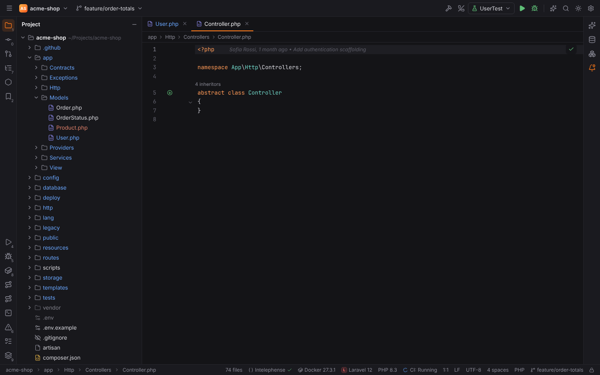

## Soft wraps and appearance

Settings | Editor | General controls soft wrapping (`editor.softWraps` with the patterns in
`editor.softWrapFiles`, by default `*.md; *.txt; *.rst; *.adoc`), whitespace, line numbers,
the caret row highlight, caret blinking with its blink period (`editor.caret.blinkPeriod`) and
smooth scrolling. Settings | Editor | Font sets the font, size, line height and ligatures. See
the [settings reference](../reference/settings.md).
