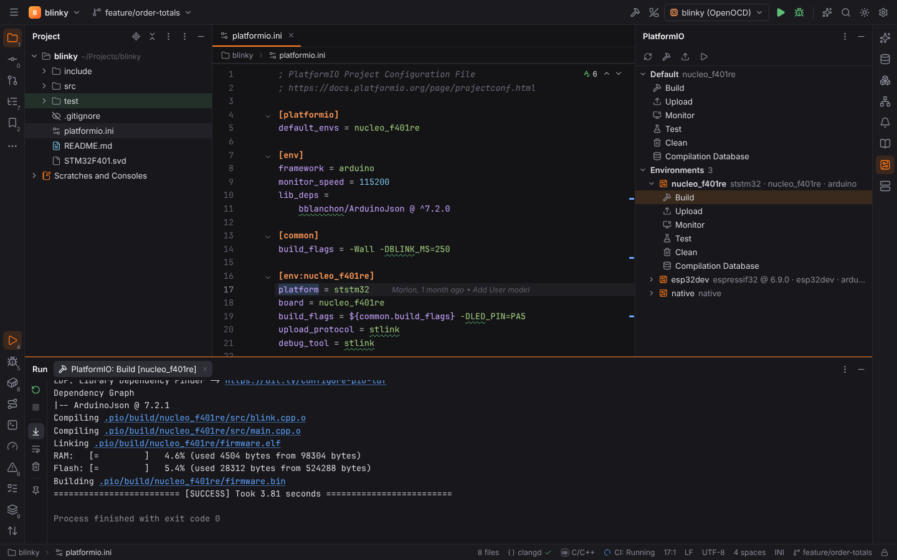
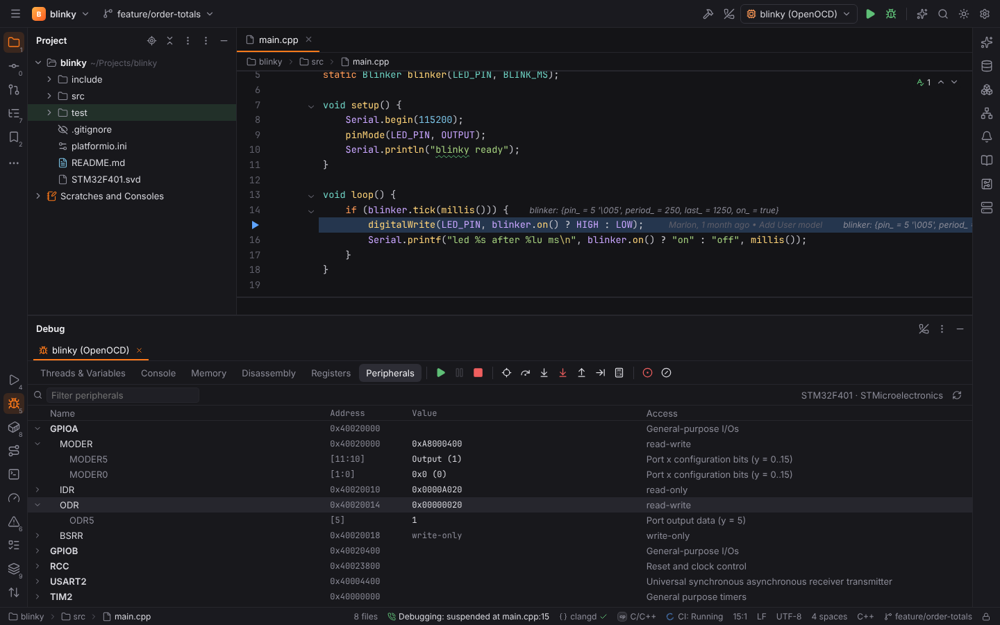

# Embedded development

[CForge](cpp.md) supports microcontroller projects like CLion: PlatformIO, ESP-IDF and
Zephyr projects, flashing and debugging boards through OpenOCD or another GDB server, and a
**Peripherals** view of the chip's registers. Forge only builds the command lines (in Rust,
`packs/cforge/embedded`); PlatformIO Core, ESP-IDF, west, OpenOCD and the cross GDB are
installed by you and never downloaded.

Every action starts the project's build tools, so [Safe Mode](project-trust.md) refuses them in
untrusted projects.

## Detection

| Framework | Detected by | Project tool |
| --- | --- | --- |
| PlatformIO | `platformio.ini` | `platformio` |
| ESP-IDF | `CMakeLists.txt` with `sdkconfig`, `sdkconfig.defaults`, `idf_component.yml` or `main/idf_component.yml` (or the IDF's `project.cmake` in `CMakeLists.txt`) | `esp-idf` |
| Zephyr | `west.yml`, or `prj.conf` next to a `CMakeLists.txt` | `zephyr` |

These projects are C/C++ projects: clangd, the editor and debugging work as described in
[CForge](cpp.md).

## PlatformIO

The **PlatformIO** tool window (right stripe) shows the project's `platformio.ini`:

- **Default** — the tasks for the `default_envs` (or every environment);
- **Environments** — every `[env:…]` with its platform, board and frameworks (default ones in
  bold), resolved like PlatformIO does: `[env]` defaults, `extends`, `${section.key}` and
  `${this.key}` references; problems (an unknown `extends`) are listed on top. Double-click
  an environment to open its section.

Each environment has the tasks **Build**, **Upload**, **Monitor**, **Test**, **Clean** and
**Compilation Database**. Double-click a task (or select it and click ▶) to run it in the
Run tool window:

| Task | Command |
| --- | --- |
| Build | `pio run -e <env>` |
| Upload | `pio run -e <env> -t upload` |
| Monitor | `pio device monitor -e <env>` (type into the console) |
| Test | `pio test -e <env>` |
| Clean | `pio run -e <env> -t clean` |
| Compilation Database | `pio run -e <env> -t compiledb` |

**Compilation Database** writes `compile_commands.json` into the project and restarts clangd,
which then knows the include paths and defines of the environment.

`platformio.path` chooses PlatformIO Core; empty uses `pio` on the PATH, then the installer's
`~/.platformio/penv`.

## ESP-IDF

**Tools | ESP-IDF** has **Build**, **Flash**, **Monitor** (in the Run tool window) and
**Menuconfig** (in the [terminal](terminal.md), because it is a full-screen program). They run
`idf.py` in the project:

- with `espIdf.path` set: `<python> <IDF_PATH>/tools/idf.py` with `IDF_PATH` in the
  environment (`espIdf.python`, default `python3`);
- else `idf.py` on the PATH (start Forge from a shell that ran ESP-IDF's export script).

Flash and Monitor pass `-p <espIdf.port>`; Flash also `-b <espIdf.baud>`.

## Zephyr

**Tools | Zephyr** has **West Build** (`west build -b <board> -d build -p auto <app>`),
**West Flash** (`west flash -d build`), **West Debug** (`west debug -d build`, in the terminal)
and **Select Board…**. The board comes from `zephyr.board`, else from the last build's
`CMakeCache.txt`; Select Board… suggests the boards the application defines under `boards/`
and stores the choice in the project settings.

## OpenOCD Download & Run

The **OpenOCD Download & Run** run configuration (Run | Edit Configurations…) flashes and
debugs a board through [OpenOCD](https://openocd.org):

| Field | Meaning |
| --- | --- |
| Target / Executable (ELF) | A CMake target (built first) or an ELF file (e.g. `.pio/build/<env>/firmware.elf`). |
| Board config file | OpenOCD configuration: `board/st_nucleo_f4.cfg` (from OpenOCD's scripts) or project `.cfg` files, separated by `;`. Default: `openocd.boardConfig`. |
| GDB port | OpenOCD's GDB server port (3333). |
| Download | **Always**: flash before running or debugging; **Never**: only debug what is on the board. |
| SVD file | The CMSIS-SVD file of the [Peripherals](#peripherals) view (default: `cpp.embedded.svdFile`). |
| GDB | The GDB to use (default: `cpp.embedded.gdb`, the cross toolchain's GDB, `gdb-multiarch` or `arm-none-eabi-gdb`). |

- **Run** flashes and resets the board: `openocd -f <cfg> -c "program {<elf>} verify reset exit"`.
- **Debug** flashes (unless Download is Never), starts `openocd -f <cfg> -c "gdb_port 3333"` in
  the Run tool window, waits until it listens for GDB, and starts a GDB session through the
  [shared debugger](debugging.md): GDB's DAP server attaches with `target remote
  localhost:3333`. Breakpoints, stepping, variables, Memory, Disassembly and Registers work
  as for native programs; the OpenOCD tab stops with the debug session.

The **Embedded GDB Server** configuration does the same with any GDB server (J-Link,
ST-LINK's `st-util`, pyOCD, QEMU): **GDB server** and its arguments are started first (leave it
empty when the server already runs), and GDB connects to **'target remote' args**
(`localhost:2331`, `tcp:192.168.1.20:3333`).

> **Note:** GDB 14 or newer is required (its built-in DAP server). The session connects with
> `target remote`; OpenOCD flashes the program before GDB starts.

## Peripherals

A debug session of a configuration with an SVD file gets the **Peripherals** tab in the Debug
tool window: the peripherals of the CMSIS-SVD file (with `derivedFrom`, register arrays and
clusters), filterable by name. Expanding a peripheral reads its registers through the
debugger's `readMemory` (registers that must not be read, such as write-only ones or those
with a read side effect, are skipped) and shows each value with its decoded fields: the bit
range, the value and the name of an enumerated value (`MODER5 [11:10] Output (1)`). Values are
read again whenever the program stops; changed values are highlighted.

## Settings

Settings | Build, Execution, Deployment | **Embedded Development**:

| Setting | Default | Meaning |
| --- | --- | --- |
| `openocd.path` | `""` | OpenOCD (empty: `openocd` on the PATH). |
| `openocd.boardConfig` | `""` | Default board configuration (project). |
| `cpp.embedded.gdb` | `""` | GDB for embedded targets. |
| `cpp.embedded.svdFile` | `""` | Default SVD file (project). |
| `platformio.path` | `""` | PlatformIO Core. |
| `espIdf.path` / `espIdf.python` | `""` | ESP-IDF folder and its Python. |
| `espIdf.port` / `espIdf.baud` | `""` | Serial port and flash baud rate (project). |
| `zephyr.west` | `""` | west (empty: on the PATH). |
| `zephyr.board` / `zephyr.appDir` / `zephyr.buildDir` | `""` / `""` / `build` | Board, application and build folder (project). |

## Browser mode

`?project=pio` opens `blinky`, a PlatformIO project for an ST Nucleo-F401RE and an ESP32 with a
Unity test, the configuration **blinky (OpenOCD)** and the STM32F401's SVD file. PlatformIO's
environments and the SVD file are read by the Rust code (WebAssembly); the outputs of
PlatformIO and OpenOCD, and the debug session with its register values, are canned.
