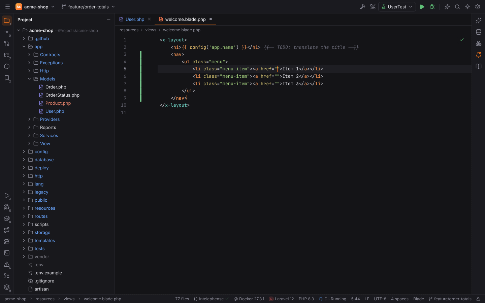
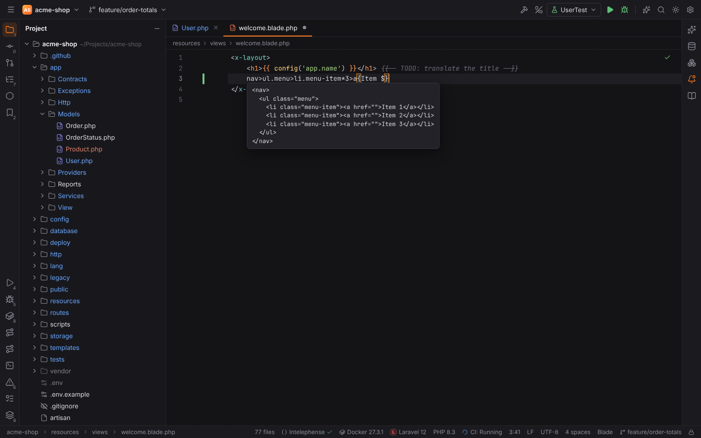
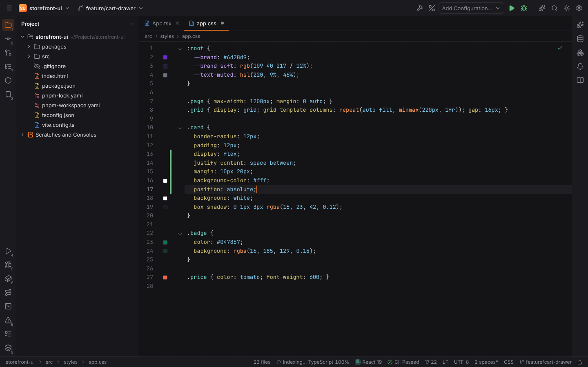
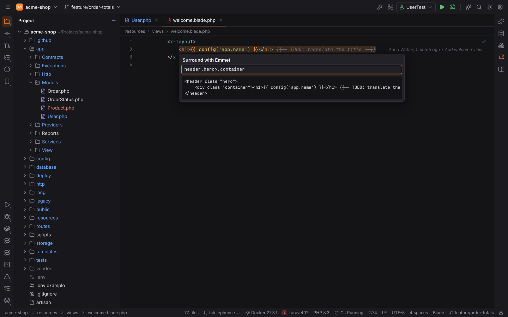
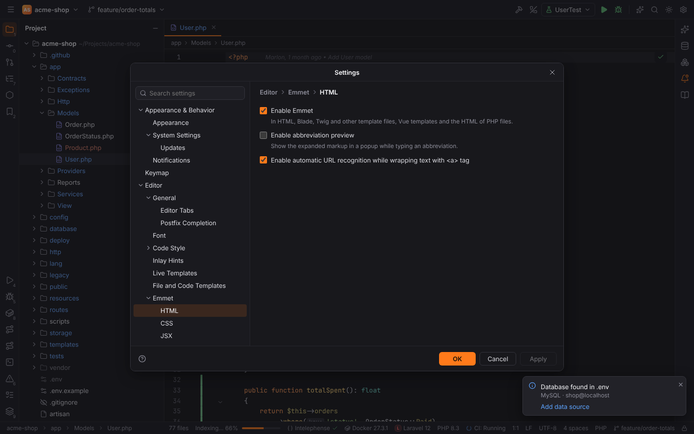
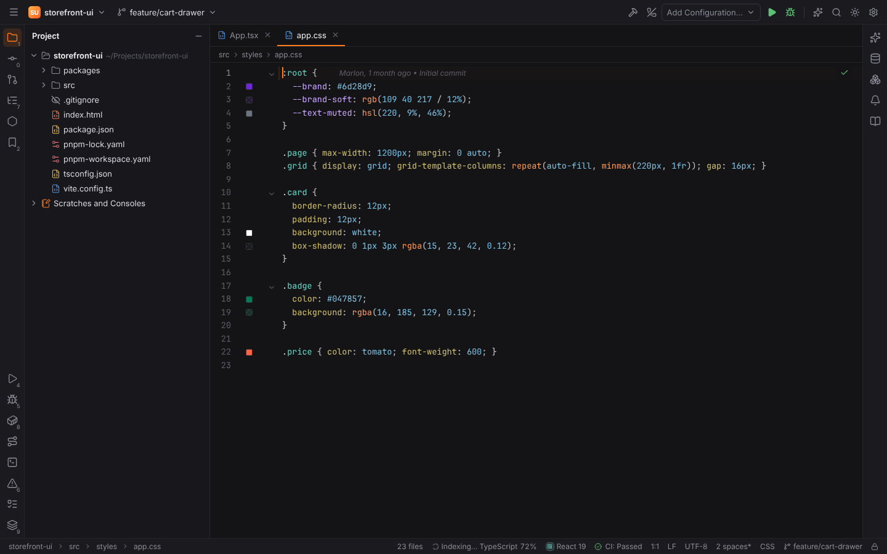
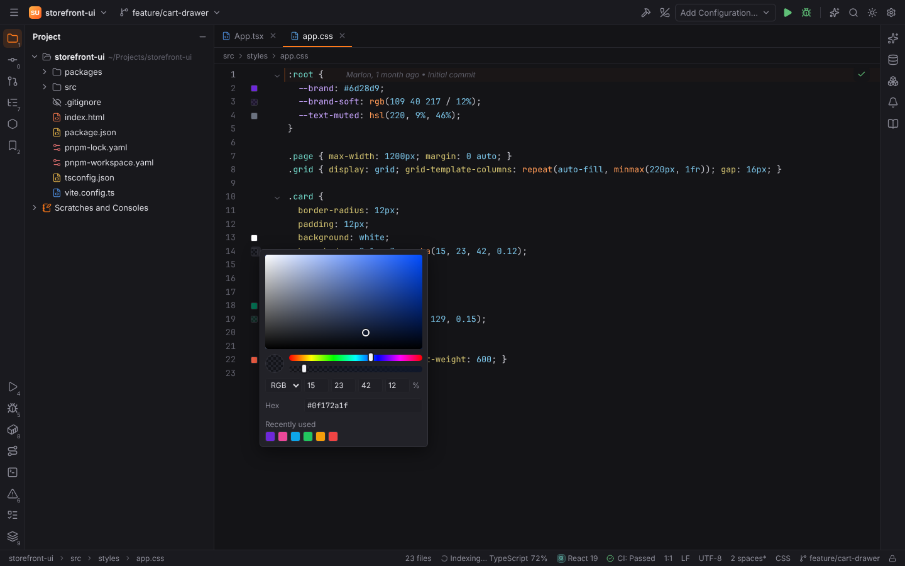
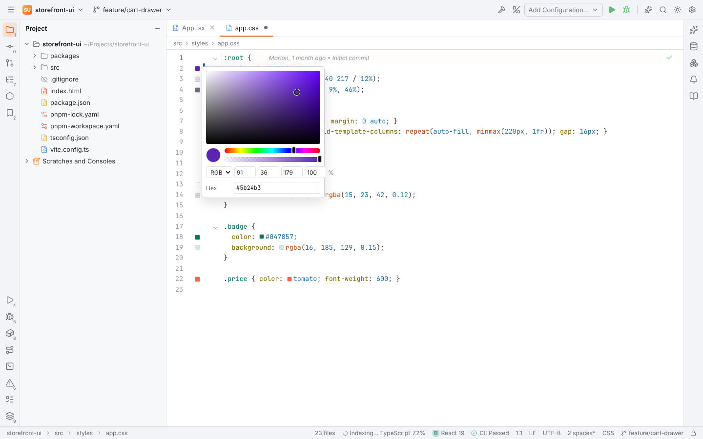

# Emmet and color previews

Emmet works as in PHPStorm: type an abbreviation such as `ul.nav>li*3>a` and press `Tab`, and
Forge writes the markup it stands for. Colors in stylesheets, markup and scripts get a swatch
in the gutter; click it to change the color with the color picker.

Parsing and expanding abbreviations is done in Rust (`crates/forge-emmet`), and so is finding,
parsing and writing colors (`crates/forge-colors`); the desktop app and browser mode behave the
same.

## Where Emmet works

| Files | What expands |
| --- | --- |
| HTML, Blade, Twig, Smarty, Latte, Jinja, Handlebars, Vue templates | markup abbreviations in text (not inside a tag, a comment, `{{ }}` / `` / `@php` code or `<script>`) |
| PHP | markup abbreviations in the HTML outside `<?php … ?>` |
| JSX and TSX (also `.js` files with JSX) | markup abbreviations where an element can start: after `(`, `>`, `return`, `=>`, `&&`, `\|\|`, `?` or `:`; `.class` becomes `className` |
| CSS, SCSS, Less, Sass, Stylus and `<style>` blocks | property abbreviations where a declaration starts |

The expand key is `Tab` by default (Settings | Editor | Emmet: `Tab`, `Enter` or `Space`). When
no abbreviation ends at the caret the key does what it always does. Live templates and postfix
templates come first: `fore` + `Tab` in a Blade view still expands the live template.

After an expansion, empty attribute values and empty elements are tab stops: `Tab` and
`Shift+Tab` move between them, `Escape` leaves them.

## Markup abbreviations

| Syntax | Example | Result |
| --- | --- | --- |
| Child `>` | `nav>ul>li` | `<nav><ul><li></li></ul></nav>` (formatted on lines) |
| Sibling `+` | `header+main+footer` | three siblings |
| Climb up `^` | `div>p^span` | `span` next to `div`, not inside it (`^^` climbs two levels) |
| Multiplication `*N` | `li*3` | three `li` elements |
| Grouping `( )` | `(dt+dd)*2` | the group twice |
| Id and class `#` `.` | `section#main.page.dark` | `<section id="main" class="page dark">` |
| Attributes `[ ]` | `a[href=/home title="Go home" data-x]` | values in quotes may contain spaces; an attribute without value becomes a tab stop; `[disabled.]` writes a boolean attribute |
| Text `{ }` | `button{Save}` | `<button>Save</button>`; `{Click }+a` puts text next to an element |
| Numbering `$` | `li.item$*3`, `h$*2` | `item1`, `item2`, `item3`; `$$` pads to `01`; `$@-` counts down; `$@3` starts at 3 |
| Implicit tags | `ul>.item`, `table>.row>.cell`, `em>.x` | `li`, `tr`/`td`, `span`; `div` elsewhere |
| Lorem ipsum | `lorem`, `lorem10`, `p*3>lorem5` | placeholder text (30 words by default) |

Snippets give elements their usual attributes and shortcuts: `a` → `<a href="">`, `img` →
``, `input:checkbox` (or `input:c`), `link:css`, `meta:vp`, `script:src`,
`btn:s`, `form:post`, `bq`, `ul+` (a list with an item), `table+` and `!` for an HTML5 document.
In JSX, `img` and other void elements close with ` />` and `label[for=x]` becomes `htmlFor`.

### Abbreviation preview

With Settings | Editor | Emmet | HTML | **Enable abbreviation preview**, a popup below the
abbreviation shows the markup while you type. It only appears for abbreviations that are clearly
Emmet (an operator, attributes, text, a known element or snippet).

## CSS abbreviations

| Abbreviation | Result |
| --- | --- |
| `m10`, `p10-20`, `m10-20-30-40` | `margin: 10px;`, `padding: 10px 20px;`, four values |
| `m-10`, `m10--20` | negative values: `margin: -10px;`, `margin: 10px -20px;` |
| `w100p`, `m2e`, `p1r`, `h50vh`, `m1.5`, `lh1.5`, `z10` | `%`, `em`, `rem`, any unit; decimals are `em`; unitless properties stay unitless |
| `df`, `dib`, `dn`, `pos:a`, `posr`, `tac`, `fwb`, `ovh`, `jcsb` | `display: flex;` … `justify-content: space-between;` (keyword by first letters or initials) |
| `c#f`, `bgc#fff`, `bd1-s#f00` | `color: #fff;`, `background-color: #fff;`, `border: 1px solid #f00;` |
| `c#3!` | `color: #333 !important;` |
| `m10+p5` | several declarations at once |
| `pos`, `d`, `bd` | the property with its default value selected as a tab stop |
| `@m`, `@kf`, `@f`, `@i` | `@media`, `@keyframes`, `@font-face`, `@import` |

Full property names expand too (`color` → `color: #000;`), and unknown abbreviations are matched
fuzzily against property names (`bxsz` → `box-sizing`). In Sass and Stylus no `;` is written.

## Surround with Emmet

Select some text (or put the caret on a line) and run **Surround with Emmet** (Find Action, or
`Ctrl+Alt+J` Surround with Live Template and choose **Emmet**, the first entry in markup
files). Enter an abbreviation; the popup previews the result and `Enter` applies it. `Up` and
`Down` bring back abbreviations used before.

- The selection goes into the innermost last element: `div.card>.body` wraps it in both.
- An element repeated with a bare `*` repeats once per selected line: `ul>li*` turns lines into
  list items.
- `$#` places the text explicitly: `a[title=$#]{$#}`.
- Wrapping a URL or an e-mail address with `a` fills its `href` (Settings | Editor | Emmet |
  HTML | Enable automatic URL recognition while wrapping text with `<a>` tag).

## Update Tag, Remove Tag and edit points

- **Update Tag with Emmet** (Find Action, action id `EmmetUpdateTag`): enter an abbreviation for
  the tag around the caret. A name renames the opening and closing tag, `#id` sets the id,
  `.class` adds classes and `[a=b]` sets attributes: `section.hero[role=banner]`.
- **Remove Tag** (Find Action, action id `EmmetRemoveTag`): removes the tag around the caret and
  keeps its content. Tags on lines of their own remove the line, and the content moves one
  indentation level out.
- **Next Emmet Edit Point** (`Alt+Shift+]`, macOS `Ctrl+Alt+]`) and **Previous Emmet Edit
  Point** (`Alt+Shift+[`, macOS `Ctrl+Alt+[`): move the caret to the next empty attribute value
  (`href="|"`), empty element (`
|
`) or empty line.

## Settings | Editor | Emmet

| Page | Setting | Default |
| --- | --- | --- |
| Emmet | Expand abbreviation with: `Tab`, `Enter`, `Space` | `Tab` |
| Emmet \| HTML | Enable Emmet | on |
| Emmet \| HTML | Enable abbreviation preview | off |
| Emmet \| HTML | Enable automatic URL recognition while wrapping text with `<a>` tag | on |
| Emmet \| CSS | Enable Emmet | on |
| Emmet \| JSX | Enable Emmet in JSX | on |
| Emmet \| JSX | Class attribute: `className` or `class` | `className` |

## Color previews

Forge shows a swatch in the gutter next to each color (up to two per line):

- in CSS, SCSS, Less, Sass, Stylus, `<style>` blocks and `style="…"` attributes: hex colors
  (`#fff`, `#ffffff80`), `rgb()`/`rgba()`, `hsl()`/`hsla()` and `hwb()` in the legacy comma and
  the modern space syntax (`rgb(0 0 255 / 50%)`, `hsl(240deg 100% 50%)`) and the CSS color names
  (`tomato`, `transparent`), in declarations and custom properties (`--brand: #6d28d9`);
- in JavaScript, TypeScript, JSX, TSX and Vue scripts: colors in strings (`'#1e90ff'`,
  `"rgba(0,0,0,.5)"`, `'tomato'`, CSS in template literals);
- Tailwind CSS color classes in `class` / `className` attributes and strings: `bg-blue-500`,
  `text-white/50`, `hover:border-red-600` (read-only swatches).

Selectors (`#main {`), `var(--x)` and colors in comments are left alone. Settings | Editor |
General | Appearance has **Show color preview in the gutter** (on) and **Show color preview
inline** (off), which draws the swatch in front of the color in the text.

## Color picker

Click a swatch (or run **Show Color Picker** from Find Action with the caret in a color) to
open the color picker:

- the saturation/brightness square, the hue slider and the opacity slider;
- `RGB` or `HSB` fields and the opacity in percent, the hex field;
- **Recently used** colors (kept in the setting `editor.colorPicker.recentColors`).

Every change is written into the document at once in the notation the color was written in:
`#abc` stays short while the color allows it, `rgba(…)` keeps its separators, `hsl()` stays
`hsl()`, a color name becomes another name or hex, and an alpha below 100% adds the alpha
(`#0000ff80`, `rgba(…)`). `Enter` or a click outside closes the picker; `Escape` restores the
original color. With the caret outside a color, Show Color Picker inserts a new hex color.

