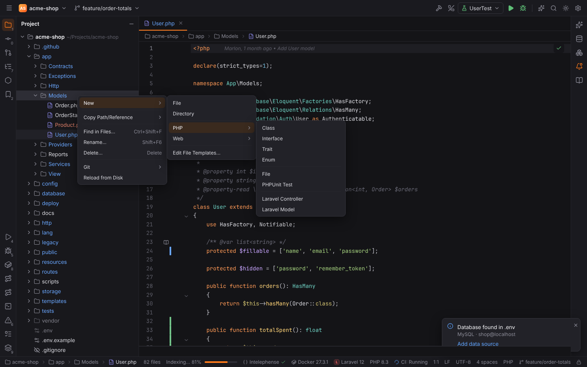
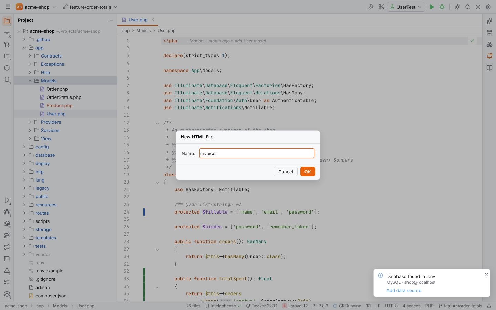
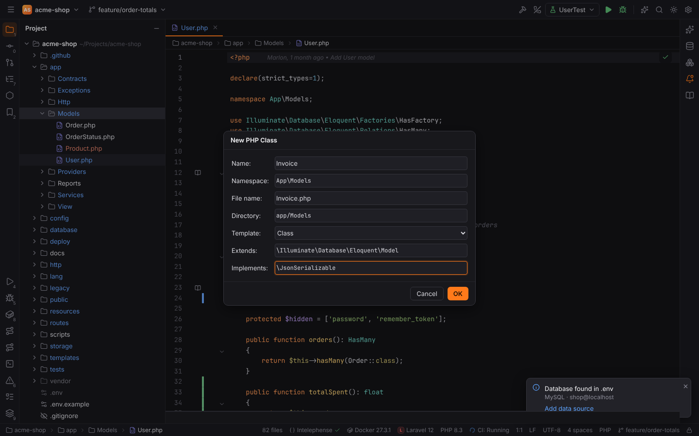
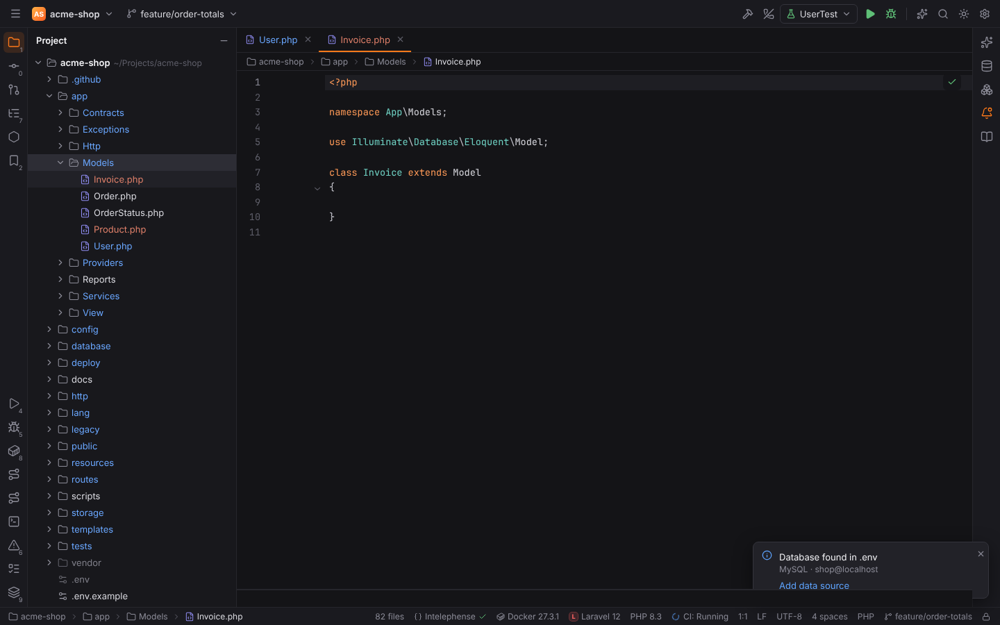
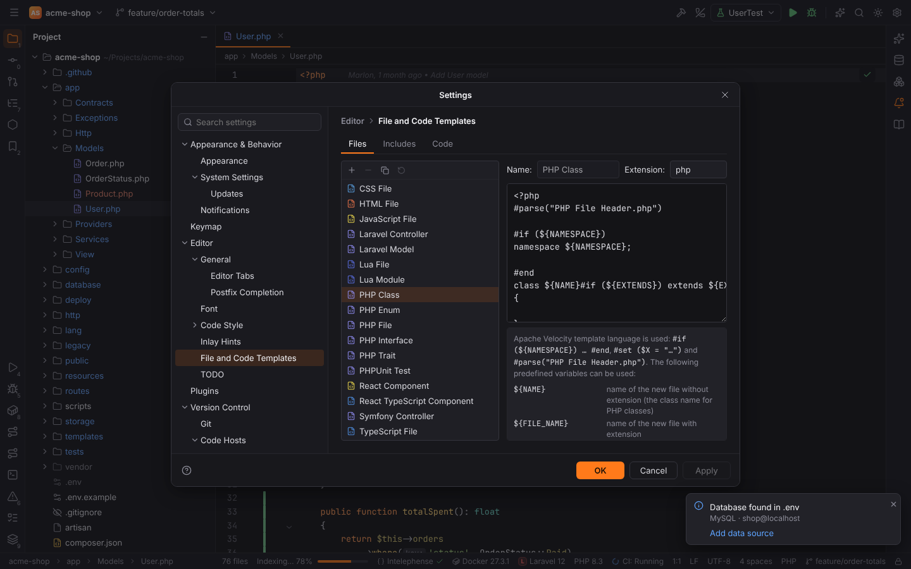
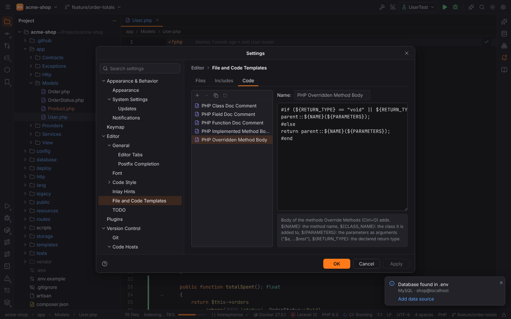

# File and code templates

Like PHPStorm, Forge creates new files from **file templates** and shapes the code that the
Generate actions write with **code templates**. Both are edited in Settings | Editor | File and
Code Templates and use the Apache Velocity template language (`${NAME}`, `#if … #end`).

## Creating a file from a template

The templates appear in three places, always for the folder you are in:

- **Project view**: right-click a folder (or a file, for its folder) › **New**.
- **File | New** in the main menu: for the folder selected in the Project view, else the
  folder of the active editor, else the project root.
- **New…** (`Alt+Insert`, macOS `Cmd+N`) while the Project view has the focus: the same list
  as a popup next to the selected folder. In an editor `Alt+Insert` stays **Generate…**.

The list shows **File** and **Directory**, then the templates the project uses, grouped in
submenus so the common choices are two clicks away:

- **PHP ▸** **Class**, **Interface**, **Trait** and **Enum** (each opens the New PHP Class
  dialog with that kind selected), then **File** and **PHPUnit Test**, then the project's
  framework templates (Laravel or Symfony).
- **Web ▸** HTML, CSS, JavaScript and TypeScript files, Vue and React components.
- **Lua ▸** Lua file and module.
- Your own templates follow directly in the New menu, then **Edit File Templates…**.

The templates:

| Template | Offered when | Creates |
| --- | --- | --- |
| PHP File | the project uses PHP | `<?php` file |
| PHP Class | the project uses PHP | class, interface, trait or enum (New PHP Class dialog) |
| PHPUnit Test | the project uses PHP | a `TestCase` subclass |
| Laravel Controller, Laravel Model | the project uses Laravel | `make:controller` / `make:model` style classes |
| Symfony Controller | the project uses Symfony | an `AbstractController` with a `#[Route]` action |
| WordPress Plugin | the project uses WordPress | a plugin file with the plugin header, the `ABSPATH` guard and an `init` callback (see [WordPress](wordpress.md#file-templates)) |
| WordPress Theme Stylesheet | the project uses WordPress | `style.css` with the theme header |
| HTML File, CSS File, JavaScript File, TypeScript File | always | web files |
| Vue Single File Component | the project uses Vue | `<script setup lang="ts">`, `<template>`, `<style scoped>` |
| React Component, React TypeScript Component | the project uses React | `.jsx` / `.tsx` function components |
| Lua File, Lua Module | the project uses Lua | `.lua` files |
| your own templates | always | see [Editing templates](#editing-templates) |

**Edit File Templates…** at the end opens the settings page. For most templates Forge asks for
the name in a small "New HTML File" dialog. The name may include sub folders
(`components/OrderList`), which are created; the extension is added unless you typed it.
The new file opens in the editor.

## The New PHP Class dialog

**PHP Class** (and every PHP template that uses `${NAMESPACE}`, such as PHPUnit Test or the
Laravel and Symfony templates) opens the New PHP Class dialog:

| Field | Meaning |
| --- | --- |
| Name | the class name; it must be a valid PHP identifier |
| Namespace | filled from the PSR-4 rules (`autoload.psr-4` and `autoload-dev.psr-4`) of composer.json for the target folder, e.g. `App\Models` for `app/Models` |
| File name | `<Name>.php` until you change it |
| Directory | the target folder; typing a namespace moves it to that namespace's PSR-4 folder (`App\Models\Billing` → `app/Models/Billing`) |
| Template | Class, Interface, Trait, Enum and the project's PHP class templates |
| Extends | parent class (for interfaces: parent interfaces, comma separated); only for templates that use `${EXTENDS}` |
| Implements | interfaces, comma separated; only for templates that use `${IMPLEMENTS}` |

Fully qualified names in Extends and Implements (`\Illuminate\Database\Eloquent\Model`) get a
`use` import after the namespace statement and are written by their short name; names from the
class's own namespace need no import. Templates that use variables of their own (the Enum
template's `${BACKED_TYPE}`) show a field for each one ("Backed type").

`Alt+Enter` › **Create class 'Receipt'** on an undeclared class opens the same dialog as
**Create New PHP Class**, filled with the name, the namespace of the usage (and its PSR-4
directory) and the template the usage needs; see [PHP: Create from usage](php.md#create-from-usage).

The composer.json is the one set in Settings | Languages & Frameworks | PHP | Composer
(`php.composer.json`). Its PSR-4 folders are relative to the folder of that file. The mapping is
computed next to the project files, so it also works in [remote projects](remote-development.md).

## Editing templates

Settings | Editor | File and Code Templates has three tabs:

- **Files**: the templates of the New menus.
- **Includes**: text pulled into other templates with `#parse`. The built-in
  **PHP File Header** is empty; put a licence or author comment there and every PHP template
  starts with it.
- **Code**: the code templates of the [Generate](php.md#generate) actions.

The toolbar above the list creates (`+`), removes (`−`, your own templates only), copies and
resets templates. **Reset to Default** brings a changed built-in template back. Changed
built-ins are shown in the accent color. Each template has a name, an extension (the new file's
extension) and its text; a syntax error is shown below the text with its line. The changes are
applied with OK or Apply like every other setting and stored in the `fileTemplates.custom`
setting (only your templates and the built-ins you changed).

### The template language

Templates use the part of Apache Velocity that PHPStorm's templates use:

| Syntax | Meaning |
| --- | --- |
| `${NAME}`, `$NAME` | a variable; an unknown variable stays as written, so `$this->x` is left alone |
| `$!{NAME}` | a variable that is empty when it is not set |
| `${NAME.toLowerCase()}` | also `toUpperCase()`, `trim()` and `replace("a", "b")` |
| `#if (${NAMESPACE}) … #elseif (…) … #else … #end` | conditions with `==`, `!=`, `&&`, `\|\|`, `!`, parentheses and strings; a variable alone is true when it is not empty |
| `#set ($ROUTE = ${NAME.toLowerCase()})` | defines a variable |
| `#parse("PHP File Header.php")` | inserts an include |
| `## comment`, `#* comment *#` | comments |
| `#[[ … ]]#`, `\$`, `\#` | text that is not parsed |

A line that holds only directives (`#if`, `#end`, `#set`, comments) leaves nothing behind in
the new file, not even an empty line. PHP attributes such as `#[Route('/x')]` are ordinary text.

### Variables

| Variable | Value |
| --- | --- |
| `${NAME}` | name of the new file without extension (the class name for PHP classes) |
| `${FILE_NAME}` | name of the new file with extension |
| `${NAMESPACE}` | namespace from the New PHP Class dialog |
| `${PACKAGE_NAME}` | the namespace, else the folder path with dots |
| `${DIR_PATH}` | folder of the new file, relative to the project root |
| `${PROJECT_NAME}` | name of the project |
| `${USER}` | your login name |
| `${DATE}`, `${TIME}` | current date (`2026-10-22`) and time (`14:05`) |
| `${YEAR}`, `${MONTH}`, `${MONTH_NAME_SHORT}`, `${MONTH_NAME_FULL}`, `${DAY}`, `${DAY_NAME_SHORT}`, `${DAY_NAME_FULL}`, `${HOUR}`, `${MINUTE}`, `${SECOND}` | parts of the current date and time |
| `${EXTENDS}`, `${IMPLEMENTS}` | the Extends and Implements fields of the New PHP Class dialog |

Any other variable a file template uses is asked for in its New dialog.

## Code templates

The PHP [Generate](php.md#generate) actions write their code with these templates:

| Template | Used by | Variables |
| --- | --- | --- |
| PHP Implemented Method Body | Implement Methods (`Ctrl+I`) | `${NAME}`, `${CLASS_NAME}`, `${PARAMETERS}` (`$a, ...$rest`), `${RETURN_TYPE}` |
| PHP Overridden Method Body | Override Methods (`Ctrl+O`) | as above; the default calls `parent::${NAME}(${PARAMETERS})` and returns its result unless the method returns `void` or `never` |
| PHP Function Doc Comment | Generate › PHPDoc Comment on a function or method | `${NAME}`, `${CLASS_NAME}`, `${PARAM_DOC}`, `${TYPE_HINT}`, `${THROWS_DOC}` |
| PHP Field Doc Comment | Generate › PHPDoc Comment on a property or constant | `${NAME}`, `${CLASS_NAME}`, `${TYPE_HINT}` |
| PHP Class Doc Comment | Generate › PHPDoc Comment on a class | `${NAME}`, `${NAMESPACE}` |

The bodies are indented inside the method and the doc comments in front of the declaration;
empty lines (for example `${PARAM_DOC}` of a function without parameters) are dropped from doc
comments. A template with a syntax error makes the action report the error instead of writing
code.

> **Note:** templates are user settings; PHPStorm's per-project template scheme is not
> available yet.
