# File types and syntax highlighting

## How a file's type is chosen

Like PHPStorm's Settings | Editor | File Types, Forge decides a file's type from, in this order:

1. **file names and path patterns**, e.g. `Dockerfile`, `.env.local`, `composer.lock`,
   `config/services.yaml` (in Symfony projects);
2. the **longest matching extension**, so `user.blade.php` is Blade, not PHP, and
   `page.html.twig` is Twig;
3. the **interpreter of a `#!` line** for files without an extension (`#!/usr/bin/env bash`,
   `#!/usr/bin/env python3`, `#!/usr/bin/env lua`).

Files that match nothing are "Plain text". The type is shown in the status bar and decides the
highlighting, the indentation (2 or 4 spaces), the language server and the file icon.

Plugins add types or replace bundled ones while they are active: in a Symfony project
`config/services*.yaml` becomes "Symfony Services", elsewhere it is plain YAML.

The complete list of types, extensions and file names is in the
[file types reference](../reference/file-types.md).

## Changing file types

Settings | Editor | **File Types** lists the recognized file types with their **File name
patterns**, like PHPStorm:

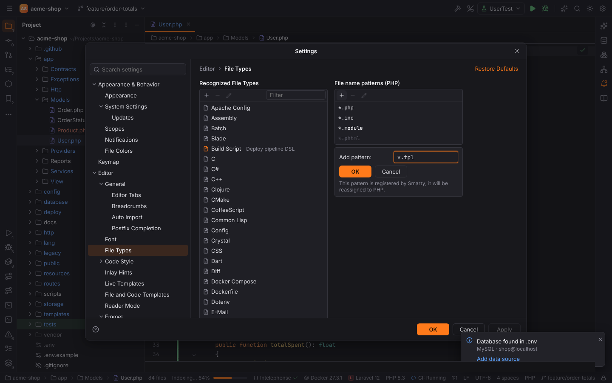

- Select a type and add a pattern with **+** (`*.module`, `Procfile*`, `config/*.conf`), edit it
  with the pencil or remove it with **−**. A pattern belongs to one type: adding one that
  another type has moves it (the form tells you which type had it). Added patterns are bold,
  removed bundled ones are struck through; adding a removed one again restores it.
- **+** above the type list creates a **custom file type** (below); **−** and the pencil remove
  and edit custom types.
- **Ignored Files and Folders** lists names the Project view hides (`.git`, `__pycache__`,
  `*.pyc`, `.DS_Store`, …; `*` and `?` are wildcards).
- **Restore Defaults** in the header brings back the bundled patterns, removes custom types and
  resets the ignored names.

The changes apply to files opened afterwards, in the desktop app and in browser mode alike
(the detection runs in Rust, `forge-filetypes`). They are stored in `fileTypes.associations`,
`fileTypes.custom` and `fileTypes.ignoredFiles`.

### Custom file types

PHPStorm's "New File Type" dialog: a name, a description and the syntax highlighting of the
type.

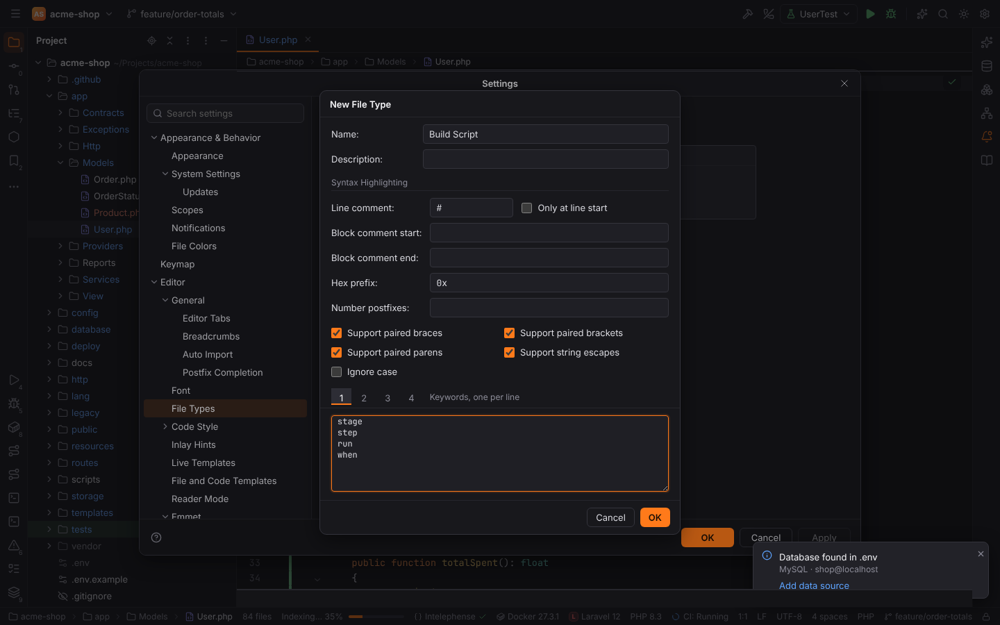

| Option | Meaning |
| --- | --- |
| Line comment, Only at line start | starts a comment to the end of the line, e.g. `#` or `//` |
| Block comment start / end | e.g. `/*` and `*/`; may span lines |
| Hex prefix | e.g. `0x` for `0xFF` |
| Number postfixes | characters allowed after a number, e.g. `lLfF` |
| Support paired braces, brackets, parens | typing `{`, `[` or `(` inserts the closing one |
| Support string escapes | `\"` does not end a string |
| Ignore case | keywords match in any case |
| Keywords 1–4 | one keyword per line; each list has its own color (keyword, built-in, type, constant). Keywords may contain other characters, e.g. `#define` |

Strings in `"` and `'` and decimal numbers are always highlighted. Add the type's file name
patterns on the right after creating it; `Ctrl+/` comments lines with its line comment.

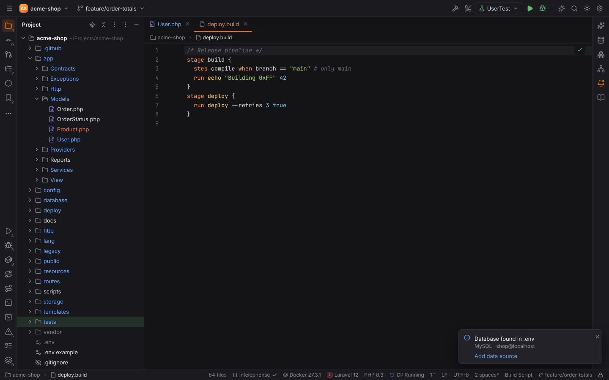

## Highlighted languages

About 70 languages are highlighted, among them PHP, Blade, Twig, Smarty, Latte, Jinja2,
Handlebars, Go templates, Velocity, Pug, HTML, CSS, SCSS, Sass, Less, Stylus, JavaScript,
TypeScript (and JSX/TSX), Vue, JSON, YAML, TOML, XML, Markdown, SQL, Lua, Python, Go, Rust,
Java, Kotlin, C, C++, C#, Ruby, Shell, PowerShell, Dockerfile, Nginx, Apache config, INI,
dotenv, Makefile, CMake, LaTeX, HTTP requests and many more.

| | | |
| --- | --- | --- |
| 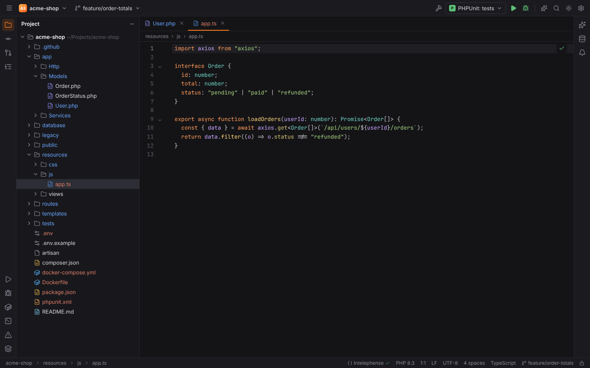 | 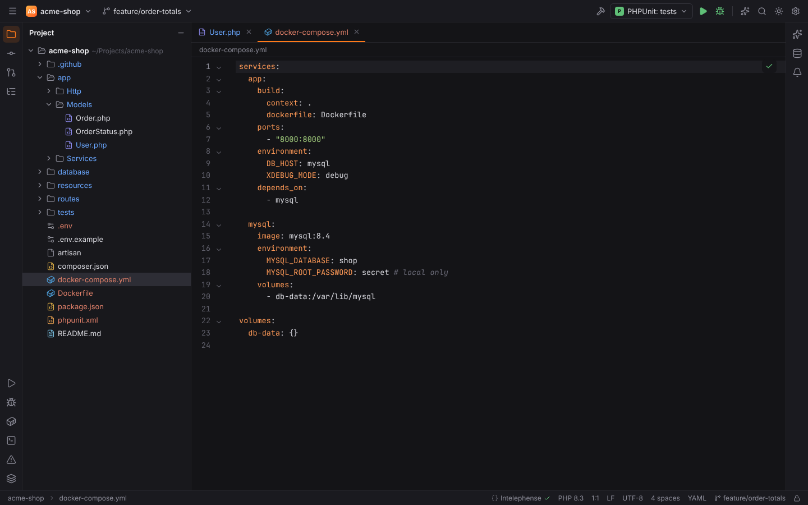 | 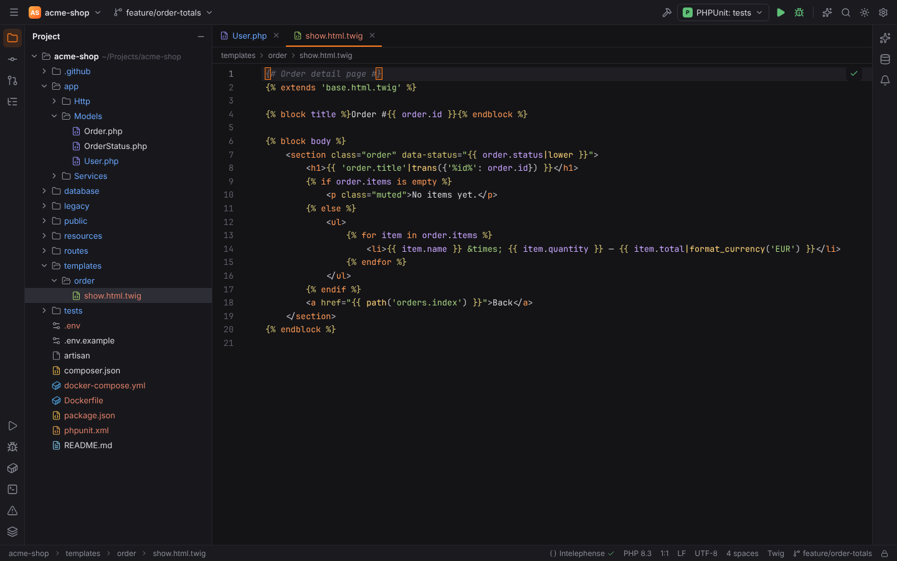 |
| 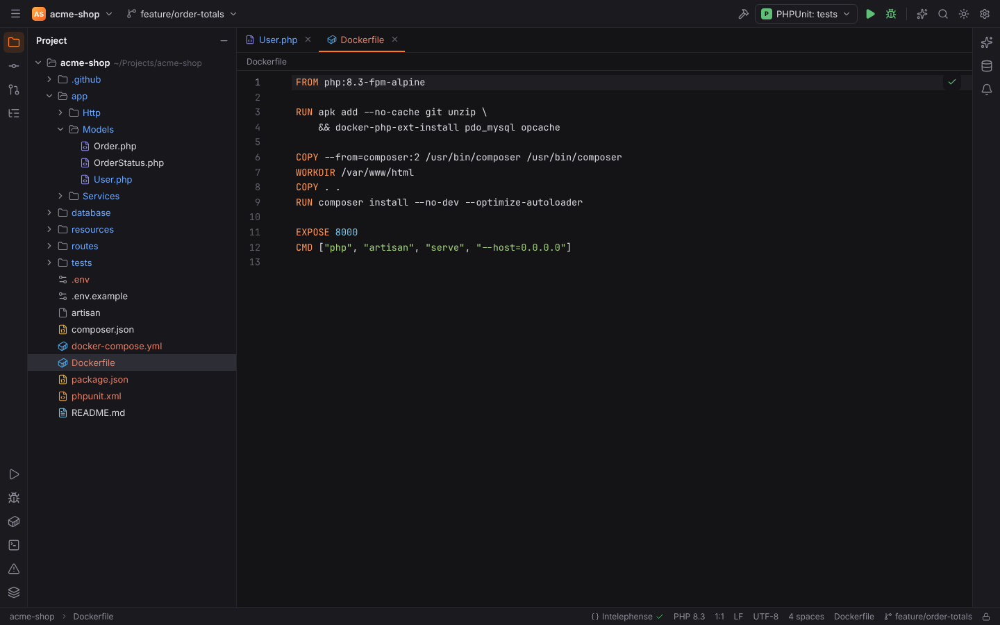 | 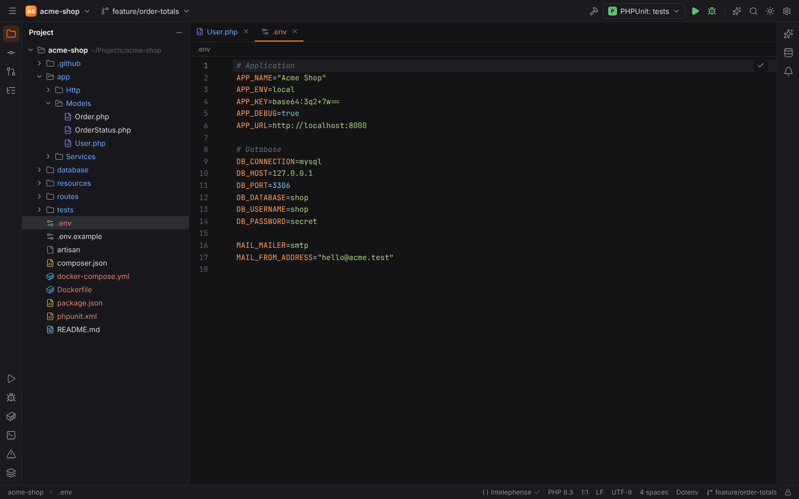 | 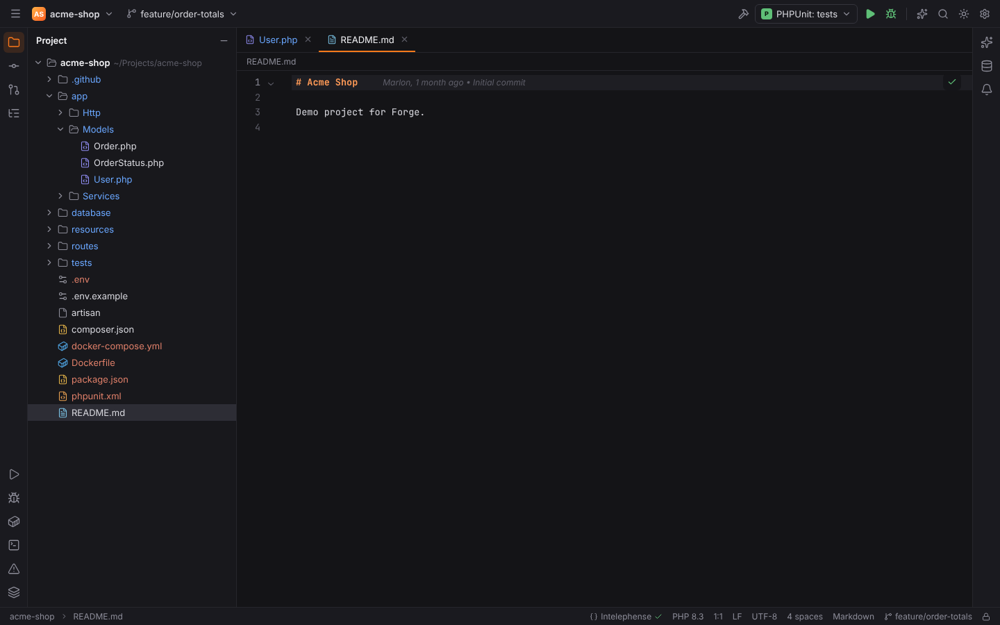 |

## Config and script formats with extra support

Some formats get more than colors, without needing a language server:

| Format | Files | Extras |
| --- | --- | --- |
| Shell Script | `.sh`, `.bash`, `.zsh`, `.bats`, `.bashrc`, `.profile`, `PKGBUILD`, `#!` scripts | completion of keywords, builtins, functions and variables; folding |
| Python | `.py`, `.pyi`, `SConstruct`, `#!` scripts | scope-aware completion, syntax checks |
| YAML | `.yml`, `.yaml`, `.neon`, `.clang-format`, … | folding, syntax checks |
| JSON | `.json`, `.jsonc`, `.json5`, `.lock`, `.babelrc`, `composer.lock`, … | folding, syntax checks |
| Dotenv | `.env`, `.env.local`, `.env.*.local`, `.env.example`, … | `${VAR}` interpolation, completion of variables in the file, Symfony Flex section folding, checks for unquoted spaces, unterminated quotes and duplicate keys |
| Ignore files | `.gitignore`, `.dockerignore`, `.npmignore`, `.*ignore` | pattern syntax, duplicate pattern hints |
| Dockerfile | `Dockerfile`, `Dockerfile.*`, `Containerfile`, `.dockerfile` | instruction, flag, stage and build-arg completion, hover docs, checks (unknown instruction, missing `FROM`) |
| Docker Compose | `compose.yaml`, `docker-compose.yml`, `compose.*.yaml`, … | Compose Specification completion and hover docs, works in incomplete files |
| INI | `.ini`, `php.ini`, `.editorconfig`, `.gitconfig`, systemd units, `my.cnf`, … | section folding, checks for broken sections and duplicate keys |
| Config | `.conf`, `.config` | key/value pairs, interpolation, nginx-style blocks |
| Postfix | `main.cf`, `master.cf` | parameter and restriction completion with documentation, lookup table types, checks |
| E-Mail | `.eml` | header/MIME highlighting, header completion, decoding of encoded words on hover, folding, checks |
| Symfony Services | `config/services*.yaml` (Symfony projects) | service, parameter and tag completion, `@service` and `%parameter%` highlighting |

These syntax checks feed the Problems view, but step aside when a language server for the
file is running (for example yaml-language-server), so you do not get every problem twice.

## Template data languages

Template languages (Twig, Smarty, Latte, Jinja2, Handlebars, Go templates) mix template tags
with content in another language, the **data language**. Forge highlights the content in its
real language and draws the template tags on top, so a LaTeX or SQL template is just as
readable as an HTML one.

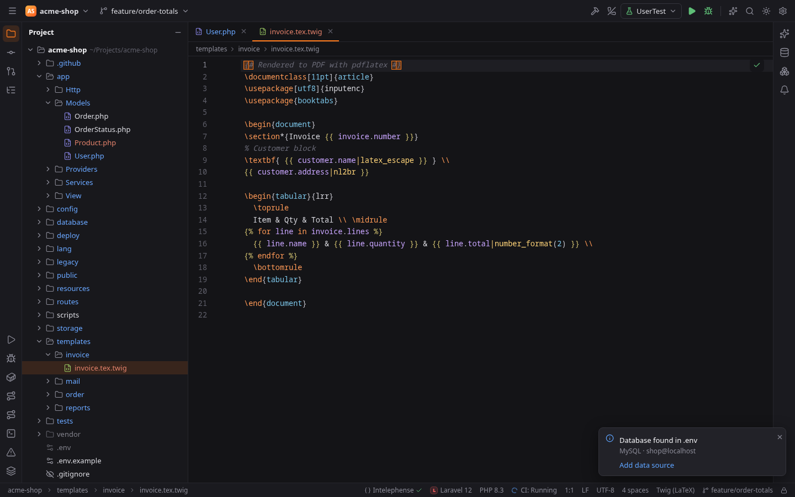

The data language of a file is chosen from the first of these that applies:

1. the patterns in Settings | Languages & Frameworks | **Template Data Languages**
   (`templates.dataLanguages`), one entry per pattern: `legacy/latex/*.tpl=latex`,
   `*.mail.twig=text`;
2. a **compound file name**: `invoice.tex.twig` is LaTeX, `report.sql.twig` is SQL,
   `style.css.tpl` is CSS, `config.yaml.twig` is YAML;
3. HTML.

Data languages: `html`, `xml`, `latex`, `css`, `scss`, `less`, `javascript`, `typescript`,
`json`, `sql`, `yaml`, `ini`, `shell`, `go`, `text`. The setting can be stored per project and
applies to files opened afterwards.

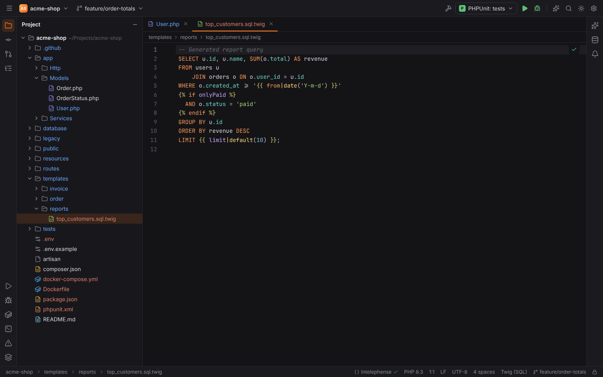

### Template delimiters

In some data languages the default delimiters are part of the content, for example `{` in
LaTeX. The **Delimiters** table on the same page (`templates.delimiters`) sets the delimiters
of a template language *in a data language*, one row per pair, as the engines themselves allow
(Smarty's `left_delimiter`, Twig's `tag_variable` / `tag_block` / `tag_comment`, Jinja's
`*_start_string`, Go's `Delims`):

| Template | Data language | Delimiters (default) |
| --- | --- | --- |
| Smarty | LaTeX | `[[ ]]` |
| Twig, Jinja2 | LaTeX | `\VAR{ }`, `\BLOCK{ }`, `\#{ }` |

Add a row with **+**, edit it with the pencil (or a double-click) and remove it with **−**.
The form shows the delimiters of the chosen template language; a pair can only appear once.
Files without a row use the language's usual delimiters (`{ }` for Smarty, `{{ }}`, ``
and `{# #}` for Twig). The table can be stored per project, and open editors follow a change
right away.

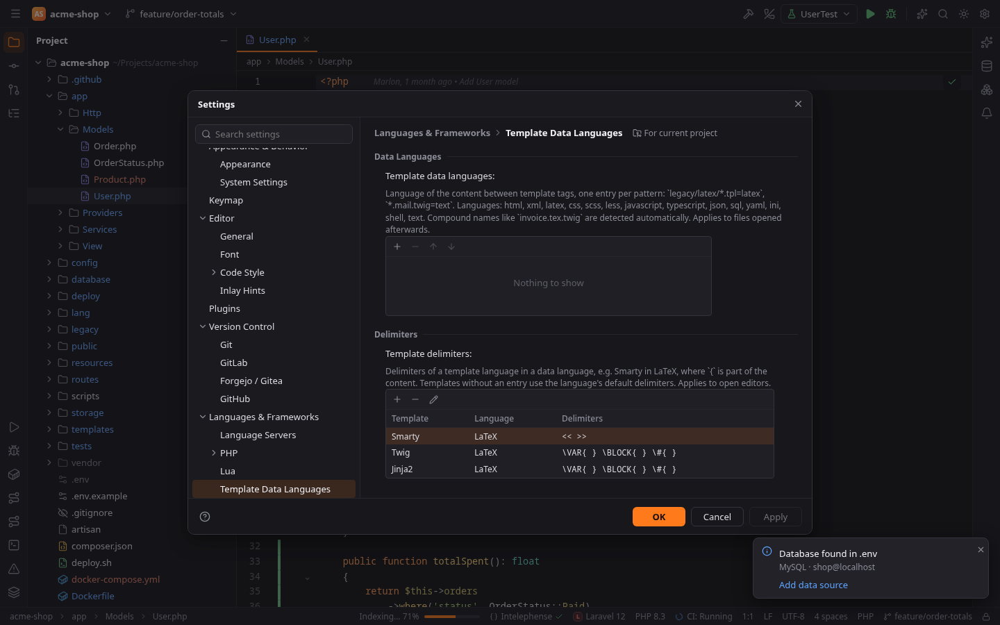

Everything that knows about tags uses the configured delimiters: highlighting, comment
toggling (`Ctrl+/` inserts `[[* *]]` or `\#{ }`), folding of blocks, matching delimiters,
auto-closing and completion of the end tag after `[[/` or `{/`. In a data language without
its own parser (LaTeX, INI, Shell) a `%` or `#` inside a tag no longer starts a comment.
Smarty's `{literal}` blocks and its auto-literal rule (`{ ` followed by a space is text) are
respected.

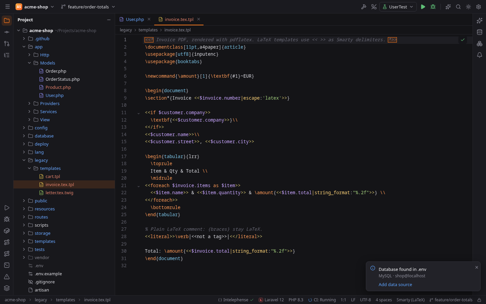

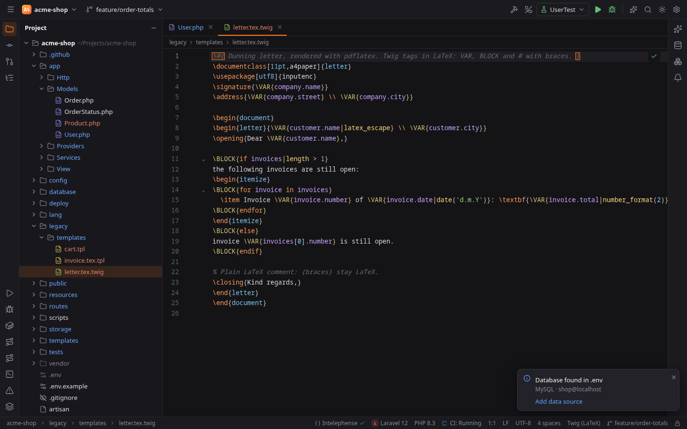

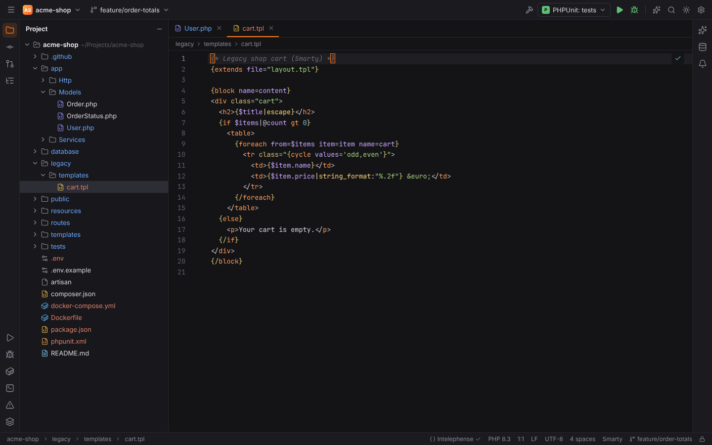

## Language intelligence

Highlighting is built in. Completion, hover and diagnostics for most languages come from a
[language server](language-servers.md); Forge suggests installing one when a file uses a
feature only a server provides. JSON and YAML files are validated, completed and documented
from their [JSON schema](json-schema.md) without a server.
