# Git

The Git plugin (`forge.git`) drives the `git` command line (no libgit2) and works in any project
that is a Git repository (also when the project is a sub-folder of the repository). The
current branch is shown in the main toolbar and the status bar.

## Get from VCS

**Git ▸ Clone…** (`Git.Clone`), **VCS ▸ Get from Version Control…** / **File ▸ New ▸ Project
from Version Control…** (`Vcs.Checkout`) and **Get from VCS** on the Welcome screen open **Get
from Version Control**:

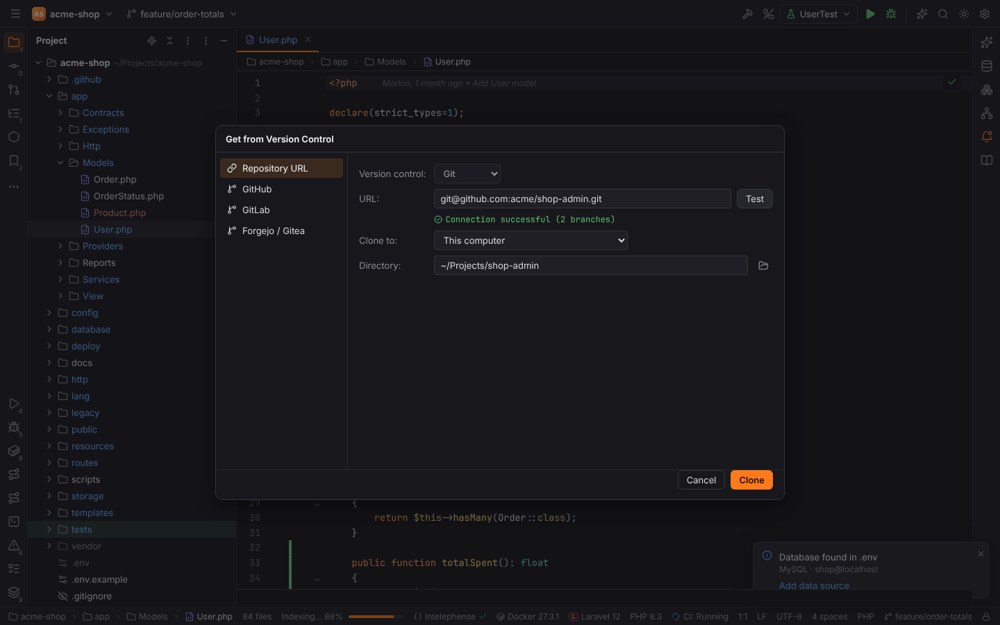

- **Repository URL**: the URL (`https://…`, `git@host:owner/repo.git`, `ssh://…` or a local
  path) and the **Directory** (by default `<Settings | System | default project directory>/<name
  from the URL>`; the folder button picks another one). **Test** runs `git ls-remote` and shows
  "Connection successful" or git's error.
- **GitHub**, **GitLab** and **Forgejo / Gitea** list the repositories of your
  [code host accounts](code-hosts.md) (owned, member and collaborator repositories, recently
  active first) with a search field; double-click a repository to clone it. Without an account
  the page offers **Log In…**.

  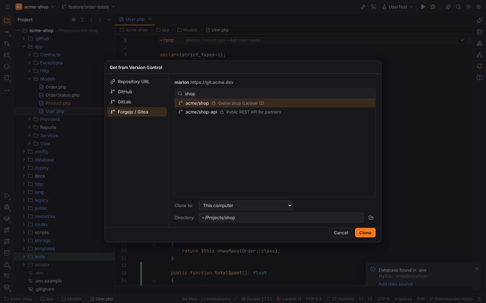

- **Clone to**: **This computer**, the host of the open remote project or a saved SSH
  connection (Settings | Tools | SSH Configurations). Remote clones run `git clone` on that host
  through the Forge agent; the folder button browses the host.
- **Clone** shows git's progress (Receiving objects, Resolving deltas, …) with **Cancel**; a
  cancelled clone removes the half-cloned folder. Afterwards the project opens; with a project
  open, Forge asks **Open Project** (**This Window**; **New Window** comes with several project
  windows).

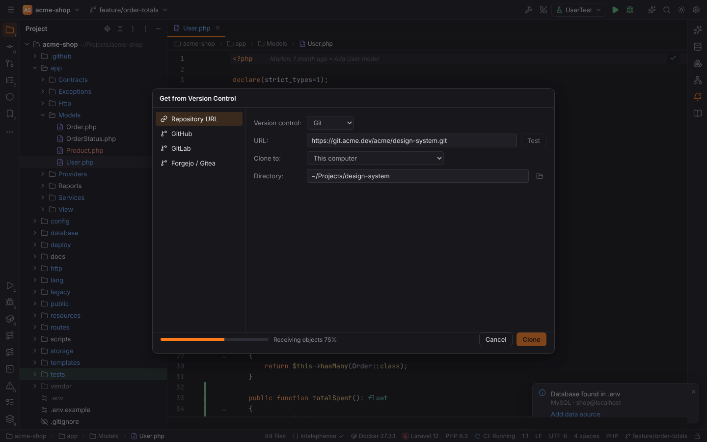

Credentials: for HTTPS URLs on the server of one of your code host accounts, Forge gives git
that account's token (from the OS keychain) for this one `git clone` / `git ls-remote` through a
`-c credential.helper=…` that reads it from the environment. Nothing is written to git config or
a credential store, and the token is never on the command line. SSH URLs use your SSH keys and
SSH agent (on a remote host: the host's keys and agent); Forge never asks for passwords in a
terminal, so a missing key fails with git's message.

## Commit tool window

**Commit…** (`Ctrl+K`, macOS `Cmd+K`) opens the **Commit** tool window (`Alt+0`, left stripe).

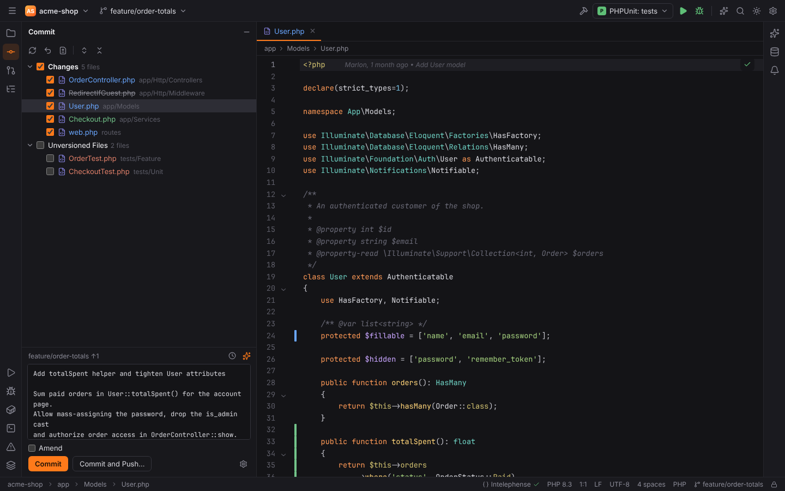

- The changes are listed in their [changelists](#changelists) (**Changes** is the default
  one) and **Unversioned Files**, as trees grouped by folder. Tick the files to include; new
  changes of the active changelist are ticked. Double-click a file (or **Show Diff**,
  `Ctrl+D`) to see its diff.
- Toolbar: **Refresh** (`Ctrl+F5`), **Rollback…** (`Ctrl+Alt+Z`, discards the changes of the
  selected files after a confirmation), **Show Diff**, **Expand All**, **Collapse All**,
  **New Changelist…**.
- Write the **Commit Message**. **Amend** amends the last commit (its message is loaded).
  **Sign-off** adds a `Signed-off-by` line (`git commit --signoff`; the same option as
  Settings | Version Control | Git | Sign-off commits).
- **Commit** (`Ctrl+Enter` in the message) or **Commit and Push…**. The gear next to them
  opens the [Commit Options](#commit-options-and-commit-checks).
- While there are shelved changes or stashes, the header shows the tabs **Changes**, **Shelf**
  and **Stash** (see [Shelf](#shelf) and [Stash](#stash)).

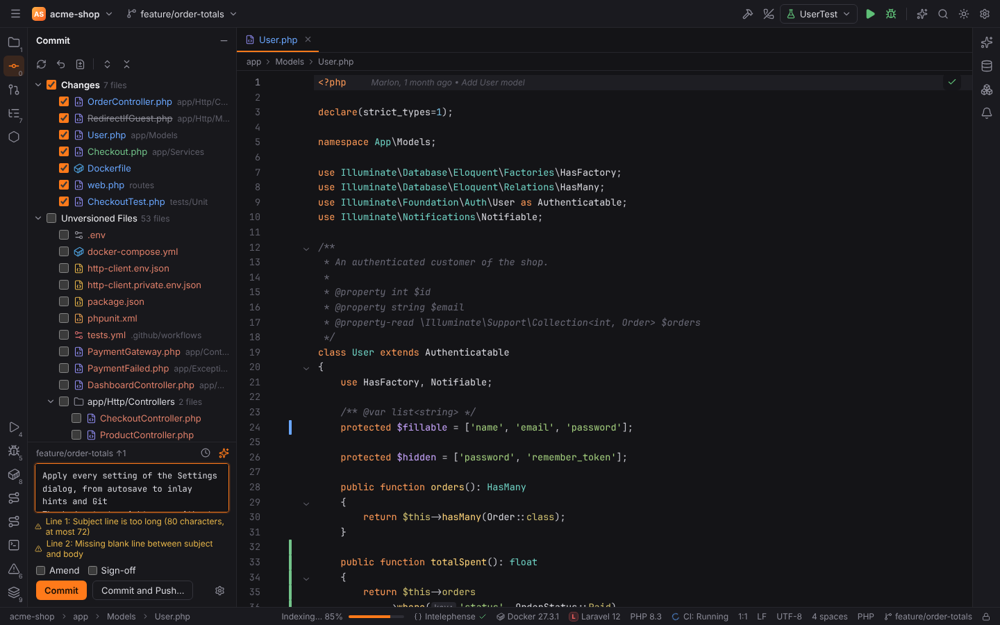

While you type, the message is checked like in PHPStorm (Settings | Version Control | Git |
Commit Message Inspections): the subject line is at most `vcs.git.commit.subjectMaxLength`
characters (72), a blank line separates subject and body
(`vcs.git.commit.blankLineAfterSubject`) and body lines stay within
`vcs.git.commit.bodyRightMargin` columns (72). Problems are listed below the message; they do
not block the commit. Lines starting with `#` are ignored. Typos and grammar problems in the
message are underlined and listed too, with their fixes on click (see
[Spelling and grammar](spelling-and-grammar.md#commit-messages)).

Before committing files with Windows line separators (CRLF), Forge asks whether to **Commit As
Is** (`vcs.git.commit.warnOnCrlf`), unless git converts them itself (`core.autocrlf` is `true`
or `input`).

> **Note:** "Commit Message History" (`Ctrl+M`) is not available yet.

### Changelists

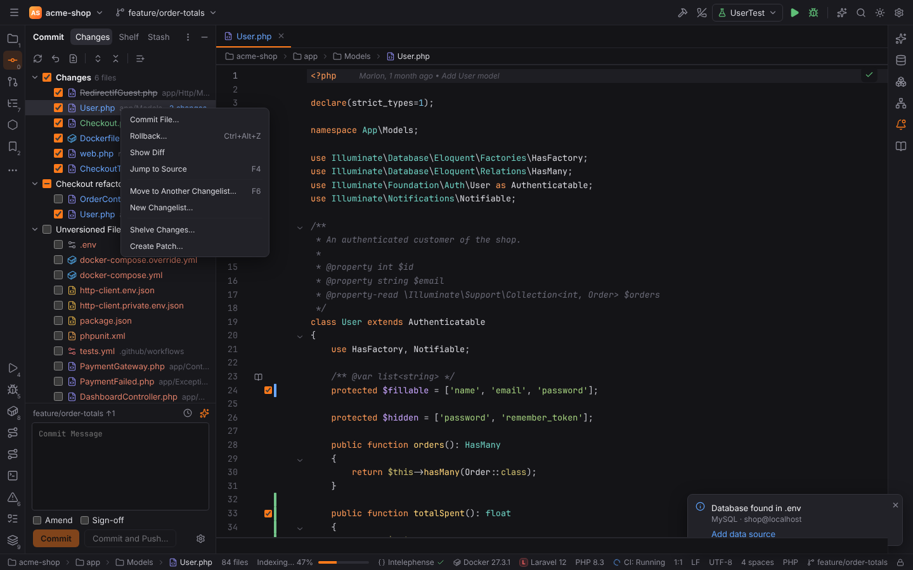

Changelists group local changes, like in PHPStorm. **Changes** is the default changelist; the
**active** changelist is shown in bold and receives new changes. Forge keeps the changelists
per project in its data directory (`changelists.json`, see
[File locations](../reference/file-locations.md)), never in the project, and git knows
nothing about them.

- **New Changelist…** (toolbar, context menu, Git ▸ Uncommitted Changes): name, comment and
  **Set active**. The comment of the active changelist becomes the commit message draft.
- Right-click a changelist: **Commit…** (ticks exactly its files), **Rollback…**,
  **Edit Changelist…** (also double-click), **Delete Changelist** (its changes move to the
  active list; the active list cannot be deleted), **Set Active Changelist**,
  **Shelve Changes…** and **Create Patch…**.
- **Move to Another Changelist…** (`F6` in the Commit tool window, file context menu) moves
  the selected file to an existing or a new changelist. Files can also be **dragged** onto a
  changelist.

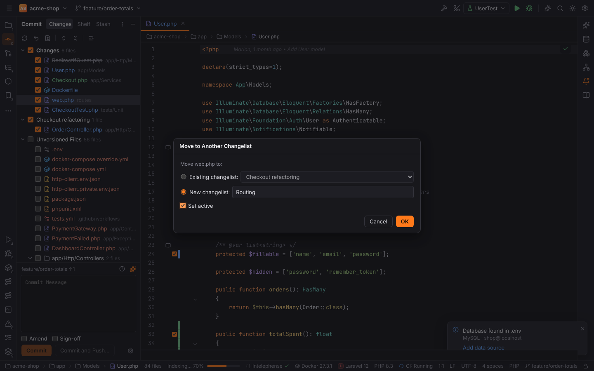

Settings | Version Control | Changelists | **Create changelists automatically**
(`vcs.changelists.createAutomatically`, on by default): applied patches and unshelved changes
go to a new changelist named after the patch or the shelved changes.

### Partial commits

Single changes (hunks) of a file can be committed while the rest stays local, like PHPStorm's
partial commits:

- While the Commit tool window is open, the editor shows a checkbox at every change of a
  tracked file (next to the [change markers](#change-markers)). Untick a change to leave it
  out of the next commit. Unsaved edits count.
- The diff of a file opened from the Commit tool window has the same checkboxes.
- A partly included file shows a half-ticked checkbox in the Commit tool window.
- Click a change marker and choose **Move to Another Changelist…** to move only that change;
  the file then shows in both changelists with the number of its changes in each. Changes moved
  to a list that is not active are left out of the commit.

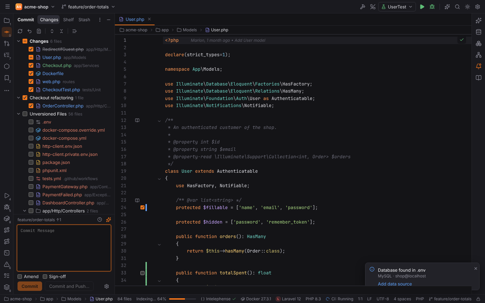

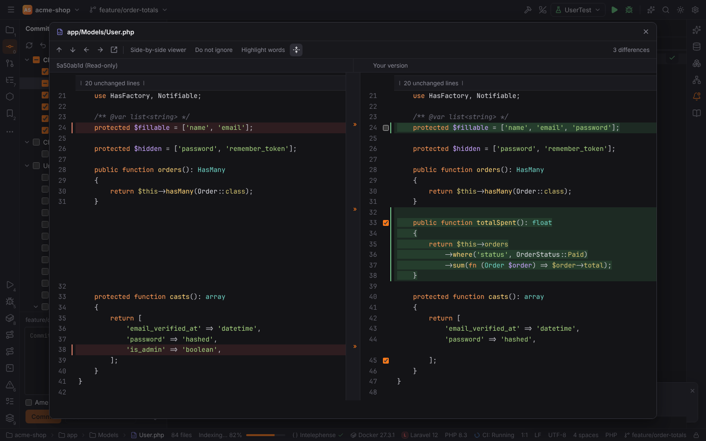

Forge builds the commit in the index without touching your files: it saves what was staged,
writes the committed version of each partly included file (HEAD plus the included changes),
commits, then restores the index, so the excluded changes stay local changes. This works in
remote projects too, since git runs on the project's host.

### Commit options and commit checks

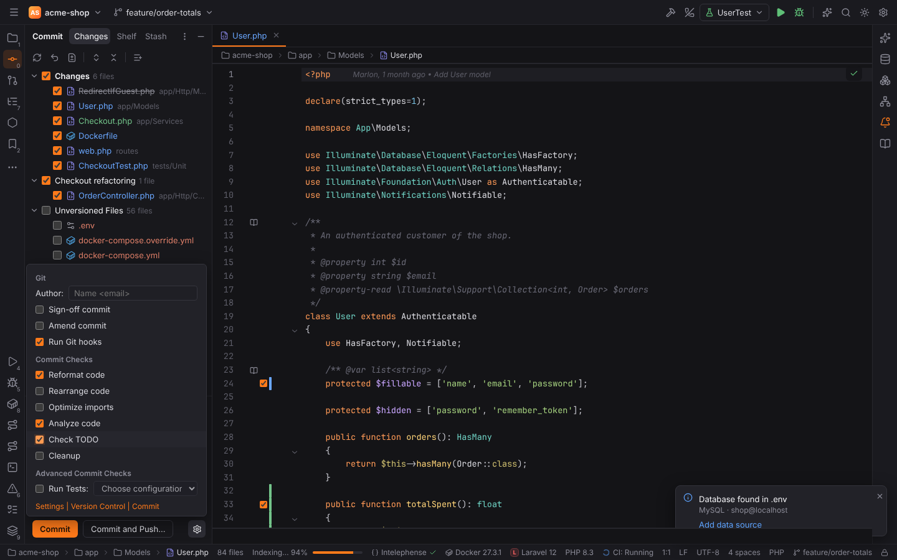

The gear next to **Commit and Push…** opens the **Commit Options**:

- **Git**: **Author** (`Name <email>` for this commit only), **Sign-off commit**,
  **Amend commit** and **Run Git hooks** (off commits with `--no-verify`, so `pre-commit` and
  `commit-msg` hooks are skipped).
- **Commit Checks**, run on the ticked files before committing:
  - **Reformat code**, **Rearrange code**, **Optimize imports** and **Cleanup** change the
    files like the [Actions on Save](actions-on-save.md) (Reformat uses the formatter of the
    file type; the other three are PHP actions);
  - **Analyze code** collects the errors and warnings of the language servers and
    inspections. When there are any, Forge asks: *"N errors and M warnings found"* —
    **Review** (opens the Problems tool window and does not commit) or **Commit Anyway**;
  - **Check TODO** looks for TODO items (the patterns of the [TODO](todo.md) tool window) in
    the added and changed lines, with **Review** (opens the TODO tool window) or
    **Commit Anyway**.
- **Advanced Commit Checks**: **Run Tests** runs the chosen run configuration and asks
  **Review** or **Commit Anyway** when it fails.

The checks are settings (Settings | Version Control | Commit, `vcs.commit.*`), so they stay as
you leave them. "Update copyright" is not available.

### Commit Message History

**Commit Message History** (`Ctrl+M`, macOS `Cmd+M`, in the commit message, or the clock icon
above it; `Vcs.ShowMessageHistory`) lists recent messages: the ones committed from Forge in this
project, then your own recent commits (`git log --author=<your email>`). Type to filter, `Up` /
`Down` select (the preview shows the whole message), `Enter` or a click puts the message into
the commit message, `Escape` closes the popup.

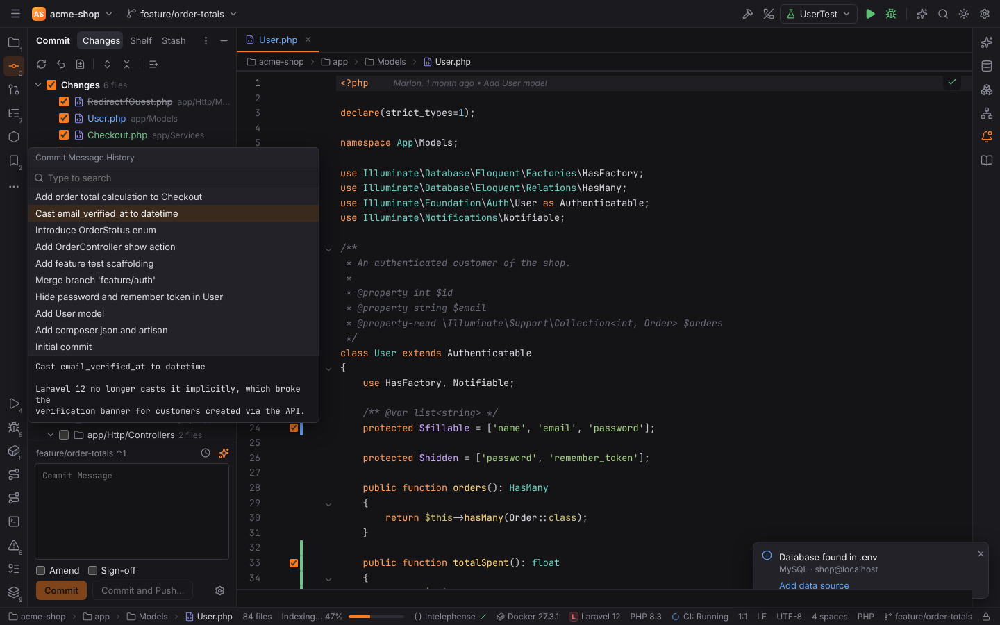

The history is kept per project in Forge's data directory
(`<data dir>/forge/projects/<project>/commit-messages.json`), never in the project. Settings |
Version Control | Commit | **Commit message history size** (`vcs.commit.messageHistorySize`,
20) limits it.

### Signing commits with GPG or SSH keys

Settings | Version Control | Git | **Sign commits with GPG/SSH key**
(`vcs.git.commit.gpgSign`, per project) signs the commits Forge makes (`git commit -S`).
**Configure GPG Key…** shows the signing setup in git config (`user.signingkey`, `gpg.format`,
`commit.gpgsign`; read-only) and lets you choose a key:

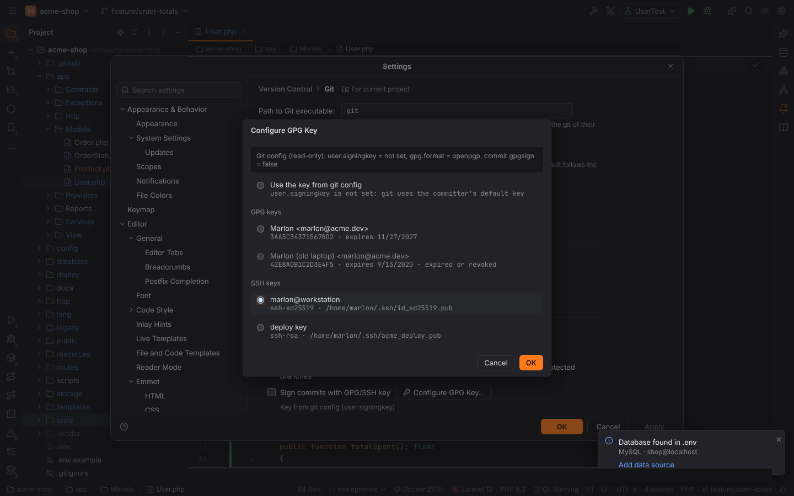

- **Use the key from git config**: git signs with `user.signingkey` (or its default key).
- **GPG keys**: your secret keys from `gpg --list-secret-keys` (expired and revoked keys are
  shown but cannot be chosen).
- **SSH keys**: the public keys in `~/.ssh/*.pub` (`gpg.format=ssh`).

The choice is stored in the Forge setting `vcs.git.commit.signingKey` (`openpgp:<key id>` or
`ssh:<public key file>`) and applied to each commit with `-c user.signingkey=… -c gpg.format=…`
only; Forge never changes git config. For remote projects the keys are listed and used on the
host. GPG asks for a passphrase through your `gpg-agent` pinentry as usual.

The [Log](#log) marks signed commits with a shield: green for a verified signature, yellow for
a signature that cannot be checked (unknown or untrusted key, expired), red for a bad or revoked
one. The commit details name the signer and the key.

### AI commit messages

Click **Generate Commit Message with AI** (the sparkle icon above the message). Forge sends the
diff of the **ticked** files (new files included), the file list and the branch name to your
default AI provider and fills in the message: an imperative subject of at most 72 characters,
optionally a blank line and a short body. Large diffs are shortened so every file keeps a share
(about 14,000 characters in total).

Configure the provider in Settings | Tools | AI Providers; you can pick a separate model for
commit messages there. See [AI](ai.md#providers).

## Diff viewer

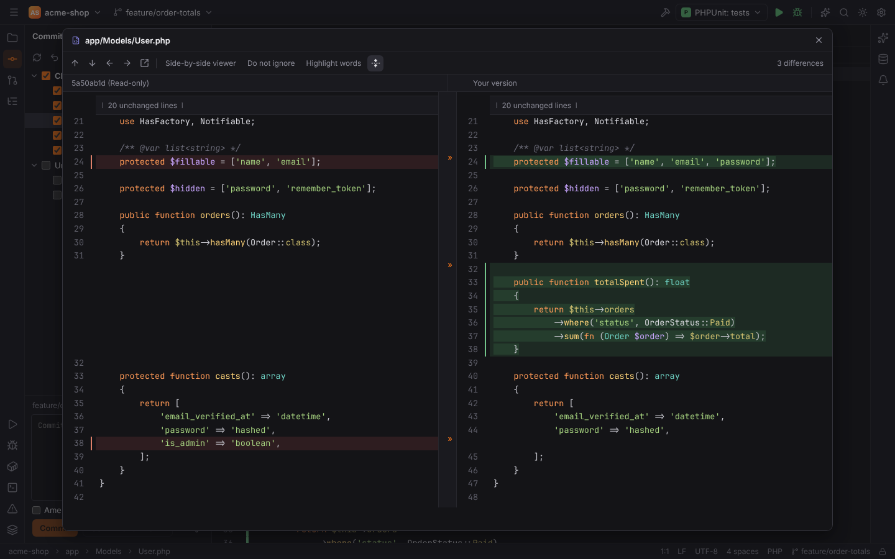

| Action | Key |
| --- | --- |
| Next / Previous Difference | `F7` / `Shift+F7` |
| Compare Next / Previous File | `Alt+Right` / `Alt+Left` |
| Jump to Source | `F4` |
| Close | `Escape` |

Next / Previous Difference are the keymap actions of the same name, so a shortcut you change in
Settings | Keymap works here too. `Escape` closes the viewer only while it has the focus, not a
dialog opened above it.

The toolbar also has viewer, whitespace and highlighting options and **Collapse Unchanged
Fragments**. Each changed block has a "Revert" arrow that replaces your side with the left
side.

## In the editor

### Change markers

Lines that differ from `HEAD` are marked in the gutter: added, modified and deleted. Click a
marker to see the old text and choose **Rollback** (`Ctrl+Alt+Z`) or **Show Diff** (`Ctrl+D`).
**Next Change** / **Previous Change** (`Ctrl+Alt+Shift+Down` / `Ctrl+Alt+Shift+Up`, Navigate
menu) move the caret to the next or previous changed block, wrapping around at the end of the
file, and open the same popup.

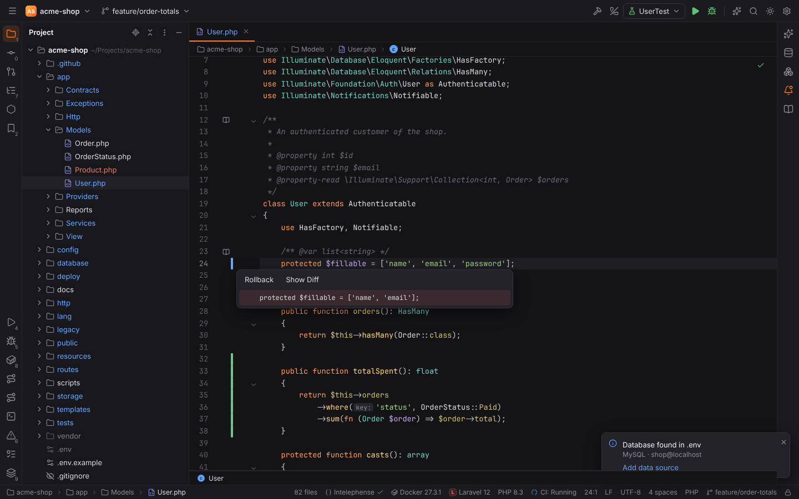

### Blame

Right-click the gutter and choose **Annotate with Git Blame** (also in the editor context menu
under Git, and in Find Action). The gutter then shows author and date per line, colored by
age; click an entry for the commit details. **Close Annotations** hides it.

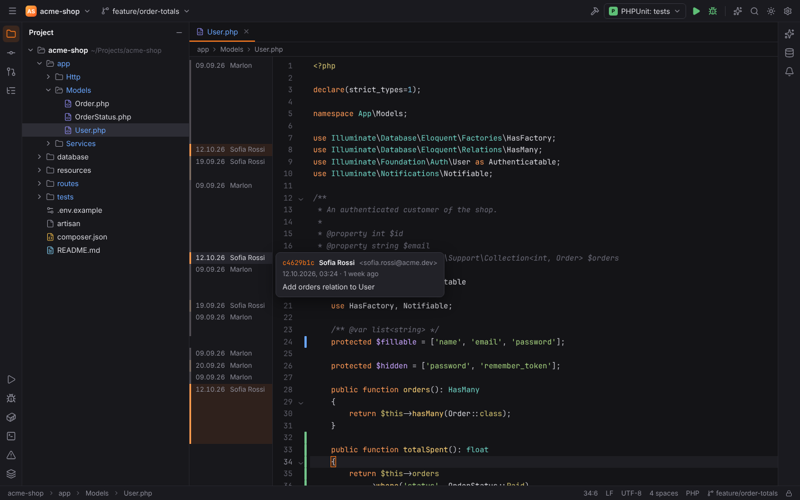

The caret line also shows an inline blame hint at its end: "Marlon, 2 days ago • message".

## Branches

Click the branch widget in the toolbar (or **Branches…** in Find Action) to open **Git
Branches**. The widget always shows the open project's branch; in a folder without a git
repository it reads **Version Control** and the status bar shows no branch.

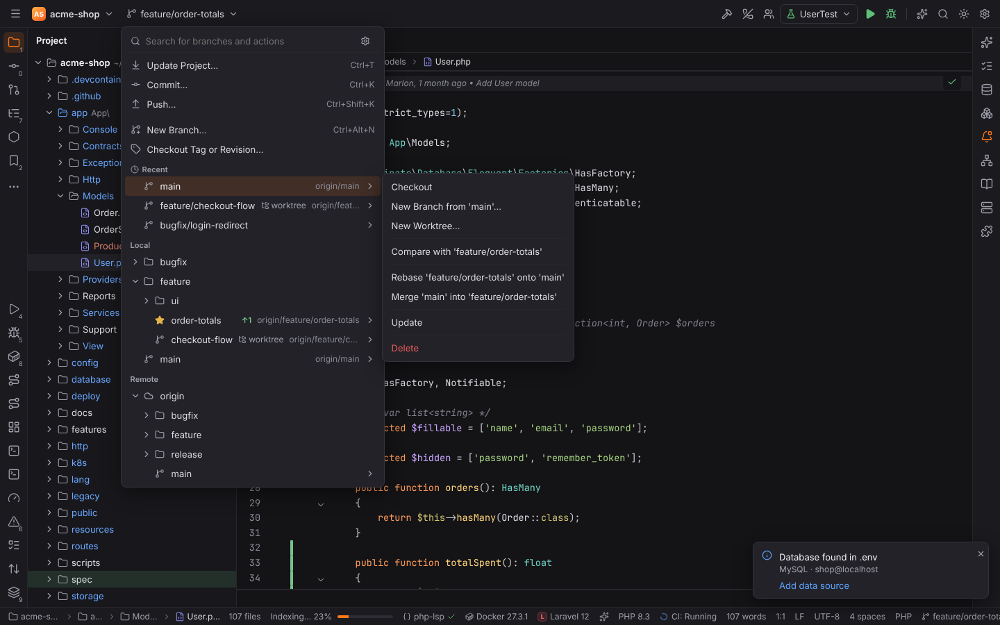

- At the top: **Update Project…** (`Ctrl+T`), **Commit…** (`Ctrl+K`), **Push…**
  (`Ctrl+Shift+K`), **New Branch…** and **Checkout Tag or Revision…**.
- **Local** and **Remote** branches with a search field ("Search for branches and actions").
- A branch's submenu: for the current branch **New Branch from '…'…**, **Push…** and
  **Update**; for other branches **Checkout**, **New Branch from '…'…**, **Compare with
  'current'** (the Git log of the commits of the branch that are not in the current branch,
  ready to [cherry-pick](#cherry-pick-revert-and-undo)), **Rebase 'current' onto '…'**,
  **Merge '…' into 'current'** and, for local branches, **Delete** (with "Force delete" for
  unmerged branches). For a local branch that no worktree has checked out, **New Worktree…**
  creates a [worktree](#worktrees) for it.
- Branches checked out in another worktree are marked **worktree**; clicking them (or **Open
  Worktree** in their submenu) opens that worktree instead of checking them out.

**New Branch…** asks for the name and whether to check it out.

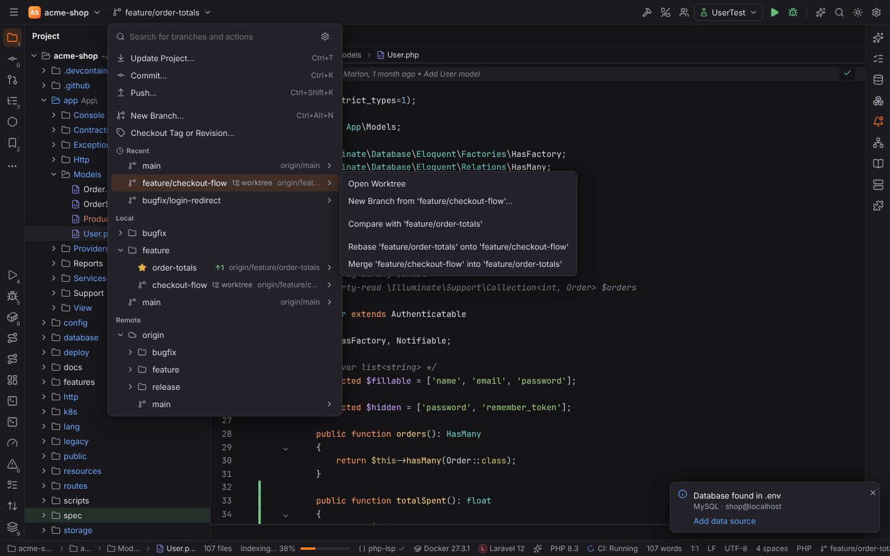

## Worktrees

The **Worktrees** tab of the **Git** tool window (**Git.Show.Worktrees**) lists the repository's
worktrees (`git worktree list`): path, branch (or "detached") and revision; the main worktree
and the one of this project are marked.

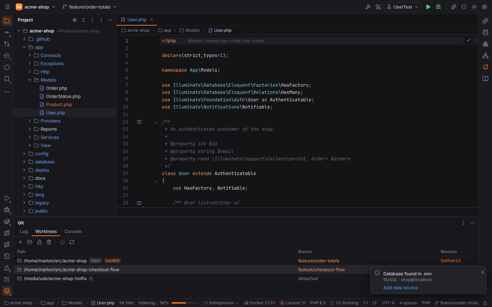

- **New Worktree…** (`+`, **Git ▸ New Worktree…**, `Git.Worktree.Create`): a **new branch**
  based on a branch of your choice, or an **existing branch** that is not checked out anywhere,
  and the **Directory** (suggested next to the main worktree: `<repo>-<branch>`). "Open the
  worktree after creating it" opens it as the project.

  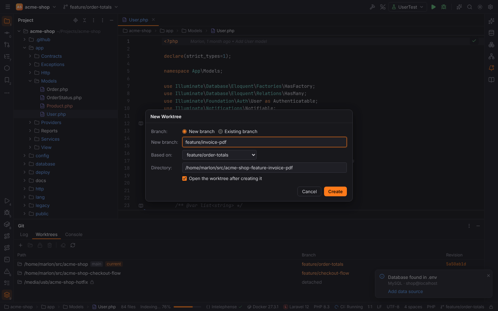

- **Open** (or double-click) opens a worktree as the project (on the same host for remote
  projects).
- **Lock…** / **Unlock** (`git worktree lock --reason`), **Remove…** (asks again with "Force
  Remove" when the worktree has local changes or is locked) and **Prune Worktrees** (forgets
  worktrees whose folder is gone, shown struck through).

## Push, update and fetch

| Action | Shortcut | What it does |
| --- | --- | --- |
| Push… | `Ctrl+Shift+K` (macOS `Cmd+Shift+K`) | pushes the current branch |
| Update Project… | `Ctrl+T` (macOS `Cmd+T`) | pulls the current branch with the update method |
| Fetch | Find Action | fetches all remotes |

Results appear as balloons ("Pushed", "Project updated", "All files are up to date", or the
error). Git runs with `ssh -o BatchMode=yes`, so SSH remotes need a key in your ssh-agent (or
without passphrase); Forge cannot answer password prompts.

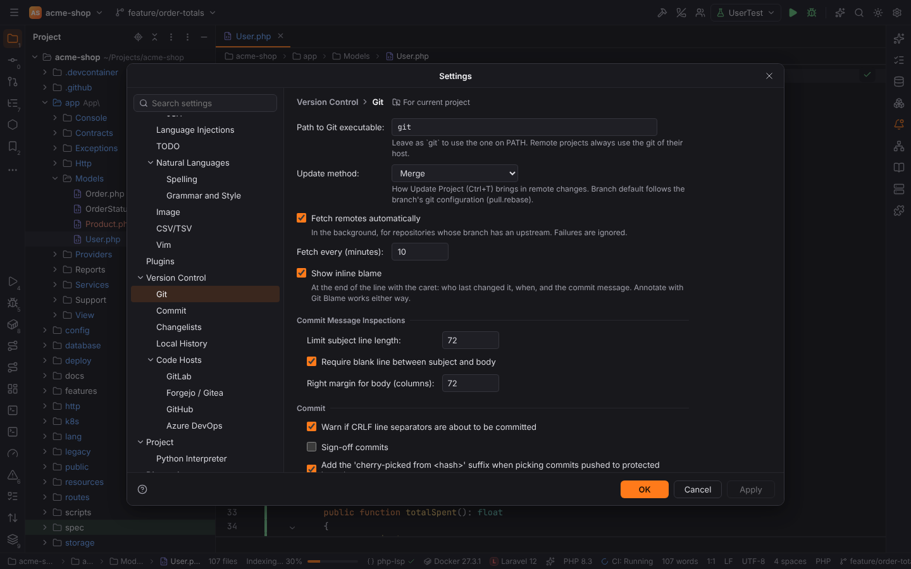

Settings | Version Control | Git:

| Option | Setting | Default |
| --- | --- | --- |
| Path to Git executable | `vcs.git.path` | `git` (the one on `PATH`; `FORGE_GIT` also overrides it). Remote projects always use the git of their host. |
| Update method: Merge, Rebase or Branch default (`pull.rebase` of the branch) | `vcs.git.updateMethod` | Merge |
| Fetch remotes automatically, every n minutes | `vcs.git.autoFetch`, `vcs.git.autoFetchInterval` | on, 10 |
| Add the 'cherry-picked from <hash>' suffix when picking commits pushed to protected branches (`git cherry-pick -x`) | `vcs.git.cherryPickSuffix` | on |
| Protected branches: names or patterns with `*`, separated by `;`. The Log never rewrites commits pushed to them. | `vcs.git.protectedBranches` | `master;main` |

Automatic fetching runs in the background while the branch has an upstream; failures
(offline, missing credentials) are ignored.

## Pull, merge and rebase

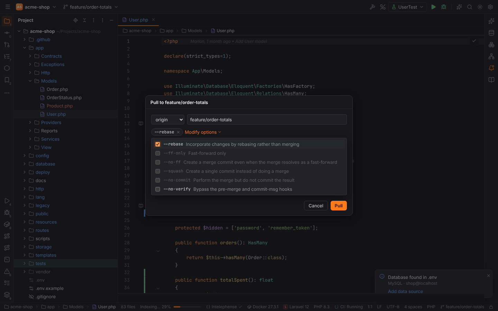

- **Git ▸ Pull…** (`Git.Pull`) opens **Pull to main**: the remote (`origin`), the branch (or
  several, separated by spaces) and **Modify options**: `--rebase`, `--ff-only`, `--no-ff`,
  `--squash`, `--no-commit` and `--no-verify`. Options that cannot be combined are greyed out;
  chosen options appear as chips you can remove with ×.
- **Git ▸ Merge…** (`Git.Merge`) opens **Merge into main**: the branch to merge and the options
  `--no-ff`, `--ff-only`, `--squash`, `-m` (shows a field for the merge commit message),
  `--no-commit`, `--no-verify` and `--allow-unrelated-histories`.
- **Git ▸ Rebase…** (`Git.Rebase`) opens **Rebase main**: the upstream (or new base) and the
  options `--onto` (adds the *from* field: only the commits after it are moved onto the new
  base), **Select another branch to rebase**, `--rebase-merges`, `--keep-empty`, `--root` and
  `--update-refs`. For an interactive rebase use
  [Interactively Rebase from Here…](#interactive-rebase) in the Log.

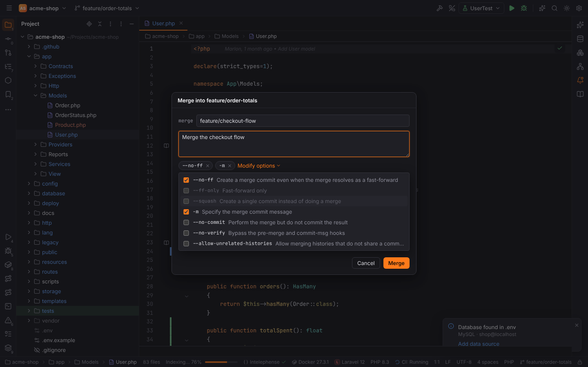

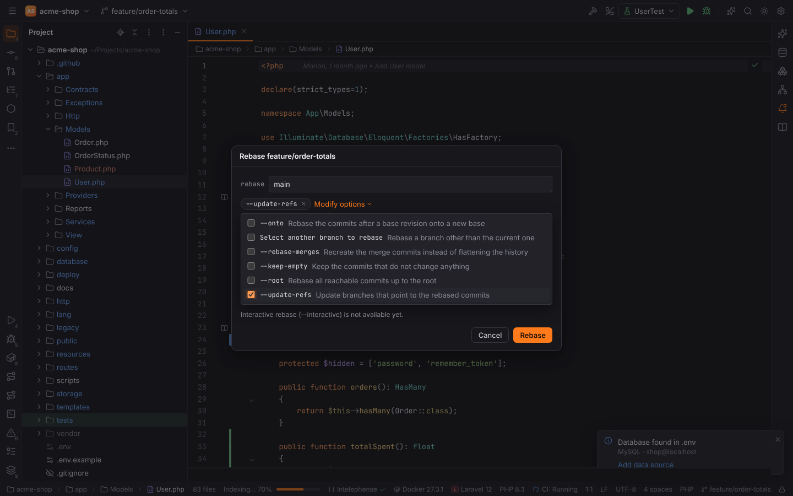

When an operation stops with conflicts, the [Conflicts dialog](#merge-conflicts) opens. While a
rebase or merge waits for you, the branch widgets in the toolbar and the status bar say
**Rebasing main** (or **Merging main**) and the Git menu offers **Continue Rebase**, **Skip
Commit** and **Abort Rebase** (`Git.Rebase.Continue`, `Git.Rebase.Skip`, `Git.Rebase.Abort`), or
**Abort Merge** (`Git.Merge.Abort`). Continuing may stop at the next conflict, which opens the
Conflicts dialog again.

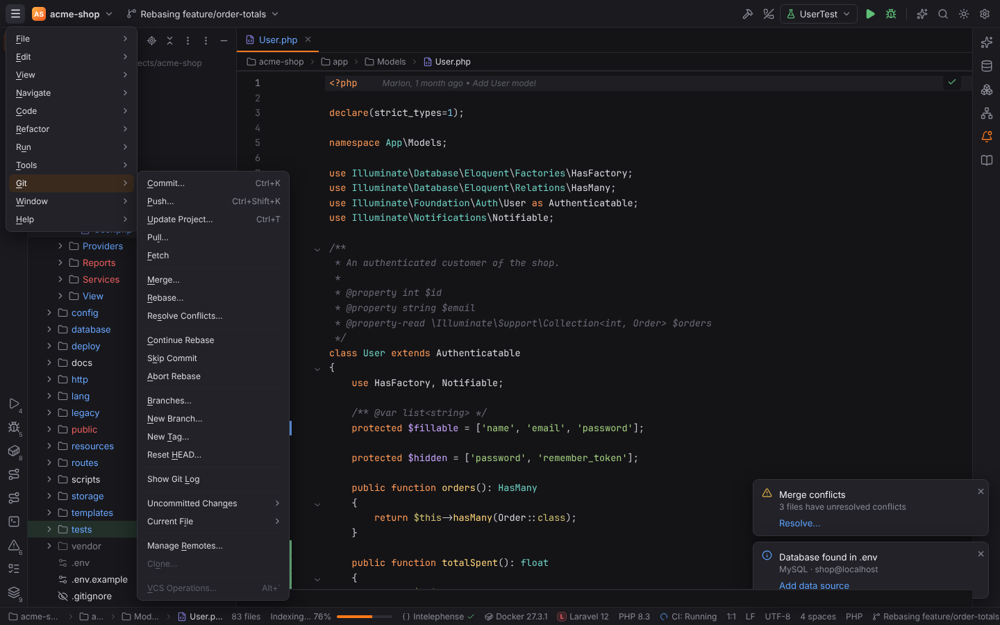

## Reset HEAD, tags and remotes

**Git ▸ Reset HEAD…** (`Git.Reset`) resets the current branch to a commit (`HEAD`, `HEAD~2`, a
hash, a branch or tag; **Validate** shows the hash) with one of the reset types:

| Type | What happens |
| --- | --- |
| Soft | Files won't change, differences will be staged for commit. |
| Mixed | Files won't change, differences won't be staged. |
| Hard | Files will be reverted to the state of the selected commit. Any local changes are lost. |
| Keep | Files will be reverted to the state of the selected commit, but local changes are kept intact. |

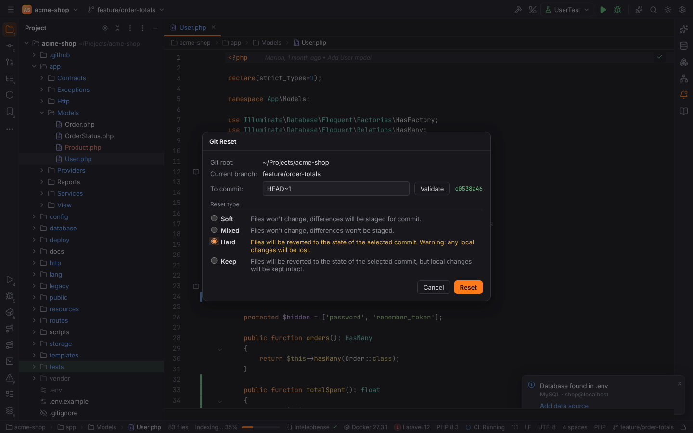

**Git ▸ New Tag…** (`Git.CreateNewTag`) opens **Tag**: the tag name, **Force** (replace an
existing tag), the commit (default `HEAD`, with **Validate**) and an optional **Message**, which
makes it an annotated tag.

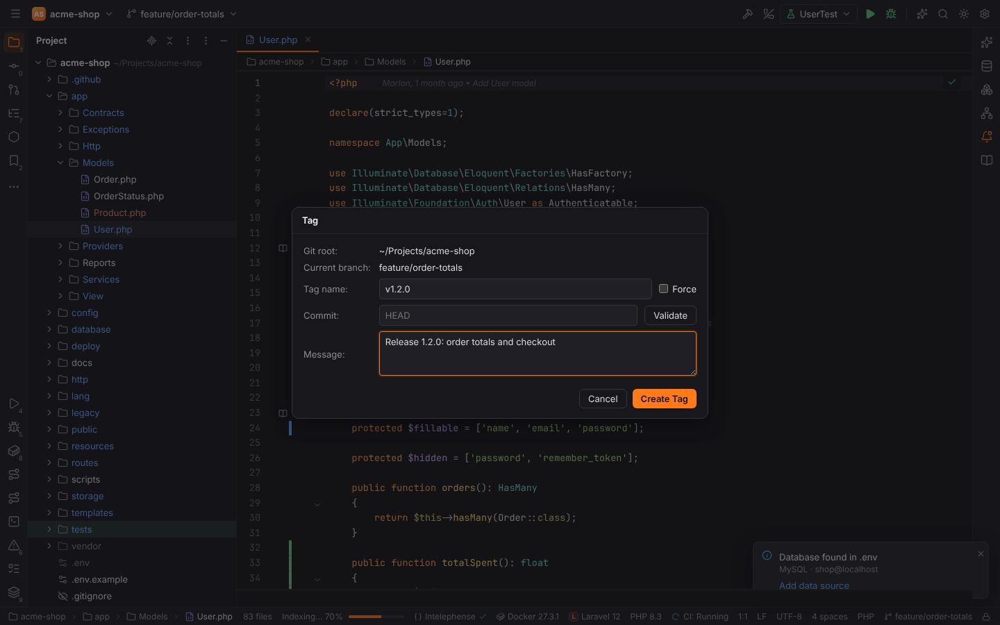

**Git ▸ Manage Remotes…** (`Git.Configure.Remotes`) lists the remotes with their URLs. **+** adds
one (**Define Remote**: name and URL), the pencil (or a double-click) edits the name and URL,
the bin removes it.

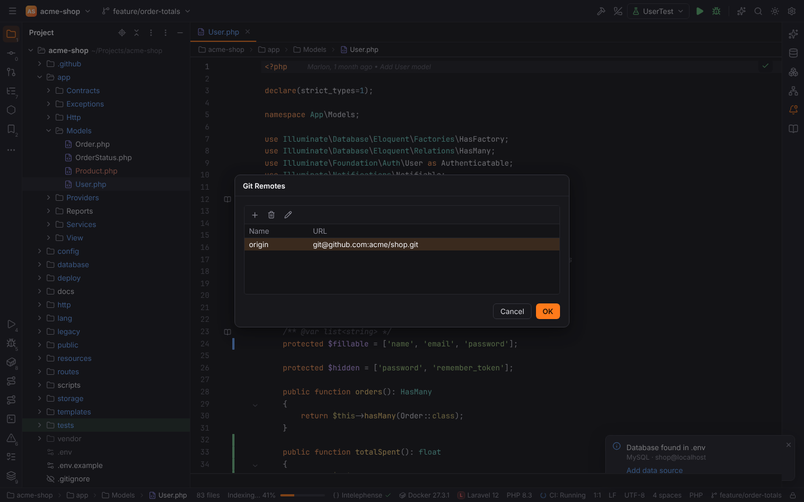

## Stash

**Git ▸ Uncommitted Changes ▸ Stash Changes…** (`Git.Stash`) shows the Git root and the current
branch, asks for a **Message** and offers **Keep index** (staged changes stay staged and in the
working tree). **Create Stash** runs `git stash push`.

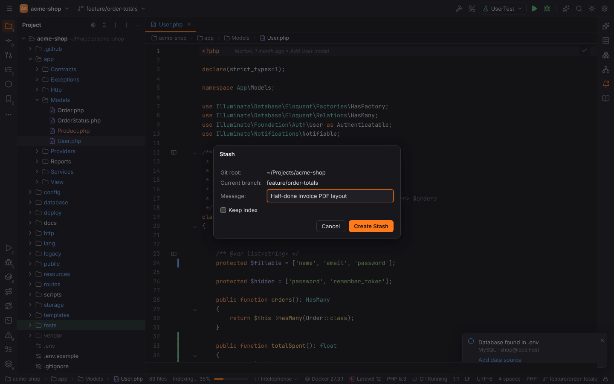

**Unstash Changes…** (`Git.Unstash`) lists the stashes of the repository:

- **View** lists the files of the selected stash; a double-click (or the diff icon) shows the
  diff between the stash's base and the stashed version.
- **Drop** removes the selected stash, **Clear** all of them (both ask first).
- **Pop stash** removes the stash after applying it; **Reinstate index** restores what was
  staged. **As new branch** creates a branch at the stash's base commit, checks it out and pops
  the stash there (`git stash branch`).
- The button reads **Apply Stash**, **Pop Stash** or **Branch**. Conflicts open the Conflicts
  dialog.

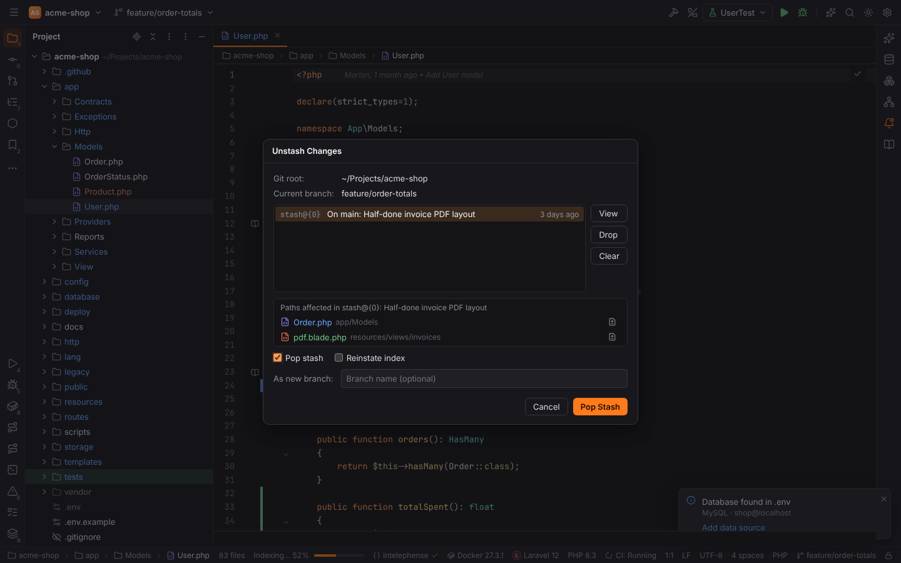

The **Stash** tab of the Commit tool window (shown while there are stashes) lists them too:
expand a stash to see its files, double-click a file (or **Show Diff**, `Ctrl+D`) for its diff,
and **Apply**, **Pop** or **Drop** the selected stash from the toolbar.

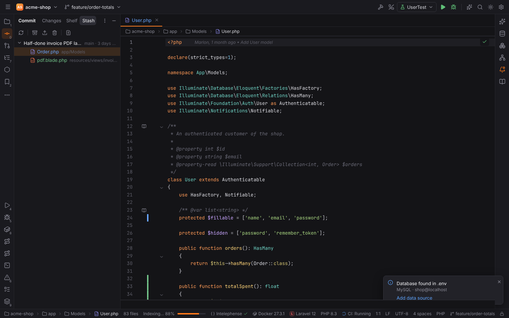

## Shelf

The shelf keeps changes aside without git, like PHPStorm's shelf. Forge stores it per project in
its data directory (`<data dir>/forge/projects/<project>/shelf`, see
[File locations](../reference/file-locations.md)); nothing is written into the project.

- **Git ▸ Uncommitted Changes ▸ Shelve Changes…** (`ChangesView.Shelve`) lists the local
  changes (new files included) with checkboxes and a **Comment**. **Shelve Changes** saves the
  ticked files as a patch and rolls them back (new files are removed).
- **Show Shelf** (`Vcs.Show.Shelf`) opens the **Shelf** tab of the Commit tool window. Expand a
  shelved changelist to see its files; `Ctrl`-click selects several.
- Toolbar: **Unshelve…** (`ShelveChanges.UnshelveWithDialog`), **Unshelve Silently**,
  **Delete**, **Show Diff** (`Ctrl+D`, also a double-click on a file) and **Rename**.
- **Unshelve Changes** lists the files with checkboxes, preselected from the selection, so you
  can unshelve part of a changelist. **Remove successfully applied files from the shelf** drops
  them from the shelf afterwards. New files come back as added files.
- A shelved patch that no longer applies cleanly is merged three-way; conflicts open the
  Conflicts dialog and the changes stay on the shelf.

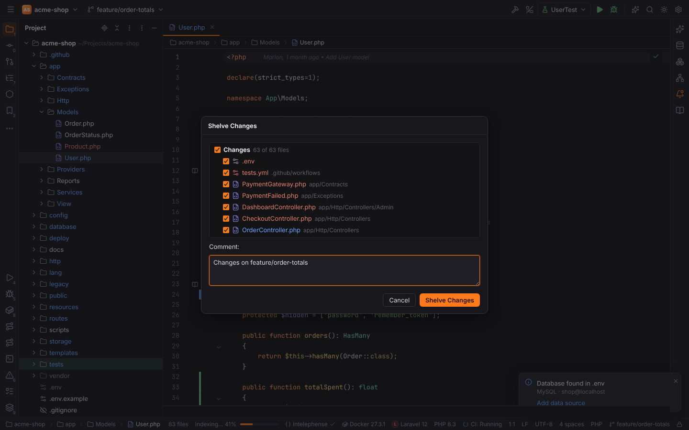

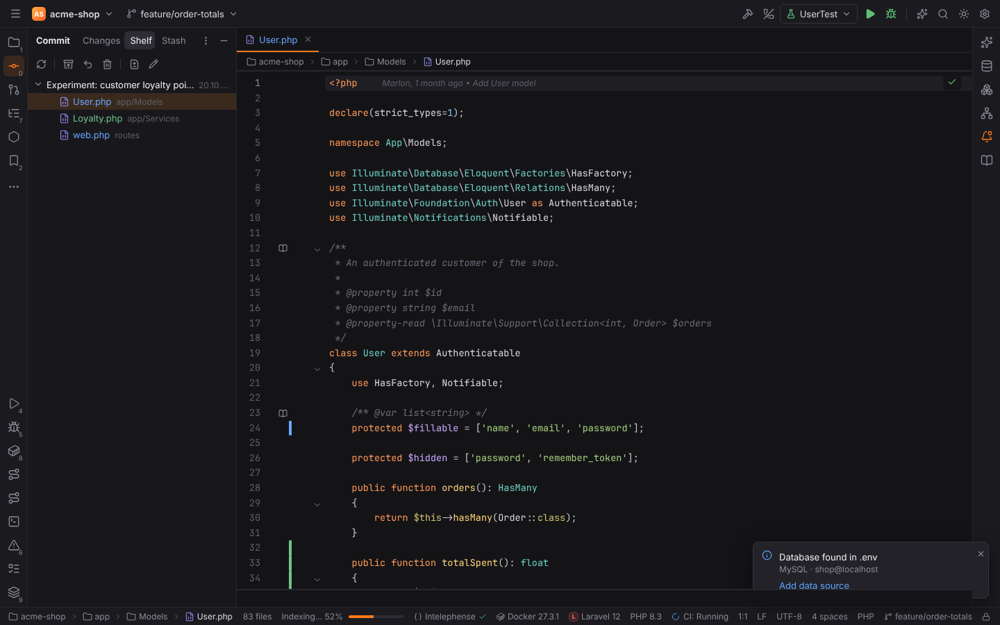

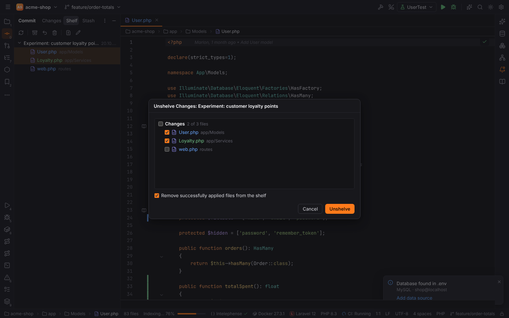

In remote projects git runs on the remote host; the shelf stays on your machine.

## Patches

**Git ▸ Patch** creates and applies patches, like PHPStorm.

**Create Patch…** (Git ▸ Patch, the context menu of changelists and files, the Git log's
commit menu) writes the selected changes, or the changes of the selected commits, as a
unified diff (`git diff --binary`, new files included) with paths relative to the project
root: **Save to file** (a relative name is saved in the project; **Browse…** picks any file in
the desktop app) or **Copy patch to clipboard**. **Reverse patch** swaps both sides.

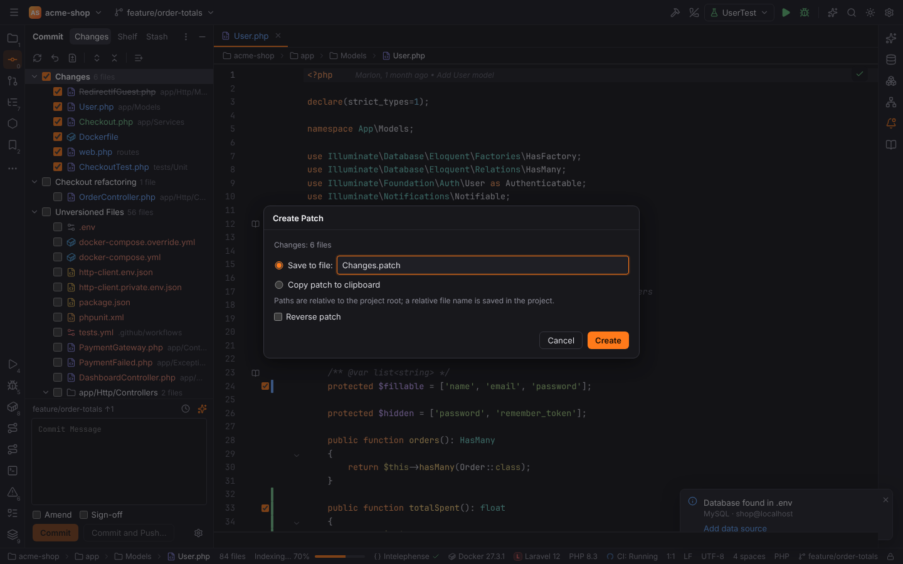

**Apply Patch…** picks a patch file, **Apply Patch from Clipboard…** reads the clipboard. Git
patches and patches of other tools (`diff -u`, `svn diff`, PHPStorm) are accepted. The
preview lists every file with its added and removed lines; double-click a file (or its diff
button) to compare the current and the patched version. **Base directory** sets where the
paths start (default: the project root), **Changelist** where the changes go.

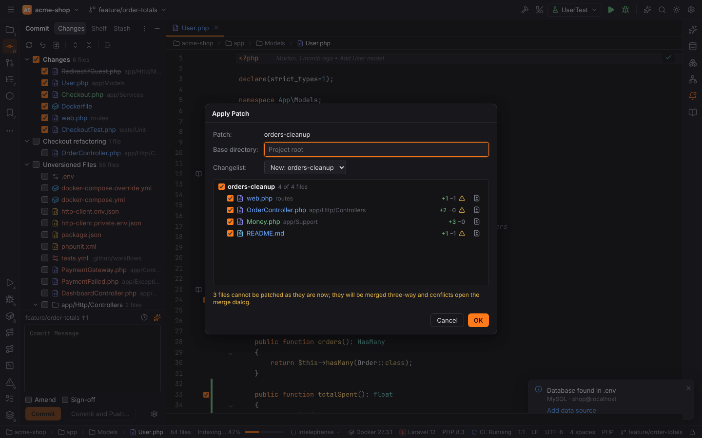

Files that no longer fit (marked with a warning) are merged three-way when the patch names the
original versions (patches made by git and Forge do); conflicts open the
[merge conflict](#merge-conflicts) resolver. Files that cannot be merged are reported and left
unchanged. New files are added to git.

## Merge conflicts

When a merge, rebase, update (pull), cherry-pick, unstash or unshelve stops with conflicts, Forge opens
the **Conflicts** dialog. Later you get it with **Git ▸ Resolve Conflicts…** (Find Action:
`Git.ResolveConflicts`), the **Resolve** link of the **Merge conflicts** balloon, or the
**Resolve** link of the **Merge Conflicts** node in the Commit tool window.

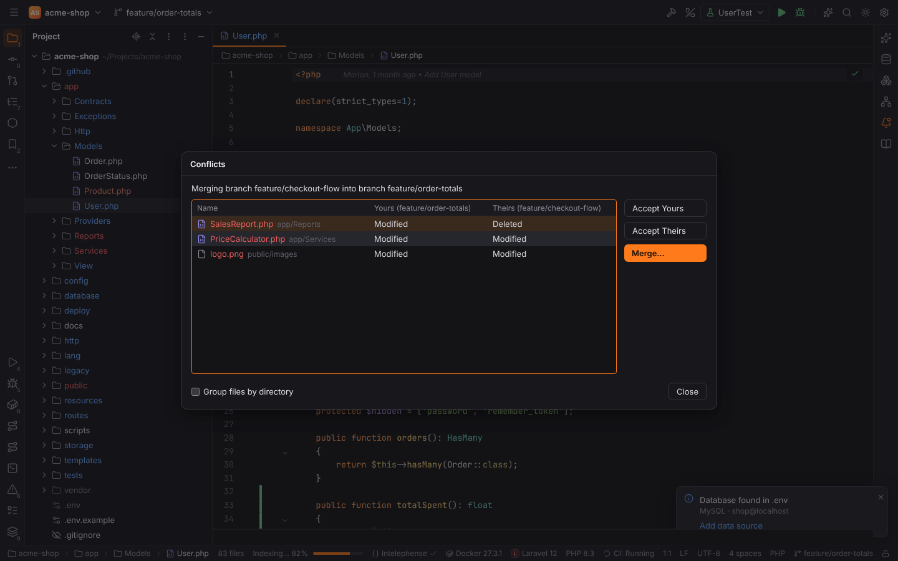

- The header says what is going on ("Merging branch feature into branch main").
- **Yours** and **Theirs** show how each side changed a file: Modified, Added or Deleted. In a
  rebase, *yours* is the commit being replayed and *theirs* the branch you rebase onto, like
  in PHPStorm.
- **Accept Yours** / **Accept Theirs** take that side's version of the selected files (a side
  that deleted the file deletes it) and mark them resolved (`git add` / `git rm`).
- **Merge…** (or a double-click) opens the merge window. For a file deleted on one side it asks
  **Keep File** or **Accept Deletion**; for a binary file, which version to keep.
- **Group files by directory** shows the files under their folders.

Until they are resolved, conflicted files are red in the Project view (and their folders), the
editor tabs and the **Merge Conflicts** node of the Commit tool window. An editor of such a file
shows the banner **File has merge conflicts** with a **Resolve…** link to the merge window.

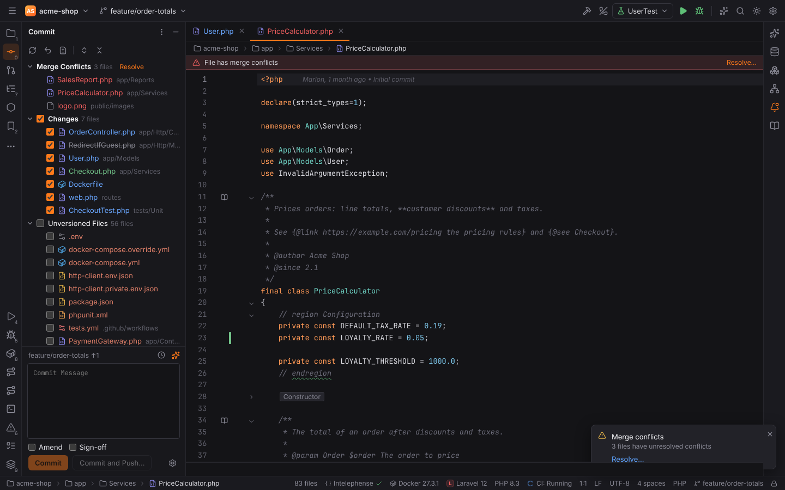

### Merge window

**Merge Revisions for …** shows your version (**Changes from main**) on the left, the editable
**Result** in the middle and the other side (**Changes from feature**) on the right. The result
starts with the common base version; the three panes scroll together and bands connect the
changes.

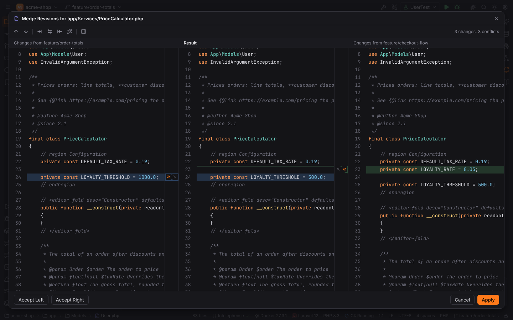

- Colours: blue for modified, green for inserted, grey for deleted lines, red for conflicts.
  Handled changes lose their colour.
- `»` / `«` next to a change applies it to the result; `×` ignores it. After you applied one
  side of a conflict, the arrow of the other side appends its text after the first.
- Toolbar: **Previous / Next Difference** (`Shift+F7` / `F7`), **Apply Non-Conflicting
  Changes from the Left Side**, **Apply All Non-Conflicting Changes**, **Apply Non-Conflicting
  Changes from the Right Side**, **Resolve Simple Conflicts** (the magic wand) and **Compare
  Contents** (left, base, right and result side by side in the diff viewer). The counter on the
  right shows the unresolved changes: "3 changes. 2 conflicts".
- **Resolve Simple Conflicts** merges conflicts where both sides changed *different* words of
  the same lines (`$price * $qty` → `$netPrice * $qty` and `$price * $quantity` become
  `$netPrice * $quantity`). Conflicts where both sides changed the same words stay for you.
- Edit the result freely; `Ctrl+Z` also undoes applied changes.
- **Accept Left** / **Accept Right** take one side for the whole file. **Apply** writes the
  result and marks the file resolved (`git add`); with unresolved changes left it asks first
  ("There are unresolved changes"). **Cancel** (`Escape`) asks before it discards your edits.

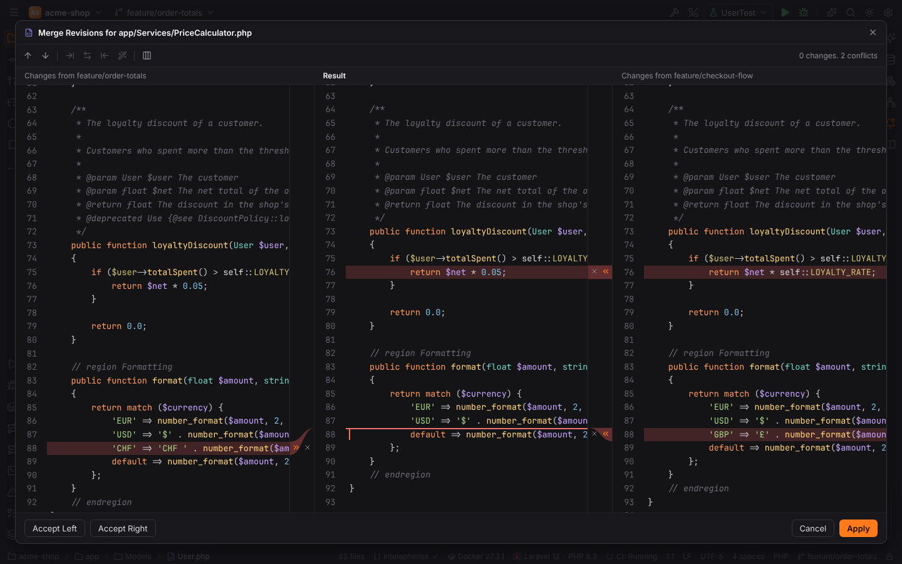

Files with `\r\n` line separators keep them. In remote projects the stage versions are read
and the result is written on the remote host. When the last conflict is resolved, Forge
reminds you to commit (merge, cherry-pick) or continue the rebase.

## Log

The **Git** tool window (`Alt+9`, bottom) has a **Log** tab with the commit graph, the
[Worktrees](#worktrees) tab and a **Console** tab with the git commands Forge ran.

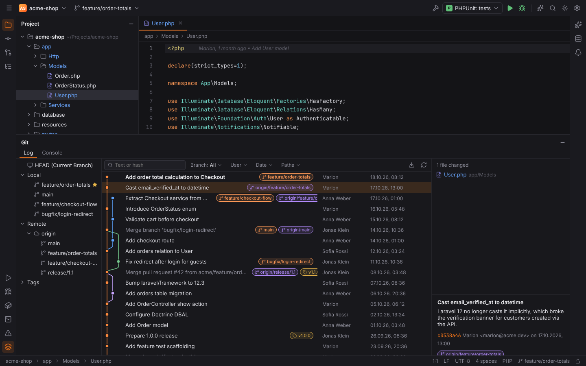

- Filter by text or hash, branch, user, date and paths; **Show all branches**. Click
  **HEAD (Current Branch)** in the branches pane to see only the current branch.
- Select a commit to see its changed files; open their diffs from there. `Ctrl+click` and
  `Shift+click` select several commits; `Up`/`Down` move the selection, `Left`/`Right` go to the
  child / parent commit.
- **Fetch All Remotes** and **Refresh** (`Ctrl+F5`) in the toolbar.
- Signed commits show a shield after the subject (see
  [Signing commits](#signing-commits-with-gpg-or-ssh-keys)); the details name the signer.

### Log actions

Right-click commits for PHPStorm's Log context menu. Every action is also in Find Action and
the keymap (Settings | Keymap) under its PHPStorm id and works on the selection of the Log.

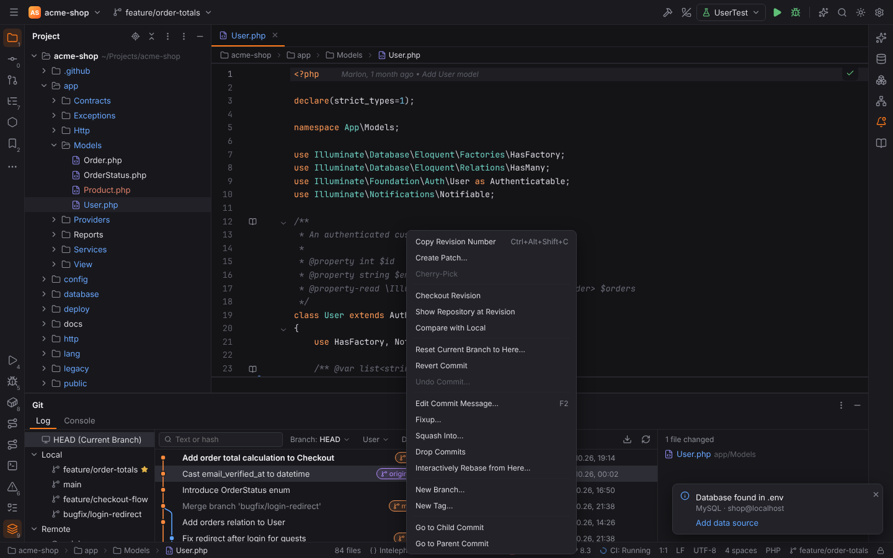

| Action | Id | What it does |
| --- | --- | --- |
| Copy Revision Number | `Vcs.CopyRevisionNumberAction` | copies the full hashes |
| Create Patch… | `Vcs.Log.CreatePatch` | writes the changes of the selected commits as a patch file into the project |
| Cherry-Pick | `Vcs.CherryPick` | applies commits of other branches to the current branch (oldest first) |
| Checkout Revision | `Git.CheckoutRevision` | detached HEAD at the commit |
| Show Repository at Revision | `Git.BrowseRepoAtRevision` | lists the files of the commit; opens them read-only |
| Compare with Local | `Vcs.Log.CompareWithLocal` | the files that differ between the commit and the working tree |
| Reset Current Branch to Here… | `Git.Reset.In.Log` | the [Reset dialog](#reset-head-tags-and-remotes) with the commit |
| Revert Commit | `Git.Revert.In.Log` | new commits that undo the selected ones |
| Undo Commit… | `Git.Uncommit` | removes the last, unpushed commit and keeps its changes |
| Edit Commit Message… | `Git.Reword.Commit` | rewords a commit |
| Fixup… / Squash Into… | `Git.Fixup.To.Commit`, `Git.Squash.Into.Commit` | commit the local changes as `fixup! <subject>` / `squash! <subject>` |
| Squash Commits… | `Git.Squash.Commits` | several selected commits become one, with an editable message |
| Drop Commits | `Git.Drop.Commits` | removes commits from the branch |
| Interactively Rebase from Here… | `Git.Interactive.Rebase` | the [Rebasing Commits](#interactive-rebase) dialog |
| New Branch… / New Tag… | | a branch or tag at the commit |
| Go to Child Commit / Go to Parent Commit | `Vcs.Log.GoToChild`, `Vcs.Log.GoToParent` | selects the neighbour in the Log |

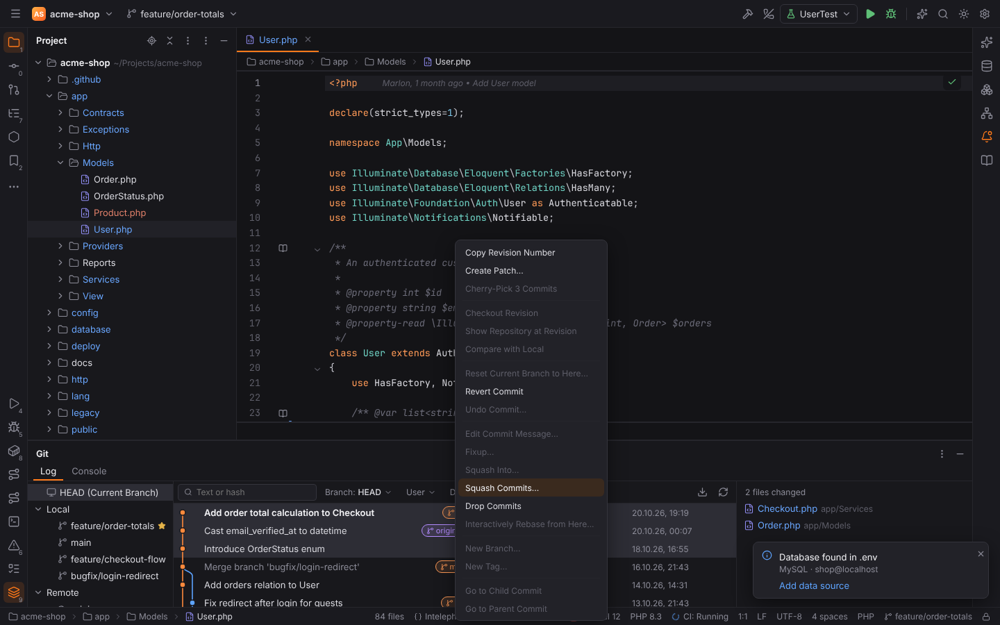

Actions that cannot run are greyed out; hover them for the reason, like PHPStorm:

- The actions that rewrite history (Undo, Edit Commit Message, Fixup, Squash, Drop, the
  interactive rebase) need commits of the current branch, no merge commits in between and no
  operation in progress.
- Commits already pushed to a **protected branch** (Settings | Version Control | Git,
  `master;main` by default) are never rewritten: "The selected commit is already pushed to
  protected branch 'origin/main'". Commits pushed to other branches can be rewritten after a
  warning (you will need a force push).
- **Undo Commit** is available only for the last commit of the current branch and only while
  it is not pushed. The changes go back to the Commit tool window (the "Changes" changelist)
  and the message into the commit message field.

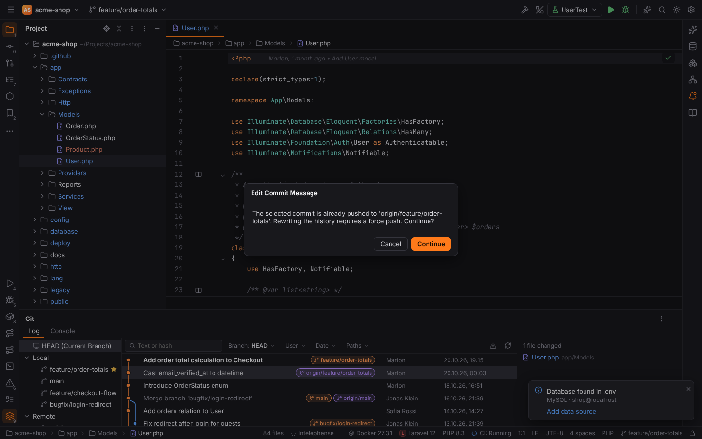

After a rewrite a balloon offers **Undo**, which moves the branch back as long as nothing
changed since. Local changes are kept (`git rebase --autostash`).

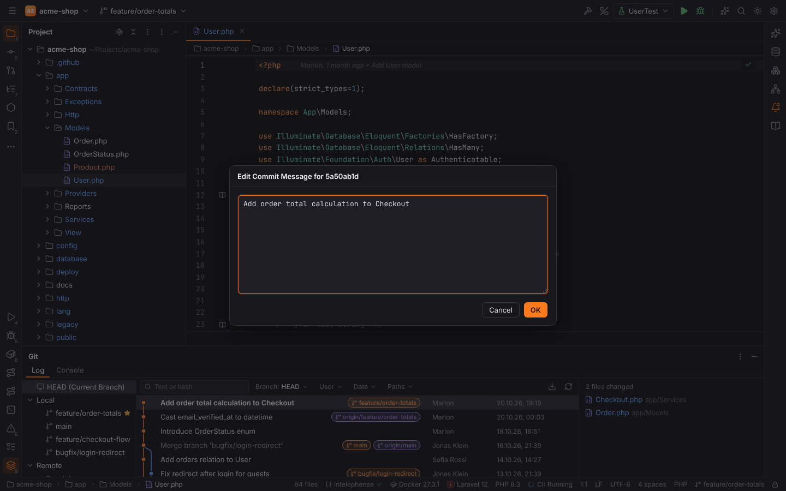

### Cherry-pick, revert and undo

**Cherry-Pick** applies the selected commits to the current branch, oldest first. Commits whose
changes are already in the branch are skipped. With "Add the 'cherry-picked from <hash>'
suffix…" on, commits that are pushed to a protected branch get git's "(cherry picked from
commit …)" line. **Revert Commit** creates one revert commit per selected commit. A cherry-pick
or revert that stops with conflicts opens the [Conflicts dialog](#merge-conflicts); commit the
result to finish it, or abort it from the Git menu.

### Interactive rebase

**Interactively Rebase from Here…** opens **Rebasing Commits** with the commits from the
selected one up to `HEAD` (newest at the top):

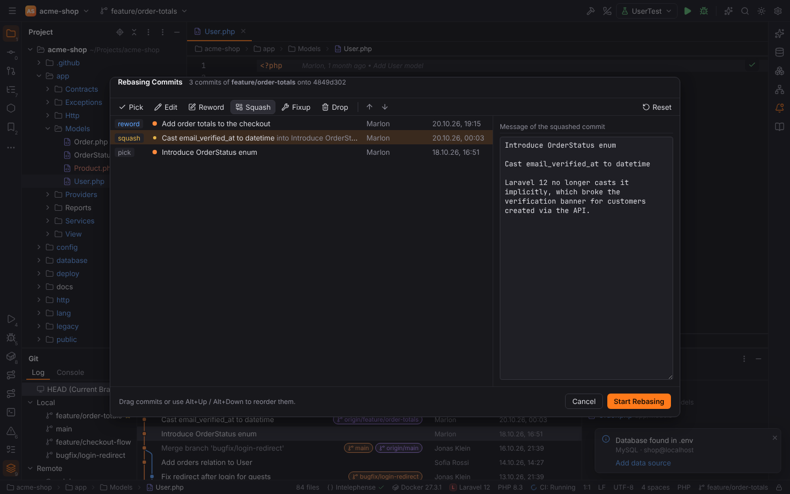

- The toolbar sets the action of the selected commits: **Pick**, **Edit** (stop after the
  commit to amend it), **Reword** (new message), **Squash** (meld into the older commit below
  and combine the messages), **Fixup** (meld and keep the older message) and **Drop**. With
  several commits selected, **Squash** becomes **Unite**: the commits are moved together and
  squashed into the oldest of them.
- Reorder commits by drag and drop or with **Move Up** / **Move Down** (`Alt+Up` / `Alt+Down`,
  `Git.Interactive.Rebase.MoveUp` / `Git.Interactive.Rebase.MoveDown`).
- For a reworded commit or a squash the right side is the message editor; otherwise it shows
  the commit's files and message. **Reset** restores the initial plan.
- `fixup!`, `squash!` and `amend!` commits (from **Fixup…** / **Squash Into…**) start right
  after the commit they target, like `git rebase --autosquash`.

**Start Rebasing** (`Ctrl+Enter`) runs `git rebase -i`. Forge writes the todo list itself and
applies new messages with `exec` steps, so git never opens an editor; this also works in
remote projects. When the rebase stops at an **Edit** step or with conflicts, the branch widget
shows **Rebasing …**, conflicts open the [Conflicts dialog](#merge-conflicts), and **Git ▸
Continue Rebase / Skip Commit / Abort Rebase** take it from there.

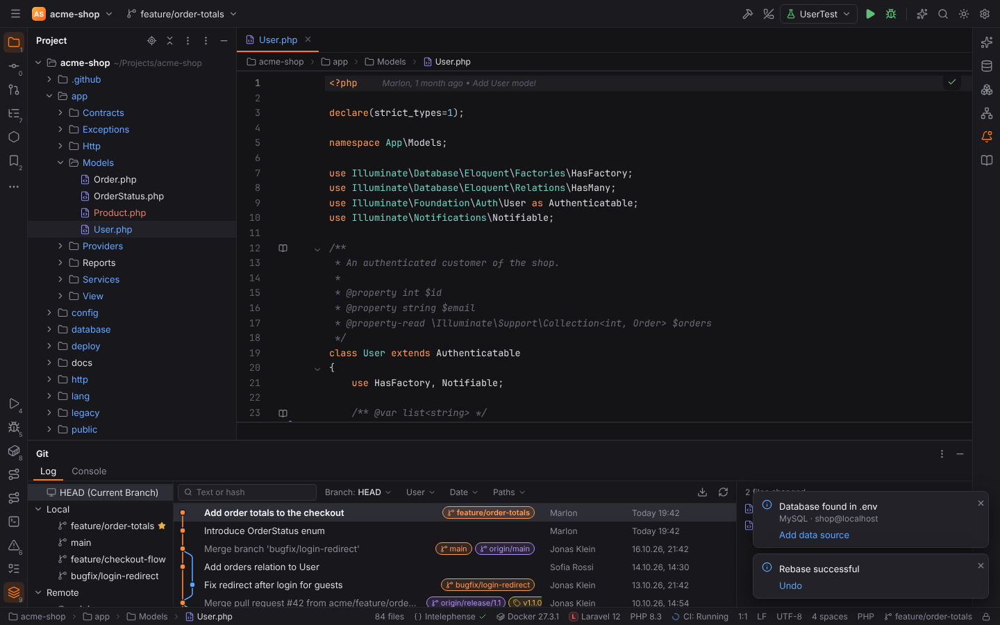

## File and folder history

**Show History** (Git ▸ Current File, the editor's and the Project view's Git submenu) opens a
**History: <name>** tab in the Git tool window, next to **Log**. For a file it lists every
commit that changed it and follows renames (the old path is shown next to the message); for a
folder, every commit that changed something below it.

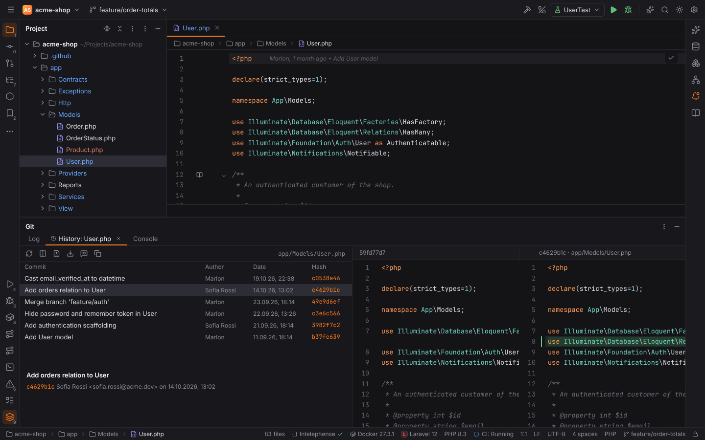

- The table has the commit message, author, date and hash. Below it are the full message and,
  for a folder, the files the commit changed (click one to preview it).
- The right side previews the file's change in the selected commit.
- Toolbar and right-click menu:

| Action | What it does |
| --- | --- |
| Show Diff (`Ctrl+D`, double-click) | the file's change in the commit in the diff viewer |
| Compare with Local | the revision against your working copy (editable) |
| Get | replaces your working copy with the revision, after a confirmation |
| Annotate Revision | opens the file as it was in the revision, read-only, with its blame |
| Checkout Revision | checks out the commit (detached HEAD) |
| Copy Revision Number | copies the full hash |

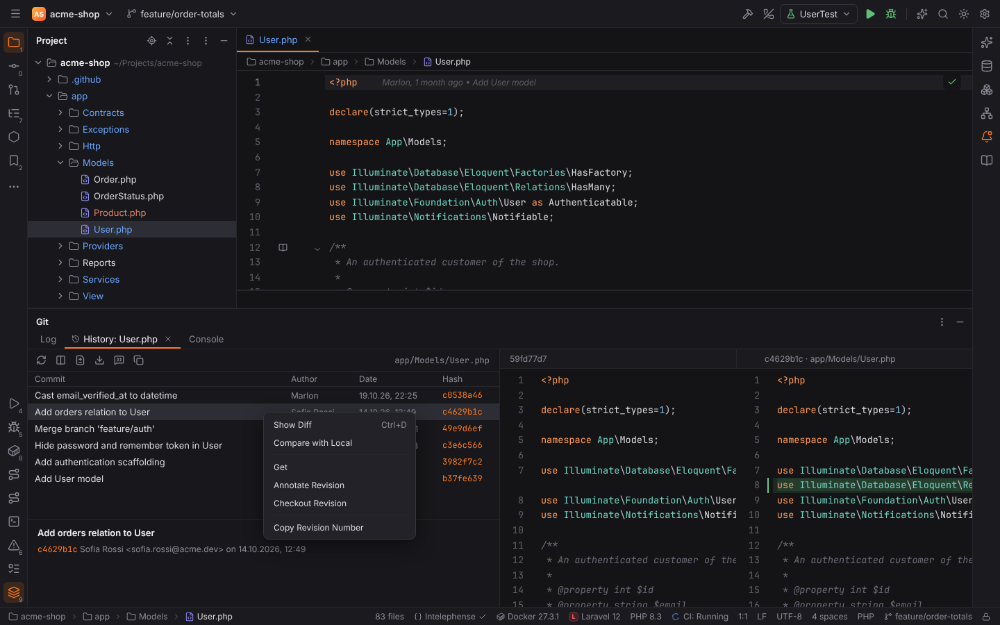

Close a history tab with its **×** or a middle click.

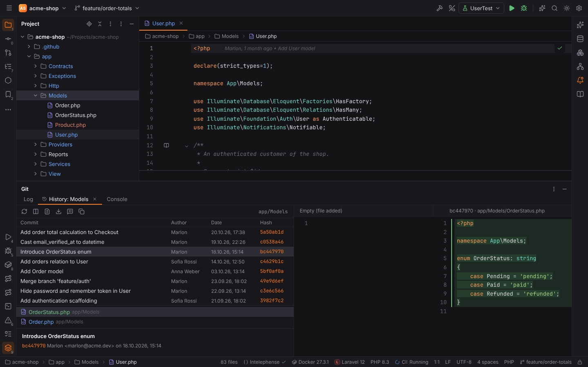

### History for selection

Select lines in the editor and choose **Show History for Selection** (Git ▸ Current File or the
editor's Git submenu). The **History for Selection** tab lists the commits that changed those
lines (`git log -L`, line numbers as in `HEAD`); the preview shows the block before and after
each commit, so you can follow how it evolved.

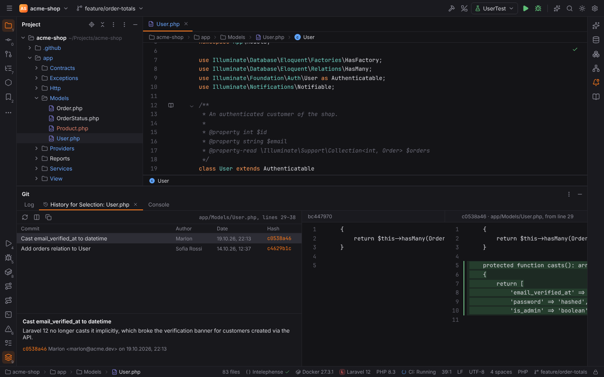

### Annotate Revision

**Annotate Revision** opens the file of that revision in a read-only editor tab named
`User.php (49e9d6ef)` with the blame of the revision in the gutter.

## Compare with Revision and Branch

- **Compare with Revision…** lists the revisions of the file (renames followed) and compares
  the picked one with your version.
- **Compare with Branch…** picks a local or remote branch or a tag. For a file it opens the
  diff; for a folder (Project view) it opens an editor tab with the files that differ between
  the branch and the working tree. Double-click a file (or `Ctrl+D`) for its diff.
- **Show Diff** is PHPStorm's Compare with the Same Repository Version: `HEAD` against your
  version.

## Compare files and folders

In the Project view, select two files or two folders (`Ctrl`+click the second one) and press
`Ctrl+D`, or right-click and choose **Compare Files** / **Compare Directories** (below Reload
from Disk). With one entry selected the item is **Compare With…** and asks for the second file
or folder in a **Select Path** dialog.

Two files open in the diff viewer; the right side can be edited and is saved when you close
it. Two folders open a folder diff in an editor tab:

- Every file and folder of both sides with size and date, and an indicator in the middle: `→`
  only on the left, `≠` different, `=` equal, `←` only on the right. Folders can be collapsed.
- The filter buttons in the toolbar show or hide each kind, with their counts.
- Double-click a file (or `Ctrl+D`, **Compare Contents**) to open its diff.
- **Copy to Right** / **Copy to Left** copy the selected file or folder to the other side
  (folders are merged; replacing a different file asks first).
- `.git`, `.hg` and `.svn` folders are not compared.

The folders are read where the project is, so this works in remote projects too.

## Compare with Clipboard

**Compare with Clipboard** (View menu, editor context menu) compares the clipboard with the
selected text, or with the whole file when nothing is selected; the whole file can then be
edited in the diff viewer.

## Code review

Pull and merge requests, issues and CI pipelines of GitHub, GitLab and Forgejo/Gitea are in
[Code hosts](code-hosts.md).

## Not available yet

Push All up to Here is not implemented yet. Local History (revisions without commits, labels,
Recent Changes) has its own page: [Local History](local-history.md). Projects (cloned repositories,
worktrees) open in the current window until Forge supports several project windows.
